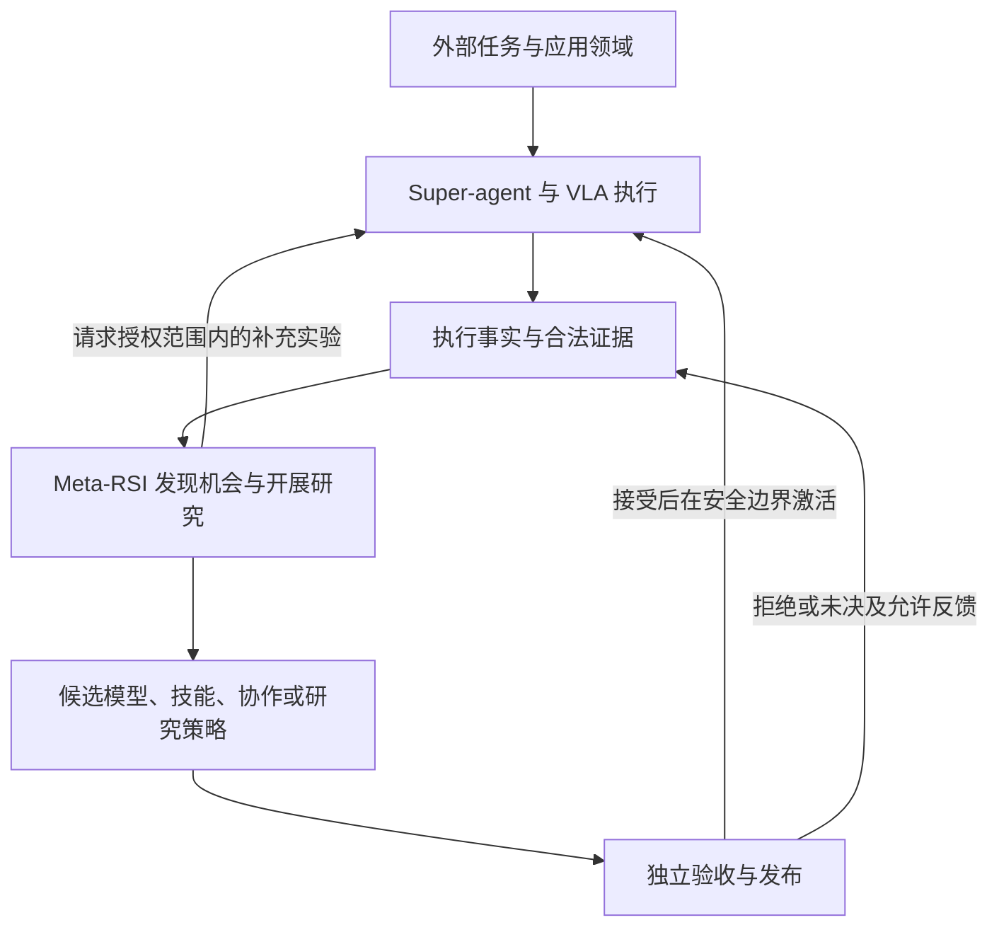

# RSI-Agent-VLA 项目总纲与研究边界

版本：V5.1 工作方案 · 2026-11-09

## 1. 研究定位

建立面向机器人操作的持续自进化系统：Super-agent 组织任务、监督与恢复，VLA 提供动作能力，Meta-RSI 从执行证据中发现成长机会、开展实验、提出更新，并经独立验收继承新版本。在有限物理交互、计算和人工预算下，研究机器人能力及其改进机制如何持续成长。

完整系统是必要的工程前提；论文贡献来自对机器人特定困难的解决、机制创新、算法创新或有辨别力的实证发现。主科学问题尚未选定。A/B/C 联合优化、三层闭环、主动实验与版本治理本身不构成已经确立的原创算法。

本方向只规划**一篇论文**。在完整系统上积极探索原创算法，也允许多个相互支撑的创新点。H3 元改进与受约束的开放式机制创造需要尽可能开展实质实验；最终未完成的部分进入未来展望。

## 2. 文档入口与权威分工

| 文档 | 回答的问题 | 维护边界 |
|---|---|---|
| [00 总纲](00_项目总纲与研究边界.md) | 做什么、哪些承诺不能丢、整体怎样运行 | 项目目标、术语和研究边界 |
| [01 系统设计](01_系统设计与框架复用.md) | 谁负责什么、复用什么、哪里需要新代码 | 架构、接口、权限及源码接入 |
| [02 科学问题](02_科学问题与创新路线.md) | 哪些困难值得研究、如何选择主创新 | 候选问题、机制构想与否定条件 |
| [03 实验与验收](03_实验设计与验收协议.md) | 怎样证明完整、有效、协同和元改进 | 系统验收、评价、对照与统计协议 |
| [04 实施路线](04_实施路线与待决事项.md) | 先做什么、还有什么未定 | 当前状态、全部待办与待决事项 |
| [05 决策与复核](05_决策映射与审查复核.md) | 哪项来自用户、哪项来自审查、证据到哪里 | Q01—19 映射、审查取舍与一手来源 |

01—03 定义方案，04 记录推进状态。设计条目不代表代码已经存在，验收条目不代表实验已经通过。当前证据范围统一见 04 §1。

原始输入保留：

- [V4 研究方案 PDF](统一持续自进化_VLA_Agent_研究方案V4_2026-11-06.pdf)：初始愿景与历史定义。
- [旧综合评估全文](历史版本/VLA_Agent_V4_综合评估报告_2026-11-09.md)、[旧系统设计全文](历史版本/系统总体设计与代码框架复用方案_2026-11-09.md)：重构前原件。
- [Q01—19 问答档案](../问答与自由审查/RSI_VLA_Q01-Q19_Verbatim_Expanded_2026-11-09.md)：用户选择及修订的依据。
- [自由审查 PDF](../问答与自由审查/RSI_VLA_Research_Review.pdf)：经复核后使用的意见输入。

本套工作方案承接 V4，以本轮问答中较晚的明确回答处理冲突。V4 所引历史 Q01—23 与本轮 Q01—19 是两套编号；没有原始全文的历史回答，不补写为用户原话。原件保留其原有链接和历史上下文，后续执行以本套文档为入口。

## 3. 已确定的研究承诺

| 承诺 | 实施含义 | 来源 |
|---|---|---|
| 完整系统必须保障 | 执行、证据、自主研究、真实更新、独立验收、发布与继承需要联通 | Q01、Q17 |
| 机器人专属定位 | 科学问题来自具身学习与交互约束，主要结论由真正 VLA 和机器人任务承担 | Q09 |
| 三类关系具备进化能力 | ρA、ρB、ρC 支持反馈驱动学习、更新和继承；是否改变由证据决定 | Q05—06，暂定设计 |
| 主动能力增长 | 失败与正常运行都能触发有预算的研究，可提出领域内新能力目标 | Q12—14 |
| 分层能力评价 | 分别展示任务效果、泛化鲁棒性、能力扩展和未来改进效率 | Q13 |
| 硬约束加综合评分 | 安全与关键能力不可牺牲；其他指标通过合理综合评分决定发布 | Q15 |
| 受约束的开放探索 | 可探索算法、组织结构与 Meta-RSI 本身；治理规则不可自主修改 | Q02—04 |
| 分级真机权限 | 全新算法首次真机：仿真验证 → 独立安全检查 → 人工审批 → 授权测试 | Q16 |
| 问题驱动并允许转向 | 不为创新重造现成技术；预设证据标准，强基线否证后保留系统并更换主线 | Q18—19 |

Q05—08 的组织与实现选择含“暂定”，后续可依据证据修订。已经明确的用户目标不能由审查者偏好替换。

## 4. 系统状态与三个循环

沿用工作记号：

```text
S_k = (θ_k, φ_k, ψ_k, ρ_k),   ρ_k = (ρA_k, ρB_k, ρC_k)
```

| 对象 | 含义 | 可继承对象示例 |
|---|---|---|
| θ | VLA 动作能力 | 模型、Adapter、相关处理器 |
| φ | Runtime 的任务执行、监督和恢复能力 | 技能实现、阶段逻辑、恢复程序 |
| ρA | 信息交互关系 | 取证、保留、压缩、路由策略 |
| ρB | 职责分配关系 | Worker 选择、交接、接管策略 |
| ρC | 学习更新关系 | 更新对象、方法、顺序和预算策略 |
| ψ | 更广义的研究与改进策略 | 诊断、实验设计、收益估计、研究规则或程序 |

工作记忆、合法证据、数据、预算状态和后端协议也影响行为，随运行版本或实验起点记录。上述记号按职责组织，不假定各变量彼此独立：ρC 可以是 ψ 的子配置，ρB 可以共享 φ 的实现。运行版本对共享实现保留唯一权威引用；实验再注明实际冻结与修改范围，同一次变化不重复计算贡献。



- **任务循环**：观测、动作、执行、监督和恢复，按动作或任务推进。
- **系统更新循环**：证据、假设、实验、候选、独立验收和版本继承，按研究轮次推进。
- **元改进循环**：研究反馈持久改变 ψ，再检验它对未见改进问题的作用，跨多个轮次推进。

前台使用已验收版本；后台产生候选，经独立验收后继承。执行模型和运行规则在任务边界或经批准的安全点切换；研究策略在研究作业边界切换，已启动作业继续绑定其起点版本。异步运行需要核对推理、训练和仿真的资源竞争；资源不足时可错峰或暂停后台作业，并记录相应代价。

## 5. 完整性与科学贡献分别验收

**工程完整性**要求真实可运行的闭环、三类关系的进化能力、失败与主动机会入口、领域内新能力发现、独立发布及真机关键验证。03 §2 将这些目标落实为工作验收条目，区分仿真阶段与完整项目。

**科学贡献**要求一个有实际代价的问题、一条清楚的机制或学习规则、区别于现成方法的预测，以及相应强对照。H1 协作学习、H2 指定反馈收益、H3 元策略迁移和 H4 条件编辑分别判断。

H3 与结构演化的最高成熟度不作为首个闭环启动条件，仍需在唯一论文范围内尽力验证。完整系统尚未通过时，不能以单模块算法成功代替项目完成；完整系统已通过但主假设不成立时，保留系统并调整科学路线。

## 6. 能力范围

完整目标是面对长期多重变化：环境与感知、新任务与技能、动力学与执行条件，以及它们的连续和复合变化。初期分别控制因素，随后测试组合、连续和未见变化。

应用领域由人指定；Meta-RSI 可以在该领域内提出未预列的新能力需求。在预定领域、权限和预算内，系统可依据独立规则筛查目标并自主开展学习；学习后由独立任务检验其实际价值、成功与泛化，合格后才计入能力增长。跨领域自主生成目标是有条件推进的高级目标。

A/B/C 是初始协作框架：前期保持接口稳定，长期允许增加、合并或拆分关系。结构变化需要保留完整系统职责、计入容量与成本，并通过独立验收。

仿真承担主要机制实验与多轮比较，Piper 真机承担关键物理闭环验证。沿用 V4 的有限迁移计划：主结果使用真正 VLA，并用第二种动作生成类型检验选定关键结论；不要求迁移全部实验矩阵。

## 7. 一篇论文的组织原则

以经确认的机器人科学问题组织论文：问题及代价 → 现有方法的剩余缺口 → 具体机制 → 强对照与反馈干预 → 长期能力及真机验证。多个创新点应解释同一主线，系统架构提供完整载体。近期以首个真实更新闭环和第一组问题辨别证据为阶段交付，具体步骤、依赖与完成标准见 [04 §2.1](04_实施路线与待决事项.md#21-近期任务的步骤产出与必要性)。

机制、学习策略、可执行算法创造和元改进具有不同证据要求。仅生成候选代码不等于创造有效算法；仅新版机器人更强不等于 ψ 更会研究。相应判据见 03。
