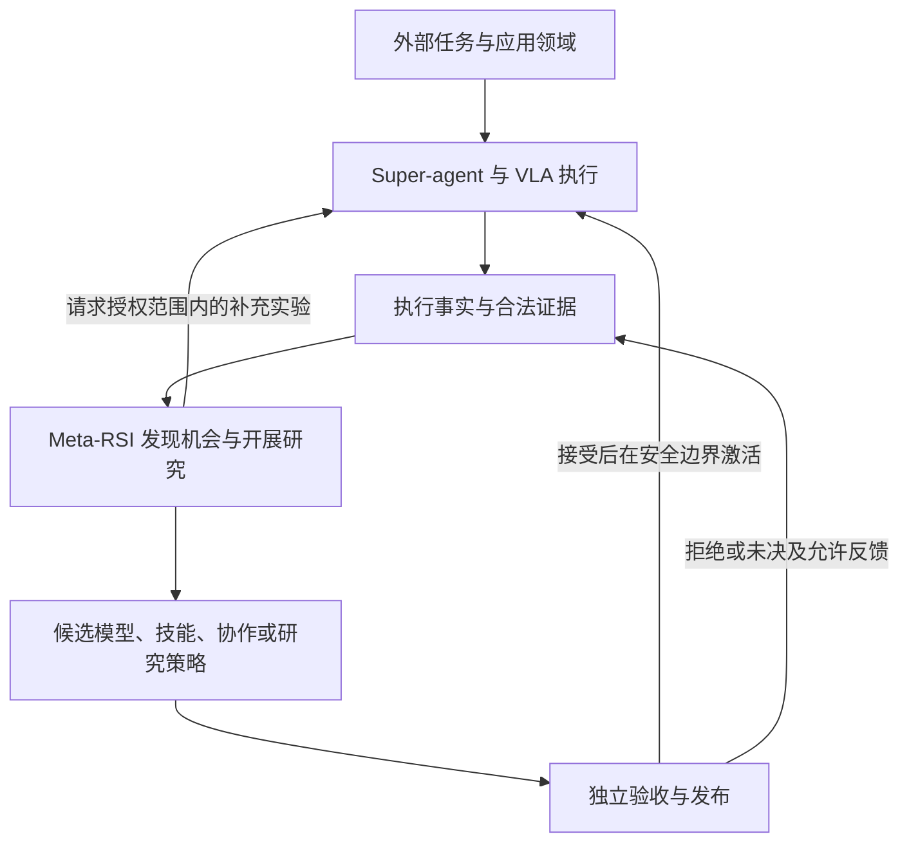

# RSI-Agent-VLA 项目总纲与研究边界

目标与方案更新：2026-11-17；承接 V5.1（2026-11-09）。冻结协议继续使用各自版本。

## 1. 研究定位

在指定机器人操作领域和明确的物理交互、计算、人工预算内，构建具有真实 VLA 学习能力的自主研究与持续改进系统。系统从正常运行和失败中发现有价值的能力缺口，自主选择并实施模型、执行策略和协作机制的改进，经独立评价后由后续任务实际继承，在保持关键旧能力的条件下提高任务表现、扩大可完成任务范围，或在预定任务表现下减少总成本。同时实质研究其研究策略与改进机制自身的演化，检验这种演化能否迁移到新的改进问题。

Super-agent 负责任务组织、监督与恢复，VLA 提供实际动作能力，Research/Meta-RSI 负责机会、实验和候选。确定性程序管理授权、资源、合法状态转换和发布；研究者在这些边界内选择问题和方法。部署域使用已合格版本，研究域可以在适用授权和隔离条件下试验尚未证明有效的候选。

完整系统提供研究载体；科学贡献来自经确认的机器人困难、具体机制或有辨别力的实证发现。主科学问题保持开放，架构、自动训练、日志与版本治理不单独构成已确立的原创算法。

本方向只规划**一篇论文**，允许多个相互支撑的创新点。H3 元改进与受约束的机制创造均保留实质研究努力；按预定资源和停止规则形成支持、未支持或未决结论，未完成范围如实进入后续研究。工程完成不以科研正结果为条件，研究验证结束也不等于项目能力目标已达成。

## 2. 文档入口与权威分工

| 文档 | 回答的问题 | 维护边界 |
|---|---|---|
| [00 总纲](00_项目总纲与研究边界.md) | 做什么、哪些承诺不能丢、整体怎样运行 | 项目目标、术语和研究边界 |
| [01 系统设计](01_系统设计与框架复用.md) | 谁负责什么、复用什么、哪里需要新代码 | 架构、接口、权限及源码接入 |
| [02 科学问题](02_科学问题与创新路线.md) | 哪些困难值得研究、如何选择主创新 | 候选问题、机制构想与否定条件 |
| [03 实验与验收](03_实验设计与验收协议.md) | 怎样证明完整、有效、协同和元改进 | 系统验收、评价、对照与统计协议 |
| [04 实施路线](04_实施路线与执行状态.md) | 先做什么、还有什么未定 | 当前状态、全部待办与待决事项 |
| [05 决策与复核](05_决策映射与审查复核.md) | 哪项来自用户、哪项来自审查、证据到哪里 | Q01—19、本轮有效决定、审查取舍与一手来源 |
| [06 先导协议](06_先导协议与版本边界.md) | 首批任务、评分、结果和版本如何对应 | 基础约定与冻结协议索引，执行状态归 04 |

01—03 定义现行方案、接口与验收，04 维护当前进展和下一步，05 保存决策/证据来源，06 说明先导协议与版本差异。01 标明已实现入口，其余设计与验收目标按实际证据判断。运行证据与断点见 [04 §1.17](04_实施路线与执行状态.md#117-5a-数据经验有限往返与资格准备2026-11-13)，本轮目标/规划同步见 [§1.18](04_实施路线与执行状态.md#118-目标与框架路线同步2026-11-17)，下一步统一见 §2；逐批执行和旧协议保存在[历史版本](../项目辅助文档/05_历史方案与执行记录/实施与执行记录_2026-11-09至13.md)，不覆盖当前状态。

本轮详细论证见[框架设计方案](../项目辅助文档/02_框架设计与实施方案/02_项目框架设计方案_复核与定稿_2026-11-17.md)，F00—F16、C01—C10、P01—P07、V01—V06 的施工细节见[框架优先实施方案](../项目辅助文档/02_框架设计与实施方案/03_项目框架详细实施方案_框架优先_2026-11-17.md)。本目录承接已确认的目标与路线；两份辅助设计方案用于设计追溯和实施细节，不另立运行状态或签发授权。后续发生目标/范围调整时同步相关设计说明，实际行为仍以源码、消费者和运行证据核实。

辅助材料统一见[项目辅助文档导航](../项目辅助文档/README.md)。该目录按用途分类，不另立目标或运行状态；原始记录/代码块中的旧路径沿清理与迁移记录追溯。

原始输入保留：

- [V4 研究方案 PDF](../项目辅助文档/05_历史方案与执行记录/统一持续自进化_VLA_Agent_研究方案V4_2026-11-06.pdf)：初始愿景与历史定义。
- [旧综合评估全文](../项目辅助文档/05_历史方案与执行记录/VLA_Agent_V4_综合评估报告_2026-11-09.md)、[旧系统设计全文](../项目辅助文档/05_历史方案与执行记录/系统总体设计与代码框架复用方案_2026-11-09.md)：重构前原件。
- [Q01—19 问答档案](../项目辅助文档/01_决策与审查原件/RSI_VLA_Q01-Q19_Verbatim_Expanded_2026-11-09.md)：用户选择及修订的依据。
- [自由审查 PDF](../项目辅助文档/01_决策与审查原件/RSI_VLA_Research_Review.pdf)：经复核后使用的意见输入。

本套工作方案承接 V4，以本轮问答中较晚的明确回答处理冲突。V4 所引历史 Q01—23 与本轮 Q01—19 是两套编号；没有原始全文的历史回答，不补写为用户原话。原件保留历史正文和上下文，可解析的导航链接随目录迁移更新，后续执行以本套文档为入口。

## 3. 已确定的研究承诺

| 承诺 | 实施含义 | 来源 |
|---|---|---|
| 完整系统必须保障 | 固定版本内全部职责有可运行实现；最终取得执行、自主研究、真实更新、独立验收、发布与后续继承证据 | Q01、Q17；本轮交付分层 |
| 机器人专属定位 | 科学问题来自具身学习与交互约束，主要结论由真正 VLA 和机器人任务承担 | Q09 |
| 三类关系具备进化能力 | 信息利用、职责协作、研究选择均可反馈适应；ρA/B/C 为当前表示，支持更新和继承，不强制三套独立学习器或每轮改变 | Q05—06；本轮明确功能与表示的区别 |
| 主动能力增长 | 失败与正常运行均可触发研究；自主发现领域内能力缺口、提出未预列目标，并以相对起点的实际能力变化计增长 | Q12—14；本轮明确增长判据 |
| 分层能力评价 | 分别展示任务效果、泛化鲁棒性、能力扩展和未来改进效率 | Q13 |
| 硬约束加综合评分 | 安全与关键能力不可牺牲；其他指标通过合理综合评分决定发布 | Q15 |
| 受约束的开放探索 | 可探索算法、组织结构与 Meta-RSI；人固定接口/权限/预算，候选内容允许超出逐项预写菜单，治理不可自主修改 | Q02—04；本轮明确自主产生要求 |
| 分级真机权限 | 全新算法首次真机：仿真验证 → 独立安全检查 → 人工审批 → 授权测试 | Q16 |
| 问题驱动并允许转向 | 不为创新重造现成技术；预设证据标准，强基线否证后保留系统并更换主线 | Q18—19 |

Q05—08 的组织与实现选择含“暂定”，后续可依据证据修订。保留功能职责和完整系统要求，允许共享、合并或调整表示与模块；当前训练配方、规则表和后端不是项目长期能力上限。

自主性覆盖机会选择、实验安排、候选产生和后续继承。记录哪些决定和代码来自系统、哪些来自人类、外部先验或教师；人提供数据/接口不自动否定自主研究，但不能把人工选好修复再交程序执行计为系统自主发现。只有事实记忆增长或冻结策略随输入选择不同动作，不构成研究策略本身进化。

## 4. 系统状态与三个循环

沿用工作记号：

```text
S_k = (θ_k, φ_k, ψ_k, ρ_k),   ρ_k = (ρA_k, ρB_k, ρC_k)
```

| 对象 | 含义 | 可继承对象示例 |
|---|---|---|
| θ | VLA 动作能力 | 模型、Adapter、相关处理器 |
| φ | Runtime 的任务执行、监督和恢复能力 | 技能实现、阶段逻辑、恢复程序 |
| ρA | 信息交互关系 | 取证、保留、压缩、路由策略 |
| ρB | 职责分配关系 | Worker 选择、交接、接管策略 |
| ρC | 学习更新关系 | 更新对象、方法、顺序和预算策略 |
| ψ | 更广义的研究与改进策略 | 诊断、实验设计、收益估计、研究规则或程序 |

工作记忆、合法证据、数据、预算状态和后端协议也影响行为，随运行版本或实验起点记录。上述记号按职责组织，不假定各变量彼此独立：ρC 可以是 ψ 的子配置，ρB 可以共享 φ 的实现。运行版本对共享实现保留唯一权威引用；实验再注明实际冻结与修改范围，同一次变化不重复计算贡献。



- **任务循环**：观测、动作、执行、监督和恢复，按动作或任务推进。
- **系统更新循环**：证据、假设、实验、候选、独立验收和版本继承，按研究轮次推进。
- **元改进循环**：研究反馈持久改变 ψ，再检验它对未见改进问题的作用，跨多个轮次推进。

前台使用已验收版本；后台产生候选，经独立验收后继承。运行版、研究策略、合法事实起点和评价条件分别绑定；共享实现保留唯一权威引用。执行模型和运行规则在任务边界或经批准的安全点切换；研究策略在研究作业边界切换，已启动作业继续绑定其起点版本。异步运行需要核对推理、训练和仿真的资源竞争；资源不足时可错峰或暂停后台作业，并记录相应代价。

## 5. 完整性与科学贡献分别验收

采用 **F 全部框架搭建 → G_F 框架交付 → P 真实组件接通与准备 → G_P 分支就绪 → V 部分、层次和整体能力验证**。F 范围在开工时固定，每部分先完成一种具体基础实现；开发过程随包进行单元、CPU 集成、进程/RPC/隔离和异常接续检查，最终统一到 G_F。真实项目模型请求、GPU 仿真、正式数据采集、训练与现场验证进入后续 P/V。F 同步开展基于已有材料的研究问题分析，不以已发现正向科学结果为开工条件。

| 判断 | 所需结果 | 尚不能据此宣称 |
| --- | --- | --- |
| 框架交付 G_F | 全部规定职责、更新算子与真实内部消费者接通，离线工程边界通过；外部重组件只在明确边界替换 | 真实模型/trainer/设备兼容、机器人能力改善或完整项目通过 |
| 真实组件就绪 G_P | 对应分支的环境、数据、原生更新/加载、资源包络、协议与权限有实际依据 | 相对强基线有收益、保持或泛化成立 |
| 系统能力验收 | 按 SC1—SC8 取得真实执行、两类更新、三类关系、主动新能力、独立发布/继承、变化与 Piper 关键闭环证据 | 每个模块都具有独立算法优势或 H3 已成立 |
| 科学主张验证 | 清楚的机器人问题、可执行规则、强简单对照、必要干预和适用重复支持相应结论 | 未研究分布、无限长期稳定或未验证的机制创造 |

至少一次有意义的合法改进被接受并由后续任务实际继承，才支持相应发布闭环目标。规则/技能更新与 VLA 参数更新均须真实发生并分别评价；数据可读、梯度存在、保存/加载和任务收益分别判断。能力收益可以是外部任务成功/范围改善，或在预定任务结果、安全与保持条件下减少成本。

三类关系的反馈学习与继承是功能要求，不要求每类独立成为论文贡献；普通候选也不必同时经过 θ 训练、新目标生成和 ψ 考试。H1—H4 分别按主张验证，方法不优于强基线时保留有效系统并调整研究路线。

H3 和机制创造都需有实际研究投入与可结束的验证：记录问题、系统产生的修订/机制、试验及成本，或未能开展的具体前提。框架通路、人工编写的新策略或生成代码文件不能单独履行这些研究目标；正向 H3 或新算法收益也不作为 G_F 的保证。

## 6. 能力范围

完整目标是应对环境与感知、新任务与技能、动力学与执行条件的持续变化。实际验证采用有限、预定的任务流与更新轮次，分阶段覆盖单因素、连续、组合和未见条件；有限多轮证据只支持所测范围，不外推无界稳定。

应用领域由人指定；Meta-RSI 可以在该领域内自主发现能力缺口并提出未预列需求。在预定领域、权限和预算内，系统可依据独立规则筛查目标并自主开展学习；学习后由独立任务检验其实际价值、成功与泛化，合格后才计入能力增长。跨领域自主生成目标是有条件推进的高级目标。

首版使用已支持 LIBERO 场景、对象与谓词的有界组合，接通目标物化、学习和独立评价。旧任务清单中的选题、未预列组合、相对起点的新增能力、独立组合迁移分别报告；目标文本或技能条目增多不计为能力增长。该目标语法是本版本的支持范围，不是整个项目对新能力的定义。

开放机制先在明确补丁/插件接口中研究，允许系统提出开发者未逐项预写的候选；更广损失、数据构造、组织结构和新后端按实际研究需要与权限扩展。接口限制保护可执行性，不将永久枚举研究答案作为自主性的实现方式。

A/B/C 是初始协作框架：前期保持接口稳定，长期允许增加、合并或拆分关系。结构变化需要保留完整系统职责、计入容量与成本，并通过独立验收。

仿真承担主要机制实验与多轮比较，Piper 真机承担关键物理闭环验证。沿用 V4 的有限迁移计划：主结果使用真正 VLA，并用第二种动作生成类型检验选定关键结论；不要求迁移全部实验矩阵。

## 7. 一篇论文的组织原则

以经确认的机器人科学问题组织论文：问题及代价 → 现有方法的剩余缺口 → 具体机制 → 强对照与反馈干预 → 长期能力及真机验证。多个创新点应解释同一主线，系统架构提供完整载体。当前先交付固定范围内的全部框架，再在真实组件就绪后取得更新闭环和问题辨别证据；阶段、依赖和完成标准见 [04 §2](04_实施路线与执行状态.md#2-框架优先的实施路线与依赖)。

机制、学习策略、可执行算法创造和元改进具有不同证据要求。仅生成候选代码不等于创造有效算法；仅新版机器人更强不等于 ψ 更会研究。相应判据见 03。

以冻结起点、强简单研究流程和候选策略组织适用整体主比较，保持相同合法信息、更新操作、合理开发机会和资源上限。必要消融集中到预定辨别子集，保持、变化、效率和连续继承尽量共享合法运行与评价点；开发、发布回归和最终封存信息流保持独立。

H3 区分“系统自主产生的某份策略更有效”和“元改进程序稳定地产生更好策略”；后者需要独立产生历史。机制创造区分预置选项选择、参数/规则优化、非预置程序生成和独立收益，不由代码长度或文件数量判断。每次验证在已注册预算和停止规则下结束，支持、未支持与未决均如实报告。
