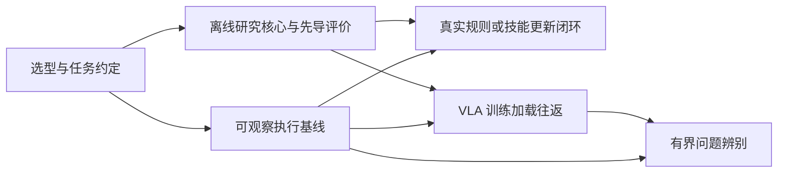

# 实施路线与待决事项

版本：V5.1 工作方案 · 2026-11-09。本文件是本套文档中当前状态、待办、待决与后续实验注册的唯一入口。定义见 [00](00_项目总纲与研究边界.md)，实现见 [01](01_系统设计与框架复用.md)，科学候选见 [02](02_科学问题与创新路线.md)，验收见 [03](03_实验设计与验收协议.md)。

## 1. 当前状态与证据

第四批准备及第三批补件见 §1.16；动态工作继续暂停。第三批原交付见 §1.15。第二批唯一开发回合及原始解释见 §1.14，第一批修复及历史静态计划见 §1.13。

| 事项 | 当前可确认的状态 | 依据与范围 |
|---|---|---|
| 输入材料 | 两份 MD、V4 PDF、问答和自由审查均已阅读 | 原件入口见 00 §2 |
| 用户决策 | 本轮 Q01—19 的最终修订已映射到方案 | 05 §1；暂定选择保留其暂定性 |
| 代码基础 | 聚合目录存在七个上游源码目录 | 本地文件与选定函数静态阅读，05 §4 |
| 自研研究 core | 已实现标准库离线 core、版本/事件/合法视图、固定 ρ 与初始 ψ/记忆、候选和三态 Gate | §1.4；只通过离线行为检查，关系学习与自主更新未完成 |
| 执行/训练/发布联调 | 其它终端已完成一次 Codex/MCP/VLA/LIBERO-PRO 单回合工程冒烟；训练、独立验收及发布未接通 | §1.2 的真实日志；环境结果字段仍为空，不计正式基线或 SC1—SC6 完整通过 |
| Piper 本项目闭环 | 本轮未打开设备或执行，没有本轮验收证据 | 既有他项目路径不替代 SC8 |
| 主科学问题/算法 | 尚未选定 | Q10/Q18/Q19；R1—R4 为候选 |
| H1/H2/H3/H4 | 均无本轮新实验结论 | 实验协议不是已完成结果 |
| 文档重构与复核 | 已形成 V5.1 工作方案 | 完成跨文档逻辑与表达复核，补充近期任务、首次发布前提和 H3 变量归属 |
| 首条链资产与本机配置 | π0.5、归一化、Tokenizer、SAM3 已绑定；Python 3.11 与匹配依赖已安装；Codex 在线工具调用、VLA CUDA 加载/推理及所测 LIBERO-PRO 场景已有运行证据 | §1.1—§1.2；SAM3 分割调用、任务独立结果和训练链仍待验收 |

旧方案中的“两张共享 RTX 4090D、单臂 Piper、每周约 12–16 小时现场、六个月阶段窗口”只作为历史规划输入。显卡可用性、模型占用、现场时间和设备状态均需在实际执行前核实；不沿用历史空闲磁盘数作为当前条件，也不据历史数值承诺完成日期。

目标聚合目录当前不是 Git 仓库，上游目录各自维护源码；文档交付不等于产生已提交的工程版本。

### 1.1 首条链资产与匹配环境（2026-11-09 更新）

本机配置在 [config/models.local.sh](../config/models.local.sh)，启动入口在 [scripts/run_libero.sh](../scripts/run_libero.sh)。本次更新只读检查其它终端的产物、安装元数据、源码和运行日志，复用此前文件结构与下载来源证据。实际运行证据来自下方 §1.2 的其它终端日志。

| 对象 | 已完成及证据范围 | 仍需完成 |
|---|---|---|
| 主 VLA | `checkpoints/RLinf-Pi05-LIBERO-130-fullshot-SFT`；既有下载 revision `6222623f635769bfc73c9472e29fab9b7fd8e027`；`model.safetensors` 7,473,091,464 字节，既有结构检查为 812 tensors；`metadata.pt`、`optimizer.pt` 存在。§1.2 日志确认匹配加载器加载到 CUDA，并实际调用 `pi0_pick` | 多任务/多初态独立基线、真实训练产物重新加载及保持评价；下载的 optimizer 文件不代表本项目已经训练 |
| 归一化与处理链 | `PI05_NORM_STATS_PATH` 指向 checkpoint 内 `physical-intelligence/libero/`；既有 JSON 检查的 state/actions mean/std/q01/q99 各 32 维；实际 VLA 日志确认读取该统计量并加载模型 | 将实际图像/状态处理、动作解码、模型 horizon 与执行 chunk 记录到 T02；不套用其它模型的统计量 |
| PaliGemma Tokenizer | `OPENPI_DATA_HOME=$HOME/.cache/openpi`；`big_vision/paligemma_tokenizer.model` 4,264,023 字节，`sentencepiece` 已安装；VLA 指令推理已有运行证据。checkpoint 已含视觉/语言 backbone | 无首次执行所需的额外整套 PaliGemma/SigLIP 下载任务；训练侧消费者在训练往返时验证 |
| SAM3 | 复用 `/home/wd/下载/sam3.pt`，3,450,062,241 字节；已安装 `RLinf/sam3`，包内 BPE 资源存在；两次冒烟均记录权重加载后 RPC 服务监听 | 所测回合未见 `segment` 调用，仍缺一次有界真实图像/提示分割功能证据；原权重下载 revision 未溯源 |
| Planner | Codex SDK 已安装；`gpt-6.1-sol` 已完成在线图像/工具交互，第二次冒烟 `error=null`，27 次工具调用 | 明确后续实验 reasoning effort、模型/记忆版本和调用预算；不再把在线登录与工具连接列为未接通 |
| Python 与依赖 | `RPent/.venv/bin/python` 为 3.11.13；Torch 2.7.1+cu126、torchvision 0.22.1+cu126、RPent 0.1.0、RLinf 0.4.0、rpent-openpi 0.2.2、rpent-libero/rpent-liberopro 0.2.0、SAM3 0.1.0、openai-codex 0.167.0、sentencepiece 0.2.3、safetensors 0.9.0rc1、omegaconf 2.4.1rc2、transformers 4.57.6、MuJoCo 3.3.0、robosuite 1.5.2、LeRobot 0.3.3 已安装 | 首条执行链已运行，不安排重复安装；SFT 所需环境、数据和配置另按实际消费者验证 |
| LIBERO-PRO | `~/.liberopro/config.yaml` 已绑定当前 .venv 包内 assets、BDDL 和 init_files，路径存在；§1.2 确认 `libero_object_swap/task 2/seed 0` 的场景、初态及渲染实际可用 | 所测一个场景不代表所有资产验收；首批任务集合待定。该配置的 datasets 路径不存在，训练数据未就绪；旧 `~/.libero` 配置不作为当前 PRO 链的阻塞项 |
| 上游记忆 | 已下载 `GPT_5.5_xhigh`，快照 `47f301ef33bf8d0e8c770342f16b3c39c6a0e8c1`；冒烟有实际读取。`gpt-6.1-sol` 未映射专用记忆，日志记录回退到该版本 | 后续显式固定 memory 版本、合法信息及基线预算；当前任务特定参考有缺失，记为覆盖缺口，不假定全任务均有 recipe；该记忆不是本项目学习成果 |
| Research LLM 与 core | Planner 后端可复用；离线 core 及持久快照已实现，见 §1.4 | 研究 Toolkit、自主机会/假设/真实实验、独立运行发布与反馈学习尚待接通 |
| 更新后的 VLA | 未找到本项目训练产物 | 匹配的 π0.5 SFT 配置、合格训练数据、真实更新—保存—加载—独立评价；首次执行不需要先下载完整训练集 |
| Molmo/第二动作类型/H4 | 当前 Codex 主链不要求 Molmo；其余分支未验收 | 按 T15/T16 及具体机制需要准备，不阻塞当前主链 |

本次安装元数据与模块发现路径核对：RPent 对应当前工作副本，RLinf/OpenPI/LIBERO/SAM3 对应 `.venv/lib/python3.11/site-packages/`。安装来源记录如下：

| 安装项 | 请求分支 | 实际安装 commit |
|---|---|---|
| RLinf | `release/v0.4` | `2348ece3df113874671478be1360ae3115b346e3` |
| RPent OpenPI | `rpent` | `a560f4dd8205b8423ecd4c8a0fabb5f54140b8a0` |
| RPent LIBERO | `rpent` | `a8323074d93a09e32bd898630a70531b1f51bc77` |
| RPent LIBERO-PRO | `rpent` | `d1e11fb181b8544487d27742c0caa3a4d46452ad` |
| SAM3 | `main` | `c1f6b1e83967c912f675d8975d437ccdc41e17d8` |

`models.local.sh` 没有设置 `RPENT_RLINF_ROOT`，当前运行实际使用已安装的匹配包。同级 `RLinf/` 仍只是另一份源码，不因路径大小写问题而强行切换到它；替换消费者前先核对其兼容性。

### 1.2 其它终端已执行的工程冒烟与剩余判定缺口

以下为 2026-11-09 运行产物的事后只读复核，不是本轮新启动的任务。日志目录名记录启动时间，最后一项动作和退出时间以日志为准。

| 记录 | 可确认的实际结果 | 支持范围 |
|---|---|---|
| [smoke-20261109-222216](../RPent/logs/smoke-20261109-222216/run.log) | VLA 模型和环境/SAM3 服务已启动；Codex 请求因 `reasoning.effort=none` 不被 `gpt-6.1-sol` 接受而终止，工具调用为 0 | 配置失败记录，不是机器人任务失败样本或有效基线回合 |
| [smoke-20261109-222602](../RPent/logs/smoke-20261109-222602/run.log) | `libero_object_swap/task 2/seed 0`，任务为沙拉酱入篮；使用 `reasoning-effort=low`，Codex SDK 完成、`error=null`、27 次工具调用。`states.json` 有初态及 7 次动作记录，其中一次 `pi0_pick` 执行 8 chunks，其余为几何移动；末步 `terminated=true`，视频/recipe/transcript 已保存 | 实际 Codex→MCP→VLA→仿真混合执行链已通；不等于裸 VLA 整任务能力、正式成功率、自主更新或 SC1—SC6 完整通过 |

第二次冒烟的 VLA `model ready in 80.3s`；实际服务器先执行 `.cuda().eval()` 再报告 ready。该回合证明历史运行窗口中的 CUDA 加载/动作推理可用。本轮只读会话的 `nvidia-smi` 仍无法访问驱动，这只能说明本会话的查询条件，不能据此推翻已有运行证据或判定宿主 GPU 损坏；后续新作业需核当时可用资源。

**优先修复结果语义**：第二次 transcript 的 `finish.status=success` 来自 Planner，`environment_success=null`；末步仍闭合夹爪，已有任务记录也注明终止发生在释放前。分别保留环境原生终止、抓取启发式、Planner 声明及释放/落稳等过程条件，不能互相替代。实际 CLI 中 `environment_success` 的赋值受 `robot_spec.finalize_run` 分支控制，是需要核对的结果写入接点。下一步补齐独立原生结果与过程标签，不把 Planner 声明自动升级为已验收完整成功，也不擅自改变原 benchmark 的成功定义。

**调用配置与预算**：当前启动脚本默认 `reasoning-effort=medium`，已完成回合使用 `low`；两者不能写成同一套已验证配置，后续实验显式固定。第二次日志记录 input 699,228、cached input 639,488、output 2,317 tokens；缓存项作为输入子项报告，不重复相加。transcript 的 `elapsed_s=209.3` 与服务启动/退出时间戳不覆盖同一时间区间，完整作业墙钟按 `run.log` 的启动至退出统计，不能把 209.3 秒直接用于全链吞吐预算。

### 1.3 更新后的剩余任务与执行顺序

已完成的主权重/配套定位、首条链依赖安装、Codex 在线连接、VLA CUDA 加载与单场景执行从前置缺口中移除。下表只列剩余交付，沿用 T 编号，不改变 §2 的总体目标。先复用现有证据；只有配置改变、明确缺证或新失败才重验相应部分。

| 顺序 | 剩余工作与 T 编号 | 下一项具体交付与通过条件 |
|---|---|---|
| 1（离线完成） | 结果与运行配置收束（T01/T02/T03） | 登记已验证模型/依赖/记忆/effort；补独立任务结果落盘及过程标签，分开成功/失败/未知、Planner finish 和 terminated；用离线样例核标签流。SAM3 分割若后续工具确需使用，再按具体预算补一次功能验证，不重装或重下权重 |
| 2（协议完成） | 首批任务、评价和预算（T02/T04/T08/T09） | 确定基础/受控变化/旧能力任务及开发、发布回归、封存划分；固定关键能力、综合评分、分母、未知/重试、接受标准和资源上限。新运行先授权；一条冒烟不外推为基线规模或可靠成功率 |
| 3（离线完成） | 自研维护位置与离线核心（T17/T03/T05/T10） | 明确 core 仓库与最窄 RPent 接口；实现 RunBundle、ExecutionEvent、EvidenceView、ExperimentResult、Candidate、GateDecision 及固定 ρ 基线；保存初始 ψ/合法记忆快照。离线检查覆盖未知、重复提交、版本恢复、拒绝/未决不发布 |
| 4 | 动作证据与小规模原生基线（T01—T03） | 复用现有 states/transcript/video，补动作建议—发送—反馈、来源、版本、缺失及全成本；按已定协议做有界任务/初态基线，取得正常、失败/未知与适用恢复记录；运行与证据接入不混为一次验收 |
| 5A | 首条自主规则/技能更新（T05/T06/T08） | 研究者从合法证据提出竞争解释，真实执行有界修复，独立 Gate 接受/拒绝/未决；完成有意义的接受、后续继承和适用回滚，拒绝样例维持原版 |
| 5B | 训练数据、π0.5 配方与真实模型往返（T01/T02/T08） | 明确公共示范/自采数据来源、任务/episode 映射和动作合约，验证匹配 SFT 配置及小批读取；有界真实更新—保存—实际加载—独立任务/旧能力评价。先测显存/步耗时再定训练预算；LeRobot 0.3.3 已安装不代表数据已通过 |
| 6 | 问题辨别与核心关系学习（T05—T10/T12） | R1 可先复用轨迹；R2 等合法版本对，R3 用独立新能力价值判据；持续保存 ψ，条件具备后做新问题考试。补齐三类关系反馈学习和 SC1—SC6，不以固定/no-op 规则替代 |
| 后续 | 长期、多变化、Piper 与有限迁移（T11—T16） | 按 M4—M6 和 SC7/SC8 完成关键机制、持续/复合变化、现场独立安全与审批、物理更新闭环及选定迁移；H4 与结构演化按具体前提推进 |

顺序 2、3 可交错推进，顺序 5A、5B 按各自前提推进，无需等待另一条先成功。当前已有有限先导评价协议和离线研究 core；尚无已验收训练数据/本项目新 checkpoint、动态独立发布或自主更新。`/home` 本次只读查询约余 142 GB，是本次快照而非容量承诺；新增数据、模型和媒体预算先计入存储，无授权不清理现有资产。此次状态更新不新增下载、装包、GPU、LLM 请求、仿真或设备授权。

### 1.4 本轮代码、协议与离线交付（2026-11-09）

本轮完成 §1.3 第 1—3 项的代码、配置、协议和针对性离线检查。未启动新模型请求、下载、安装、训练、GPU/仿真或设备操作。历史冒烟继续按 §1.2 的证据范围引用；新增结果出口与显式固定配置尚待授权动态验收。

| 交付 | 权威产物 | 完成范围 |
|---|---|---|
| 独立结果 | `RPent/robots/libero/result.py`、LIBERO toolkit/RobotSpec、CLI/Dashboard 消费接点 | 原生 benchmark 成功与 Planner finish、工具启发式、terminated/truncated、附加过程标签分开；无证保留 unknown。历史 step 7 经匹配安装链的明确语义离线恢复 benchmark_success=true，释放/落稳仍未知；原文件保留，派生结果在 artifacts/offline-20261109/runtime/recovered-smoke/result.json，不计新运行或正式基线 |
| 固定运行链 | [run_profile_v1.json](../config/run_profile_v1.json)、[runtime_observed_v1.json](../config/runtime_observed_v1.json)、[check_runtime.py](../scripts/check_runtime.py)、[run_libero.sh](../scripts/run_libero.sh) | 匹配安装元数据、模型/归一化、外部记忆 revision、原生 5-action chunk/5-step 推理等静态记录。该次交付的后续 Planner 配置固定 low；2026-11-10 已由 §1.5 的 v2 medium 配置接替。原 v1 与历史结果不改写 |
| 首批任务与评价 | [06 先导协议](06_首批任务先导协议.md)、[pilot_v1.json](../config/pilot_v1.json) | 基础/位置交换/旧能力探针，开发、重复发布回归与封存初态，有限工程评分、完整分母、恢复/reset 和资源上限。阈值不代表统计显著性；未获得动态执行许可 |
| 最小研究 core | [core README](../core/README.md)、`core/src/rsi_vla/`、`core/configs/`、`core/tests/` | 聚合目录自有维护，标准库，无装包或训练器改写。RPent 通过结构化结果与 states/transcript 文件接入；不替换 .venv 的 RLinf/OpenPI。固定 ρ 和初始 ψ/合法记忆可保存恢复，不计为关系学习 |
| 当前验证 | [离线检查记录](../core/OFFLINE_CHECKS.md) | 记录命令、当前结果、历史数据派生证据与未运行项目；仅支持所测离线逻辑 |

维护边界：RPent 子仓库维护通用结果消费及 LIBERO 原生结果生产；聚合目录 `core/` 维护本项目研究数据合约、合法视图、预算和本地版本状态机；`config/` 固定本项目先导协议。聚合目录仍无 Git，本轮未初始化 Git、提交或替换依赖。正式独立 evaluator/发布者需由受保护进程持有有效版本写权限；本地类与不同角色参数只验证状态转换，不构成进程安全隔离。

剩余工作从第 4 项继续：动作级 L0 全覆盖、授权的独立结果动态验收和多任务基线，随后自主规则/技能更新及原 trainer 往返。旧能力任务当前只是保持探针，需先建立真实锚点。完整自主更新、独立正式发布、ρA/B/C 反馈学习、H3 新问题考试和 SC1—SC8 总体验收均未完成。

### 1.5 第 4、5A、5B 项推进（2026-11-10）

主终端协调了 A Runtime、B 训练、C 研究三条隔离工作，无继续委派。主会话与三名编码子代理的实际 `turn_context` 均为 `gpt-6.1-sol / high`，记录见 [model-settings.json](../artifacts/offline-20261110/model-settings.json)。usage limit 中断后主终端接手集成与收尾；已通过且仍适用的检查沿用原日志，仅补受影响的共同接口和中断前尚未验收的监督修正。

| 检查点 | 本轮交付及证据 | 当前判断 |
|---|---|---|
| 1：第 4 项运行基础 | [run_profile_v2.json](../config/run_profile_v2.json)、[pilot_v2.json](../config/pilot_v2.json)，新起点 `initial-medium`；启动入口从冻结 RunBundle 生成显式参数；RPent 记录动作 proposal/send/RPC feedback、动作来源及 run/episode/bundle/protocol；独立原生结果、JSONL 导入和分项成本；实际进程组墙钟/GPU占用包络/存储采样监督 | 针对性离线检查通过；动态验收未通过且未运行。初始化/reset内部动作、控制器应用量/测得运动、后台模型确认和部分成本仍明确缺失；不能称动作全覆盖或完整成本已验收 |
| 2：medium 小规模基线 | 开发 8 槽、发布回归 8 槽的串行计划；固定起点及 release benchmark 使用 v2 medium 独立身份；原权重、任务、评分、阈值保持 | 16 槽均未启动，牛奶/抽屉仍为未证实能力探针。没有 medium 成功率或已验收锚点，历史 low 不计入分母；封存 seed 5/6 不调度 |
| 3：5A 规则/技能更新 | `research_tools.py / rule_updates.py` 接通合法开发证据、机会、竞争解释、实验、真实产物差异及 Candidate；Runtime 实际读取有限规则文件；Research LLM 请求准备显式 medium，未调用时 effective=null | 仅离线工具/产物交接通过，未提出或实施基于真实 medium 开发证据的更新。当前有限对象是 chunk 前缀，改变控制时序，启动入口要求新的匹配 profile/协议/基线；不作为本轮已有效修复，也未接受、继承或回滚真实候选 |
| 3：5B 模型更新 | 实际安装链的 π0.5 配方、数据/动作合约、小批入口、原 trainer 监督、保存布局及 Runtime descriptor 交接；读取实际归一化和 checkpoint header，CPU 原生配置及 worker序列化检查通过 | 未找到合格 LIBERO 本地数据；没有真实小批读取、训练、保存新模型、实际重新加载或任务/旧能力评价。预备报告为 `blocked_no_qualified_dataset`，静态 handoff 不是模型往返验收 |

后续运行的 Planner、Research LLM 均由 v2 profile 显式绑定 `gpt-6.1-sol / medium`。`run_profile_v1.json / pilot_v1.json`、历史 low 日志和既有快照保持原样，仅复用仍适用的依赖、接口与所测场景证据。`initial-medium` 是未验收的不可变起点身份，不是已测能力锚点。

本轮聚合代码版本为 `aggregate-core-v0.2.0`，仍未初始化聚合 Git。RPent 在 `c41c0e6` 的独立 detached worktree 中开发，继承原目录全部未提交成果；主终端只集成新增差异，不覆盖其它终端改动、不 stage/commit。实际源码和增量补丁保存在 [本轮归档](../artifacts/offline-20261110/)，针对性结果见 [OFFLINE_CHECKS.md §5](../core/OFFLINE_CHECKS.md#5-2026-11-10-第45a5b项的离线集成)。

**真实阻塞与顺序。** 当前配置授权仍全部为零。除此之外，现有 Codex SDK 没有已验证的逐请求多模态输入计数及 provider 输出上限，有限 token 预算下会在创建 Planner/启动模型前拒绝；不能用请求后的 usage 或离线 ResearchJob 代替约束。需先接通可约束请求的实际后端，再验证一个已见场景回合的独立结果/身份/成本；缺失仍须为 unknown。独立 evaluator 已按全部槽读取实际原生结果和动作文件，但 safety、compatibility、critical_progress、resource_limits 未获对应独立证据时仍为 null；受保护评价/发布的操作系统权限部署也未验收。检查点 1 动态通过前，不启动 medium 矩阵或两类真实更新。

**集中待授权方案（均未授权、未启动）。**

1. 模型请求监督缺口解决后：仅 `libero_object_swap/task 2/seed 0`、`initial-medium` 一个回合；单 GPU、900 秒启动至清理、Planner 600 秒/20 turns、2000 步、40 工具、input 100万（含cached）/output 8000、产物1GiB，不含训练、下载、安装、硬件。不自动扩大为矩阵；若更换预算依据或后端须先另行明确，不默认豁免 token 上限。
2. 数据分两段：先对已安装 `pi05_libero` 配置引用的 `physical-intelligence/libero` 解析不可变 revision、核元数据，最多8MiB；再按固定元数据选择沙拉酱入篮的前2个匹配示范，仅下载所需 parquet/两路媒体，最多512MiB，保留原 episode 映射。revision/episode IDs 当前未知；不兼容、超额或不能确认与评价信息隔离则停止，不扩展全量下载。
3. 合格数据小批读通且第4项验收后，另行授权训练资源测量：1张指定GPU、microbatch1、最多3个optimizer step、900秒/900 device-seconds占用包络、产物上限64GiB（不是下载额度），全局单作业。当前 RLinf OpenPI 只支持本配方的 `no_shard`，不能据两张卡推断能分片；可能显存不足，记录实测后再定正式规模。实际加载及独立任务/旧能力评价另按授权排队，不由仿真额度代授权训练。

后续5A的一次medium研究请求/实验，以及开发和发布矩阵，均在检查点1通过后按实测成本申请具体额度。两路径各自独立Gate；拒绝/未决保持当前版，不为闭环演示强制接受，也不先组合两类变化。

### 1.6 第 4 项动态授权与执行登记（2026-11-10）

用户已授权“补齐第4项缺口并完成动态验收，再开展两条真实更新”，随后明确选择保留Codex、token改为记录项，以墙钟、模型请求数、工具数和环境步数为硬上限，并另建协议版本。另单独授权仅替换本项目`.venv`的pyarrow为16.1.0，NumPy及其它包不动。原版本实际为26.0.1；替换后分发包元数据仅此一项变化，NumPy仍为1.26.4，LeRobot导入与原生CPU子集/loader合成fixture已通过，真实示范尚待下载。

新授权配置为 `config/run_profile_v3.json / config/pilot_v3.json`，起点 `initial-medium-v3`。任务、评分、阈值与封存范围不变；v1/v2及原快照保留。新运行每回合完整墙钟900秒、Planner600秒、模型HTTP转发前限20请求、40工具、总环境步2000（包含setup/reset）、1GiB项目产物，单GPU且全局串行。token/cached子项/output完整记录，不再声称token或货币硬上限。模型及effort在每次HTTP实际请求体核验，后端返回模型与usage另记录。本地请求计数接点已通过HTTP fake和真实Codex SDK→本地假模型联通，不把该测试算外部模型能力。

主终端先运行已见swap/task2/seed0的一个有界回合；成功或失败均由原生结果判，缺失/中断为unknown，不计正式基线分母。其运行基础验收通过后再按v3冻结矩阵测开发8槽、发布回归8槽，保留未启动/未知/无效全部槽；封存不调度。两条真实更新按各自前提分开排队，不组合、不强制接受。当前状态：离线补缺已集成待动态启动；运行证据统一在 `artifacts/authorized-20261110/` 登记。

### 1.7 真实诊断、缺陷修复与 v5 首槽验收（2026-11-10）

| 真实作业 | 事实及成本 | 独立判断 |
|---|---|---|
| `stage4-medium-smoke-01`（v3） | 模型CUDA加载，30个setup步；首个gpt-6.1-sol/medium请求成功，第二请求usage limit 429；104.934秒，2次模型转发 | 0策略步，unknown；原始结果保留，清理完成 |
| `stage4-planner-connectivity-01` | 限额恢复时间后1个实际medium请求返回READY，5.611秒、无GPU | 仅验证账号和转发，不算机器人能力 |
| `stage4-medium-smoke-02`（v4） | 30 setup+66策略步；460.939秒、8模型转发；第8请求上游超时后下游HTTP未结束，主监督提前停止 | unknown；已修复错误分支发送502并关闭连接，无自动重试；新增失败回归通过 |
| `stage4-vla-grasp-diagnostic-03`（独立组件bundle） | 12次真实VLA预测、60策略步+30 setup；184.165秒、8模型请求；独立原生false、正常闭合failure。完整任务目标并未完成 | 动作/RPC/身份/原生结果/实际模型配置已验证；发现另有4个继承PyCharm读取未进RPent计数，实际10工具超过该诊断剩余6，因此整体未通过；未回填为成功 |

v4依据checkpoint自身metadata显式记录`discrete_state_input=false/max_token_len200/action_horizon10/model_action_dim32`。旧日志True来自缺省配置；实际tokenizer本已消费False，未找到网络中该标志的行为分支，不断言曾造成弱基线。checkpoint记录`num_steps=10`，当前保留既定Runtime采样5；该实际计算差异单列，不称完整复刻原采样配方。源证据见 `checkpoint-config-diagnosis/`。

针对实际暴露的工具绕行，v5在运行子进程禁用所有继承MCP，仅启用RPent；用户全局PyCharm配置不改。原生Codex配置消费者已确认PyCharm=false、RPent=true，并用真实SDK连接本地假模型验证配置可运行。正式回合再逐条核SDK原始工具来源和预算；不能仅凭配置声明通过。

当前后续配置为 `config/run_profile_v5.json / config/pilot_v5.json`，起点`initial-medium-v5`，原v1—v4与诊断原件保留。任务、评分、阈值不改。下一阶段预指派开发8槽、发布8槽，串行，总墙钟/GPU占用包络各14400秒、320次模型请求，每回合900秒/20请求/40工具/2000总步/1GiB。先仅执行首个完整任务槽作为v5独立运行基础检查；其技术证据未通过则停止余槽、无自动重试，全部槽仍保留。通过后推进余下medium矩阵，再判断5A/5B各自前提，真实更新仍未启动。

### 1.8 v6 实际运行基础通过、medium 矩阵进行中（2026-11-10）

v5首个开发槽因新串行入口未传SAM3路径而启动失败，40.6秒runner区间、43.942秒完整阶段耗时，无策略动作；该槽为技术无效/unknown，另外15槽停止保留。v6把SAM3与OPENPI_DATA_HOME纳入冻结profile，启动前检查已有资产；A已只读追踪三个服务实际消费者，没有发现其它当前必需环境遗漏。旧v5原件不改写，v6新技术修订队列扣除了旧阶段已消耗的墙钟、GPU占用包络与setup步，没有退回其成本。

v6首个完整任务 `development/base_salad/seed1` 已独立验收：原生benchmark_success=true、terminated=true、attempt_closed=true，无技术error；完整369.555秒，424环境步=30 setup+394 policy；20模型HTTP请求，40个RPent派发，SDK另记录1次未派发/被拒绝的工具尝试（可见工具事件共41）。工具来源全部走受计数RPent；身份、顺序、RPC proposal/slot映射、实际model/medium、模型实际加载与推理、完整usage、预算和进程清理检查均true。

[checkpoint1](../artifacts/authorized-20261110/medium-v6-baseline/checkpoint1.json) 只授予当前完整任务Runtime运行基础通过，不是整个medium矩阵、正式发布或完整系统通过。当前串行队列在测其余开发/发布槽；首槽为原冻结矩阵的一项，不属于此前组件诊断，也未替换v3—v5的失败或unknown。medium成功率、牛奶/抽屉起点与固定锚点须等完整对应矩阵；两类真实更新仍未开始。

### 1.9 用户暂停与续接断点（2026-11-10 14:52）

**最新指令**：用户先要求第三槽收口后直接转5A、再5B，其余基线槽保留未完成；随后要求5A完成后暂停5B；最新因额度不足要求“暂停并简单交接”。当前全面暂停，未排新作业，5A进程已退出且cleanup_confirmed=true/remaining_process_ids=[]。先前动态授权不覆盖本次暂停，须等后续恢复指令。

- 第4项：v6前两开发槽success/failure原件保留。第三槽已依据完整原生false、40次准入/finish预算拒绝和清理证据生成`independent-budget-result.json`，独立outcome=failure；原result的unknown/SDK interrupted不改。其后3次模型转发的停止传播缺口仍判false，不能追认为历史控制合格。独立补件和`independent-budget-audit.json`在原第三槽目录。固定8开发槽结果`baseline-v6-partial-development`保留unknown5；其余13个开发/发布槽未启动，不缩分母；旧能力锚点和完整medium基线未建立。
- 第4项增量修复：client/server共享首个原子`budget_stop.json`；工具40次准入即标记，已准入工具收尾后Codex记录明确原因并中断；Gate阻止停止后的新模型转发，外部取消/技术错误仍unknown。A新增13项+受影响既有28项通过；主新增Gate假HTTP1项、预算补件3项、v3实际Planner消费者3项通过。实际Runtime源代码在后续run的`code_snapshot/`留存，不生成hash。新停止分支尚未取得“真实预算耗尽且无技术错”的动态验收。
- 5A真实研究：`research-medium-01/`一次实际gpt-6.1-sol/medium请求，完整37.803秒、1模型请求、13606输入/977输出；依据开发证据提出保留最后1次工具用于诚实finish的有限提示，保留3竞争解释。SDK枚举格式与已解析result_id引用的本地校验问题已离线修复并复用原响应，没有再次调用模型。唯一phi修改`planner_finish_reserve_calls:0→1`，θ/processor/ρ/ψ/memory/profile及chunk5冻结。研究store为`state-v6/research`，job=`research-v6-finish-reserve`，experiment=`finish-reserve-experiment`，试验bundle=`finish-reserve-v6-trial`。
- 5A真实试验：`5a-finish-reserve-candidate-01/`，position_swap_salad/seed1；Runtime提示已实际进入Planner，VLA已加载且预测8次。14次模型转发、25次工具准入，完整371.977秒；第14次转发遭上游transport错误并返回本地502，runner exit1，无自动重试。独立outcome=unknown/technical_invalid；不能当任务失败、规则无效或能力改善。完整独立audit已保存；该失败请求token不可确认，已返回13次请求usage只是观测下界，不能冒充完整费用。
- 5A仍待：先把本次试验已知硬成本及未知token状态写入ResearchJob/研究finding，再生成正式Candidate、独立Gate和有效版保留记录；不自动重试。完整release/current/anchor及旧能力缺失，正式Gate不得accept。尚未执行有效版激活、继承或回滚；不强制接受候选，也不把未运行的配对比较当收益证据。
- 5B暂停在准备阶段：已授权单包pyarrow16.1.0兼容修复、原生CPU合成fixture、匹配动作专家partial-SFT配方及精确PID/Ray短路径监督代码通过适用离线检查；真实metadata已固定revision并选择816/822两个示范（239帧，主体32495450字节）。未下载示范主体、未读真实batch、未训练/保存/实际加载/任务或旧能力评价。metadata在`dataset-metadata-01/`，后续须用户恢复后才调度。

待集成的主终端离线增量保存在`artifacts/authorized-20261110/continuation-1422/pending-integration.patch`：当前v6静态消费者/default引用、core README/06说明，以及已通过的部分矩阵规则观测回归（1项）。该补丁尚未集成，静态checker改动尚未执行；不要把它们计为当前通过。主工作隔离区`/tmp/rsi-stage2/main`、A/B/C原隔离区和未提交成果均保留；RPent原有staged .idea及其它终端改动未动。没有提交、推送、迁移目录或修改全局Codex配置。

省略其余基线槽可继续验证候选消费及训练往返接口，但缺少完整medium成功率、关键旧能力与固定锚点，不能证明能力改善/保持或获得正式发布资格。用户另要求在全部任务结束后讨论RPent提交组织和新路径终端Codex记忆/配置续接；该后续事项尚未展开。当前core/config/scripts/项目文档仍在聚合目录，RPent单仓提交不会包含它们；新终端先读本节及core/OFFLINE_CHECKS.md，不可从旧授权自动启动动态作业。

### 1.10 每回合工具上限调整（2026-11-10）

用户要求仅将后续每回合工具上限设为 **60**，其它配置再议。配置入口为 `config/pilot_v7.json`，准备起点为 `initial-medium-v7-tools60`（沿用 v6 的模型、processor、规则、ρ/ψ、合法记忆及执行 profile，不代表已验收能力或当前有效版激活）。`scripts/run_medium_baseline.py` 从协议读取单回合工具上限，原累计 640 次额度保留。v6 及前三槽/5A 记录不改写；新预算比较须使用匹配结果。动态工作继续暂停，没有启动新作业；减少测试槽数、常驻服务、压缩上下文等方案尚未实施。静态准备可用 `prepare_runtime` 配合 `state-v6`、`pilot_v7.json` 和新起点；启动仍需恢复指令及对应作业预算。


### 1.11 离线执行基础集成与单回合静态计划（2026-11-11）

**状态：继续暂停。** 本轮没有真实Planner/Research请求、仿真、GPU推理/训练、下载/安装或设备访问，没有恢复作业、重试5A、提交或激活候选。聚合目录仍无Git；RPent既有staged `.idea`及其它终端成果保留，只合入逐文件适用的增量。`continuation-1422/pending-integration.patch`已先检查适用性再集成，默认静态consumer进一步指向v7工具60。

**5A已完成离线记录收尾。** 复用原Research响应和试验独立audit，在 `state-v6/research` 补记 `finish-reserve-experiment` finding及Candidate `finish-reserve-v6-candidate`；原始试验保持unknown/technical_invalid，传输中断不支持提示无效、任务能力失败或能力改善。试验14请求、25工具、371.977秒、180总环境步；研究+试验账本累计15请求、25工具、409.780秒，只有两笔对应charge。第14请求token未知，试验13份usage的604493 input/544512 cached input/2151 output仅为观测下界；Candidate累计下界另加原Research的13606/0/977，完整总token仍缺失。cached始终为input子集，不额外相加。

`state-v6/release/decisions/finish-reserve-v6-missing-release.json` 由既有独立Gate生成inconclusive（candidate/current/anchor发布结果均缺），`current_retention.json` 保留 `initial-medium-v6`。这是本次离线登记当前起点，未执行Runtime激活，不追认历史发布合格。没有配对收益比较、有效继承或回滚；原有三槽、5A的result/audit/响应和技术缺陷记录不改写。

| 状态 | 具体交付 |
|---|---|
| 已实现 | `robots/libero/task_input.py` / CLI：启动传入任务、必要动作/权限/失败边界、现有技能入口、三份相关原始外部先验；专用任务记忆缺失显式登记，完整指南/索引按需可读。没有生成或冒充学习成果 |
| 已实现 | `back_project_batch`逐点复用原`back_project`，统一step，保留顺序、逐点结果/错误/缺失；只读，无隐藏动作合并 |
| 已实现 | `RuntimeJournal.budget_snapshot`及工具反馈读取Gate/环境owner快照，显示剩余工具、实际请求、墙钟和总环境步；不重复扣费，缺失为null，监督仍是权威 |
| 已实现 | 原子budget stop及进程停止标记阻止后续请求/新工具；允许已准入操作在剩余步数内收尾。请求上限、外部取消传播；较低permit还传入实际CLI步数限制 |
| 已实现 | 复用原生finalizer和外部监督，Launcher自动保存`independent_result.json`、停止分类、`cost_breakdown.json`；保留原始result。正常失败、预算耗尽、取消、超时、技术错分开；中断/缺证仍unknown |
| 已实现 | 复用模型加载timer、tool_end和请求计时，补媒体/daemon清理时间；完整墙钟为外包络，动作工具/媒体等为包含或重叠诊断项，不相加。input/cached/output独立，缺失为null并保留观测下界；辅助模型加载分项仍缺失 |
| 离线通过 | 定向fixture/本地不转发假服务、协议/较低授权传递、批量定位及无效输入、CLI精简视图消费、自动收尾与历史关联。命令、实际数量、日志和跳过项统一见 `core/OFFLINE_CHECKS.md §6` |
| 待真实验收 | 单回合是否无需重复准备、输入是否够用、真实停止传播/独立结果、实际usage、分项耗时与清理；离线通过不证明模型理解、任务能力或实际收益 |
| 尚未实施 | 四槽发布协议、成本评分调整、常驻VLA、新多步自主技能；5B仍缺示范主体/真实batch、训练—保存—实际加载—任务与旧能力评价 |

**历史静态计划（已由 §1.12 取代，原件保留）。** 配置入口 `config/pilot_v8.json / config/run_profile_v8.json`，协议 `rsi-libero-pro-pilot-v8-offline-runtime-tools60`，bundle `initial-medium-v8-offline-runtime`，代码 `aggregate-core-v0.4.0`，输入 `libero-startup-v1`。静态交付为 [development_plan.json](../artifacts/offline-20261111/development_plan.json)、`task_input.json`、`source_manifest.json`和未签发的`single-job-permit-proposal.json`。仅 `position_swap_salad / seed1` 开发初态，工具60及其它现有单次/阶段上限；绑定实际源码副本、冻结模型/processor/合法记忆/profile/协议。历史工具40只作诊断，不能作新输入/预算下的公平收益对照；不预排第二回合。

恢复后的第一步是用户明确恢复后，复用本轮 `phase_budget_snapshot.json` 已核对的原campaign/prior链历史消耗；仅在有新消耗时刷新，按较低剩余额度签发这一回合permit并核对源码/输入是否仍匹配快照；然后才允许单回合。当前计划包含暂停和缺permit阻塞，未创建运行输出目录，未执行该计划；Launcher仅在mock监督的fixture下验证。所有本轮公共执行基础优化归于离线工程工作，不记为RSI自主改进。5B保持原数据/训练断点。

### 1.12 有界 VLA 连续执行离线交付（2026-11-11）

**状态：暂停，未执行。** 本轮仅离线工程改造；无真实 Planner/Research 请求、仿真、GPU、训练、下载、安装或设备访问。没有提交、推送、删除历史或新增子代理，不记为 RSI 自主学习成果。RPent 的既有未提交修改和 staged `.idea` 保留；本轮原内容及增量保存在 `artifacts/offline-20261111-vla-v9/`。

- 新工具 `vla_execute(instruction, max_chunks)` 已经实际 Toolkit/MCP 暴露。Planner 下达任务/子目标并监督执行段，VLA 在 1—24 次显式预测额度内使用最新观测，每 chunk 仍五步；首轮暂定可用24。整回合所有上限不变，剩余总环境步数含 setup，余量不足完整 chunk 即停止。返回原生结果、chunk/确认步数、不确定步数、停止原因、观测与预算；未成功耗尽额度不自动判阶段失败。
- 复用 `_vlm_chunk`、原 processor/action/RPC/原生终止、预算 owner、自动收尾及 usage 实现；新增推理结束/动作段耗时及推理关联。成功状态落盘后 Toolkit、Codex、RequestGate 共同关闭后续 Planner 准入；正常成功不误记取消或技术错误。
- startup-v2 描述新分工，保留旧抓取/接触/几何路径。默认相关记忆改为带条件、single-shot 强度和全文入口的原文节选，省略其它场景绝对高度；匹配 `libero_object_swap/t2` 的专用记忆仍缺失，不生成配方。完整上游原文及旧 hybrid 指南原样保留，并注明适用路径。
- Planner 反馈选择 `calibrated`，实际 MCP 只发送标定全局/腕部图；`full` 可按需回退。VLA 自身图像/方向/分辨率、processor、磁盘原始媒体和独立评价证据不变。
- CPU 离线证据、具体数量及首轮 fixture 修复见 `core/OFFLINE_CHECKS.md §7`。未验收真实任务能力、Planner 请求节约、实际耗时收益或训练效果。

**唯一待运行回合：** `position_swap_salad / seed1`，已见开发初态；入口 `config/pilot_v9.json`、`config/run_profile_v9.json`，protocol=`rsi-libero-pro-pilot-v9-bounded-vla-tools60`，bundle=`initial-medium-v9-bounded-vla`，code=`aggregate-core-v0.5.0-bounded-vla`，input=`libero-startup-v2-bounded-vla`，execution=`bounded-vla-v1`。静态计划 [development_plan.json](../artifacts/offline-20261111-vla-v9/development_plan.json) 关联 `source_manifest.json`、`task_input.json` 和未签发 permit 提案；v8 只保留为历史，不再是另一个待运行回合。首选新工具，必要时 Planner 可选已有工具；不规定必须几次 Planner 请求，不把历史工具40的结果当公平收益对照，不预排第二回合。

模型/effort、工具60、模型请求20、900秒完整作业/600秒 Planner、总环境步2000、存储1GiB及其它既有单回合/阶段上限保持。复用上一轮已核对的 `phase_budget_snapshot.json`，历史消耗继续记账，未重置阶段额度或调整发布矩阵、评分、Gate。下一真实回合应从 transcript/事件保留实际介入原因（缺失则未知）、新工具指令/停止原因与切换细粒度工具的原因，记录任务结果与技术有效性、请求/推理/chunk/动作量、input/cached/output、分项耗时及成功后额外请求/拒绝尝试。

**恢复后的第一步：** 等待明确恢复与匹配单作业许可；先核对快照/输入/工具/配置仍匹配实际源码，只有新增消耗才刷新阶段账本，并把许可压到较低剩余额度。随后才可执行这一个回合。当前没有许可、未创建运行输出目录；5B 及其余历史作业继续暂停。已知缺口仍包括专用记忆、辅助模型加载独立耗时、真实停止/清理与模型能力证据，以及正式发布/旧能力/训练链的原有未决项。

### 1.13 VLA 技术错误传播与离线验收（2026-11-12）

**状态：本批离线工作完成，继续暂停。** 没有真实 Planner/Research/其它模型请求、仿真、GPU推理、训练、下载、安装或设备访问，没有恢复队列、重试历史作业、提交、推送或删除产物。本轮证据见 [core/OFFLINE_CHECKS.md §8](../core/OFFLINE_CHECKS.md#8-2026-11-12-vla-技术错误向最终结果传播修复)。RPent 起点为 main，HEAD `c57b134`，本地 origin/main 比较领先2/落后2；未联网更新上游。聚合目录无 Git，RPent 原有 staged `.idea`、AGENTS.md 和其它终端文件保留。

根因是 `vla_execute` 捕获技术异常后仅返回工具错误和事件，RPent finalizer 仍可因 Planner 正常退出，把上次原生 false 关闭为任务 failure/valid；launcher 未消费这些执行事件，acceptance 默认读原始结果。修复使执行段、推理及动作 proposal/RPC 通过序号关联；Toolkit 已存段与绑定回合的事件进入 finalizer，launcher 独立复查事件。acceptance 默认读取 launcher 的独立结果，显式原始路径也核对执行故障；evaluator 和轨迹导入消费技术无效结论。实际源码及改动范围见新快照的 `source_manifest.json`，不要求修改未受影响的执行接口。

| 事实/停止情况 | 独立结论与技术状态 |
|---|---|
| 原生成功、正常清理与自动收尾 | success / valid / completed；原生成功事实保持 |
| 无技术故障，原生截断或有原生 false 的正常关闭 | failure / valid / completed |
| 仅 chunk 额度结束且未关闭尝试 | unknown，运行状态 unknown；执行健康可为 clear，不能作为已完成任务结果 |
| 有证据的预算耗尽并完成负向收尾 | failure / valid / budget_exhausted；不是技术故障 |
| 取消 | unknown / cancelled；取消原因与执行健康分别保留 |
| 推理、动作 RPC 或不确定执行故障未解决 | unknown / technical_invalid / technical_error；保留事件及其来源 |

原始 `result.json` 和历史产物不改写。派生 `independent_result.json.native_task_result` 保留原生标志、service 最后信号和来源引用；`execution_health` 保存故障、停止事件及身份/序号缺口。技术有效性不改写环境事实。普通参数纠正不会永久否决任务；已有预算派生恢复语义经历史记录验证保留。当前没有执行故障的明确恢复判据，因此后续工具成功、原生成功、Planner finish 均不消除已记录故障；该缺口保留为 unresolved，不新增恢复框架。

**唯一待运行回合仍是 `position_swap_salad / seed1`，一个已见开发回合。** 新入口为 [development_plan.json](../artifacts/offline-20261112-vla-result/development_plan.json)，profile=`config/run_profile_v9_resultfix.json`，bundle=`initial-medium-v9-resultfix`，code=`aggregate-core-v0.5.1-vla-result-validity`。协议继续使用 `rsi-libero-pro-pilot-v9-bounded-vla-tools60` / `config/pilot_v9.json`；本次纠正原有技术有效性传播，评分、矩阵、Gate及评价语义未改变，不另建协议。execution=`bounded-vla-v1`，input=`libero-startup-v2-bounded-vla`；新输入快照与旧输入字节一致。§1.12 的 v9 计划作为旧快照保留，由本计划替代，不是第二个待运行回合。

模型/effort、工具60、模型请求20及其它单回合/阶段上限保持。新计划复用原阶段预算快照和消耗，未签发 permit，`execution_authorized_now=false`，未创建运行输出目录。当前没有离线检查已知、必须先修才能准备该单回合的代码缺陷；实际执行仍缺明确恢复指令和匹配许可，真实任务能力、服务/停止清理及既有正式发布/旧能力/训练缺口仍待动态证据。本批在此停止，不进入第二批或接入研究调度/发布继承。

### 1.14 第二批唯一开发回合、技术验收与第三批事实输入（2026-11-12）

**状态：唯一回合已结束，再次停止。** 本批仅恢复 `position_swap_salad / seed1`，没有恢复历史队列、重试、Research 模型请求、候选更新、训练、下载、安装、设备操作、发布或新增子代理；没有提交、推送、删除历史或修改源码、发布矩阵、评分和 Gate。本回合属于**执行基础验收，不是 RSI 自主更新完成**。技术链正常、独立任务成功；固定 `max_chunks=24` 条件存在第二段取12的偏差，不能登记为该固定条件完整通过。

**身份与执行前核对。** run=`development-v9-resultfix-position-swap-salad-s1-01`，episode=`position_swap_salad-s1`，bundle=`initial-medium-v9-resultfix`，protocol=`rsi-libero-pro-pilot-v9-bounded-vla-tools60`，code=`aggregate-core-v0.5.1-vla-result-validity`，execution=`bounded-vla-v1`，input=`libero-startup-v2-bounded-vla`。使用 §1.13 唯一静态计划及冻结 profile，Planner 实际为 `gpt-6.1-sol / medium`，原 π0.5 权重/processor/归一化/采样5与五步 action chunk、外部记忆均保持。RPent main/HEAD `c57b134`、本地 origin/main 领先2/落后2；未联网更新上游，聚合目录仍无 Git。45份快照文件逐字节匹配实际源码，复用第一批错误传播及消费者检查。旧输入快照保留旧 run/bundle 元数据；提示与来源内容一致，launcher 按本回合 context 重新生成身份，实际 startup identity 检查通过。宿主 GPU0 空闲后仅使用该卡，全局锁串行。许可、源码/输入核对及未重置的阶段余量见 [second-batch-preflight.json](../artifacts/offline-20261112-vla-result/second-batch-preflight.json)、[second-batch-permit.json](../artifacts/offline-20261112-vla-result/second-batch-permit.json)。

**结果与证据入口。** [独立结果](../artifacts/development-v9-resultfix-position-swap-salad-s1-01/independent_result.json) 为 `success / valid / completed`，`benchmark_success=true / terminated=true / truncated=false`，停止原因为 `native_success`，`execution_health=clear`；原生来源为 LIBERO `_check_success()`，不是 Planner finish。本回合没有调用 finish，原始 result 保留。SDK 原始 stream 的 interrupted 是成功时主动关闭 Planner；最终 `interrupted=false/error=null`、runner exit0，不能当技术取消。[独立 audit](../artifacts/development-v9-resultfix-position-swap-salad-s1-01/independent-audit.json) 的19项检查全部true，覆盖身份/源码/工具计数/动作映射/原生结果/实际配置/usage/预算/清理。`supervisor.json` 记录 cleanup_confirmed=true、remaining_process_ids=[]，没有自动重试。技术错误分支本回合未触发，其修复证据仍为第一批离线链与本次源码匹配。

| 本回合事实 | 数量、原因与范围 |
|---|---|
| 工具与模型请求 | 3次受计数 RPent 工具、3次 SDK 可见工具，外部绕行0；实际 HTTP Planner 请求4次，均200且有完整usage；工具次数不等于模型请求次数 |
| 请求1 | 仅声明先看第0步，未调用工具、未取得新环境反馈；input12512/cached0/output70，3.502秒。为何拆成单独文字请求，日志未说明 |
| 请求2 | 执行 `view_env_state(step=0)`；input12977/cached12416/output59，3.572秒。与请求1之间无状态变化，不称一次任务恢复 |
| 请求3 | 根据第0步任务语言/图像确认目标与篮子，调用 `vla_execute("Pick the salad dressing and place it in the basket", max_chunks=24)`；input16107/cached12800/output157，7.690秒 |
| 第一执行段 | 24次预测、24 chunks、120确认动作、0不确定动作；原生false且未截断，stop=`chunk_allowance`，是未完成，不是失败 |
| 请求4 | 根据第一段最新反馈，Planner 声明瓶子在篮子上方但原生仍false，改下达放入并释放子目标；调用同一工具 `max_chunks=12`；input19880/cached16128/output116，6.881秒。持有状态是 Planner 图像判断，没有新增独立 holding 标签 |
| 第二执行段 | 12次预测、12 chunks、60确认动作、0不确定动作，原生成功。本次12在工具schema的1—24范围内，但偏离冻结首选值24；现有启动输入只说明范围和“24暂定”，未约束后续参数，audit也不检查这一冻结条件。原结果不改写，计划符合性单列false |
| VLA与动作总量 | VLA工具2次、实际模型预测36次、36个五步chunks；180个策略动作均有service确认，RPC不确定0。总环境步210=30 setup+180 policy；2次原生setup/reset都发生在policy之前，没有中途reset或重试；控制器实际应用量/实测运动/内部物理tick仍缺失 |
| 最新观测 | 源码每次从 `_last_obs` 预测、每chunk后以 `chunk_obs[-1]` 调用 `set_obs`，连续工具无旧 `raw_obs` 覆盖；35个相邻预测边界均先收到前chunk反馈。支持持续消费最新返回观测；journal未记录每次推理的不可变 observation ID/图像状态绑定，不能逐帧独立复核输入 |
| 细粒度切换与恢复 | 没有切换几何/抓取工具，也没有显式恢复。第一段额度结束后由 Planner 选择继续；不是预写成功脚本。第二段成功不能区分“子目标措辞起作用”与“同任务再给12 chunks也会成功” |
| 成功后行为 | 从service首次原生true（sequence704）与client完成标记（sequence228）两条时间线检查，成功后模型转发0、拒绝0、没有新VLA预测/段或重复finish；同一个已准入末chunk还执行1动作（service send706），原五步chunk内语义保持 |
| 重复准备与观察 | `view_env_state`仅初态1次，两个执行段各自返回最新标定全局/腕部图；没有read_file、guide/memory重读、segment、back_project或反复定位。请求1是可研究的纯文字开销；没有证据说明删掉它的收益或行为影响 |

**成本。** [cost_breakdown.json](../artifacts/development-v9-resultfix-position-swap-salad-s1-01/cost_breakdown.json) 保存完整作业161.179秒，单GPU占用包络同值（不是利用率积分）；实际 input **61476**、cached input **41344**、output **402**，四份usage齐全，cached为input子集，非缓存input20132，不能再把cached相加。output内含21 reasoning tokens，不能额外加到output。字符数和约1MiB的工具反馈序列化大小不是token；精确图像/文本token拆分及货币账单未取得，未估算费用。

| 计时项 | 秒 | 解释 |
|---|---:|---|
| 主VLA加载 | 62.529 | 实际模型ready；SAM3等辅助加载没有独立timer |
| Planner HTTP请求 | 21.645 | 4个请求的传输span总和；SDK整体65.6秒包含工具等待，不是全作业墙钟 |
| VLA推理 | 21.947 | 36个推理span |
| VLA动作RPC | 9.068 | 36个chunk执行span，确认180动作；不等于控制器运动耗时 |
| 全部动作工具 | 40.270 | 包含推理、RPC和记录等，不能与前两行相加 |
| 状态媒体/末尾媒体 | 9.124 / 0.262 | 前者是工具span内的记录项 |
| setup/reset | 20.248 | 原生2次setup/reset，包含在服务/作业包络中 |
| daemon清理/监督进程组额外清理 | 10.473 / 0 | 正常daemon退出已完成；监督无需额外终止 |

项目产物31,580,845字节（30.118MiB），远低于1GiB；最终逻辑字节与本回合阶段增量以 [phase_budget_snapshot.json](../artifacts/offline-20261111/phase_budget_snapshot.json) 中本run的charge为准，audit的artifact_bytes是当时测量值，不包含其后派生报告。只有本次新增消耗刷新该原账本，历史4回合仍计费；本次新增4请求/3工具/210步/1回合/161.179秒墙钟与GPU包络。原阶段剩余变为257请求、517工具、30616步、11回合，墙钟13079.955秒、GPU包络13080.844秒；这些余量**不是追加执行许可**。原5A研究/试验独立账本未改写。

**下一决定与第三批事实输入。** 基础执行链可支持第三批做开发证据接线；本批在此停止，不自动进入第三批、5A或5B。

- **先修的具体问题：** 若后续验收要求固定单次24，须把冻结的段额度传入实际工具边界并检查计划符合性；本次24/12已发生，不能事后改计划或补跑。`core/src/rsi_vla/adapters/rpent.py` 的高层 `action_source` 仅识别 `pi0*`，本回合两个 `vla_execute` transition 被标为 `tool`，应在第三批修正该分类；动作级source=vla及segment raw_event完整，未影响本次原生结果或动作计数。第一批的技术错误传播链没有本次新故障；失败/预算分支的真实动态覆盖仍缺。
- **能否进入 ResearchTools：** 在临时离线store中将本回合构造成一条合法开发 `ExperimentResult`，真实 `query_development` 消费通过，轨迹只读导入237事件、末结果success；没有写入正式研究store、扣研究额度或调用ResearchLLM。仍需正式导出 `result_id/bundle/protocol/benchmark/role=development/evidence_level/criteria_ref/assignments/costs/data_refs`，绑定本bundle的ResearchJob与独立授权预算，并提供合法EvidenceView。本回合不用虚构7个未运行槽已完成；完整矩阵消费仍须保留8槽及unknown。原结果里的valid保持，24/12计划偏差也须随证据导出。
- **实际接口缺口：** 现有自动发现只读 premature finish 和工具40的finish预算拒绝，本回合两者均为空；研究响应schema仅 `propose_finish_reserve_hint/defer`。尚无执行段/Planner介入/工具切换/观测新鲜度/成本机会的通用只读提取与合法引用接口，也无相应候选动作schema；raw segment/inference关联保存在事件中，但尚未提升为研究者可消费的结构化摘要。每次推理的观测ID、独立holding/交接标签、辅助加载timer及执行故障恢复判据仍缺。需要哪些字段由第三批具体消费者决定，不在本批增加研究调度或恢复框架。
- **值得研究的现象与竞争解释：** 第一次24 chunks未完成，Planner续段改子目标后12 chunks成功；要区分指令贡献与纯额度贡献，需要事先匹配的续段条件。纯文字请求1、主模型加载、约9.1秒状态媒体与10.5秒清理是已测成本入口；是否值得优化取决于匹配任务收益与全成本。没有细粒度切换、失败或恢复样本，不能从缺样推断这些路径可靠或不必要。本次不追加辨别回合。
- **证据用途：** 本回合可用于开发、执行基础验收、合法问题发现和成本定位；不能作为RSI自主更新、稳定VLA能力、正式发布、旧能力保持或公平收益比较。工具40历史只作诊断；请求少、一次成功及与旧日志的数值差异都不足以证明优化有效。没有选择有利的发布初态。
- **后续协议待决：** 匹配起点须绑定源码、bundle、θ/processor/φ、ρ/ψ/合法记忆、初态及执行额度/指令策略，固定seed不证明中途状态可恢复；确定固定24还是允许Planner选1—24，再建立匹配比较。发布矩阵/current/固定anchor及旧牛奶/抽屉能力仍无完整证据；不能把本次已见seed1改作有利发布起点。需决定unknown/invalid/计划偏差如何进入分母与技术/任务状态，保持当前协议直到显式修订；成本收益须同时看任务结果、完整墙钟/请求/token/GPU/媒体/失败成本，明确cached子集、缺失项与权衡标准。四槽/八槽测试、矩阵/评分/Gate或发布继承均未在本批实施。

逐请求/段/成功后行为/临时导入事实见 [offline-diagnostics.json](../artifacts/development-v9-resultfix-position-swap-salad-s1-01/offline-diagnostics.json)；原始入口为同目录 `action_events.jsonl`、`environment_service/action_events.jsonl`、`model_requests.jsonl`、`states.json`、`transcript_object_swap_t2_s1.json`、SDK stream、视频和日志。具体命令与复用范围沿 [core/OFFLINE_CHECKS.md §9](../core/OFFLINE_CHECKS.md#9-2026-11-12-第二批唯一开发回合) 登记，不新增交接文件。

### 1.15 第三批：离线补正与最小闭环接线（2026-11-12）

**状态：完成离线接口交付，停止。** 本轮没有模型请求、仿真、GPU、训练、安装、下载、设备访问、提交、推送或真实候选激活，没有恢复队列、重跑前两批或新增子代理。人工工程接线及合成响应检查不计为自主研究、关系学习、能力提升或元改进。模型/medium、工具60、请求20和已有单次/阶段上限不变。旧静态计划及其源码清单是第二批的历史输入；当前源码已变化，不能继续使用原许可/清单启动。没有签发新许可或运行后续计划。

**补正一：段额度语义。** 对照 `RPent/robots/libero/task_input.py` 的原启动提示、第一批 `task_input.json / development_plan.json.preferred_execution`、`config/run_profile_v9_resultfix.json.vla_segment` 和第二批实际调用：工具范围是1—24，`provisional_first_segment_max_chunks=24`，提示称24为暂定段额度，静态计划首选24；后续段没有要求与首段相同。§1.14及原 `offline-diagnostics.json.plan_adherence` 将首选/暂定值解释为全段固定的“冻结条件”，存在表述歧义。原记录、偏差布尔值及来源全部保留，本节为事后补充解释，不追认为事前注册。

本次支持的结论为：**首段24、后续段在1—24范围内由Planner选择的有界执行实际完成任务。** 实际第二段12；“每段固定24”没有验收。无需为该文字歧义重跑，也未新增固定24限制。后续协议应分别冻结允许范围、Planner选择权限、首段建议、提示版本及策略版本，不默认所有段长度相同。

**补正二与正式输入。** `core/src/rsi_vla/adapters/rpent.py` 将 `vla_execute/pi0_pick/pi0_doubled` 归为VLA动作，已知几何primitive归为scripted，其余unknown；高层事件另存Planner调用发起、指令/额度选择与任务选择事实。原始journal的VLA预测、proposal/send/feedback及segment事件仍完整保留，不将VLA执行成功解释为自主选择任务。来源修正不修改原事件。

正式入口 `python -m rsi_vla import-development` → `development.import_development` → EventLedger/EvidenceView/ExperimentResult → `ResearchTools.query_development` → `BoundedResearchAdapter.prepare_request`。它核对run/episode/bundle/protocol、任务及开发seed、独立结果/成本/audit身份；只接受协议开发划分。完整L0（含缺失、unknown和原始结果）随研究请求传入，媒体仅引用实际已有文件，原始证据路径保留。可一次读取多个同类result，无需逐回合请求模型。

版本化正式store为 [batch3 state/research](../artifacts/offline-20261112-batch3/state/research/)；真实回合派生记录为 `development-v9-resultfix-s1-origin-v2`，237事件、两个VLA高层transition。新来源索引 [research-derivation-v2.json](../artifacts/development-v9-resultfix-position-swap-salad-s1-01/research-derivation-v2.json) 指回原回合及store；旧 `offline-diagnostics.json`、旧临时导入解释均保留。同一store同run/result等值重放幂等，冲突拒绝；变更导入语义需新的版本化store，不在旧events上覆盖。成本作为历史执行成本引用，不再扣研究/阶段账本。真实回合离线消费、重复导入和合成defer均通过，研究charge为空。这里的输入检查job仅用于离线消费，没有研究运行许可。

**有限研究入口。** 旧 `run_research_review.py` 和v1 finish-reserve响应保留。新增 `scripts/prepare_bounded_research.py` 使用已有预算job、人的domain policy和 `BoundedResearchAdapter` v2；只准备输入/校验已有响应/生成有限规则产物，不调用模型或启动实验。机会可来自正常成功但低效、失败/unknown或能力边界；至少两种竞争解释、区别预测、实际修改及停止条件可回溯到同一请求。证据或算子不足时defer并列缺口。本次真实成功记录合成暂缓，未强造修改。

| 允许对象 | 实现与真实消费者 | 必要检查/前提 |
|---|---|---|
| `chunk_steps`，1至原生cap内且非no-op | `rule_updates.rule_update/write_rule_trial` → `runtime.prepare_runtime` → `RPent/robots/libero/tools.py._vlm_chunk` | 规则schema、固定theta/processor；改变时序须新匹配profile/协议及基线，现有launcher拒绝不匹配前缀；本轮仅合成离线产物 |
| `finish_requires_native_success=true` | 同一规则工厂 → `RPent/robots/libero/toolkit.py` native finish guard | simulation实验须有合法开发的Planner success/native false错配；真实新回合没有此触发证据，不能据成功强开 |
| `planner_finish_reserve_calls=1` | 同一规则工厂 → `RPent/rpent/session/runtime.py` 的Planner预算提示 | simulation实验须有同身份工具40的已计数finish拒绝证据；新工具60回合不满足旧触发，不能外推收益 |

人的职责是设定领域、允许对象、权限、预算和独立评价；研究者在范围内选机会、解释及补证/实验提案/候选或暂缓。允许列表仅上述已有消费者，不包含任意代码、学习算法、评价规则或有效发布写入。`ResearchTools`仍持有实验成本/结果和Candidate链；合成结果入账只验证候选接口，标为offline，不能形成真实运行证据。新准备脚本没有动态实验后端，后续执行仍须独立明确授权。响应携带停止条件及无执行授权记录。

**可信发布消费。** `ReleaseManager.deployment_bundle` 在task boundary/approved safe point读取可信active；`scripts/run_libero.sh --deployment-release <trusted-root>` 经现有runtime入口冻结选择。显式 `--bundle` 保留实验、评价、候选运行和历史复现，两种选择互斥。选版一次后，已准备/启动作业保持原bundle及参数，不热切换。模型、processor、phi规则和合法memory快照分别进入现有环境变量、规则context、memory CLI及启动输入消费者；不再仅从backend profile借用memory。

accept与activate仍分开；reject/inconclusive、scope不匹配、安全点不符、基线/有效版revision过期均不能改变有效版。新增revision绑定防止回滚到同一bundle后重放旧accept。回滚限曾激活祖先；下一部署读取回滚后的版本。simulation的未验收bootstrap不能作为可信部署起点，未将 `initial-medium-v9-resultfix` 改称合格发布版。本轮只有隔离临时store的模拟Gate/激活/回滚，真实active未写。

研究端只写开发证据、机会、实验和候选；评价端持有冻结协议及独立结果；发布端重新计算Gate并拥有active写权。当前是本地单worker API边界，**OS账户/ACL及受保护服务隔离尚未部署验收**；目录分开不代表隔离已成立。普通部署需要可信发布端提供已合格有效版；显式实验运行不赋予发布资格。

**评价草案与后续条件。** 推荐方案及用户待决选择见 [06 §第三批评价草案](06_首批任务先导协议.md#第三批评价草案未生效)。`config/run_profile_eval_draft.json` 仅准备四任务输入适配，沿现有 `prepare_runtime`/`build_task_input`/CLI消费；四任务静态计划检查通过，没有生效Gate或矩阵修改。静态验证和完整命令见 [OFFLINE_CHECKS §10](../core/OFFLINE_CHECKS.md#10-2026-11-12-第三批离线补正与接线)。

| 后续批次 | 具体前置条件与当前阻塞 |
|---|---|
| 第四批5A | 用户先确定评价取舍/统一接受标准和本次执行授权；可信端权限部署、匹配起点与旧能力anchor尚缺。研究job需单独预算和合法开发证据；当前真实成功回合未支持现有finish算子，chunk修改还缺时序匹配基线。研究者可补证或暂缓，不能把本次人工接线当自主结果。真实研究请求/有界实验/独立Gate/接受后继承及适用回滚均待对应授权和证据；旧v6试验原样保留 |
| 第五批5B | 先有合格且来源/动作合约明确的数据、匹配π0.5配方及真实小批读取，再核资源并授权训练预算；保存新模型/processor、实际加载、独立任务及旧能力评价、可信发布消费分别验收。当前无合格本地数据、本项目训练产物或真实往返；本次仅验证参数接线，未授权下载/训练/GPU/矩阵，不必等待5A成功但不能跳过自身前提 |

### 1.16 第三批补件与调整后的第四批准备（2026-11-12）

**完成离线补件和具体方案，动态工作继续暂停。** 复用前三批有效证据，没有重导入/重跑原回合，没有外部模型、网络假服务、仿真、GPU、训练、下载、安装、设备、真实激活、旧队列恢复、提交、推送或子代理。聚合目录仍非Git；RPent main/c57b134相对本地origin/main领先2/落后2，未联网更新上游，原用户改动保留。§1.15为历史交付；其“首次Research必须先有发布anchor/ACL”的过强依赖由本节分层修正，旧记录保留来源。

**技术诊断入口。** `ResearchTools.discover_opportunity(source=technical_diagnostic)` 接受有合法开发引用的invalid/unknown记录，原生事实、技术有效性、故障来源和缺失仍保存在完整ExperimentResult/EvidenceView；它只允许诊断/补证/暂缓，不转为正常任务failure或证明规则/技能失效。原failure入口继续只消费有效失败/unknown，未用capability_boundary绕过。`plan_rule_experiment`拒绝将技术诊断机会直接当行为算子前提。定向反例覆盖有效失败、成功、技术unknown、无证据/无引用、发布/封存非法输入。

**独立关键推进。** 依据pilot_v9原critical_progress定义和实际 `vla_execute → _vlm_chunk`：有界路径没有消费几何坐标、TaskState完成提交或holding/落稳标签，逐项写不适用依据；只查实际指令/额度和最新观测绑定。其它技能/混合路径当前缺独立前提/失效坐标/提交证据则None，不统一默认通过。正式evaluator汇总独立报告及引用，False可触发Gate拒绝、None保持未决。第二批原记录缺逐推理观测ID，离线结果仍None（见 `historical-critical-progress.json`），未用native成功或19项audit代替。今后 `set_obs`仅新增observation_update序号，inference_start记录对应序号和latest/override；动作、指令和预算不改，历史不回填。

**传输补件。** 完整不可筛选的L0仍在原EvidenceView/store；`research_transport.pack/unpack`对整个现有bounded envelope做可逆字段表/重复子树/常量共享，没有删事实、用模型写摘要或学习ρA。所有细节已在首屏传输，引用的媒体仍只是原合法媒体引用，不引入按需检索平台或额外模型/工具请求。第三批同一真实回合：原文件917431字节/字符；原压紧JSON 546216字节/字符；新传输211040字节/字符；模型实际prompt含前缀211358字节/字符。精确roundtrip恢复237个L0事件全部字段、重复嵌套、missing/unknown/故障/来源/引用。这里字符均为该ASCII材料实际计数，不是token；已装VLA SentencePiece不适用于Research模型，未报告token或承诺节省比例/模型理解效果。具体计量见 `transport-measurement.json`。

实际新入口 `run_bounded_research.py` child使用 `model_prompt(transport)`，不会再把展开的evidence_views附在prompt中。完整旧请求保存在bounded_requests，新factored传输在bounded_transports，旧派生不变。64k输入/4k输出仍只是observed_only参考，不声称硬token cap或已验证上下文适配。

**请求前可执行性。** `research_preflight.operator_preflight` 在临时store生成真实规则/差异并调用现有prepare_runtime，不运行任务。产物可生成不等于可试验，具体结果见 [operator-preflight.json](../artifacts/offline-20261112-batch4-preparation/operator-preflight.json)。

| 对象 | 当前证据/真实消费者 | Runtime结果与当前阻塞 |
|---|---|---|
| chunk_steps:5→2 | 本回合没有支持缩短prefix的区别证据；规则文件由write_rule_trial生成，消费者为_vlm_chunk | prepare_runtime拒绝changed action timing；需要统一事前的允许prefix/共享原生合约/各版配置与配对协议及匹配起点，不能去掉时序保护强跑 |
| finish_requires_native_success:true | 新回合无Planner成功/原生失败错配；消费者为Toolkit native finish guard | 可生成产物并准备参数，但缺算子触发证据及新许可，当前不可试验 |
| planner_finish_reserve_calls:1 | 新回合工具60/成功自动收口，无旧工具40的finish拒绝触发；消费者为session/runtime Planner提示 | 可准备参数但没有收益/触发依据；不机械重跑v6，当前不可试验 |

三个均不适用，所以当前A为**不启动Research**，不是花1次额度取得已知defer。最多一个后续φ扩展建议：`planner_segment_handoff_hint`（待批准，未加入allowlist/schema）。依据第二批首段额度用尽仍未完成、随后Planner改为放入/释放子目标的真实调用；Planner关于持有状态的图像解释仍未独立证实。建议只允许“无提示”与“额度结束后显式说明原生状态及剩余子目标再选择指令”的提示差异，接入既有 `task_input.build_task_input` 操作边界文本及runtime_rules→context适配；五步chunk、1—24范围、Planner选择权、工具60/请求20和原生成功规则不变。先实现有限字段/真实文本消费者和CPU渲染/无动作语义变化检查，再重做该新增算子的离线预检和新输入绑定；未经用户批准扩大真实研究范围前，不向真实Research开放。现有证据仅支持研究这个交接机会，不证明提示有效；不增加任意代码执行能力。

**新的可执行传输接口（本轮未执行）。** `scripts/run_bounded_research.py`默认dry-run；实际execute复用RequestGate、原进程监督、dynamic_job_lock、usage与ResearchJob记账，固定gpt-6.1-sol/medium。它要求显式新permit精确匹配job/bundle/protocol、完整input、输出位置、job预算、阶段余额与新源码副本；从不读取历史authorization=true恢复运行。预检没有可试验算子会在网络/子进程启动前拒绝。单请求、无自动重试、输出存在拒绝再次dispatch；`--reconcile`只重解析原SDK/transport记录，研究和原阶段charge幂等，schema/消费错误保留供离线修复。SDK配置沿现有build_codex_config关闭shell/apps/multi-agent/web和外部MCP，不开放研究文件工具。此处是接口与进程内替身证据，未部署OS ACL，未验证真实网络传输。

**两级待执行方案。** 当前具体输入/方案为 [development-plan.json](../artifacts/offline-20261112-batch4-preparation/development-plan.json)，request为同目录development-request.json，job=`research-batch4-development-01`，请求=`research-batch4-development-request-01`，证据只含正式v9开发记录。旧research-plan.json是仅准备过的输入草案，保留但不调度；新job总预算将Research与任务分列相加，不重置阶段额度。源bundle=`initial-medium-v9-resultfix`只是研究起点身份，原生模型/processor/phi/合法记忆冻结；未来候选和匹配起点须显式绑定新源码/配置，不能沿用旧源码许可。

| 资源 | Research单次上限 | A开发任务单次上限 | A合计上限 | B：4起点+4候选+1继承的逐任务上限之和 | 原阶段当前余额 |
|---|---:|---:|---:|---:|---:|
| 模型请求 | 1 | 20 | 21 | 180 | 257 |
| 完整墙钟秒 | 300 | 900 | 1200 | 8100 | 13079.955315762898 |
| GPU包络秒 | 0 | 900 | 900 | 8100 | 13080.843568180688 |
| 工具 | 0 | 60 | 60 | 540 | 517 |
| 环境步（含setup） | 0 | 2000 | 2000 | 18000 | 30616 |
| 存储字节 | 10485760 | 1073741824 | 1084227584 | 9663676416 | 16862450993 |
| 仿真回合 | 0 | 1 | 1 | 9 | 11 |

上限来源：现行pilot_v9每任务提案、原阶段 `phase_budget_snapshot.json`；Research为本次≤1请求/300秒/10MiB的未授权提案，总job请求21是Research1+任务20，**不是把单任务上限调成21**。任务Planner timeout600秒/turn20，恢复1/reset重试0及其它既有限额不变；训练/下载/设备均0。没有新的货币/token硬承诺。历史v9任务实耗161.178683秒、4请求、3工具、210步、31580845字节，v6研究37.803秒/1请求仅作估量参考，跨版本不可比；可靠预计用量目前未知，20是硬上限，绝不承诺只需4请求。加载/执行/完整墙钟、input/cached/output保留分项。

A+B为10任务回合+1Research，逐任务请求上限之和201、墙钟9300秒、GPU9000秒、环境步20000、存储10747904000字节；其中工具合计600比原余额517多83。故这些不是已预留保证：所有实际消耗共用原stage剩余额度，不扩大原限额；分段逐回合核账，准备下一可比任务时不足完整原单次限额即停止/待审查，不能给candidate较低预算制造不可比结果。本轮阶段used/remaining及charge未变。B能否收齐取决于获准后实际消耗，不预授权额外83工具或重复。

A：先批准至多一个新提示算子的真实研究范围、有限实现/预检与新输入，再单独许可≤1次真实Research。可选补证/实验提案/候选或defer；无算子零请求，defer零任务，最多1候选、position_swap_salad/seed1开发回合1次。该seed是已见开发初态。研究响应仅准备Candidate；原生结果未知/技术故障/成本或触发不足即停止，不自动追加、重试或发布。任务本身还需要与生成候选、新代码和预算匹配的独立single-job permit；Research permit不授权仿真。首次Research不依赖先建立发布anchor或ACL，开发试点不计完整5A。

B：用户先批准新统一协议（四槽seed3或保留八槽、关键能力/综合权衡、能力/效率分支、成本/重复/未决规则），再做匹配起点4槽和候选4槽；current=anchor时共用起点完整结果，不跑12槽。满足条件的完整匹配结果可复用，本次开发回合不能填发布槽。独立结果/全部硬约束通过后，还需可信评价/发布权限部署和合格有效版才能真实activate。以后普通deployment入口在任务边界消费获准版并运行单独授权的后续任务，形成真实继承；拒绝/未决维持原版，回滚仅返回适用已激活历史。当前无B授权，无合格current/anchor，无真实候选/发布/继承证据。

可审查命令（从聚合目录执行，当前只应运行第一条；第二条是后续明确授权且预检通过后的形状）：

```bash
PYTHONDONTWRITEBYTECODE=1 RPent/.venv/bin/python scripts/run_bounded_research.py --plan artifacts/offline-20261112-batch4-preparation/development-plan.json
# 待用户批准有限对象、完成对应实现/预检并另发新permit；当前三个对象均不可试验，下面不会获准dispatch。
PYTHONDONTWRITEBYTECODE=1 RPent/.venv/bin/python scripts/run_bounded_research.py --plan artifacts/offline-20261112-batch4-preparation/development-plan.json --execute --permit /path/to/new-reviewed-research-permit.json
# 已有响应发生本地schema/消费错误时，只做离线重解析：
PYTHONDONTWRITEBYTECODE=1 RPent/.venv/bin/python scripts/run_bounded_research.py --plan artifacts/offline-20261112-batch4-preparation/development-plan.json --reconcile
```

`development-permit-proposal-not-issued.json.authorized=false`不是许可。当前无具体候选bundle，任务命令须在Research实际产物后由既有runtime生成并绑定candidate、源码、protocol及单作业permit，不能虚构候选ID提前调度。任务计划形状：`scripts/run_libero.sh --artifacts <candidate-store> --protocol <approved-common-protocol> --bundle <actual-trial-bundle> --task-key position_swap_salad --seed 1 --split development --run <new-run> --output <new-output>`，默认只准备，真实execute另加匹配的authorization。

**仍待用户决定：** 是否批准唯一交接提示扩展；Research/开发试点的具体新许可；发布采用四槽还是现行八槽、关键旧能力清单/容忍范围、非关键综合权衡、效率分支及10%建议/噪声/重复规则；根据分段实际余额决定后续授权，不能扩大预算。5B的数据/训练/真实模型往返前提维持原记录，不在本轮授权。验证见OFFLINE_CHECKS §11；本轮交付仅离线接口和准备，不是自主研究、真实实验、完整5A、发布、能力提升或元改进。

## 2. 双轨推进与依赖

系统轨保障完整闭环，研究轨选择论文机制；两轨共享执行、证据、预算和实验设施。并行指工作安排，不要求引入多套 Runtime 或多个代理并发开发。

| 阶段 | 系统轨 S 的交付 | 研究轨 R 的交付 | 依赖与检查点 |
|---|---|---|---|
| M0 选择与注册 | 确定首个模型、后端、应用范围、匹配环境和观测/动作/数据约定 | 四方向已有覆盖与候选问题卡 | T01/T02/T04/T17；明确加载与数据链、维护归属及授权范围 |
| M1 可观察执行 | 真正 VLA 的单任务/连续任务基线，动作事实与未知标签 | 用已有/新合法轨迹检查可测失效和竞争解释 | 接入不改变原 primitive 顺序/数值/时序含义；结果分母清楚 |
| M2 最小更新闭环 | 研究者自动提出并执行真实修复，独立验收/拒绝与边界激活 | 用已具备接口筛查候选问题，继续形成四方向证据 | 先固定首批任务评价协议 T08，再接通一类候选，随后完成 VLA 训练—加载及规则/技能两类路径 |
| M3 核心能力完整 | ρA/B/C 均具可执行学习与继承；正常时主动研究、领域内新能力、暂缓 | 四方向形成同口径证据记录，满足条件的路线开展有界辨别试验 | SC1—SC6；不以占位调用代替真实反馈，不要求四路线各做一套正式算法实验 |
| M4 主机制辨别 | 支持冻结/通道干预、完整预算与回归 | 选主问题、明确规则、强基线/消融与独立重复 | 注册开发预算、效应和转向标准后运行 |
| M5 长期与现场 | 连续/复合/未见变化，Piper 关键闭环，有限第二动作类型迁移 | E4、主机制真机关键证据，尽力 E5/E6 | SC7/SC8；现场审批与独立安全检查 |
| M6 成文与边界 | 版本、协议、负结果与复现入口齐全 | 按实际证据写一篇论文；未完成高级目标进入展望 | 完整性与每项科学主张分别核对 |

H4 在其机制前提成立时插入，不阻塞基本闭环。H3 的问题划分、快照记录和同记忆对照从早期准备，足够开发问题出现后开展考试，不临近成文才补造历史。

M1—M3 期间即开展低成本问题筛查；不能等整套工程堆栈完成才寻找创新。若科学残余未出现，暂停非必要工程扩展并加强直接解法分析；若方法有效但系统未完整，继续完成系统责任。

### 2.1 近期任务的步骤、产出与必要性

近期阶段交付为：一条有独立评价的真实自主更新闭环，以及一组能决定下一步研究方向的辨别证据。以下步骤细化 M0—M2 和早期研究筛查，不增加新的项目目标。全部待办状态仍按 §3 的 T 编号管理。



六步按主要依赖组织：第二、三步可交错推进；第五步在模型、数据、加载和评价接口就绪后可与第四步并行，不必等待规则候选成功发布。第六步的问题整理从第一步开始，各试验在自身前提满足后启动。

图中的执行、训练和交互试验在相应运行授权后开展。选型、源码阅读、离线数据结构和协议草案可先推进。已有有效证据按适用条件复用；阶段顺序不要求把相同检查再做一遍。

#### 第一步：确定首条模型链、应用范围和任务集合

对应 T01、T02、T04、T17。先核对 RPent、匹配的 RLinf/π0.5 与 LIBERO 这条工程首选链：训练器与加载器是否对应，所需模型、数据和仿真资产是否可用，现有解释器/导入路径与依赖声明是否匹配。依赖缺失、需要安装或下载时，列出具体对象、用途和资源需求，再按授权执行。

同步确定首批任务范围：已有基础能力任务、受控变化任务、旧能力回归，以及领域内新能力探索入口。按角色划分开发、发布回归和封存考试，任务数与预算待资源和先导结果确定。有限任务集合只限制近期验证范围，领域内仍保留提出未预列目标的能力入口。

**产出**：可定位的环境/模型/数据配置、观测动作约定、应用边界和任务划分，登记在 T01/T02/T04/T17 与后续实验配置中。

**完成标准**：链上每个输入、转换、加载与执行消费者都有明确位置；资产和依赖标明“可用/待取得/未验证”；下一项有界试验能明确说明用哪个环境、模型、任务和预算。存在关键缺口时先解决该缺口。

**作用与必要性**：为后续所有任务建立共同起点。否则，归一化、相机或动作协议错误可能被误认为持续学习问题；平台缺少的接口也可能让候选科学问题根本不可测试。

#### 第二步：建立离线研究核心和首次发布评价协议

对应 T03、T05 的初始表示、T08、T10。先实现当前链用到的 RunBundle、事件、合法 EvidenceView、ExperimentResult、Candidate 和 GateDecision；ρA/B/C 初期用固定规则，ψ 有可保存的表示。固定策略是基线，不计为已完成关系学习。

用小型离线样例检查：未知结果不会变成成功、调用结束与子目标/整任务结果分开、完成事件不重复提交、当前关系失效不删除历史事实、未知状态按权限和预算处理、ρA 不能隐藏 L0、候选起点和实际修改对象可定位、拒绝/未决不改变有效版、版本和研究记录可重新读取。根据首批任务拟定先导评价协议，明确关键能力、综合分、成本、分母与缺失处理，以及 03 §3.5 的状态覆盖率、恢复续程预算和 reset 重试归属；规则在第一次候选运行和激活前固定。

**产出**：薄研究骨架、必要的离线检查、首批任务评价协议，以及 ψ/记忆的初始快照定义；详细产物引用登记到对应 T 条目。

**完成标准**：离线检查通过，独立评价和发布写入边界明确；实际采用的有限评分协议已确定。此时仅通过离线检查，运行验收仍待后续步骤。

**作用与必要性**：建立可追溯的研究和版本单位，使后续“改了什么、为什么接受、是否继承”可以回答。评分不能等看到候选结果后才决定。它可与上游原生运行基线的准备交错进行。

#### 第三步：建立真实 VLA 执行与证据基线

对应 T01—T03。先按原生控制/chunk 协议运行有界任务，记录结果与成本，再在事实发生处增加最小记录接入。保留动作建议、实际发送/执行映射、反馈、接管来源、版本和缺失；初期采用完整参考或固定/分层媒体保留，不提前引入复杂取证学习。

对记录接入，静态核对调用顺序和参数，按需要用配对初态或可复用轨迹检查动作映射；随机系统记录随机性和时序差异，不能要求不适用的逐位相等。只有改变了执行协议，才重建受影响的比较基线。失败、中断或未知样例可在授权范围内使用受控条件检查。

对实际调用的技能，登记输入/返回语义、已验证起态、完成依据、交接限制和版本引用；在适用样例上检查任务状态语义。恢复工具接入时，按 03 §3.5 关联触发、交回与完整任务结果；未具备的恢复能力保留为未完成，不用片段结束信号替代验收。

**产出**：可重放/定位的基线轨迹、技能配置与验证记录、逐任务结果、耗时和资源费用，SC1/SC2 对应的首批证据。

**完成标准**：VLA 确实驱动机器人仿真；记录足以区分模型建议、发送和反馈；能识别成功、失败与未知。模型若没有可用基础能力，先修接入或补足起点，避免人为弱基线。

**作用与必要性**：这是后续学习的数据来源和独立比较起点。它还回答哪些失败属于基础工程、哪些现象值得进入科学问题筛查。

#### 第四步：完成第一条自主规则或技能更新闭环

对应 T05/T06 的起步实现及 T08。研究代理从合法证据中识别机会、提出竞争解释、提交一个有界实验、调用现有工具产生真实候选，再由独立 Gate 判断。选择已授权且接口明确的规则或技能对象，不提前指定为论文创新。

机会入口检查失败与正常运行两种情形；正常机会可来自耗时、频繁恢复或领域内新能力需求。新能力先按独立规则筛查范围和可检验性，再自主学习并独立检验。允许预算不足或收益证据不足时暂缓，不要求每个入口都成功产生可发布改进。

**产出**：机会—假设—实验—实际差异—独立结果—接受/拒绝/未决—后续版本的完整记录。

**完成标准**：系统真实调用实验/修复工具，产生并加载候选；有效候选有独立收益和后续继承证据，拒绝或未决候选维持原版，回滚路径经过适用检查。一次真实候选被拒绝只证明相应路径，不能代替有意义的接受与继承证据；找不到有效改进时保留缺口并继续诊断。

**作用与必要性**：把“计划由 Meta-RSI 研究”变成实际自主行为，首次接通任务循环与更新循环。人的角色是设定领域、权限、预算和评价规则，研究者在这些范围内选择具体候选。

#### 第五步：接通一次真实 VLA 训练—加载—任务评价往返

对应 T01/T02/T03/T08。确认合法且覆盖目标技能的数据，沿匹配的原生 trainer 开展有界更新，保存新 checkpoint 与处理器/归一化，再经前台实际加载器解码动作和独立评价。训练资源开销、失败候选和验证均计费。

数据不足时先明确补数来源；取得模型产物后先核验兼容性，再判断任务能力。小步训练或小数据可以检查链路，但不能仅凭训练退出成功就宣称 VLA 能力提升。候选没有满足评分标准则拒绝，不为“闭环成功”强制发布。

**产出**：数据—原 trainer—checkpoint/处理器—实际加载—动作—独立结果的关联记录。

**完成标准**：真实训练产物能被运行链消费，任务结果和旧能力保持可评价；其是否允许激活由同一独立协议决定。若只通过兼容检查，则标注“模型往返已通、能力改善未证实”，SC4/SC5 的完整证据仍需补齐。

**作用与必要性**：落实 VLA 本体可更新的工程责任，也为后续研究“θ 更新如何影响职责分配与数据分布”提供合法版本对。规则闭环不能替代这一步。

#### 第六步：开展首轮有界问题辨别，并启动 H3 的证据积累

对应 T07/T09/T10，使用 E1—E3 和 E5 的适用部分。四方向问题卡从第一步开始整理；得到相应证据后，只对能够区分竞争解释的条件启动试验：

| 入口 | 近期可回答的问题 | 直接比较与结论去向 |
|---|---|---|
| 证据—修复 R1 | 同轨迹中不同保留规则会不会改变有效修复选择 | 固定/分层保留与候选规则；无重要差异则保留简单方案 |
| 升级再适应 R2 | θ 改变后，旧 B 是否失配，简单校准是否足够 | 使用合法已有版本或第五步产物；正式升级结论需新 θ 独立能力收益 |
| 主动成长 R3 | 新目标是否带来独立任务或技能组合收益 | 固定课程/失败优先与主动规则；任务名称增加不算增长 |
| 研究策略 R4 | ψ 的表示、记忆与考试边界是否可比较 | 从第二步保存初始与后续快照；有可执行 ψ 候选和未见开发问题时做有界考试流程试跑 |

H3 流程试跑先检查快照可加载、共同起点可复现和反馈不泄漏，不能据少量同类问题宣布迁移。后续随问题种类与独立历史增加，再判断 H3 本身是否得到支持。受约束代码/算法创造在有具体研究缺口与隔离接口时尽早探索，范围按 T12 定义。

**产出**：各方向的观察、直接解法、剩余代价、识别条件和下一决定；能写出主机制则进入 M4，证据不足则保持候选。

**完成标准**：首轮结果足以决定“采用现成方案、补哪项证据、深入哪条机制或转向”；不以必须选出获胜方向作为完成条件。

**作用与必要性**：让工程闭环持续产生可辨别的科学证据，避免集成完成后才寻找论文问题；同时保留你要求尽力推进的 H3 与机制创造目标。

### 2.2 近期阶段的验收边界

| 近期产出 | 支持的阶段判断 | 后续仍需完成的整体责任 |
|---|---|---|
| 选型、离线核心、真实基线 | M0/M1 和部分 SC1/SC2 | 全部核心能力与变化范围验收 |
| 规则/技能与 VLA 两类真实更新往返 | M2、相应 SC3—SC5 证据 | ρA/B/C 全部反馈学习、领域内新能力的完整验证 |
| 首轮问题辨别、ψ 快照与考试准备 | 研究主线的早期证据和 H3 可测条件 | 强基线正式比较、反馈干预、独立重复与 H3 结论 |

M3 之后继续完成三类关系学习、长期与复合变化、Piper 关键闭环和有限迁移。近期步骤不替代这些总体目标。日历安排在模型资产、环境和先导吞吐明确后制定；目前按依赖与验收结果推进。

## 3. 当前待办与决策入口

下列条目仍有未完成或未定项；已完成的资产、安装和工程冒烟见 §1.1—§1.2，更新后的执行顺序见 §1.3。能从源码、资源与有界检查解决的先解决，只有影响研究目标、评分取舍或权限的实质选择才讨论。

| ID | 事项 | 下一项可审查交付 | 何时必须解决 |
|---|---|---|---|
| T01 | 主 VLA、仿真、原 trainer 与匹配环境 | 权重/配套、匹配依赖、Codex 在线调用、VLA 加载推理及单场景已完成；剩 SAM3 分割功能、独立任务结果、多任务基线和原 trainer 往返验证 | 扩展基线与训练前按实际缺口完成，不重装已通过的执行链 |
| T02 | 观测/动作/时钟/数据合约与控制粒度 | 固化当前实际安装的 RLinf/OpenPI 消费链和所测参数；补 BackendSpec、独立任务结果落盘、动作/时钟/队列及训练数据 producer—consumer 表；分开 terminated、启发式 pick success 与完整成功 | 正式基线统计、证据学习和训练往返之前 |
| T03 | 独立事实、失败/未知与合法视图 | 复用已有 states/transcript/video，补动作级 L0、独立结果来源、缺失/未知、任务状态提交/失效、基础审计和合法 EvidenceView；高层工具记录不替代动作全覆盖 | 开始学习和比较之前 |
| T04 | 应用领域与新能力价值验证 | 06 已固定桌面四任务先导与初态划分；仍需新能力独立价值与真正未见问题划分 | 主动新目标试验之前 |
| T05 | ρA/B/C 的学习对象与算子 | 每类状态、动作、目标、反馈、更新、冻结与继承实例；ρB 关联技能起态/交接证据及版本适用性 | SC6 验收之前 |
| T06 | 机会选择具体算法 | 规则基线与适用 VOI/Bandit/其他方法比较提案 | 声称机会选择方法贡献之前 |
| T07 | 主科学问题与原创规则 | 四方向问题卡、强直接解法残余、区别/失败预测 | M4 之前 |
| T08 | 硬约束与综合评分 | 06/pilot_v2 已固定 medium 有限工程协议（v1 历史保留）；仍需授权实测的 current/长期锚点、完整成本与动态 Gate 接入；扩展时另定版本 | 首次 M2 仿真候选激活之前确定有限范围协议，正式比较前确定相应完整协议 |
| T09 | 强基线充分调优与统计规模 | 同等开发预算、最小有用增益、区间方法、重复单位、转向规则 | 正式方法比较之前 |
| T10 | H3 可比快照与记忆定义 | 已有上游 GPT_5.5_xhigh 记忆须作为外部先验显式登记；已有 ψ/ρC 归属与初始合法记忆快照；仍需真实演化历史、开发/新问题划分、兼容记忆及考试协议，不把下载记忆记为本项目元学习成果 | 建立 core、形成 ψ 演化历史时开始，首次独立比较前冻结 |
| T11 | 单持续模型或多专用版本池 | 是否有保留专家的实际需要；容量/维护成本对比 | 引入并行专家运行架构之前 |
| T12 | 开放代码/结构候选范围 | 允许补丁/插件、接口检查、资源权限、治理保护 | 启用 E6/结构修改之前 |
| T13 | 新算法与配置调整的审批分类 | 原授权范围、语义变化、人工批准对象与记录方式 | 首次候选进入真机前 |
| T14 | Piper 资源与物理协议 | 设备/记录状态、动作单位、工作区、速度/负载、急停/接管/复位及授权 | 任何设备查询或操作前按现场规范处理 |
| T15 | 第二动作生成类型的有限迁移 | 选择要迁移的关键结论、模型类型、独立协议与预算 | 相关泛化结论前 |
| T16 | H4 条件前提与一手依据 | 干预可行性、原文证据、直接修复对照和退出条件 | 启动权重编辑之前 |
| T17 | 自研代码和跨仓维护归属 | 离线 core 已在聚合目录 core/ 实现，RPent 最窄接口为结果 JSON + states/transcript；运行链当前消费 .venv 中匹配安装的 RLinf/OpenPI，不能仅因同级源码存在就切换导入路径 | 开始工程实现或替换运行依赖之前 |

Q24 的**需求原则已定**：失败驱动加主动发现、预算限制与可暂缓；T06 只开放具体算法。Q15 的多版本池没有明确回答，T11 不预设通过。本轮按执行请求固定了有限先导工程权重和预算（06）；正式研究阈值、统计规模与更广风险容忍度仍需相应证据。

## 4. 后续实验注册与结果维护

每次实验按 03 选入口，在本节维护索引；详细配置与结果放对应代码/外部 artifact，避免在多个文档重复状态。已有两条其它终端执行的工程冒烟，证据与限制见 §1.2；当前 pilot_v2 为未执行的 medium 有限工程先导协议，v1 历史保留；当前未登记正式预注册的机制试验、训练更新或动态独立发布条目，不将事后整理追认为预注册。

每条注册至少保留：

```text
实验 ID / 对应 E0—E7 / 假设与区别预测
起点 RunBundle / 数据与代码差异 / 真实后端协议
主任务分布与开发-验证-最终划分 / 合法信息
候选和强基线 / 调优空间与各方开发预算
硬约束 / 主指标、分母、综合评分版本、长期锚点
资源上限 / 重复单位 / 精度、统计与停止规则
授权和新算法审批范围 / 结果与负结果位置
结论：支持、不支持或未决 / 下一决定
```

实验过程中必要改动保留原因和版本，不能把看过最终结果后的选择回填成预注册。小规模先导支持的范围按其实际条件陈述。

## 5. 停止、补证和转向

| 触发条件 | 行动 |
|---|---|
| 接口/归一化/chunk 等基础错误解释了失败 | 先修工程链，再判断科学残余 |
| 固定审计、校准或普通优化已解决候选问题 | 作为工程能力保留，不强造专用算法 |
| 结果精度不足 | 在已注册预算内补证；不足则报告未决 |
| 合理调优后主方法仍无稳定价值 | 依 Q19 保留完整系统，调整科学问题/方法 |
| ψ 同记忆考试没有额外价值 | 不主张 H3，保留实际结果与后续研究目标 |
| H4 干预不成立或关键保持失败 | 停止该编辑分支，继续其他闭环 |
| 运行超过预算/许可或触发安全边界 | 停止相应作业，按独立规则处理 |
| 四方向都只剩现成组件组合 | 限制附加工程，重新寻找可测问题；不预告原创成果 |

六个月沿用为依赖和优先级的阶段规划参考，不定义完整愿景上限，不预设多篇论文分摊。资源约束需要调整时，显式说明尚未完成的目标，不能把目标悄悄改成已完成的较小系统。
