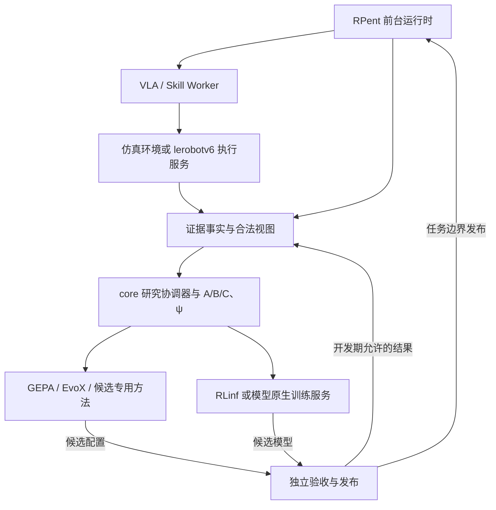

# RSI-Agent-VLA 系统总体设计与代码框架复用方案

版本日期：2026-11-09。依据：[V4 综合评估与方法研究建议（修订版）](VLA_Agent_V4_综合评估报告_2026-11-09.md)、V4 原方案，以及本会话已克隆源码。

本文交付最新版系统分工和代码搭建设计。列出的 `core/`、研究接口和接入改动均为拟建内容；本轮没有创建这些模块、修改上游源码、安装环境或运行模型。A/B/C 全部可继承进化与 H3 仍是完整目标，具体主算法未裁定，Q24 保持未决。

**一、结论：保留 RPent 主运行框架，调整辅助项目地位，并增加独立研究核心。**

报告修订不要求更换 RPent，但要求改变搭建顺序和职责边界。采用“RPent 运行骨架＋独立轻量 core＋按需接入的训练／优化后端”。系统先支持观测、对照和冻结，再接入候选学习方法，避免把 A+C 或某个通用优化器写死在主流程。

| 项目／自研部分 | 最新定位 | 首阶段实际复用 | 后续接入条件 |
|---|---|---|---|
| **RPent** | **唯一主运行框架** | Planner、Toolkit、RobotSpec、环境／模型 RPC、会话与现有可视化 | 为证据和职责干预补必要接入点 |
| **独立 core** | **研究控制与方法实现主体** | 新增实验配置、证据关联、候选与独立验收协议 | 随问题残余增加 A/B/C 和 ψ 的具体规则 |
| **RLinf** | 首条 RPent π₀.₅ 链的匹配模型后端；训练后端 | 复用 RPent 实际调用的加载链与适用 SFT 入口 | 配置、checkpoint、归一化和版本兼容核验通过 |
| **官方 openpi** | 模型源码与原生训练／推理备选 | 阅读和复用模型处理器、独立推理服务接口 | 需要原生训练、第二模型路径或 H4 时增加适配 |
| **ENPIRE** | 研究执行协议和特定实现参考 | 实验记录、权限边界与角色分离设计 | 确实采用其已发布任务／PLD 环境时才调用对应 launcher |
| **GEPA** | 可插拔的配置／文本优化器与强基线 | 暂不作为主方法依赖 | 候选字段、评价和预算接口确定后接入 |
| **SkyDiscover/EvoX** | H3 元搜索参考与适用基线 | 暂不部署整个系统 | 有足够改进问题、需要比较搜索策略进步时接入 |
| **OpenETA** | 证据与经验审查设计参考、备选 Runtime | 借鉴证据／工作记忆分离及评价流程 | RPent 出现具体无法适配的瓶颈时再评估替换 |
| **lerobotv6 副本** | 唯一 Piper 真机执行后端 | 保留设备、采集、部署和已有安全链 | 独立 RPC 适配及项目现场验收；设备操作另需授权 |
| **ReinFlow／DOMINO** | 既有离线工具／按需仿真资产 | 复用确实适用的校验、分析和任务接口 | 研究任务需要时接入，不强制沿用旧 R4 规格 |

这一调整有三项实质变化：ENPIRE 从“可能直接承担后台框架”收紧为协议与适用代码参考；GEPA/EvoX 明确为可替换的优化工具及对照；训练入口从宽泛的“openpi 或 RLinf”收敛到首条已存在的 RPent—RLinf 加载链，再单独评估其他路线。

**二、源码核查改变了哪些设计判断。**

| 本轮源码事实 | 对设计的直接影响 |
|---|---|
| RPent 的 `RobotSpec` 和 `get_toolkit()` 已定义接入职责 | 复用现有运行模型，不再自建通用 Agent 框架 |
| 机器人发现通过顶层 `robots.<name>` 包完成 | 新机器人／研究入口需要实际接入该目录；不能假定已有任意外部插件注册机制 |
| `Toolkit.execute_tool()` 对非 readonly 工具捕获状态并发布 StepRecord | 可复用高层调用记录；它不是逐原生动作全覆盖记录器 |
| `readonly` 也用于文件写入／finish 等不推进环境的工具 | 不能把该标记直接当作文件权限或可信审计级别 |
| DashboardEventSink 包含 StepRecord、Transcript、Usage 等事件 | 可用于界面与高层关联；不能作为 L0 唯一来源 |
| Flywheel 的 EpisodeWriter 把转移暂存在内存，`finalize()` 才写文件 | 可复用对齐与导出规则；需新增逐动作持久记录与缺失标记 |
| LIBERO 默认 Toolkit 启动视频记录，结束时保存 episode 视频 | 研究 A 的实际存储收益时需控制这条记录路径，不能只改变学习器可见数据 |
| LIBERO primitive 用一次 `env.chunk_step()` 执行一段动作 | 工具后才运行的 Watcher 不等于 chunk 内监督，B 需要明确干预粒度 |
| Flywheel 原始记录可保留失败，SFT exporter 只导出成功回合 | 诊断和候选价值学习不能仅消费成功 SFT 数据 |
| `ENPIRE/enpire/policy/autoresearch.py` 是控制请求客户端 | 它不是已经实现的通用假设／实验调度器；后台薄协调器仍需自研 |
| RPent π₀.₅ 服务调用 `rlinf.models.embodiment.openpi.get_model` | 默认模型链应保持这个加载器、配置和处理器的一致性 |
| RPent 依赖声明指定 `RLinf` release 和 `RLinf/openpi` 的 rpent 分支 | 本地克隆的各个 main 与官方 openpi 不是自动兼容的替代品 |

主要证据：[Toolkit](../RPent/rpent/tools/toolkit.py)、[事件边界](../RPent/rpent/dashboard/events.py)、[EpisodeWriter](../RPent/rpent/flywheel/episode.py)、[LIBERO Toolkit](../RPent/robots/libero/toolkit.py)、[primitive 执行](../RPent/robots/libero/tools.py)、[ENPIRE 控制客户端](../ENPIRE/enpire/policy/autoresearch.py)、[π₀.₅ 服务](../RPent/rpent/robots/components/pi05_vla_server.py)、[RPent 依赖](../RPent/pyproject.toml)。

上述是静态源码事实，不是这些组合已在本机跑通的证据。

**三、完整系统分为四个职责域，允许少量进程实现。**

| 职责域 | 负责什么 | 权威对象 |
|---|---|---|
| 前台运行 | 任务阶段、Worker 调用、监督恢复与受限职责决策 | 当前已发布 RunBundle 与实际执行状态 |
| 研究与学习 | 生成假设、选择实验、调用训练／优化、产生候选 | 实验配置、合法证据视图、预算和候选档案 |
| 证据与数据 | 关联事实、选择性保留、成本和缺失；提供按角色的数据视图 | 执行事件与媒体引用；不能由学习器改写旧事实 |
| 独立验收与发布 | 回归、保持、兼容性、接受／拒绝与边界切换 | 保护的评价协议、测试资源和发布决定 |



第一版可以只有前台、后台协调器和独立 evaluator 三类应用进程，模型和环境沿用已有服务。证据先采用每个生产者追加自己的 JSONL 文件，媒体沿用已有数组／图像／视频工具；无需先引入消息队列集群、工作流平台或大型数据库。

发布与评价是独立职责，不要求为它们再建两个大型 LLM。确定性检查、原生环境判据和固定统计过程足够时直接使用。

**四、研究核心的所有权与最小目录。**

建议在现有聚合目录下新增一个独立自研目录 `core/`。克隆项目仍保留各自 Git 历史；研究方法不散落在七个仓库里。以下结构均为拟建，不代表本轮已经创建。

```text
RSI-Agent-VLA/
├── RPent/                         # 主 Runtime，未来维护必要的接入改动
├── RLinf/                         # 已克隆训练源码，运行版本另做匹配
├── openpi/                        # 官方模型源码与专项备选
├── ENPIRE/ OpenETA/ gepa/ skydiscover/
├── core/                          # 新增的研究代码主体
│   ├── pyproject.toml
│   ├── src/rsi_vla/
│   │   ├── contracts.py           # 版本组合、候选、事件与结果的共同定义
│   │   ├── evidence.py            # L0 关联、L1 选择、视图与完整性状态
│   │   ├── cooperation.py         # A/B/C 表示、固定基线、冻结与替换
│   │   ├── research.py            # 有界实验协调与候选生命周期
│   │   ├── evaluation.py          # 公共协议执行、诊断与快照考试
│   │   ├── release.py             # 独立接受／拒绝与发布版本选择
│   │   ├── cli.py                 # 研究运行入口；复用 RPent 执行任务
│   │   └── adapters/
│   │       ├── rpent.py           # 首先接入
│   │       ├── rlinf.py           # 选定训练流程后接入
│   │       ├── gepa.py            # 第二阶段
│   │       ├── evox.py            # H3 阶段
│   │       └── lerobot.py         # 真机接入阶段
│   ├── configs/
│   │   ├── system.yaml
│   │   └── experiments/           # 按问题建立协议，不按算法硬编码主流程
│   └── tests/                     # 与已实现边界相对应的离线反例和集成检查
└── 项目文档/                       # 评估与本设计
```

开始时只实现用得到的文件和适配器；不预建所有后端空类。共同数据结构集中在 `contracts.py`，上游类型转换集中在适配器。环境原生观测、动作、模型处理器和训练数据保留其原有格式，不把它们转换为旧 R4 通用数组。

数据、日志与候选模型放配置指定的外部 artifact 根目录。新研究可定义自己的路径配置；只有调用确实消费旧变量的 ReinFlow 脚本时，才按该脚本要求显式设置 `REINFLOW_DATA_DIR` 和 `REINFLOW_LOG_DIR`。

**五、RPent 怎样接入：先复用工厂与工具，再增加必要的低层观测点。**

首选维护一个范围明确的 RPent 研究接入分支。新增 `robots/rsi_libero/` 作为薄入口，复用现有 LIBERO 工厂、工具与服务；以后新增 `robots/piper/` 接入远端 lerobotv6 服务。该方式符合当前顶层机器人发现逻辑。[发现逻辑](../RPent/rpent/robots/base.py)、[扩展指南](../RPent/docs/source-en/rst_source/development/add_robot.rst)

| 接入位置 | 已有机制 | 拟采用方式 |
|---|---|---|
| `RobotSpec`／工厂 | 提示、运行配置、服务启动和 Toolkit 构造 | 包装原工厂，注入研究配置与版本引用 |
| `Toolkit.add_tool()`、`Tool.with_handler()` | 支持显式替换工具处理器 | 对明确工具增加证据关联／职责选择；保持原 schema 和生命周期 |
| `Toolkit.execute_tool()` | 参数校验、调度、取消、状态捕获 | 高层调用级记录复用；需要覆盖拒绝／失败时增加统一观察钩子 |
| `LiberoPrimitives._step_env()`、`_vlm_chunk()` | 原生 step、proposal 与 chunk 调用 | 增加可选转移观察和 chunk 控制点；默认路径保持原行为 |
| `LiberoEnvFacade`／实际环境后端 | 环境原生执行与返回数据 | 获取实际时间、应用命令或快照时，在拥有相应事实的一侧接入 |
| `DashboardEventSink` | 高层 StepRecord、Usage 和 Transcript | 增加旁路消费者，复用已有 Dashboard；不替代逐动作记录 |

不要用全局 monkey patch 改 Planner、覆盖 Python 导入顺序或复制整份 LIBERO 实现。薄入口可复用公开工厂；若必须依赖私有方法，只在一个适配文件中记录该依赖，并对接入点做版本检查。

工具包装能截获一次 primitive 调用，但该 primitive 可能执行多个动作和内部重试。它只能支撑该粒度的实验。需要 B 在 chunk 内干预时，应在实际执行循环增加控制点，而不能把工具完成后的状态检查称为实时监督。

`env.chunk_step()` 目前在一次 RPC 内运行整段动作。为接入监督改成逐 step 调用，会改变通信、时序和观测协议；如果这样做，要给基线同样执行协议并重新建立数值行为。更细的钩子若置于环境进程内，应在原线程／原控制顺序执行，避免破坏图形上下文和物理节拍。

**六、代码复用映射：直接调用、薄适配和新增部分分开。**

| 目标功能 | 已有源码 | 复用判断 | 仍需补什么 |
|---|---|---|---|
| LLM 交互、工具调度与 transcript | [Planner](../RPent/rpent/planner/base.py)、[ApiAgentLoop](../RPent/rpent/planner/api_loop.py) | 直接复用 | 前台／研究角色的工具集合与输入视图 |
| 工具 schema、错误和取消 | [Toolkit](../RPent/rpent/tools/toolkit.py)、[Tool](../RPent/rpent/tools/base.py) | 直接复用并薄适配 | 研究相关的事件关联；不另建同义工具框架 |
| 单任务状态与媒体工件 | [EnvState](../RPent/rpent/session/base.py) | 复用现有序列化 | 独立 run/episode 目录与研究级版本关联 |
| 图像、状态、动作块采样链 | [LIBERO primitives](../RPent/robots/libero/tools.py) | 优先复用 | L0、A/B 控制点以及实际动作掩码 |
| π₀.₅ 编码与模型请求 | [client](../RPent/rpent/robots/components/pi05_vla_client.py)、[server](../RPent/rpent/robots/components/pi05_vla_server.py) | 首条链直接复用 | 匹配训练输出、归一化和发布元数据 |
| 轨迹对齐和标准 SFT 导出 | [EpisodeWriter](../RPent/rpent/flywheel/episode.py)、[export](../RPent/rpent/flywheel/export.py)、[LIBERO spec](../RPent/robots/libero/flywheel.py) | 复用规则和适用 exporter | 即时事实记录、失败消费路径和选择性媒体 |
| 经验文件权限与合并 | [MemoryManager](../RPent/rpent/memory/manager.py) | 复用 | 研究期间共享记忆的冻结与独立发布控制 |
| 实验边界／记录格式 | [ENPIRE contract](../ENPIRE/enpire/policy/autoresearch_instruction.md) | 复用设计与字段 | 本项目协调器、合法作业配置与 evaluator |
| 特定 PLD 启动 | [ENPIRE launcher](../ENPIRE/enpire/policy/pld/launcher.py) | 条件复用 | 当前映射绑定其任务与 YAM，不直接用于 Piper |
| A/B/C 通用配置优化 | [GEPAAdapter](../gepa/src/gepa/core/adapter.py)、[optimize](../gepa/src/gepa/api.py) | 薄适配 | 把候选映射为有界字段，统一实验和预算 |
| 搜索策略演化 | [run_discovery](../skydiscover/skydiscover/optimize/api.py)、[EvoX](../skydiscover/skydiscover/optimize/search/evox/controller.py) | 后期薄适配 | 只接开发 evaluator，不拥有最终 Gate |
| VLA SFT | [RLinf SFT](../RLinf/examples/sft/train_vla_sft.py) | 首选匹配配方 | 具体模型配置、数据消费者与 checkpoint 往返 |
| 官方模型推理／干预 | [openpi Policy](../openpi/src/openpi/policies/policy.py)、[客户端](../openpi/packages/openpi-client/src/openpi_client/websocket_client_policy.py) | 独立专项适配 | 与 RPent RPC、处理器、噪声和 reset 语义对齐 |
| Piper 执行 | [Piper](/home/user/xzh/lerobotv6/src/lerobot/robots/piper/piper.py)、[FollowerSafety](/home/user/xzh/lerobotv6/src/lerobot/reinflow/follower_safety.py) | 保留已有链 | 外部服务、动作来源和项目现场验收 |

最后一行指向现有 `/home/user/xzh/lerobotv6`，由部署配置定位，不假定它与新项目具有固定相对位置；这些源码没有迁入新研究工程。

新增工作应主要落在三处：研究事实与可见性、A/B/C／ψ 的实验表示、候选—验收—发布的一致性。模型网络、数据解码、通用 RPC、终端、Dashboard 和训练循环优先沿用适用实现。

**七、Evidence Core：先保存可追溯事实，再把 A 接到正确的记录层。**

拟建的 L0 事件至少关联下列字段，未提供的事实必须显式为未知而非填零：

| 字段组 | 最小内容 |
|---|---|
| 身份 | run、任务、episode、事件序号、active_bundle、父 proposal／decision |
| 时序 | 捕获、接收、推理、请求发送、执行／反馈的可得时间；注明时钟域与缺失 |
| 动作 | 模型建议、被选前缀、过滤／覆盖后发送命令、执行有效掩码、测得状态 |
| 来源 | VLA、脚本、恢复、人工接管；请求 Worker 与实际 Worker |
| 决策 | A 保留决定、B 交接决定、相关策略版本及原因 |
| 标签 | 判据来源、success／failure／unknown、监督事件、接管与技术无效 |
| 资源 | 推理／执行费用、媒体字节、作业和人时引用 |
| 完整性 | 丢帧、日志间隙、未完成 episode、写入失败和不可用字段 |

命令、实际控制器应用量和测得运动是不同事实。仿真首先能记录原生命令与返回状态；若控制器内部裁剪未暴露，应说明“应用量未知”，不能把 proposal 当成实际执行。Piper 侧由实际发送与反馈接口提供其可得字段。

L0 由执行事实生产者记录，不能让 A 决定是否保留。L1 在循环缓冲中的媒体上选择持久保存与研究可见性，记录规则及实际选择概率；L2 的内部特征、精细诊断和复测按研究需求及授权启用。记录概率、结果标注概率和修复动作选择概率分别保存，未知时不伪造。

初期可复用完整 Flywheel／视频作为诊断参考，然后在同一数据上构建不同 EvidenceView。这个阶段只验证信息选择效果，不声称实现了实际存储节省。正式评价 A 的记录成本时，需接管真实 L1 持久写入路径，避免完整视频和图像仍在另一条默认链中全部保存。

起步时让 A 只控制研究证据的额外保留与可见性，即时控制所需的观测保持相同。运行时必需的媒体缓存、序列化和模型输入成本作为共同费用记录；Dashboard 与整段录像设置也在各组保持一致。后续研究在线信息路由时，再明确允许改变哪一类控制／规划输入。

Flywheel 的内存列表和回合结束 finalize 不能承担中断时的 L0 完整性保证。可先实现轻量追加记录与有界缓冲，并记录缺失状态；日志故障按安全边界处理，不能用磁盘 I/O 无限阻塞底层控制。未完成记录仍可用于标注过的诊断，但不应伪装成完整训练／验收 episode。

工作记忆、合法研究证据和受保护评价材料采用不同视图。OpenETA 的分层原则可借鉴，但其完整 recorder 与 runtime、协议、工件体系有依赖，不宜整模块直接搬入 RPent。[OpenETA 记录合约](../OpenETA/docs/rollout-data-contract.md)

**八、A/B/C 与 ψ 的代码位置：表示与算法解耦。**

在 `cooperation.py` 先定义配置与调用边界，初期使用固定策略作为基线。学习器可以后接入，不要求先实现一个专用协同算法。

| 对象 | 拟定输入与输出 | 首个实现 | 后续扩展 |
|---|---|---|---|
| A | 合法事件／缓冲信息 → 保留、压缩、路由与概率 | 固定／分层保留，保护基础审计 | 候选价值取证或其他路线 |
| B | 阶段、Worker 状态与监督信息 → 执行／接管／恢复选择 | 透传现有分配，记录请求与选择 | 简单校准、可学习交接 |
| C | 证据视图、可用修复和预算 → 实验／修复／暂缓 | 固定修复顺序 | Bandit、GEPA 或专用学习规则 |
| ψ | 研究状态与可信实验结果 → 后续研究决策／策略修订 | 明确可冻结的固定研究协议 | 可继承参数、规则或程序更新 |

Planner 提出任务意图，B 决定已授权 Worker 之间的执行分配，底层执行服务保留最终动作约束。需要明确谁是某一决定的唯一执行入口，避免 Planner 和 B 各自发命令。B 的高层交接频率与底层安全监测频率分开；LLM 不进入硬实时控制循环。

φ 的工具／恢复实现与 ρB 的选择配置分别引用。ρC 可以是 ψ 的子配置；可使用一个实现引擎和共享参数，但实验需要保存实际冻结范围，不能把同一次修改重复报告成两个独立增益。

早期配置可用命名组件和有界字段表达，GEPA 输出先解析和校验，再作为候选运行。不能让文本候选直接覆盖安全、最终评价或前台有效版。是否允许开放式代码更新，是后续具体实验的选择。

**九、后台研究：复用 Planner 能力，新增薄协调器，不把 ENPIRE 当现成总调度器。**

`research.py` 管理少量候选和串行／有界作业：读取合法证据 → 记录竞争解释 → 指定试验 → 调用适配器 → 收集结果 → 生成候选或暂缓。第一版单机、一个后台 worker 即可；复杂并发只有吞吐证据支持时再增加。

Research Agent 可以复用 RPent 的 `Planner.solve()` 和 Toolkit，而配一套独立研究工具：读取证据、比较版本、提交固定实验配置、调用训练配方、查看作业结果、提交候选。前台工具与后台工具分别注册；后台不持有真实设备发送接口、最终测试材料或发布写权限。

后台 Toolkit 仍需实现其作业状态捕获和结束语义。`Toolkit.get_env_state()` 在基类中是抽象接入点，研究工具执行后应返回研究作业状态与记录，不应尝试捕获机器人观测；也不能仅靠把所有作业标为 readonly 来绕过状态记录。

RPent 的 common file 工具授权由 MemoryManager 提供；`readonly=True` 是调度语义，不能替代角色权限。尤其不要据此自动把 `write_text_file` 暴露给所有角色，或把 Agent 的 `finish(success)` 当作独立任务成功。

ENPIRE 的研究契约可直接用于定义一次实验应保留的假设、输入版本、差异、预算、结果和决定。其 `autoresearch.py` 提供的是 health／pause／restart 等客户端请求；其 PLD launcher 还固定了任务和设备配置。只有采用对应环境时才作为执行后端复用，不能仅凭函数名把它接成通用 Meta-RSI。

研究协调器只应启动自己拥有的作业，并按已授权预算监督到终点。训练／仿真／模型查询需要相应运行授权；本设计文档不启动它们。

**十、训练与模型：首条链跟随当前加载器，避免维护两套同义路径。**

本轮确认 RPent π₀.₅ 服务调用 RLinf 的 `get_model()`，客户端负责环境观测编码并使用 RPent RPC。官方 openpi 的 `Policy.infer()` 和 WebSocket 客户端具有另一套接口。故第一条 LIBERO 链优先复用 RPent 已有模型服务、匹配的 RLinf/openpi 依赖与 SFT 数据路径。

RPent 当前依赖声明不是“安装已克隆的所有 main”：它指定 RLinf release 和专用分支。搭建时需要选择并记录实际匹配版本；当前七个克隆快照只能作为源码基础。此处没有授权切换分支、安装依赖或下载新仓库。

训练配方也必须与模型一致。例如本地 [libero_sft_openpi.yaml](../RLinf/examples/sft/config/libero_sft_openpi.yaml) 包含 `pi0_libero` 设置，不能原样改路径后就称为已验收的 π₀.₅ 配方。需要核对模型类型、数据字段、图像处理、归一化、精度、动作执行前缀与输出加载器。

`TrainingBackend` 的拟定职责很窄：接收经过校验的数据引用、起点模型、完整配置和预算，启动原训练器，返回 candidate checkpoint、处理器／归一化引用、实际成本和退出状态。不要在 core 里重写优化器或训练循环。

官方 openpi 后续用于原生模型或 H4 时，通过独立 adapter 接入。特别是本地 `Policy.infer(noise=...)` 支持显式噪声，而其 WebSocket 客户端公开 `infer(obs)` 没有相同参数；不能只因模型内部存在该能力，就宣称远程复现实验支持固定噪声。reset、噪声控制、内部特征与编辑能力按实际后端声明。

训练后必须做 producer—consumer 往返：数据 exporter → 原训练器 → checkpoint／统计量 → 实际前台加载器 → 解码动作。检查成功仅支持该版本与该接口，不代表任务能力已提高。

**十一、实验能力先于主算法：同一执行器支撑四类研究入口。**

| 入口 | 代码职责 | 应复用的部分 | 本入口不能声称什么 |
|---|---|---|---|
| 固定轨迹诊断 | 同一完整参考生成不同 EvidenceView，比较下游选择 | 已有轨迹读取、Exporter 规则与原始记录 | 不证明真实记录节省或长期交互收益 |
| 交互式方法比较 | 同起点、固定外部任务流，允许 A/B/C 改变后续数据 | RPent 执行、环境判据、适配器 | 不将内部报警率当总体失败率 |
| 更新后 B 再适应 | 固定新 θ 和技能，替换旧 B／简单校准／学习 B | 同一前台与 Worker | 不要求每次模型更新都必须重学 B |
| ψ 快照考试 | 在共同 S0、记忆、证据与预算下比较早／晚 ψ | 同一实验调度和结果聚合 | 不用前台增强或记忆增长代替 H3 |

`evaluation.py` 复用这些公共执行流程，但开发和最终评价采用不同权限与数据范围。GEPAAdapter.evaluate 和 EvoX evaluator 只接开发／指定验证接口，它们的内部“接受候选”不等于本系统正式发布。

GEPA 的 metric calls 不是机器人交互、GPU 时间和人工成本的统一单位；EvoX 的 iterations 也不是统一成本。实际账本在执行／训练侧记录，优化器只获得剩余允许预算。模型调用、失败候选、验证和未发布训练同样计费。

需要同初态机制实验时，先验证后端的 snapshot／restore 能力。当前 RPent LIBERO 环境 façade 没有公开任意中间状态的快照 RPC；固定 seed 的 reset 不能替代这项能力。若必须新增，保持 evaluator-only，并明确恢复控制器、随机数、策略历史与动作队列的范围。

**十二、候选、验收与发布：一份版本组合，一条正式写入路径。**

建议采用少数共同数据对象，而不先建立庞大 schema 系统：

| 拟建对象 | 必要内容 | 主要生产者／消费者 |
|---|---|---|
| BackendSpec | 观测／动作规格、单位、时钟、控制协议和可用能力 | 后端生产，模型／运行配置消费 |
| RunBundle | 模型、处理器、φ、A/B/C、ψ、记忆和协议的版本引用 | 发布端生产，前台和实验消费 |
| ExecutionEvent | 第七部分的事实与缺失 | 执行侧生产，合法证据视图消费 |
| ExperimentResult | 起点、变体、数据范围、预算、结果与完整性 | 实验器生产，研究者与 evaluator 消费 |
| Candidate | 基准 RunBundle、实际修改范围、产物及开发结果 | 研究侧生产，独立验收消费 |
| GateDecision | 使用协议、通过／拒绝／未决、原因、兼容性和成本 | 独立评价生产，发布端消费 |

正式流程为：candidate → independent evaluation → accepted／rejected／inconclusive → eligible release → task-boundary activation。拒绝保留旧版，负结果继续留存。当前 active version 已改变时，基于旧版的候选不能无条件叠加；重新声明适用起点并验收，而非后台直接覆盖前台配置。

回归评价可以复用原生环境判据和已有 evaluator，但成功、旧能力保持、安全／兼容和数据完整性分别判定。候选优化器不得修改同一次比较的判据。发布只切换兼容版本组合，并处理旧动作队列和内部状态。

原始事实、工作记忆、开发验证与最终封存测试各自有读写边界。前台仍可获得完成任务所需的实时反馈；隔离的是受保护的测试材料和优化用标签，而非禁止机器人闭环观察。

**十三、环境与进程组织：按实际依赖分隔，先单机少量服务。**

| 环境／进程 | 建议 | 说明 |
|---|---|---|
| core 与 RPent 应用 | 优先评估 Python 3.11 组合 | RPent 声明 Python ≥3.10、<3.13；不是当前 ReinFlow 3.8 环境 |
| 模型与仿真 | 跟随 RPent 已匹配的依赖／服务 | 感知模型依赖有冲突时沿用其独立进程方式 |
| RLinf 训练 | 独立匹配环境 | 不把本地最新 main 与 RPent 固定依赖视为已兼容 |
| 官方 openpi | 需要时独立环境 | 不让它替换 RPent 分支依赖的同名模块 |
| Piper | 保持 lerobotv6 现有环境 | 跨进程传递明确的观测与动作，不在 core 里打开设备 |
| GEPA／EvoX | 需要时增加独立优化作业 | 通过 candidate／result 文件或小接口衔接 |

外部进程启动采用结构化参数和明确配置；以作业和版本引用关联结果。初期一个后台 worker 加本地文件即可，吞吐确实不足时再引入并发。模型服务和训练可能争用显存，前台不阻塞是需要实测和资源限制的目标，不能由“两个进程”自动保证。

未批准的模型／资产下载、包安装、训练、仿真和设备操作仍不执行。当前设计不要求修改已有三个工程环境。

**十四、分阶段搭建与验收：先证明接入没有改变语义，再证明研究效果。**

| 阶段 | 最小工作 | 对应检查 | 支持的结论 |
|---|---|---|---|
| 离线数据层 | contracts、事件导入、EvidenceView、固定 A/B/C 和候选记录 | 未知标签、重复／缺失关联、视图越界、实际概率字段 | 只证明离线记录与比较管线 |
| RPent 单任务接入 | 薄 robot 入口、高层和动作级记录点 | 原 primitive 数值／顺序不变；proposal 与执行前缀对齐 | 证明所测后端的记录接入 |
| P0 更新闭环 | 一个明确修复入口、独立 evaluator、边界切换与拒绝 | 旧起点候选、缺归一化、未结束队列、拒绝后维持旧版等反例 | 证明具体条件下合法更新闭环 |
| 科学问题诊断 | 固定轨迹、简单审计／校准与最小交互对照 | 分母、成本、合法信息与结果来源 | 判断是否存在有价值残余 |
| 专门方法与强对照 | 确定具体规则后接 GEPA／其他适用优化器 | 相同权限、字段、总预算、反馈干预与独立重复 | 支持范围明确的 H1/H2 |
| H3、Piper、H4 扩展 | 按证据依赖逐项加入 | 快照考试、现场门检、内部干预及保持 | 分别支持对应主张 |

离线 mock／回放即使能走完 candidate—release 状态，也不能作为真实机器人 P0 验收。GPU 和现场阶段在获得具体授权后执行，验收结果按所测实现与条件陈述。

优先写的是能发现边界错误的检查：例如 A 无权隐藏 L0、不能把缺失结果视为成功、被拒绝候选不改变有效版、最终测试结果不能进入优化器。不要为尚未实现的所有后端预写大套镜像测试。

**十五、当前可以固定的设计与继续开放的研究选择。**

现在可以固定：RPent 主运行骨架、独立 core、Piper 经 lerobotv6、训练随实际加载链、事实与视图分离、正式发布由独立路径控制，以及优化器通过统一实验接口接入。

继续开放：A+C、B+C 或其他关系的主方法，证据价值估计规则、ψ 的参数化与学习方法、H4 的编辑目标、第二动作生成类型和是否增加仿真平台。Q24 不因存在后台队列而被自动裁定；队列服务与主动机会选择算法是两件事。

基于当前静态证据，最直接的搭建顺序是：独立 core 的离线证据与实验骨架 → RPent 单任务及动作级关联 → 原有匹配训练链的一次候选往返 → 独立验收和边界发布 → 问题诊断与具体学习算法。这样既尽量复用现有功能，也保留对算法路线的辨别能力。

**附：证据、维护和本轮交付范围。**

本文按本会话已克隆快照分析：RPent `c41c0e6`、OpenETA `b022602`、ENPIRE `99ee90a`、SkyDiscover `0d932b6`、GEPA `cb7674c`、openpi `215abfb`、RLinf `1bf7898`。另复核作者当前 [RPent 扩展说明](https://github.com/RLinf/RPent/blob/main/docs/source-en/rst_source/development/architecture.rst) 与 [ENPIRE 控制客户端](https://github.com/NVlabs/ENPIRE/blob/main/enpire/policy/autoresearch.py)，用于核对关键职责。

未来修改上游集成时，应保留许可与归属，维护实际改动，不复制整库后失去来源。上游内建测试按触及范围执行；对旧 Piper/R4 链的代码／规格变更继续遵循其既有检查。本轮仅新增设计文档，未触发这些运行检查，也未将文档中的拟建接口写成已经完成的代码。
