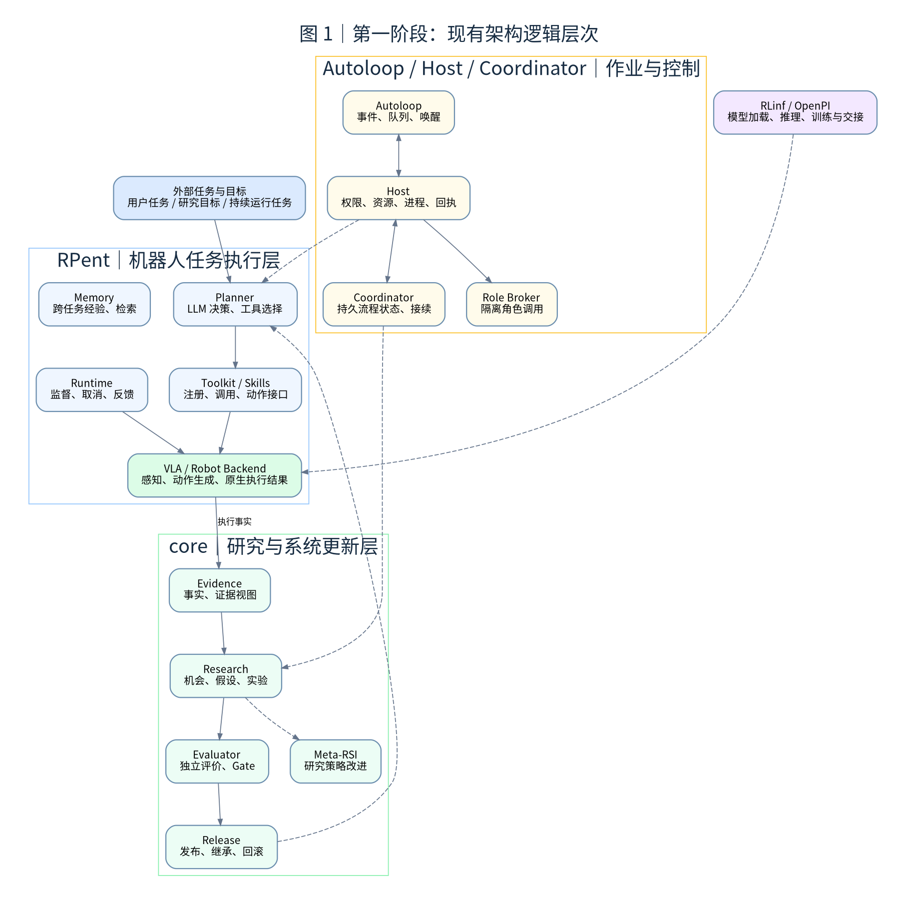
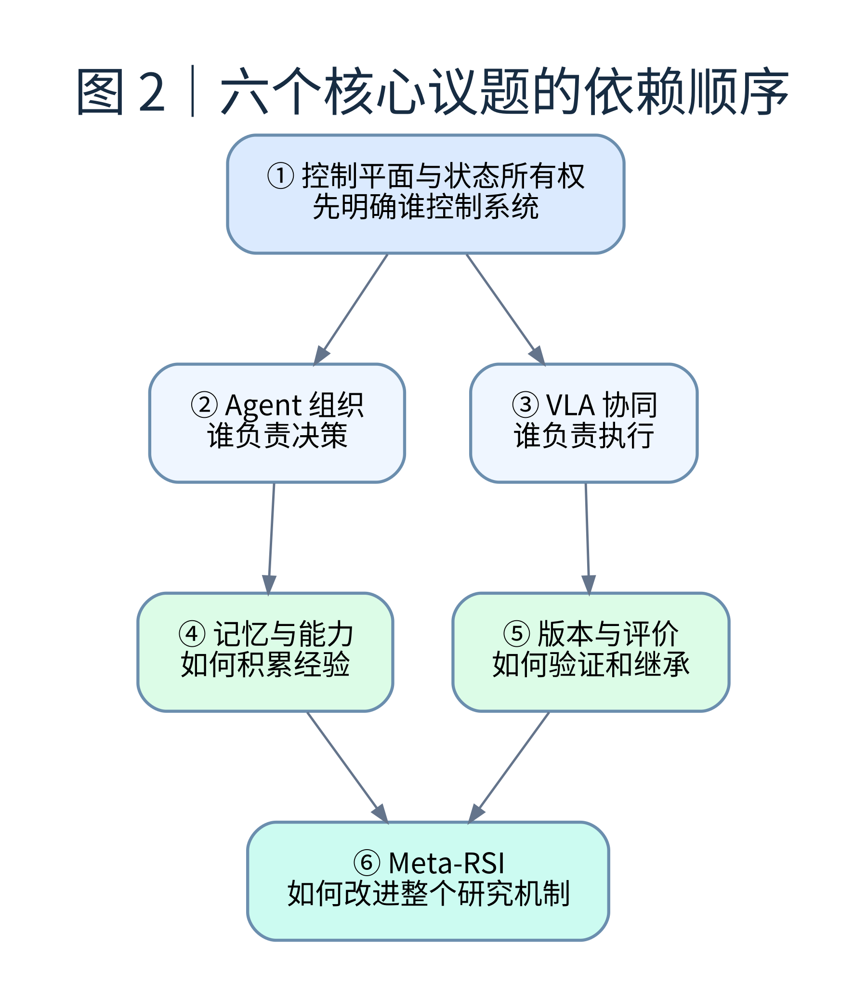
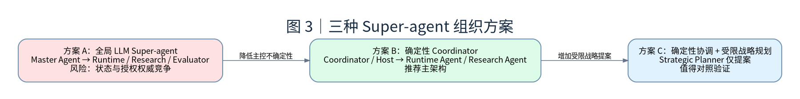
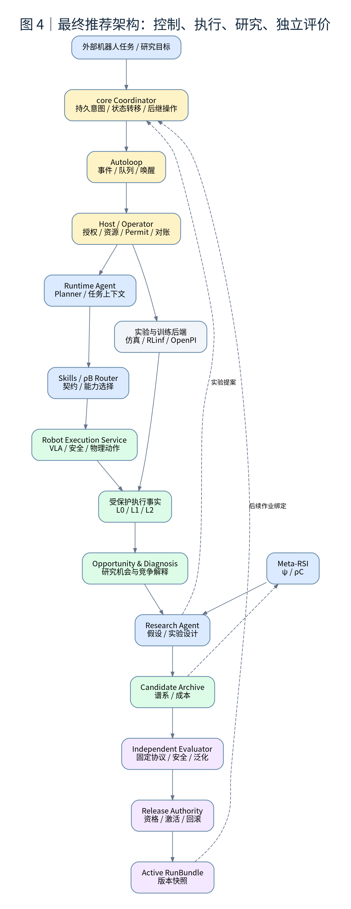
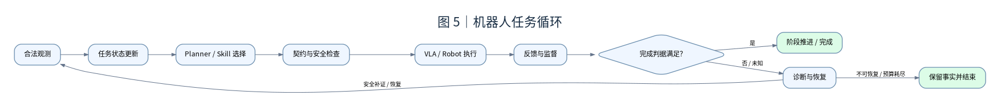
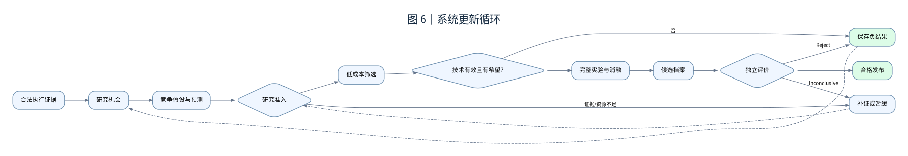
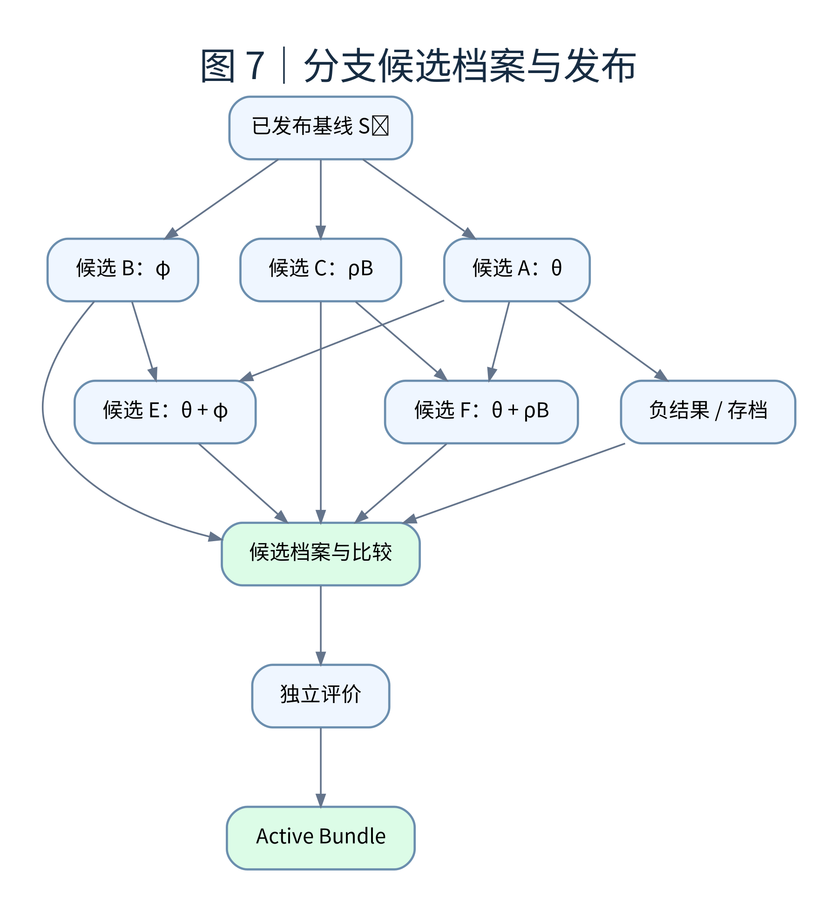
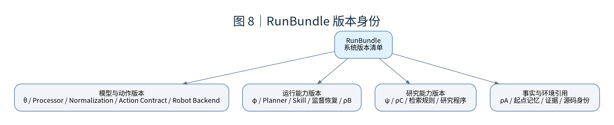
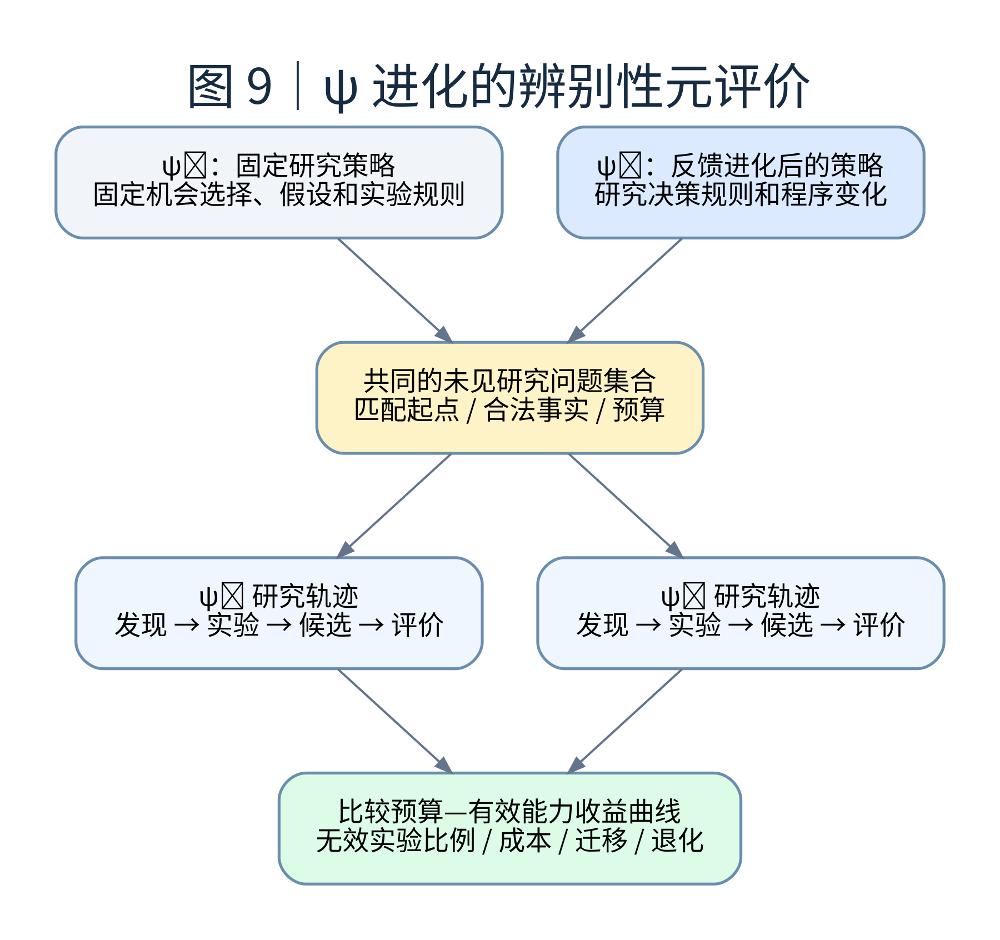
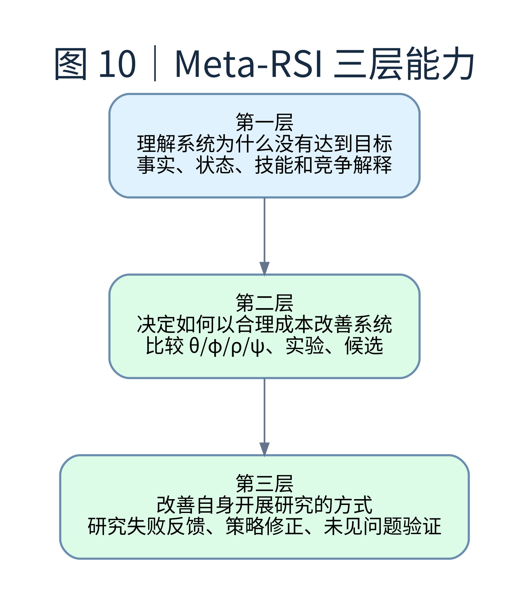

# RSI-Agent-VLA 架构诊断：逐消息会话记录（可见内容转录）

> **记录性质与限制**：以下按当前会话中可见的用户和助手消息顺序转录，保留文字、Markdown 表格、公式、链接，以及原助手消息中用于表达图形的 Mermaid / 图形组件源码。这里没有可调用的 ChatGPT 平台原始会话导出接口，因此本文件**不能声称是平台生成的逐字原始导出**；图片的像素级渲染也不能直接从聊天界面提取。为尽可能保留非文字信息，另附可编辑的图形源码和独立 SVG 重建图。图形素材见同名 `架构诊断完整对话记录_素材/`，可一并下载 ZIP。本文档前置标题、消息标识和说明属于归档结构，不是原始消息的一部分。
>
> **内容范围**：本轮需求之前的完整架构探讨、后续生成文档的请求与回答，以及本次修订请求。系统/开发者指令、隐藏思考与工具执行日志不属于用户可见会话消息，不在记录范围内。

---

## 消息 01｜用户

# RSI-Agent-VLA 项目架构深度探讨：跨 Agent 架构借鉴与系统优化

我的 RSI-Agent-VLA 项目已上传到 GitHub：

[https://github.com/Xuruiyi/RSI-Agent-VLA](https://github.com/Xuruiyi/RSI-Agent-VLA)

我希望你结合项目仓库文档、必要源码，以及当前有代表性的 Agent 架构，对我的项目开展一次深入的架构思考与探讨。

**本次任务的核心不是写 Agent 技术综述或论文调研报告，而是借鉴不同 Agent 的优秀设计，分析如何完善和优化 RSI-Agent-VLA 的系统架构。**

我希望你能够真正理解不同 Agent 的设计思想，判断哪些机制适合我的项目，哪些不适合，以及应该如何修改和组合。你可以质疑现有设计、提出替代架构，但必须说明理由和依据。

---

# 一、项目定位与现有架构

## 1. 项目定位

RSI-Agent-VLA 是面向机器人操作的持续自进化系统。

整体架构中，Super-agent 负责组织任务、调用工具、监督执行与恢复；VLA 提供感知到动作的执行能力；Meta-RSI 从执行经验中发现改进机会，组织研究与实验，提出更新；独立评价与发布机制决定哪些更新进入后续任务。

系统围绕三个循环组织：

- **任务循环：** 观测、决策、动作、反馈与恢复。
- **系统更新循环：** 执行经验、研究机会、假设与实验、候选更新、独立评价、发布与继承。
- **元改进循环：** 利用研究反馈更新研究策略，改善后续诊断、实验设计与更新选择。

## 2. 主要架构层次

### RPent：任务执行与机器人交互层

RPent 是主要执行底座，承担：

- Planner 及模型调用适配。
- 工具注册、调用与结果返回。
- 会话、观测、记忆与运行状态管理。
- 技能、VLA 及其他动作能力的调用。
- 执行监督、恢复和机器人接入。
- 执行事实、原生结果及相关证据的记录。

机器人专属实现位于 `robots/<robot>/`；共享执行与接口能力位于 `rpent/`。LIBERO 是其中一个具体集成，整体架构面向可扩展的机器人与动作后端。

### core：研究、更新与版本管理层

core 是自研模块，连接执行经验与系统更新，主要承担：

- 证据组织、任务完成与研究机会管理。
- 研究请求、实验协调、候选生成与提交。
- 协作关系和研究策略的反馈与更新。
- 数据、训练、模型加载和评价的交接。
- 独立评价、候选接受或拒绝、发布与版本继承。

core 通过适配器调用执行和训练能力。机器人动作执行、原生模型训练等能力沿匹配的底层实现接入。

### Autoloop 与宿主：调度及作业生命周期层

Autoloop 提供事件、队列、定时唤醒与 worker 等通用机制。

项目宿主和 core 业务消费者负责：

- 根据结果选择后继操作。
- 准备与派发具体作业。
- 协调资源、权限与运行边界。
- 管理长作业、回执、中断恢复和清理。

运行 Agent 组织当前机器人任务；Research 负责跨任务改进；调度层负责让这些作业按条件推进。三者通过明确的任务、状态与结果接口协作。

### 模型与训练后端

当前主模型链采用匹配的 RLinf/OpenPI 实现，支持 π0.5 的加载、推理及训练接入。

RPent 连接模型推理与机器人环境；core 组织数据、训练和版本交接。模型、处理器、归一化及动作合约共同构成执行版本的一部分。

同级 RLinf/、openpi/ 源码目录与实际运行时安装实现分别管理，不能默认二者相同。

## 3. 系统中的可更新对象

项目采用以下工作记号：

[\
S=(\theta,\phi,\psi,\rho),\qquad\
\rho=(\rho_A,\rho_B,\rho_C)\
]

- θ：VLA 模型及相关处理器。
- φ：任务执行、技能、监督与恢复能力。
- ρA：信息获取、保留、压缩与路由关系。
- ρB：职责分配、技能选择、交接与接管关系。
- ρC：更新对象、方法、顺序与预算策略。
- ψ：诊断、实验设计、收益判断及更广义的研究策略。

这些是职责划分，不假定它们在实现上完全独立。例如 ρC 可以是 ψ 的子配置，ρB 可以与 φ 共享实现。

事实记忆、合法证据、训练数据、任务状态和预算状态也会影响行为，需要与运行版本及研究起点建立关联。

## 4. 整体交互方式

外部任务进入执行层，由 Super-agent、工具、技能和 VLA 完成交互。

执行层产生观察、动作反馈、任务结果和成本等事实。研究层消费合法证据，提出补充观察、实验或更新候选；必要时再次调用执行或训练能力。

候选经过独立评价后被接受、拒绝或保留为未决。通过发布条件的更新在适用边界激活，后续任务消费明确绑定的新版本。

前台任务执行与后台研究可以分开推进。已启动作业绑定其起点版本，更新通过版本交接进入后续作业。

## 5. 仓库阅读入口

优先阅读：

- `项目文档/00_项目总纲与研究边界.md`
- `项目文档/01_系统设计与框架复用.md`
- `core/README.md`
- `RPent/README.md`

按需查阅：

- `RPent/rpent/planner/`、\`session/\`、\`tools/\`、\`memory/\`、\`robots/\`
- `RPent/robots/libero/`
- `core/src/rsi_vla/`
- `agent-autoloop/README.md` 及相关接口
- `config/` 与 `scripts/` 中的实际接线

文档用于理解架构目标，源码及调用方用于核对实际职责和接口。请区分设计目标、已有实现和历史方案。

本次暂不展开项目当前实验进度、运行结果或执行排期。

---

# 二、借鉴的 Agent 架构及代表系统

围绕以下六个方向开展比较。

**每个方向严格以三个代表系统为主要研究对象，不要继续扩展成庞大的 Agent 名录。**

优先选择开源高星项目、具有代表性的优秀论文，以及与本项目关系最密切的系统。需要提供项目或论文的直接链接，并核对资料的真实性、时效性及开源状态。

不需要详细介绍每个系统的全部功能，只需要理解其核心架构、关键机制、优缺点，以及对本项目的借鉴价值。

## 方向 1：单 Agent、Tools 与 Skills

代表：

1. Claude Code：[官方文档](https://docs.anthropic.com/en/docs/claude-code/overview)
2. mini-SWE-agent：[GitHub](https://github.com/SWE-agent/mini-swe-agent)
3. OpenHands：[GitHub](https://github.com/OpenHands/OpenHands)

重点探讨：

- 单 Agent + Tools + Skills 为什么可能优于复杂多 Agent？
- 如何划分 Agent 自主决策与确定性代码执行的边界？
- 如何组织 Planner、工具、技能、记忆和执行反馈？
- 如何避免一个 Agent 职责无限膨胀？
- 什么情况下需要委派专业子 Agent？
- 如何让 Skills 形成可积累、可组合、可复用的能力体系？

结合 RPent 的现有设计，判断是否应该进一步优化 Planner、Tools、Memory 和 Skill 的职责与关系。

## 方向 2：事件驱动、持续运行与 Agent 编排

代表：

1. Agent-Autoloop：[GitHub](https://github.com/KKKKhazix/agent-autoloop)
2. DeepSeek Super-Agent：[GitHub](https://github.com/DeepSeek-ai/dsh-superagent-prototype)
3. OpenClaw：[GitHub](https://github.com/openclaw/openclaw)

重点探讨：

- 如何组织长期运行的 Agent？
- 如何实现事件驱动、定时唤醒、任务接续和失败恢复？
- 如何管理多个任务的状态、优先级和资源？
- 如何避免上下文无限膨胀、Agent 空转和重复执行？
- 是否需要 Router、Worker、Watchdog 等角色？
- 如何划分 Autoloop、宿主、core 和 Agent 的职责？
- 运行 Agent 和 Research Agent 是否应该相互隔离？

尤其深入比较 Agent-Autoloop 与 DeepSeek Super-Agent 的架构思想。

注意区分 DeepSeek 的架构设计、公开原型和正式产品，不要将研究原型视为完整生产系统。

重点不是照搬某种 Super-Agent 架构，而是判断我的项目是否需要全局协调者、多个独立 Worker，以及怎样实现更合理的任务生命周期管理。

## 方向 3：多 Agent 协作与工作流

代表：

1. LangGraph：[GitHub](https://github.com/langchain-ai/langgraph)
2. CrewAI：[GitHub](https://github.com/crewAIInc/crewAI)
3. Microsoft Agent Framework：[GitHub](https://github.com/microsoft/agent-framework)

重点探讨：

- 单 Agent、主 Agent + 子 Agent、Router + Worker 和多 Agent 协作各自适合什么场景？
- 如何决定是否拆分 Agent？
- Agent 之间应该如何传递任务和结果？
- 如何管理上下文隔离、共享状态与协作冲突？
- 哪些流程应该由状态机管理，哪些应该由 LLM 动态决策？
- 如何避免重复编排、职责重叠和通信成本过高？

结合运行 Agent、Research、Evaluator、训练和评价等现有职责，设计合理的协作关系。

特别注意：不要因为某个框架支持多 Agent，就建议我的系统采用大量专业 Agent。

## 方向 4：自主科研与实验闭环

代表：

1. ScientistTwo：[论文](https://arxiv.org/abs/2609.19644)
2. AI Scientist-v2：[论文](https://arxiv.org/abs/2504.08066) · [GitHub](https://github.com/SakanaAI/AI-Scientist-v2)
3. Google AI Co-Scientist：[Nature 论文](https://www.nature.com/articles/s41586-026-10644-y)

重点探讨：

- 如何从机器人执行经验中发现值得研究的问题？
- 如何形成和筛选研究假设？
- 如何管理多个竞争性假设？
- 如何设计低成本初筛和完整实验？
- 如何利用失败实验指导下一轮研究？
- 如何通过消融实验判断改进是否真正有效？
- 如何把评价意见转化为新的实验？
- 如何实现候选的独立评价，避免自我评价偏差？

重点借鉴 ScientistTwo 的假设生成、实验筛选、消融驱动改进、审稿反馈和完整性审计机制。

但不要直接复制其多 Agent 结构。需要判断哪些机制应该进入 core，哪些属于 Research Agent 内部，哪些应该由确定性程序实现。

## 方向 5：自动搜索、Agent 自我改进与递归进化

代表：

1. ADAS：[论文](https://arxiv.org/abs/2408.08435)
2. Darwin Gödel Machine：[论文](https://arxiv.org/abs/2505.22954) · [GitHub](https://github.com/jennyzzt/dgm)
3. AlphaEvolve：[论文](https://arxiv.org/abs/2506.13131) · [GitHub](https://github.com/google-deepmind/alphaevolve)

重点探讨：

- 如何让 Agent 优化自己的工作流、架构和策略？
- 如何管理多个候选方案，而不是只进行局部迭代？
- 如何利用历史实验形成候选档案？
- 如何平衡探索与利用？
- 如何避免改进过程过拟合和能力退化？
- 如何判断 Agent 真的变强了，而不是仅仅提高了某个基准分数？

结合 S=(θ,φ,ψ,ρ)，重点讨论：

- θ：VLA 模型与处理器的改进。
- φ：任务执行、技能、监督和恢复机制的改进。
- ρA：信息管理和路由机制的改进。
- ρB：职责分配、技能选择和交接机制的改进。
- ρC：更新对象、更新顺序和预算策略的改进。
- ψ：诊断、实验设计、研究选择及改进机制自身的进化。

特别关注：

**如何让 Meta-RSI 不仅能够改进机器人系统，还能改进自身发现问题、提出假设、设计实验和判断收益的能力？**

需要区分普通任务纠错、持久经验积累、Agent 策略进化和改进机制自身进化。

## 方向 6：具身 Agent 与 VLA 协同

代表：

1. SayCan：[论文](https://arxiv.org/abs/2204.01691)
2. Voyager：[论文](https://arxiv.org/abs/2305.16291) · [项目网站](https://voyager.minedojo.org/)
3. Gemini Robotics ER 1.6：[官方介绍](https://deepmind.google/blog/gemini-robotics-er-1-6/)

重点探讨：

- 高层 Agent 与低层 VLA 应该如何分工？
- Agent 应该负责任务规划、技能选择、动作调用还是具体动作控制？
- VLA 执行失败如何反馈给 Agent？
- 如何区分感知、规划、动作生成和环境扰动造成的失败？
- 如何实现执行监督、恢复、技能积累和跨任务复用？
- 如何将机器人执行经验转化为训练数据和研究证据？
- 如何考虑真实机器人动作的不可逆性、安全性和执行成本？

重点分析 Agent 与 VLA 的职责边界，以及如何避免高层 Agent 不必要地介入低层控制。

---

# 三、围绕项目开展的核心架构探讨

完成必要的代表系统比较后，请将研究重点转回 RSI-Agent-VLA。

不需要对所有 Agent 逐个写长篇综述，而是围绕以下六个核心问题开展深入讨论。

## 问题 1：整体架构与模块边界是否合理？

重点分析：

- RPent、core、Autoloop、宿主之间的职责是否清晰？
- Super-agent、运行 Agent、Research 和 Evaluator 应该如何组织？
- 哪些能力属于通用执行底座？
- 哪些能力属于自研研究业务？
- 哪些工作应该由 Agent 完成，哪些应该由确定性程序完成？
- 是否存在职责重叠、过度封装、控制权不清或不必要的复杂度？

请特别审查 RPent 与 core 的边界，以及 Autoloop 与宿主的边界。

## 问题 2：Super-agent 应该采用什么组织方式？

重点比较：

- 单主 Agent + Skills。
- 主 Agent + 专业子 Agent。
- Router + 多 Worker。
- 确定性工作流 + Agent 决策。
- 事件驱动的 Agent Runtime。

结合机器人任务和跨任务 Research 的不同特点，提出合理的组织方式。

重点讨论运行 Agent 和 Research 是否应该拥有独立的上下文、记忆、权限和执行环境，以及如何共享必要的经验与证据。

## 问题 3：如何完善三个闭环？

分别讨论：

**任务循环：**

观测 → 决策 → 动作 → 反馈 → 诊断 → 恢复。

如何提升长时程任务执行、失败定位、策略调整和机器人安全性？

**系统更新循环：**

执行经验 → 证据 → 研究机会 → 假设 → 实验 → 候选更新 → 独立评价 → 发布 → 版本继承。

如何筛选研究机会、组织实验、管理候选和控制更新风险？

**元改进循环：**

研究反馈 → 策略诊断 → 研究策略更新 → 后续研究。

如何判断研究策略是否有效，以及如何真正提升 ψ 的能力？

重点关注三个循环之间的关系，避免形成重复、相互竞争或无限递归的控制流程。

## 问题 4：如何优化 S=(θ,φ,ψ,ρ) 的进化机制？

重点讨论：

- 不同更新对象如何分类？
- 哪些对象应该独立更新，哪些需要组合更新？
- 如何选择更新对象和顺序？
- 如何维护多个竞争性候选？
- 如何评价局部收益和整体收益？
- 如何避免更新之间相互干扰？
- 如何管理研究策略、运行策略和模型版本之间的关系？

如果现有记号不够合理，可以提出调整，但不要为了形式上的完整性强行增加复杂抽象。

## 问题 5：如何管理记忆、证据与版本？

重点讨论：

- 任务内记忆与跨任务记忆的边界。
- 原始执行事实与 Agent 总结的区别。
- 研究假设、实验记录和可复用知识的管理。
- 记忆与证据的关系。
- 证据来源、任务、时间和版本的关联。
- 模型、处理器、归一化、动作合约、Skill 和 Agent 配置的版本绑定。
- 正在运行的任务如何固定起点版本。
- 更新如何安全地进入后续任务。

特别关注独立评价、发布、回滚和证据可追溯性。

## 问题 6：如何控制系统复杂度和计算成本？

重点讨论：

- 是否真的需要更多 Agent？
- 哪些能力可以通过现有 Agent + Skills 实现？
- 哪些任务需要并行 Worker？
- 哪些流程适合状态机？
- 哪些研究值得投入昂贵实验？
- 如何分配模型、GPU、仿真和真实机器人资源？
- 如何避免研究系统本身消耗过多资源？
- 如何衡量架构复杂度带来的实际收益？

始终以机器人研究的实际需求为依据，不追求模块数量和 Agent 数量。

---

# 四、最终需要形成的架构建议

在充分理解项目和讨论核心问题后，形成一套推荐的架构优化方案。

重点回答：

1. 当前架构哪些设计值得保留？
2. 哪些模块的职责或接口需要调整？
3. 哪些机制值得从其他 Agent 借鉴？
4. 哪些机制应该改造后采用？
5. 哪些复杂设计没有必要引入？
6. 三个闭环应该如何组织？
7. Super-agent、Research、Autoloop 和 core 应该如何协作？
8. 如何让系统具备真正可验证的持续自我改进能力？

请给出：

- 推荐的整体架构图。
- 核心模块职责及边界。
- 三个闭环的交互关系。
- 关键数据流和控制流。
- 核心状态与版本管理建议。
- 当前架构与推荐架构之间的主要差异。

如果存在明显的架构争议，可以给出两种竞争方案并分析取舍，不需要为了形式完整而设计大量方案。

对于重要架构建议，说明：

- 解决什么问题。
- 借鉴哪个系统的什么机制。
- 为什么适合本项目。
- 需要改变哪些模块或接口。
- 预期收益和新增成本。
- 有什么替代方案。
- 如何通过实验验证是否值得采用。

最终应形成一份简洁的架构决策表：

| 架构问题 | 当前设计 | 推荐调整 | 主要依据 | 待验证事项 |
| ---- | ---- | ---- | ---- | ----- |

---

# 五、讨论方式与要求

本次任务以持续的技术思考和架构讨论为主，建议分三个阶段，逐渐深入，中途不中断：

**第一阶段：项目理解与架构诊断**

阅读仓库文档和必要源码，重建当前架构，确认模块职责、实际调用关系和设计目标。

然后提出最值得深入讨论的 5—6 个架构问题，说明各自的重要性和关键分歧。

**第二阶段：跨 Agent 机制借鉴与专项讨论**

围绕第二、三部分开展研究。

不要逐个介绍所有系统，而是针对当前项目的架构问题，选择最有参考价值的机制进行分析。

允许挑战现有设计，也允许提出与原方案不同的架构。

**第三阶段：综合架构设计**

在前面的讨论基础上，形成推荐架构，明确模块边界、三个闭环、状态管理和进化机制。

不要在尚未理解项目时直接提出大规模重构。

不要在关键问题尚未讨论清楚时过早确定最终架构。

## 必须遵循的原则

1. **项目优先：** 所有研究都服务于 RSI-Agent-VLA 的架构优化，不要偏离到泛化的 Agent 技术介绍。
2. **少而精：** 每个方向最多三个主要代表系统，优先开源高星项目和有代表性的优秀论文。
3. **机制优先：** 重点分析可迁移的设计思想，不需要复述大量论文内容。
4. **源码优先：** 项目现状以实际源码、调用关系和配置为依据，不能把设计目标当作已有实现。
5. **批判性：** 可以否定现有设计，也可以否定其他 Agent 的某些设计，不要为了借鉴而借鉴。
6. **适度复杂：** 不要默认多 Agent 优于单 Agent，不要默认增加模块就能提升自主性。
7. **证据驱动：** 区分项目事实、外部研究结论、架构判断和待验证假设。
8. **机器人优先：** 充分考虑 VLA、物理环境、真实动作、安全性和实验成本的特殊性。
9. **自我进化：** 不仅关注如何改进 VLA，也关注如何改进 Agent、Research 和 Meta-RSI 自身的研究与改进能力。
10. **重视讨论：** 不要一次性生成冗长的综合报告，要围绕重要架构问题逐个深入分析，允许反复质疑和修正。

**最终目标：设计一套真正适合机器人操作领域的持续自进化系统，使 RSI-Agent-VLA 能够长期积累执行经验，自主发现问题、选择研究方向、开展实验、改进 VLA 与 Agent，并逐步提升自身发现问题和改进系统的能力。**

---

## 消息 02｜助手（第一阶段：项目理解与架构诊断）

# 第一阶段：项目理解与架构诊断

<badge color="success">阶段一：项目架构重建</badge> <badge color="info">进入专项讨论前</badge>

我先给出一个总体判断：

**RSI-Agent-VLA 目前最值得研究的，不是如何增加更多 Agent，而是如何建立一套能够协调多个智能决策过程、确定性工作流、物理执行和独立评价的统一系统。**

这两者看起来相似，实际上是不同的架构问题。

如果直接照搬 DeepSeek Super-Agent、OpenClaw 或 ScientistTwo 的多 Agent 结构，很容易在已有架构上叠加第二套调度、状态管理和协作机制，反而增加系统复杂度。

我先完成了第一阶段的仓库理解。本轮暂不确定最终架构，也不展开项目实验进度、运行结果和执行排期。

---

## 一、重新理解 RSI-Agent-VLA 的实际架构

我阅读了以下主要材料：

- `项目文档/00_项目总纲与研究边界.md`
- `项目文档/01_系统设计与框架复用.md`
- `core/README.md`
- `RPent/README.md`
- `agent-autoloop/README.md`

并进一步检查了 RPent 的 Planner、Toolkit、MemoryManager、LIBERO 工具实现，以及 core 的 Research、Coordinator、Host、Evaluator、Release 等源码。

首先，有一个值得明确的认识：

**你的项目实际上已经不是一个简单的 Super-agent + VLA 系统，而是一个由多个控制层、执行层和研究层组成的分层自主系统。**

### 1.1 当前架构的实际职责关系

根据文档和源码，我将当前系统重建为以下结构：

<box border radius="lg" padding={3} gap={3}>
  <box background="rgba(59,130,246,0.09)" radius="md" padding={3} gap={1}>
    **外部任务与目标**

    <text color="secondary" size="xs">用户任务、研究目标、持续运行任务</text>
  </box>
  <box align="center" gap={1}>
    <icon name="arrow-down" color="secondary" size="lg"/>
    <text color="secondary" size="xs">任务进入与执行调度</text>
  </box>
  <box border radius="md" padding={3} gap={2}>
    **RPent：机器人任务执行层**
    <grid columns={2} gap={2}>
      <grid-item>
        <box background="rgba(59,130,246,0.08)" radius="md" padding={2}>
          **Planner**

          <text color="secondary" size="xs">LLM 决策、工具选择、任务推进</text>
        </box>
      </grid-item>
      <grid-item>
        <box background="rgba(59,130,246,0.08)" radius="md" padding={2}>
          **Memory**

          <text color="secondary" size="xs">跨任务经验、记忆检索与沉淀</text>
        </box>
      </grid-item>
      <grid-item>
        <box background="rgba(59,130,246,0.08)" radius="md" padding={2}>
          **Toolkit / Skills**

          <text color="secondary" size="xs">工具注册、技能调用、动作接口</text>
        </box>
      </grid-item>
      <grid-item>
        <box background="rgba(59,130,246,0.08)" radius="md" padding={2}>
          **Runtime**

          <text color="secondary" size="xs">会话、监督、取消、执行反馈</text>
        </box>
      </grid-item>
    </grid>
    <box background="rgba(16,185,129,0.08)" radius="md" padding={2}>
      **VLA / Robot Backend**

      <text color="secondary" size="xs">感知、动作生成、物理环境交互、原生执行结果</text>
    </box>
  </box>
  <box align="center">
    <icon name="arrow-down-up" color="secondary" size="lg"/>
    <text color="secondary" size="xs">执行事实、动作事件、媒体和结果</text>
  </box>
  <box border radius="md" padding={3} gap={2}>
    **core：研究与系统更新层**
    <grid columns={2} gap={2}>
      <grid-item>
        <box background="rgba(16,185,129,0.08)" radius="md" padding={2}>
          **Evidence**

          <text color="secondary" size="xs">事实、证据视图、数据引用</text>
        </box>
      </grid-item>
      <grid-item>
        <box background="rgba(16,185,129,0.08)" radius="md" padding={2}>
          **Research**

          <text color="secondary" size="xs">机会、假设、实验、候选</text>
        </box>
      </grid-item>
      <grid-item>
        <box background="rgba(16,185,129,0.08)" radius="md" padding={2}>
          **Evaluator**

          <text color="secondary" size="xs">独立评价、Gate、证据核验</text>
        </box>
      </grid-item>
      <grid-item>
        <box background="rgba(16,185,129,0.08)" radius="md" padding={2}>
          **Release**

          <text color="secondary" size="xs">发布资格、激活、继承、回滚</text>
        </box>
      </grid-item>
    </grid>
    <box background="rgba(16,185,129,0.08)" radius="md" padding={2}>
      **Meta-RSI**

      <text color="secondary" size="xs">研究程序、诊断、实验设计与研究策略改进</text>
    </box>
  </box>
  <box align="center">
    <icon name="arrow-down-up" color="secondary" size="lg"/>
    <text color="secondary" size="xs">作业请求、授权、执行回执、资源账本</text>
  </box>
  <box border radius="md" padding={3} gap={2}>
    **Autoloop + Host + Coordinator**

    <box background="rgba(245,158,11,0.08)" radius="md" padding={2}>
      **Autoloop**

      <text color="secondary" size="xs">事件、队列、定时唤醒、worker 生命周期</text>
    </box>
    <box background="rgba(245,158,11,0.08)" radius="md" padding={2}>
      **Host**

      <text color="secondary" size="xs">业务操作、权限、资源预留、进程监督与回执</text>
    </box>
    <box background="rgba(245,158,11,0.08)" radius="md" padding={2}>
      **Coordinator**

      <text color="secondary" size="xs">持久化工作流状态、后继操作选择、恢复与协调</text>
    </box>
    <box background="rgba(245,158,11,0.08)" radius="md" padding={2}>
      **Role Broker**

      <text color="secondary" size="xs">Runtime / Research / Evaluation / Release 的隔离调用</text>
    </box>
  </box>
  <box background="rgba(16,185,129,0.07)" radius="md" padding={3}>
    **RLinf / OpenPI 等模型与训练后端**

    <text color="secondary" size="xs">模型加载、推理、数据处理、训练及权重交接</text>
  </box>
</box>

这是根据当前代码职责整理的逻辑结构，不代表所有模块都运行在同一个进程，也不意味着上述所有调用都通过同一条直接链路完成。

主要依据是项目设计文档的最小职责拓扑，以及 core README 对各模块的实际消费边界描述。<Cite refs={["turn505211view0","turn475391view1","turn171593view0"]}/>

### 1.2 RPent：比普通 Agent + Tools 更完整

这里有几个值得注意的源码事实。

**第一，Planner 与 Toolkit 已经具有比较清晰的边界。**

Planner 负责模型驱动的决策过程，通过 `solve()` 接收任务、系统提示词和 Toolkit。

Toolkit 则负责：
- 注册和暴露工具。
- 参数校验。
- 执行工具。
- 管理工具并发。
- 处理取消和清理。
- 记录执行后的环境状态。

特别是 Toolkit 内部的 `_Scheduler`，不是简单的工具调用器，而是具有读操作并发、写操作排队、取消和关闭等待机制的执行协调器。

这对于机器人非常重要：多个读取操作可以并行，但环境状态变更不能任意并发。<Cite refs={["turn316297view0","turn563102view0"]}/>

**第二，Memory 已经具备跨任务经验沉淀机制。**

`MemoryManager` 采用分层记忆：

- global
- task-family
- task-specific

并支持经验草稿、证据关联、合并、冲突归档和置信度调整。

这意味着 RPent 本身已经拥有一定的经验积累能力，而不是每次启动都完全依赖初始 Prompt。<Cite refs={["turn563102view1","turn948780view3"]}/>

**第三，机器人动作接口已经开始体现职责约束。**

LIBERO Toolkit 中已经存在 ρB 路由控制，并且将部分执行能力限制在注册的 Worker 和动作合约内。

`execution_arms.py` 进一步区分动态 Agent 执行与冻结程序执行，并对动作预测次数、执行阶段和可观测状态条件作出约束。<Cite refs={["turn142064view2","turn142064view3","turn142064view4"]}/>

我的初步评价：

RPent 不需要推倒重来。它的 Planner、Toolkit、Memory、RobotSpec 和动作执行接口，是应该继续利用的底座。

真正需要研究的是：如何在其上构建适合长期自进化的更高层控制和研究机制。

---

### 1.3 core：已经具备相当明确的研究治理结构

我认为 core 是本次架构讨论中最值得深入研究的部分。

当前代码中已经存在：

| 模块 | 实际职责 |
|---|---|
| `contracts.py` | RunBundle、ExecutionEvent、Candidate、ExperimentResult 等合约 |
| `evidence.py` | 追加事实、构建证据视图 |
| `research_tools.py` | 研究工具、假设及候选操作 |
| `research.py` | 研究作业和预算管理 |
| `bounded_runner.py` | 有界 Research SDK 调用 |
| `evaluation.py` | 独立评价协议及 Gate |
| `release.py` | 可信发布、激活和版本管理 |
| `effective_psi.py` | 有效研究策略快照 |
| `task_continuation.py` | 后继任务选择与接续 |

尤其有三个设计值得保留。

**A. Research 不直接控制发布。**

`ResearchTools` 明确没有 Gate、Release 和 Runtime 激活接口。

研究者可以提出候选，但不能自行宣布候选通过，更不能直接发布。

这是很重要的反自我评价机制。<Cite refs={["turn679215view1","turn679215view3"]}/>

**B. Research 已经不是无限制的自由 Agent。**

`bounded_runner.py` 将实际 Research 请求限制在明确授权、固定输入、有限请求和预算范围内。

例如，实际 SDK 子进程使用只读沙箱，且不自动重试已经启动的请求。

这与让 Research Agent 自由调用工具、无限循环研究，是完全不同的设计思路。<Cite refs={["turn679215view2","turn120768view3"]}/>

**C. ψ 已经开始从事实记忆中分离出来。**

`effective_psi.py` 保存研究程序、提示规则、检索规则、依赖关系和 ρC 配置，同时将事实记忆单独保存。

它还要求预留未暴露的任务家族和机制，避免只在开发问题上验证研究策略。

我认为这是 Meta-RSI 后续研究的重要基础。<Cite refs={["turn171593view4","turn679215view0"]}/>

不过，这也带来一个尚未解决的科学问题：

如何证明研究策略本身真的变强，而不只是改变了 Prompt、程序或检索配置？

这个问题不能靠生成一个新的 ψ 版本来回答。

---

### 1.4 Autoloop 与 Host：需要特别注意的架构边界

这一部分我想先纠正一个容易产生的认识：

**Autoloop 并不是 RSI-Agent-VLA 的业务总调度器，也不应该承担机器人研究流程的全部决策。**

Autoloop 的核心是事件驱动、队列、定时唤醒、worker 管理和事件记录。

它并不需要理解 VLA、实验假设、候选模型或发布协议。<Cite refs={["turn618828view3","turn476671view0"]}/>

而当前 `midterm_host.py` 的设计明确规定：

- Autoloop worker 负责唤醒 Host。
- Host 管理已注册业务操作。
- Host 管理 permit 和资源预留。
- Host 管理独立进程监督。
- Host 消费作业回执并协调恢复。

`protocol10_coordinator.py` 则负责持久化业务工作流的意图、操作、回执和进度。<Cite refs={["turn171593view1","turn171593view2","turn185426view2"]}/>

这里存在一个值得深入研究的地方：

`midterm_host.py` 已经承担了相当多的业务控制职责，Coordinator 又拥有自己的持久化状态。

这不代表设计错误，但意味着必须明确：

- Host 是不是唯一的业务控制者？
- Coordinator 是否是业务状态的唯一权威？
- Autoloop 是否仅提供唤醒和事件传输？
- 谁拥有作业的最终状态和恢复决定？

否则，未来增加 Worker 或 Research Agent 时，很容易出现多个模块都认为自己有权推进任务。

---

## 二、第一阶段的总体架构诊断

结合现有文档和源码，我认为目前架构有四项值得保留的优势，以及四项需要深入讨论的风险。

### 2.1 应当保留的设计

| 设计 | 我的评价 | 原因 |
|---|---|---|
| RPent 作为主执行底座 | 强烈保留 | 已经具备机器人执行、Planner、Toolkit、Memory 等基础能力 |
| core 独立研究与治理 | 强烈保留 | 避免把机器人执行、研究和发布耦合在一起 |
| 确定性程序管理工作流 | 强烈保留 | 状态、权限、预算和安全不能交给 LLM 自由决定 |
| 独立评价与版本继承 | 强烈保留 | 是持续自进化可信性的基础 |

这些设计与项目最初确定的研究定位一致。<Cite refs={["turn137349view0","turn505211view0"]}/>

### 2.2 值得重点审查的四个问题

**问题 A：控制权和状态所有权可能越来越复杂。**

目前至少存在以下状态管理机制：

- RPent 的 Session、Toolkit 和 Runtime Journal。
- core 的 EventLedger、ResearchJob 和各类 Store。
- Coordinator 的业务工作流状态。
- Host 的作业、进程和回执状态。
- Autoloop 的事件日志和调度状态。

这些机制并非天然重复，各自有合理用途。

但如果未来增加更多 Agent，必须明确哪些状态是权威事实，哪些只是索引、投影和缓存。

我认为这是当前最重要的基础架构问题。

**问题 B：Agent、Worker 和业务模块的概念需要进一步统一。**

例如：

- RPent Planner 是 Agent。
- Research 是一个受限的 LLM 研究执行者。
- Evaluator 是一个独立评价职责。
- Coordinator 是确定性流程控制器。
- Autoloop Worker 是任务唤醒和派发程序。
- Host 是业务控制适配器。

它们并不处于同一个抽象层次。

如果统统称为 Agent，就会产生大量没有必要的角色拆分。

**问题 C：经验、记忆、证据和 Skill 之间还需要建立更明确的关系。**

目前 RPent MemoryManager 负责经验记忆，core EventLedger 负责事实和证据，ρB 负责技能及 Worker 路由。

而项目设计文档还规定，技能应具有输入输出语义、完成依据、适用起态、交接限制及模型和工具版本引用。

这意味着 Skill 实际上已经不仅仅是 Prompt 或工具描述，而是一种需要验证的可复用能力资产。<Cite refs={["turn563102view1","turn475391view1"]}/>

未来应该研究：

- 事实记忆是否只保存经验索引？
- 哪些经验可以提炼为 Skill？
- Skill 的验证记录如何关联原始证据？
- Skill 如何随着 VLA 和工具版本变化重新评估？

**问题 D：逻辑隔离与实际独立性必须区分。**

core README 明确指出，Python 对象和接口分层并不自动构成操作系统权限隔离。

项目已经有 `protocol10_roles.py` 和隔离角色子进程机制，区分 Runtime、Research、Evaluation、Operator 和 Release 的写入域。

这是一条正确的方向。后续需要继续区分：

1. 代码层面的职责隔离。
2. 进程层面的执行隔离。
3. 存储层面的写权限隔离。
4. 评价层面的数据和判据独立。

尤其不能让 Research Agent 通过共享文件、上下文或权限间接影响独立评价。<Cite refs={["turn475391view1","turn120768view0","turn532103view0"]}/>

---

## 三、最值得深入讨论的六个架构问题

接下来进入第二阶段前，我建议不要平均分配精力，而是优先解决以下六个问题。

它们之间存在依赖关系。

<box border radius="lg" padding={3} gap={3}>
  <title size="lg">六个核心架构议题</title>
  <list connector="solid" marker="number" gap={3}>
    <list-item>
      **控制平面：整个系统究竟由谁协调？**

      <badge color="danger">最高优先级</badge>

      关键分歧：全局 Super-agent、确定性 Coordinator，还是事件驱动 Runtime？

      需要研究 Autoloop、Host、Coordinator、RPent Session 之间的控制权，以及如何建立唯一的业务状态权威。
    </list-item>
    <list-item>
      **Agent 组织：单 Agent、主从 Agent 还是 Router + Worker？**

      关键分歧：运行 Agent 和 Research 是否需要独立 Agent 实例？是否需要专业子 Agent？

      重点研究上下文、记忆、权限和执行环境隔离，以及哪些任务确实值得委派。
    </list-item>
    <list-item>
      **Agent 与 VLA：高层智能和低层动作如何协同？**

      关键分歧：Agent 应该决定到什么粒度？VLA 应该自主执行到什么程度？

      需要讨论技能调用、动作分段、执行监督、失败归因、恢复策略和安全接管。
    </list-item>
    <list-item>
      **记忆、证据与 Skill：如何形成可积累的能力体系？**

      关键分歧：统一记忆系统，还是事实、经验、程序性知识分别管理？

      需要明确原始事实、研究证据、任务记忆、Skill、技能验证记录之间的关系。
    </list-item>
    <list-item>
      **版本与独立评价：怎样保证持续进化可信？**

      关键分歧：逻辑隔离是否足够？哪些更新必须具备独立评价和完整版本绑定？

      需要统一 θ、φ、ψ、ρ 与处理器、动作合约、工具和技能的版本身份。
    </list-item>
    <list-item>
      **Meta-RSI：怎样让系统学会更好地改进自己？**

      <badge color="success">核心研究价值</badge>

      关键分歧：ψ 是一个独立进化对象，还是整个研究系统的策略配置？

      需要建立研究策略的独立评价、竞争性候选、未见问题测试，以及探索与资源预算机制。
    </list-item>
  </list>
</box>

### 六个问题之间的关系

我建议按下面的顺序展开：

<box border radius="lg" padding={3} gap={2}>
  <box background="rgba(59,130,246,0.09)" radius="md" padding={3} align="center">
    **① 控制平面与状态所有权**
    <text color="secondary" size="xs">先明确谁控制系统</text>
  </box>
  <box align="center">
    <icon name="arrow-down" color="secondary"/>
  </box>
  <grid columns={2} gap={2}>
    <grid-item>
      <box background="rgba(59,130,246,0.06)" radius="md" padding={2} align="center">
        **② Agent 组织**
        <text color="secondary" size="xs">谁负责决策</text>
      </box>
    </grid-item>
    <grid-item>
      <box background="rgba(59,130,246,0.06)" radius="md" padding={2} align="center">
        **③ VLA 协同**
        <text color="secondary" size="xs">谁负责执行</text>
      </box>
    </grid-item>
  </grid>
  <box align="center">
    <icon name="arrow-down" color="secondary"/>
  </box>
  <grid columns={2} gap={2}>
    <grid-item>
      <box background="rgba(16,185,129,0.07)" radius="md" padding={2} align="center">
        **④ 记忆与能力**
        <text color="secondary" size="xs">如何积累经验</text>
      </box>
    </grid-item>
    <grid-item>
      <box background="rgba(16,185,129,0.07)" radius="md" padding={2} align="center">
        **⑤ 版本与评价**
        <text color="secondary" size="xs">如何验证和继承</text>
      </box>
    </grid-item>
  </grid>
  <box align="center">
    <icon name="arrow-down" color="secondary"/>
  </box>
  <box background="rgba(16,185,129,0.11)" radius="md" padding={3} align="center">
    **⑥ Meta-RSI**
    <text color="secondary" size="xs">如何改进整个研究与进化机制</text>
  </box>
</box>

---

## 四、我目前最重要的一个初步判断

在正式比较 Claude Code、OpenHands、DeepSeek Super-Agent、OpenClaw、LangGraph、ScientistTwo、ADAS 等系统之前，我想先提出一个值得验证的架构假设：

**RSI-Agent-VLA 可能最适合采用「少量长期职责明确的 Agent + 确定性控制平面 + 可组合 Skills + 独立评价系统」，而不是采用一个统领所有业务的超级 LLM Agent。**

具体来说：

- Runtime Agent：负责当前机器人任务。
- Research Agent：负责跨任务发现问题、提出假设和形成候选。
- Evaluator：主要由确定性程序、独立评价器和必要的辅助模型组成，不必默认是自主 Agent。
- Coordinator：确定性控制工作流，不需要具备通用推理能力。
- Autoloop：负责事件驱动和任务唤醒。
- Host：负责业务作业生命周期、权限、资源和外部进程监督。
- Skills：作为运行能力的可复用、可验证资产。

这里的关键不是有几个 Agent，而是让不同决策过程拥有不同的上下文、权限和目标，同时通过统一的证据与状态接口协作。

这只是目前的架构假设，还需要通过第二阶段的跨系统机制比较和专项分析来验证。

---

## 五、接下来的讨论安排

我建议第二阶段不要先从六个方向逐一介绍论文，而是围绕实际架构问题进行机制比较。

优先研究：

| 专项 | 重点参考 | 希望解决的问题 |
|---|---|---|
| 控制平面 | Agent-Autoloop、DeepSeek Super-Agent、OpenClaw | 长期运行、任务接续、协调者职责 |
| Agent 组织 | Claude Code、mini-SWE-agent、LangGraph | 单 Agent 能力边界及专业委派 |
| 科研闭环 | ScientistTwo、AI Scientist-v2、AI Co-Scientist | 假设筛选、消融、反馈驱动研究 |
| 自我进化 | ADAS、Darwin Gödel Machine、AlphaEvolve | ψ 及整个系统的递归改进 |
| 具身协同 | SayCan、Voyager、Gemini Robotics ER | 高层 Agent 与 VLA 的分工 |

每个方向严格控制三个主要代表对象，并以实际可迁移的架构机制为讨论中心。

### 我建议下一轮首先深入的问题

**问题一：RSI-Agent-VLA 是否需要一个真正的全局 Super-agent？**

我希望重点比较两种架构：

- 方案 A：Super-agent 作为全局主控，负责分配任务、调用专业 Agent、协调 Research 和 Runtime。
- 方案 B：确定性 Coordinator 负责系统级流程，Runtime Agent 和 Research Agent 分别自主决策自己的业务，Autoloop 负责唤醒和接续。

我们需要认真比较这两种方案，而不是预设 B 一定正确。

特别要研究：

1. DeepSeek Super-Agent 的全局协调思想，哪些适合引入？
2. Agent-Autoloop 的事件驱动机制，能否成为整个系统的持续运行基础？
3. Host 和 Coordinator 是否需要合并、拆分或重新定义接口？
4. Research 是否应该成为独立的长期运行主体？
5. 如果有多个 Worker，谁负责冲突处理、资源仲裁和失败恢复？

**我的倾向是先验证方案 B，但不排除在某些复杂任务中引入受限的全局 Agent。**

下一步就从这个问题开始，深入分析代表系统的实际架构、关键机制和源码，最后给出适合 RSI-Agent-VLA 的组织方案。

---

## 消息 03｜用户

按照你的思路逐步推进，直到完成全部讨论，中途不中断

---

## 消息 04｜助手（临时可见的工作说明）

我会按前面确定的顺序连续完成：先核对仓库的实际接线与控制权，再针对六个架构问题比较代表系统的机制，最后形成推荐架构、接口调整、三个闭环和决策表。对于源码已经实现的能力、文档中的目标，以及尚需验证的设计假设，我会分别标明。

---

## 消息 05｜助手（第二、三阶段综合答复；连续输出的第 1 部分）

# RSI-Agent-VLA：跨 Agent 架构借鉴与系统优化

## 一、架构研究的核心结论与判断基线

本次讨论以 2026 年 11 月 16 日可访问的 GitHub 仓库为依据，综合项目文档、关键源码和六类代表性 Agent 系统。

先明确我的核心结论：

**RSI-Agent-VLA 不需要重新设计一个庞大的 Super-agent 框架，而应在现有 RPent + core + Autoloop 架构上，进一步完善四种能力：受约束的自主决策、可靠的跨作业协调、可验证的能力积累，以及能够评价自身改进效率的 Meta-RSI。**

我倾向于采用：

> **确定性控制平面 + 独立的 Runtime / Research Agent + 可验证的 Skills + 候选搜索与独立评价 + 分层持续进化。**

这里的“独立”指上下文、权限和运行边界可以独立，而不是每个职责都必须创建一个全新的 Agent 框架。

### 1.1 首先区分已有设计与真正落地的能力

直接核对仓库后，有几项非常重要的事实：

| 能力 | 当前判断 |
|---|---|
| RPent Planner、Toolkit、机器人执行接口 | 已有工程基础 |
| core 的证据、候选、评价和发布合约 | 已有代码及离线工作流基础 |
| Autoloop 事件驱动和作业唤醒 | 已有可复用实现 |
| Coordinator 的持久化意图、操作与回执 | 已有实现入口 |
| Runtime / Research / Evaluation 角色隔离 | 已有独立角色执行机制，仍须按实际部署核实安全边界 |
| ρA/B/C、ψ 的持续进化 | 有策略表示和部分反馈更新机制，完整进化效果尚需独立验证 |
| 真实 θ 更新、独立评价、发布和跨轮继承 | 不能仅凭接口存在认定完整闭环已经成立 |

这里尤其需要注意：当前项目设计已经明确要求 L0/L1/L2 证据分层、运行版本绑定，以及受保护的评价与发布。它们不是我建议重新发明的功能，而是应当继续落实、验证和完善的既有架构约定。<Cite refs={["turn236113view0","turn614032view1","turn614032view2"]}/>

### 1.2 我不会建议推倒重建的三个部分

**RPent 应继续作为唯一主 Runtime。** 它已经承担 Planner、Toolkit、会话、机器人接入和 VLA 执行，不应再引入 OpenHands 或其他框架维护第二套机器人执行主链。

**core 应继续承担研究业务和版本治理。** 它不只是 Research Agent 的工具包，也是候选、证据、评价和继承的业务边界。Research 可以进化，但它不能获得任意更改评价标准或正式发布的权限。

**Autoloop 应继续提供通用事件和作业生命周期机制。** 不应把它改造成理解机器人任务、研究假设和模型发布的智能业务总管。

真正值得重新审查的，是这些基础组件之间的控制权、交接契约和进化机制。

---

## 二、第二阶段：跨 Agent 架构的机制比较

### 2.1 六类代表系统的核对结果

以下严格使用你指定的六组、每组三个主要代表。这里关注的是可迁移机制，不是产品功能排名。

| 方向 | 三个代表系统及直接链接 | 对本项目最重要的机制 |
|---|---|---|
| 单 Agent 与 Skills | <Link url="https://code.claude.com/docs/en/overview" title="Claude Code"/> · <Link url="https://github.com/SWE-agent/mini-swe-agent" title="mini-SWE-agent"/> · <Link url="https://github.com/OpenHands/OpenHands" title="OpenHands"/> | 简洁 Agent 循环、工具约束、技能复用、隔离执行环境 |
| 持续运行与编排 | <Link url="https://github.com/KKKKhazix/agent-autoloop" title="Agent-Autoloop"/> · <Link url="https://github.com/DeepSeek-ai/dsh-superagent-prototype" title="DeepSeek Super-Agent"/> · <Link url="https://github.com/openclaw/openclaw" title="OpenClaw"/> | 事件驱动、工作项、授权、持久状态、独立 Worker |
| 多 Agent 协作 | <Link url="https://github.com/langchain-ai/langgraph" title="LangGraph"/> · <Link url="https://github.com/crewAIInc/crewAI" title="CrewAI"/> · <Link url="https://github.com/microsoft/agent-framework" title="Microsoft Agent Framework"/> | 状态图、职责隔离、类型化交接、确定性工作流 |
| 自主科研 | <Link url="https://arxiv.org/abs/2609.19644" title="ScientistTwo"/> · <Link url="https://github.com/SakanaAI/AI-Scientist-v2" title="AI Scientist-v2"/> · <Link url="https://www.nature.com/articles/s41586-026-10644-y" title="Google AI Co-Scientist"/> | 假设搜索、逐级实验、消融、研究反馈和完整性审计 |
| 自我进化 | <Link url="https://arxiv.org/abs/2408.08435" title="ADAS"/> · <Link url="https://github.com/jennyzzt/dgm" title="Darwin Gödel Machine"/> · <Link url="https://github.com/google-deepmind/alphaevolve" title="AlphaEvolve"/> | Agent 策略搜索、候选档案、竞争性进化、可执行评价 |
| 具身协同 | <Link url="https://arxiv.org/abs/2204.01691" title="SayCan"/> · <Link url="https://voyager.minedojo.org/" title="Voyager"/> · <Link url="https://deepmind.google/blog/gemini-robotics-er-1-6/" title="Gemini Robotics ER 1.6"/> | 技能可行性、程序性记忆、具身推理与动作执行解耦 |

开源状态需要特别区分：

- mini-SWE-agent、LangGraph、CrewAI、Microsoft Agent Framework、Agent-Autoloop、OpenClaw、DGM 和 AI Scientist-v2 均有公开实现。OpenHands 的仓库在当前版本已呈现 Agent Canvas 控制中心定位，应以具体版本确定所借鉴的代码。
- DeepSeek 明确声明其公开版本是**研究原型，不是正式 DeepSeek 产品，也不等于内部完整实现**。
- AlphaEvolve 公开仓库包含可本地评价的最小实现及研究产物，不能视为完整内部系统的开源。
- Claude Code 是公开文档可核对的产品，不应把它当作所有内部实现均开源。
- ScientistTwo 主要以论文核对；Google Co-Scientist 的论文公开，不代表其完整生产研究系统开源。Gemini Robotics ER 1.6 也主要依据官方技术说明。

这些区别会直接影响我们应该“复用代码”还是“借鉴机制”。<Cite refs={["turn727008view1","turn727008view0","turn727008view7","turn236113academia48","turn236113search3"]}/>

---

### 2.2 专项一：Agent-Autoloop 与 DeepSeek Super-Agent 究竟有哪些不同？

这是整个架构讨论中最重要的一组对比。

二者都希望让 Agent 长期自主工作，但解决问题的层次不同。

| 维度 | Agent-Autoloop | DeepSeek Super-Agent 公开原型 |
|---|---|---|
| 核心定位 | 让 Agent 持续被正确唤醒和接续 | 让系统持续接收、判断和完成工作 |
| 核心抽象 | Event、Rule、Worker、Task | Trigger、Mandate、Ticket、Assignment、Session |
| 调度方式 | 确定性内核根据规则派发 | Engine、Policy、Assessor 和 Executor 协同 |
| 智能判断 | 主要交给外部 Agent | 主会话承担部分工作判断与协调 |
| Worker | 可替换命令行 Agent | 每个 Ticket 对应独立 Executor Session |
| 状态与恢复 | 事件日志、投影、挂起接续 | 持久 Ticket、Assignment、Effects 与回执 |
| 最值得借鉴 | 事件溯源、零消耗挂起、熔断 | 工作授权、任务身份、独立上下文、结果回传 |
| 不宜照搬 | 通用规则不理解机器人研究语义 | 编码任务的主会话模式不能直接拥有物理执行权 |

Agent-Autoloop 的一个优秀设计是：其内核不依赖模型来决定事件如何持久化、何时唤醒、如何处理重复和何时熔断。

DeepSeek 的一个优秀设计是：将工作从连续聊天中分离出来，形成拥有独立身份、授权和执行上下文的工作项。其公开架构还包含持久副作用队列以及提交事务后才执行的机制。<Cite refs={["turn396212view5","turn866964view0","turn866964view2","turn866964view4"]}/>

#### DeepSeek 思想中真正适合 RSI-Agent-VLA 的部分

我尤其认可三点。

**第一，工作项不能等同于一次 LLM 调用。**

一个研究目标可能需要经历：

研究请求 → 补充证据 → 假设修订 → 实验 → 失败 → 再实验 → 候选提交。

LLM 会话只是其中某一次推理工作的执行载体。

因此，Research 的长期身份应该由业务状态保存，而不是依赖不断增长的模型对话历史。

**第二，协调者不应该执行全部具体工作。**

不同任务可以使用独立的会话、工具和工作目录。

对于 RSI-Agent-VLA，Runtime 与 Research 应该拥有独立上下文，但可以共享已经获准的事实引用。

**第三，任务授权比任务委派更加基础。**

Agent 不仅需要知道“做什么”，还必须知道：

- 在哪个起点版本上做。
- 可以操作哪些对象。
- 可以消费多少资源。
- 可以访问哪些证据。
- 可以生成哪些产物。
- 什么情况下必须停止。

因此，一个专业 Agent 的本质不仅是不同的 Prompt，而是**不同的目标、上下文和权限约束**。

#### 不应该照搬的部分

DeepSeek 原型的工作环境是软件仓库。软件任务通常允许修改、测试、回滚和重新运行。

机器人操作有两个根本差异：

1. **物理动作不能假设可逆。** 网络超时后再次提交同一个机器人动作，可能造成二次抓取、碰撞或不可预期的状态改变。
2. **执行结果不等于模型报告。** Agent 声称工作完成，不能替代环境或独立测量提供的完成依据。

因此，我不建议让全局 LLM Super-agent 直接决定机器人作业是否重试、何时激活动作模型或是否撤销发布。

---

### 2.3 三种 Super-agent 组织方式的取舍

<box gap={3}>
  <box border radius="lg" padding={3} gap={2}>
    <row justify="between" align="center">
      **方案 A：全局 LLM Super-agent**
      <badge color="secondary">不推荐作为主架构</badge>
    </row>
    <box background="surface-secondary" radius="md" padding={2} align="center" gap={1}>
      **Master Agent**
      <icon name="arrow-down-up" color="secondary"/>
      <row justify="center" gap={2}>
        <box background="surface" border radius="sm" padding={2}>Runtime</box>
        <box background="surface" border radius="sm" padding={2}>Research</box>
        <box background="surface" border radius="sm" padding={2}>Evaluator</box>
      </row>
    </box>
    优点是灵活，能够动态分配任务、解释异常、综合不同工作结果。

    但主 Agent 容易变成新的状态与授权中心，与现有 core、Host 和 Coordinator 发生控制权竞争。长时间推理还会增加成本和非确定性。
  </box>
  <box border radius="lg" padding={3} gap={2}>
    <row justify="between" align="center">
      **方案 B：确定性 Coordinator**
      <badge color="success">推荐主架构</badge>
    </row>
    <box background="surface-secondary" radius="md" padding={2} align="center" gap={1}>
      **Coordinator / Host**
      <icon name="arrow-down-up" color="secondary"/>
      <row justify="center" gap={2}>
        <box background="surface" border radius="sm" padding={2}>Runtime Agent</box>
        <box background="surface" border radius="sm" padding={2}>Research Agent</box>
      </row>
      <text size="xs" color="secondary">Evaluator / Release 作为独立治理流程</text>
    </box>
    状态转移、授权、预算、发布由确定性程序管理。LLM 在自己的职责域内自主提出决策。

    优点是适合物理执行、可审计性和独立评价，且可以直接继承已有 core 架构。缺点是开放式目标规划必须通过显式的业务扩展点实现。
  </box>
  <box border radius="lg" padding={3} gap={2}>
    <row justify="between" align="center">
      **方案 C：确定性协调 + 受限战略规划**
      <badge>值得对照验证</badge>
    </row>
    <box background="surface-secondary" radius="md" padding={2} align="center" gap={1}>
      **Strategic Planner（仅提出建议）**
      <icon name="arrow-down" color="secondary"/>
      **Admission / Coordinator（授权与执行）**
      <icon name="arrow-down-up" color="secondary"/>
      <row justify="center" gap={2}>
        <box background="surface" border radius="sm" padding={2}>Runtime</box>
        <box background="surface" border radius="sm" padding={2}>Research</box>
      </row>
    </box>
    允许一个战略规划过程评估多个研究方向、预算机会和任务依赖，但其输出是提案，而不是具有执行权的命令。

    相比 A，它保留动态规划能力；相比 B，它多一次推理和提案审核成本。
  </box>
</box>

**我的选择是 B 作为可靠的基础架构，C 作为可以实验验证的扩展能力。**

这里最关键的不是是否存在全局 Agent，而是它是否成为最终权威。

如果未来引入战略规划者，它可以提出：

`ResearchProposal`、`TaskGraphProposal`、`BudgetRequest`、`EvidenceRequest`。

但它不可以直接改写：

`ActiveBundle`、`EvaluationProtocol`、`ReleaseDecision`、`SafetyPermit`。

这样才能在不牺牲自主性的前提下，保持系统可恢复、可验证。

---

### 2.4 专项二：为什么先保留单 Agent + Tools + Skills？

Claude Code、mini-SWE-agent 和 OpenHands 给出的共同启示，并不是单 Agent 在所有任务上都优于多 Agent。

更准确的结论是：

**复杂工作不必对应复杂 Agent 组织；很多复杂性可以由工具、环境和状态管理吸收。**

mini-SWE-agent 强调极简 Agent 核心和可替换执行环境；Claude Code 将工作能力扩展到 Skills、Hooks 和按需子 Agent；OpenHands 则突出了开发执行环境与控制界面的工程价值。<Cite refs={["turn727008view6","turn163064view5","turn727008view7"]}/>

对 RPent，我建议这样划分：

| 能力 | 最适合的承担者 |
|---|---|
| 理解当前任务目标 | Runtime Planner |
| 选择下一项高层能力 | Planner + ρB |
| 具体工具参数和契约验证 | Toolkit / Skill Adapter |
| VLA 连续动作预测 | VLA Backend |
| 动作发送、互斥与硬安全 | Robot Execution Service |
| 阶段成功、任务成功判断 | 合法状态判据和独立结果 |
| 失败恢复方案选择 | Runtime Agent，受监督规则限制 |
| 跨任务问题诊断 | Research Agent |
| 科学实验执行 | 有界实验后端 |
| 正式发布判定 | 独立 Gate / Release |

这种拆分不需要为每项职责增加一个 Agent。

什么时候值得委派专业子 Agent？

我认为应该同时考虑四个条件：任务有相对独立的输入输出；需要不同的工具权限或上下文；能并行或者显著减少主 Agent 的上下文负担；收益能够覆盖委派和校验成本。

例如，Research 在同一机会下对两个互不依赖的机制进行文献分析，可以委派两个短生命周期研究执行者；但“检查实验 JSON 是否符合 schema”不应该委派给 LLM。

### Skills 应该从工具封装上升为经过验证的能力

这里值得借鉴 Voyager 的程序性技能库，但不能照搬其 Minecraft 代码执行方式。

我建议定义三个层次：

- **Tool**：一个明确的底层操作接口，例如获取观测、执行动作段或查询证据。
- **Skill**：具有前置条件、完成依据、失败语义及版本依赖的可复用能力。
- **Task Procedure**：由多个 Skills 与条件分支组成的任务过程，由 Planner 选择、状态规则监督。

一个 Skill 不应该只描述“怎样调用”，还要明确“在什么情况下可以相信它”。

你的项目文档实际上已经提出输入输出、已验证起态、场景、交接限制和验证记录的要求。建议完善既有技能配置与评价记录，而不是另建一套独立的技能数据库。<Cite ref="turn293196view1"/>

---

### 2.5 专项三：多 Agent 框架最值得借鉴的不是 Agent 数量

LangGraph、CrewAI、Microsoft Agent Framework 的抽象各有不同，但都能够把确定性工作流与智能决策组合。

对本项目而言，最有价值的是：

- LangGraph 的持久执行、状态转移和恢复思想。
- CrewAI 对自主 Agent 协作与确定性 Flow 的明确区分。
- Microsoft Agent Framework 的 Agent、Workflow 与类型化交接设计。<Cite refs={["turn727008view3","turn163064view3","turn163064view4"]}/>

但我的建议是：**不为了这些能力，将已有 Coordinator 整体迁移到 LangGraph、CrewAI 或 Microsoft Agent Framework。**

原因不是这些框架不够好，而是你已经有一套与机器人动作、受保护评价、版本继承和预算权限紧密绑定的工作流。

如果再引入一个框架作为总协调器，就可能同时维护：

- Autoloop 的事件状态；
- 新框架的流程 checkpoint；
- core Coordinator 的操作状态；
- Host 的作业状态。

这种重复编排本身就会成为新的故障来源。

更合理的做法是吸收这些框架的设计原则，完善已有状态与交接合约；只有当前协调机制确实无法可靠满足某类工作流时，再进行局部替换实验。

---

### 2.6 专项四：ScientistTwo 最值得迁移的五个机制

ScientistTwo 的科研流程对 Meta-RSI 具有很强的参考价值。

但我认为最有价值的不是它创建了多少研究角色，而是这些角色背后的科研流程可以被抽象成五项机制。

<box border radius="lg" padding={3} gap={2}>
  <list marker="number" connector="solid" gap={3}>
    <list-item>
      **假设生成与竞争**

      从明确的瓶颈、失败现象和现有基线中提出多个竞争性解释，而不是看到失败就立即修改模型。
    </list-item>
    <list-item>
      **低成本筛选到完整评价**

      先用代表性子集排除明显不可行的方案，再投入完整实验。便宜的结果只能用于筛选，不能自动成为正式发布证据。
    </list-item>
    <list-item>
      **消融驱动研究修正**

      不仅验证方案整体是否有效，还要判断哪个组件产生收益、哪个组件无效，以及是否存在交互作用。
    </list-item>
    <list-item>
      **将审查意见转化为实验**

      审查指出的弱点应形成可检验的问题、补证请求或实验计划，而不是仅修改文字解释。
    </list-item>
    <list-item>
      **完整性审计**

      核对报告分数与可重现结果、规则符合性、材料来源，以及研究方法与实际代码是否一致。
    </list-item>
  </list>
</box>

论文确实包含子集筛选、全量实验、消融、模拟审稿和 rebuttal 实验，并单独讨论可复现性、规范违规与方法—代码一致性。<Cite refs={["turn303450view0","turn303450view1","turn303450view2"]}/>

这里必须提出一个批判性意见：

**ScientistTwo 的模拟审稿不能等同于 RSI-Agent-VLA 的独立评价。**

它通过研究过程中的自动审稿反馈改进方案；但用于最终衡量的自动评价也可能存在模型偏好、任务分布相似性和评价器过拟合。

在机器人系统里，正式 Gate 应主要依据受保护任务、真实环境反馈、冻结协议和安全标准，不能让 Research 与审查 Agent 互相说服后就宣布能力提高。

因此建议：

| ScientistTwo 机制 | RSI-Agent-VLA 中的合理归属 |
|---|---|
| 生成竞争假设 | Research Agent |
| 选择筛选实验 | Research Agent 提案 + core 准入 |
| 执行实验与收集结果 | core 工作流 + 原生实验后端 |
| 消融计划 | Research Agent |
| 消融结果计算 | 确定性分析程序 |
| 审稿意见与实验建议 | 开发侧 Research Critic |
| 分数和方法完整性审计 | 独立 Evaluation |
| accept / reject / inconclusive | 受保护 Gate |
| 正式激活 | Release |

这一分工能保留 ScientistTwo 的科学研究优势，而不需要复制它的大量专用 Agent。

---

### 2.7 专项五：ADAS、DGM、AlphaEvolve 对 Meta-RSI 的真正启示

这三个系统代表三种彼此相关但不完全相同的自我改进思想。

| 系统 | 核心机制 | 对 RSI-Agent-VLA 的启示 |
|---|---|---|
| ADAS | 在可表示的 Agent 设计空间中搜索新的 Agent 程序 | ψ、φ 和部分 ρ 可以成为可搜索的结构或程序 |
| Darwin Gödel Machine | 保存多条进化分支，允许历史 Agent 成为新候选的父节点 | 不要只保留当前最优候选，应维护探索档案 |
| AlphaEvolve | LLM 提议程序修改，自动评价并利用结果继续搜索 | 将候选生成与可执行评价分开，形成严格反馈闭环 |

DGM 特别强调生成候选档案和分支式开放探索；AlphaEvolve 则强调程序候选与自动评价器的结合。<Cite refs={["turn925282view5","turn303450view5","turn722582view0","turn727008view0"]}/>

我认为三者的共同价值可以总结为：

**将改进机制从“根据一次失败修改当前版本”，升级为“在受约束空间中维护、比较和演化多个候选改进方案”。**

但是有一个很大的限制：

代码性能优化可以经常运行数千次低成本评价；VLA 训练、仿真评估和真机交互通常昂贵得多。

因此，RSI-Agent-VLA 不适合无差别扩大候选搜索规模，而应该采用：

**小规模竞争档案 + 分层筛选 + 预算敏感的搜索 + 独立完整评价。**

另外，允许 ψ 修改研究程序，不等于允许它修改安全边界、受保护数据或正式评价标准。

如果研究策略可以同时修改自己的考试题和评分程序，那么所谓递归进化就失去了可信的评价基础。

---

### 2.8 专项六：具身 Agent 的核心不是让 LLM 控制更多动作

SayCan、Voyager 和 Gemini Robotics ER 1.6 分别提供三个重要思想：

- SayCan：高层语言规划需要受到具体技能可行性的约束。
- Voyager：成功经验可以形成程序性能力，供未来任务复用。
- Gemini Robotics ER 1.6：高层具身推理可以负责空间理解、规划、成功判断和调用 VLA 等工具。<Cite refs={["turn722582view2","turn722582view3","turn163064view6"]}/>

这三者对 RPent 的共同启示是：

**高层 Agent 应当调用具有明确可行性和完成语义的动作能力，而不是替代低层动作控制器。**

我建议保持如下基本边界：

\[
\text{Agent：决定做什么、何时切换、失败后如何处理}
\]

\[
\text{Skill / VLA：在给定目标和条件下产生动作}
\]

\[
\text{Execution Service：负责合法发送、执行监督和硬安全}
\]

\[
\text{Evidence：证明实际发生了什么}
\]

这一边界还需要结合 RPent 的实际动作粒度进行完善，尤其不能把动作段结束后的反馈误认为动作段内部具备实时监督能力。

---

## 三、第三阶段：RSI-Agent-VLA 的推荐整体架构

现在将讨论重点完全转回项目本身。

我的推荐不是改变现有三层系统，而是**在现有架构中进一步明确控制平面、智能决策平面、物理执行平面与可信评价平面**。

### 3.1 推荐架构图

<CodeBlock language="mermaid" model_previewable>
flowchart TB
    U["外部机器人任务 / 研究目标"]
    CO["core Coordinator 任务状态 · 后继流程 · 持久意图"]
    AU["Autoloop 事件 · 队列 · 唤醒"]
    H["Host / Operator 资源 · Permit · 作业监督"]

    subgraph R["RPent：任务执行"]
        RA["Runtime Agent Planner · Context"]
        SK["Skills / ρB Router 任务能力与交接"]
        ROB["Robot Execution Service VLA · 动作监督 · 硬安全"]
        RA --> SK --> ROB
    end

    E["受保护执行事实 L0 · L1 · L2"]

    subgraph C["core：研究与进化"]
        O["Opportunity & Diagnosis 研究机会与竞争解释"]
        RE["Research Agent 假设 · 实验设计 · 候选生成"]
        CA["Candidate Archive 分支 · 来源 · 成本"]
        PSI["Meta-RSI ψ / ρC 研究策略"]
        O --> RE --> CA
        PSI --> RE
        CA --> PSI
    end

    EXP["实验与训练后端 仿真 · RLinf/OpenPI"]
    EV["Independent Evaluator 固定协议 · 安全 · 泛化"]
    REL["Release Authority 资格 · 激活 · 回滚"]
    B["Active RunBundle 版本快照"]

    U --> CO
    CO <-->|"唤醒与回执"| AU
    AU --> H
    CO <-->|"授权业务请求"| H
    H --> RA
    H --> EXP

    ROB --> E
    EXP --> E
    E --> O
    E --> EV
    CO --> O

    RE -->|"实验提案"| CO
    CA -->|"评价申请"| EV
    EV -->|"Gate 结果"| REL
    REL -->|"原子版本交接"| B
    B -.->|"新作业绑定"| CO

    classDef agent fill:#e2efff,stroke:#4c82be,color:#14355c
    classDef control fill:#fff1d6,stroke:#d29b37,color:#674200
    classDef evidence fill:#e0f3e8,stroke:#40936c,color:#164d34
    classDef gate fill:#f1e6fa,stroke:#9872b3,color:#51366c
    class RA,RE,PSI agent
    class CO,AU,H control
    class E,O,CA,EXP evidence
    class EV,REL,B gate
</CodeBlock>

这张图是**逻辑职责架构**，不是建议新增同名微服务。例如 `Opportunity`、`Candidate Archive` 和 `Release Authority` 都可以继续由已有 core 模块实现。

需要特别澄清两条关系：

第一，Research 发出实验提案后，真正的授权、资源仲裁和执行仍走既有 Coordinator / Host / 角色消费者。Research 不能绕过这些机制直接启动真机或正式评价作业。

第二，正式评价必须独立消费原始证据及受保护协议。图中从 Candidate Archive 指向 Evaluator 的箭头表示评价申请，不表示 Research 能够选择或修改正式评价结果。

---

## 四、问题一：RPent、core、Autoloop 与 Host 的边界

### 4.1 最关键的原则：一个状态事实只有一个权威所有者

我认为目前不需要建立一个统一的大型数据库替换全部 Store。

更合适的原则是：

**不同类型的状态可以分别存储，但同一业务事实不能由多个模块独立裁决。**

| 状态或控制事项 | 推荐权威所有者 | 其他模块的职责 |
|---|---|---|
| 事件、唤醒、队列工作状态 | Autoloop | Host 消费事件 |
| 工作流意图、当前操作及后继关系 | core Coordinator | Host 执行已批准的操作 |
| 作业授权、资源预留与进程监督 | Host / Operator | Coordinator 保存业务结果 |
| 当前机器人观测和执行状态 | RPent / Robot Backend | core 读取合法证据 |
| 原始执行事实 | 原始执行生产者及受保护记录域 | core 建立引用和派生视图 |
| 研究假设、实验与候选 | core Research Store | Research Agent 通过有界接口操作 |
| 独立测试结果和 Gate | Evaluation Authority | Research 只消费允许公开的反馈 |
| Active Bundle 和发布修订号 | Release Authority | 新任务读取已发布版本 |
| 研究策略 ψ 与 ρC | core 的版本化研究策略存储 | Research 使用绑定的快照 |

这并不是要求所有状态强行集中到一个组件，而是要求每个状态变化都有唯一写入责任与可追溯的因果关系。

### 4.2 Coordinator 不应与 Host 合并成一个超级控制器

我检查了 `protocol10_coordinator.py`、`midterm_host.py` 和 `task_continuation.py`。

当前 `Coordinator` 已经具有非常值得保留的机制：持久化稳定意图、在派发前核对先前副作用、区分执行与对账。

`TaskContinuationBackend` 也使用有限后继图，根据原始角色回执选择预注册后继，而不允许回执提供任意命令、许可或资源限制。<Cite refs={["turn335645view0","turn335645view1","turn335645view2"]}/>

这是合理的基础设计。

我建议进一步确定：

**Coordinator 回答：业务下一步应该是什么？**

例如，补证之后应该发起 Research，还是因信息不足暂停。

**Host 回答：这个已经获准的作业能否安全启动、运行、收尾？**

例如，GPU 是否可用、设备是否被占用、许可是否有效、子进程是否需要终止。

**Autoloop 回答：什么时候需要重新唤醒或交付这个工作项？**

例如，资源释放、定时条件满足、收到回执。

不应该让三个模块都能独立决定“重新运行同一个机器人实验”。

### 4.3 一个比增加 Router 更重要的问题：如何处理提交结果未知？

假设 Research 已经获准启动一个机器人实验：

1. Coordinator 生成稳定的操作身份。
2. Host 检查授权并启动 Runtime。
3. Runtime 发送了一段真实动作。
4. 网络中断，Host 未能确认最终结果。
5. Autoloop 随后重新唤醒业务作业。

这个时候系统不能因为没有收到成功回执，就自动重新执行相同动作。

否则可能出现物理动作重复。

推荐的规则是：

- 操作身份不变，恢复时优先检查同一操作的原始回执。
- 如果能确认没有实际提交，才考虑按许可重新启动。
- 如果提交过但效果未知，保留 `unknown`，先尝试合法观察和对账。
- 如果无法获得足够依据，不允许自动重放有物理副作用的操作。
- 读取、查询等真正幂等的操作可以有单独的重试策略。

这里需要区分**逻辑操作的唯一身份**与**物理动作实际发生的次数**。分布式系统的幂等键不能让不可逆动作自动变成幂等操作。

事实上，当前角色源码已经明确要求，对缺少返回回执的动态执行启动标记，应先核对原生输出，不得直接重新提交。推荐的是把这种正确规则统一贯彻到所有外部副作用。<Cite ref="turn741982view7"/>

### 4.4 RPent 与 core 不应共享同一套 Planner 控制权

RPent 对机器人任务拥有局部决策权。

core 对研究对象选择和业务流程拥有研究决策权。

两者可以共享模型 SDK、Planner 接口或底层工具框架，但不应该共享一个持续增长的 Agent 会话。

我建议明确：

`RPent` 提供能力与结果接口，例如 `execute_skill`、`get_observation`、`get_execution_status`、`cancel_at_safe_boundary`。

`core` 提供研究业务接口，例如 `query_evidence`、`create_hypothesis`、`submit_experiment`、`register_candidate`。

Research 通过实验适配器调用 RPent，而不是直接进入 RPent 内部会话修改现场状态。

这可以让 RPent 保持机器人通用执行底座的定位，也避免 core 成为第二套动作执行器。

---

## 五、问题二：Runtime Agent 和 Research Agent 如何组织？

这里需要区分三个不同的东西：

1. Agent 的长期业务身份。
2. Agent 的单次 LLM 执行会话。
3. Agent 使用的持久化记忆和能力资产。

它们不应该绑定成一个对象。

### 5.1 Runtime Agent：以当前任务为中心

Runtime Agent 的运行边界应当是当前任务或明确的任务阶段。

它拥有当前观察、任务目标、已授权技能、局部状态和有限任务记忆。

它不需要掌握所有历史实验，也不需要查看所有失败候选或研究计划。

任务结束后，原始事实被保存，必要的经验可以被提炼，但不应将完整对话直接传给下一次机器人任务。

### 5.2 Research Agent：以跨任务改进为中心

Research Agent 的长期业务身份可以对应一个研究机会、问题族或改进目标。

但它不必始终保持同一个 LLM 会话存活。

一次 Research 调用可以生成假设或实验提案，随后退出；新的实验结果到来时，下一次调用读取结构化研究状态与相关证据继续推进。

这比维护一个不断增长、不断压缩的大型研究上下文更加可控。

尤其值得注意的是，当前 `research_transport.py` 与 `bounded_runner.py` 已经走向有界研究请求、独立证据请求与宿主转交的模式。这种模式可以直接保留，不必为了形式上的长期 Agent 而改成持续对话进程。<Cite refs={["turn396212view7","turn614032view2"]}/>

### 5.3 两者应该共享什么？

| 共享内容 | 推荐方式 |
|---|---|
| 原始执行事实 | 通过证据 ID 和合法视图共享 |
| 已发布 Skills | 通过 Skill 配置与版本引用共享 |
| 已接受的执行经验 | 通过经过验证的记忆项共享 |
| 当前 Active Bundle | 任务启动时绑定快照 |
| 研究假设和失败候选 | 通常不直接进入 Runtime 上下文 |
| 正式评价的保留任务与判据 | 不向 Research 或 Runtime 暴露 |
| Runtime 的当前实时控制状态 | 不由 Research 直接修改 |

一个重要推论是：

**Agent 的上下文隔离，不意味着知识不能共享；知识共享，也不意味着需要共享 Agent 会话。**

### 5.4 是否需要专门的诊断 Agent、实验 Agent、编码 Agent 和审稿 Agent？

我的判断是：现在没有必要默认将它们都独立成长期 Agent。

可先让 Research Agent 使用不同的研究 Skills，例如：

- 竞争性假设生成。
- 失败归因和缺失证据分析。
- 实验设计与消融方案。
- 候选代码或策略修订。
- 开发侧批判性审查。

只有在任务确实需要独立上下文、不同工具权限或并行处理时，才临时委派专业执行者。

这里可以借鉴 ScientistTwo 的角色分工，但不复制它的角色数量。

Evaluator 仍然保持独立。用于研究讨论的 Critic 可以是 LLM；用于发布的 Gate 不应只是另一个 Critic。

---

## 六、问题三：三个循环应该怎样组织？

我认为三个循环必须保留，但需要明确它们的频率、触发条件和控制权限不同。

| 循环 | 最小推进单位 | 自主决策主体 | 最终约束 |
|---|---|---|---|
| 任务循环 | 动作段或任务阶段 | Runtime Agent | Robot Safety / Execution |
| 系统更新循环 | 研究机会与候选 | Research Agent | Budget / Evaluation / Release |
| 元改进循环 | 多轮研究策略比较 | Meta-RSI | 独立元评价与固定治理规则 |

三个循环之间不是互相调用的无限递归，而是通过持久化事件、实验请求和版本交接形成有界联系。

### 6.1 任务循环：从“失败后反思”转为“证据驱动的状态修正”

推荐结构：

<CodeBlock language="mermaid" model_previewable>
flowchart LR
    A["合法观测"] --> B["任务状态更新"]
    B --> C["Planner / Skill选择"]
    C --> D["契约与安全检查"]
    D --> E["VLA / Robot执行"]
    E --> F["反馈及监督"]
    F --> G{"达到完成判据?"}
    G -->|是| H["阶段推进 / 完成"]
    G -->|否或未知| I["诊断与恢复选择"]
    I -->|"安全补证/恢复"| A
    I -->|"不可恢复/预算耗尽"| J["保留事实并结束"]
</CodeBlock>

这里需要增加的不是一段更长的 Reflection Prompt，而是更可靠的任务状态和执行监督。

#### 任务失败诊断应保留多个竞争解释

例如，“抓取失败”可能来自：

| 解释 | 需要的证据 | 可能的调整 |
|---|---|---|
| 目标识别或定位错误 | 当前图像、定位与对象状态 | 重新感知、修正目标 |
| VLA 动作能力不足 | 发送动作、环境转移、对照结果 | 调整 Skill 或 θ |
| 技能起态不匹配 | 实际起态与验证起态 | 修改前置条件或交接 |
| ρB 选择错误 | 可用技能和选择记录 | 改进路由策略 |
| 外部环境扰动 | 时间对齐的执行和感知证据 | 调整鲁棒性或重试条件 |
| 执行反馈缺失 | RPC、监督与记录完整性 | 补证或保留 unknown |

一个失败可以同时由多个因素造成。

不能仅靠 Agent 的自然语言解释把相关性当成因果性。无法通过现有证据区分的情况，应保持未决，并转化为 Research 的辨别实验。

#### 特别需要注意 VLA 动作段的监督边界

当前 LIBERO 动作工具通过 `chunk_step` / `rsi_chunk_step` 发送动作段，源码对 RPC 异常也保留可能已经部分执行的未知状态。

这意味着工具返回后的监督不等于每个动作步都获得实时保护。<Cite ref="turn335645view6"/>

对于真实机器人，应区分：

- Agent 层的阶段监督。
- 动作段之间的可观测检查。
- 执行服务内部的安全监测。
- 硬实时控制器或设备安全机制。

越接近真实运动和硬实时要求，越不应该把决策放到远程 LLM 上。

### 6.2 系统更新循环：从“单候选修复”转为“有预算的竞争研究”

推荐研究过程是：

<CodeBlock language="mermaid" model_previewable>
flowchart TD
    E["合法执行证据"] --> O["研究机会"]
    O --> H["竞争假设与可区分预测"]
    H --> Q{"研究准入"}
    Q -->|"成本或证据不足"| W["补证 / 暂缓"]
    Q -->|允许| S["低成本筛选"]
    S --> V{"技术有效且有希望?"}
    V -->|否| N["保存负结果"]
    V -->|是| X["完整实验与消融"]
    X --> C["候选档案"]
    C --> G["独立评价"]
    G -->|Accept| R["合格发布"]
    G -->|Reject| N
    G -->|Inconclusive| W
    N --> O
    W -.->|"新证据或新许可"| Q
</CodeBlock>

这里的关键变化是：研究机会不是修改命令，假设不是候选更新，实验成功也不是发布通过。

建议将每个研究机会的最小内容明确为：

`现象 + 影响范围 + 当前证据 + 竞争解释 + 可辨别实验 + 预期成本 + 适用版本`

例如，同样是“任务中频繁抓取失败”，Research 至少应考虑：

- H1：现有 VLA 在该对象和起态下能力不足。
- H2：高层 Skill 调用条件不正确。
- H3：ρB 在已有可用能力中选错了执行方式。

若 H2 成立，训练 θ 可能只是昂贵的错误修复方向。

因此，系统应该有权选择“不训练模型，先检查技能调用”。

这也是将 ρC 与 Research 策略联系起来的真正价值。

### 6.3 元改进循环：不应该只做 Prompt 反思

普通研究循环回答：

> 如何改进机器人能力？

元改进循环则回答：

> 在相同的研究问题和资源约束下，怎样改变研究方法，才能更有效地发现并实现能力改进？

因此，元循环必须有不同于系统更新循环的评价目标。

我建议将 ψ 理解为**可执行且可冻结的研究策略**，而不是单纯的 Research Prompt。

它可以包括研究机会排序、检索方式、假设产生与筛选策略、实验设计规则、收益估计、候选选择和资源分配。

元循环的基本过程应是：

`研究反馈 → 识别策略性缺陷 → 提出 ψ 候选 → 固定条件比较 → 独立元评价 → 选择性继承`

例如：

- 旧 ψ 在失败后倾向于优先提出 VLA 训练。
- 新 ψ 会先比较 Skill 条件错误、ρB 选择错误和 θ 能力不足。
- 两者在相同的未见研究问题和预算下分别研究。
- 比较谁能更早发现正确原因，以及最终获得多少真实能力收益。

**只有新 ψ 在独立、未见问题上表现出更好的研究效率，才能证明研究策略发生了有价值的进化。**

这需要有意控制事实记忆、任务先验、起点系统能力和实验资源，否则很容易把“看过更多历史数据”误判为“研究方法更强”。

---

## 七、问题四：如何真正优化 \(S=(\theta,\phi,\psi,\rho)\) 的进化？

这一部分是 RSI-Agent-VLA 区别于一般机器人 Agent 的核心。

我建议保持现有研究记号，但在系统实现中区分三个概念：

- **进化对象**：允许改变的能力或策略。
- **可部署产物**：实际模型、代码、配置及依赖。
- **评价单元**：固定版本、环境和数据条件下被比较的完整系统。

这三个概念不能混为一谈。

### 7.1 不建议将六类进化对象完全独立建模

现有记号：

\[
S_k=(\theta_k,\phi_k,\psi_k,\rho_k)
\]

\[
\rho_k=(\rho_{A,k},\rho_{B,k},\rho_{C,k})
\]

具有良好的研究表达能力，但不意味着系统中必须存在六个互不依赖的版本控制器。

建议继续采用下面的职责划分。

| 进化对象 | 主要变化 | 更新策略 | 必须注意的依赖 |
|---|---|---|---|
| θ | VLA 权重、Adapter、处理器 | 数据训练、适配、模型选择 | 动作合约、归一化、Skill |
| φ | Planner、Skill、监督与恢复程序 | 规则、提示、程序修改 | θ、ρB、Robot Backend |
| ρA | 信息保留、压缩和路由 | 规则学习、采样策略优化 | 证据完整性、研究偏差 |
| ρB | Skill 选择、职责交接与接管 | 上下文策略学习 | Skill 适用性、θ、φ |
| ρC | 更新对象、实验次序和预算 | 研究选择策略学习 | ψ、实验成本、候选空间 |
| ψ | 诊断、假设、实验设计及研究程序 | 程序搜索、策略优化、元评价 | ρC、研究记忆、评价协议 |

其中，ρC 完全可以作为有效 ψ 的一部分实现，只在需要辨别其贡献的实验中单独冻结或改变。

项目当前 `relation_learning.py` 和 `effective_psi.py` 已经为策略反馈、上下文研究选择和研究策略快照提供了入口，且支持记录开发问题与预留问题的区别。无需重新构建另一套平行策略系统。<Cite refs={["turn396212view7","turn335645view3"]}/>

### 7.2 真正需要新增的是更新依赖和兼容性判断

这里存在一个很容易被低估的问题：

**单个模块改进不一定意味着组合后的系统改进。**

例如：

- 新 θ 可以改善某些抓取动作，但可能破坏原 Skill 的动作假设。
- 新 φ 可以优化恢复流程，却可能改变 ρB 所依赖的技能成功分布。
- 新 ρA 可以降低证据存储成本，却可能增加失败诊断的不确定性。
- 新 ψ 可以改变实验选择，但这种改变可能只在特定研究任务上有效。

建议引入轻量的更新依赖声明，而不是建立复杂的全局依赖推理引擎。

<box border radius="lg" padding={3} gap={2}>
  <title size="md">关键进化对象的耦合关系</title>
  <grid columns={2} gap={2}>
    {#each [
      {a:"θ ↔ φ",b:"模型与技能调用",d:"处理器、动作历史与控制粒度"},
      {a:"φ ↔ ρB",b:"能力与能力选择",d:"起态、完成判据、交接成功率"},
      {a:"θ ↔ ρB",b:"模型与技能路由",d:"更新后旧技能验证是否仍适用"},
      {a:"ρA ↔ ψ",b:"信息与研究判断",d:"取证偏差、诊断质量、证据缺失"},
      {a:"ρC ↔ ψ",b:"实验选择与研究方法",d:"避免共享实现被重复计入收益"},
      {a:"ψ ↔ 系统版本",b:"研究能力与研究起点",d:"隔离研究策略收益与底座能力收益"}
    ] as item}
      <grid-item>
        <box background="surface-secondary" radius="md" padding={3} gap={1}>
          **{item.a}**
          <text weight="medium" size="sm">{item.b}</text>
          <text color="secondary" size="xs">{item.d}</text>
        </box>
      </grid-item>
    {/each}
  </grid>
</box>

每次候选更新应记录自己的 `changed_components` 和 `dependency_refs`，由兼容性检查决定需要重新验证哪些技能和评价范围。

例如，若 θ 改变了动作 chunk 解码协议，相关技能不能继续无条件沿用旧版本的验证结论。

### 7.3 从单一改进链转向小规模候选档案

这部分我建议借鉴 DGM 和 AlphaEvolve，但采用更克制的形式。

<CodeBlock language="mermaid" model_previewable>
flowchart TB
    B["当前已发布基线 S₀"]
    B --> A["候选 A：θ 更新"]
    B --> C["候选 B：φ 修订"]
    B --> D["候选 C：ρB 优化"]
    A --> E["候选 E：θ + φ 组合"]
    C --> E
    A --> F["候选 F：θ 与 ρB 适配"]
    D --> F
    A --> X["负结果 / 历史存档"]
    C --> G["候选档案与比较"]
    D --> G
    E --> G
    F --> G
    X --> G
    G --> H["独立评价及适用性检查"]
    H --> I["一个正式 Active Bundle"]
</CodeBlock>

这里的核心是：

可以保留多个竞争候选，但**同一部署范围只有一个明确的当前有效版本**。

候选档案应是已有 core Candidate 和 Experiment Store 的扩展索引，而不是另起一套进化平台。

建议候选节点至少包含：

`candidate_id`、`parent_bundle`、`changed_components`、`artifact_refs`、`hypothesis_refs`、`experiment_refs`、`evaluation_status`、`cost`、`compatibility_scope`。

这样，研究系统可以选择从历史候选继续探索，而不是每次只围绕当前最优解做局部修改。

### 7.4 如何平衡探索与利用？

不建议直接使用一个固定的“探索概率”控制全部实验。

原因是不同更新对象的成本和风险差别很大。

更合理的过程是：

先通过确定性准入排除技术无效、无数据、无预算或不符合安全条件的候选，再对剩余候选估计其收益、不确定性和成本。

一个可以作为设计起点的研究价值指标是：

\[
Q(h)=
\frac{
P(\text{valid}\mid h)
P(\text{gain}\mid h,\text{valid})
\mathbb{E}[\Delta V\mid h]
}{
\mathbb{E}[C(h)]+\epsilon
}
\]

其中 \(h\) 是研究假设或更新方案，\(C\) 包括推理、训练、仿真、真机和人工成本。

这只是**初始排序启发式**，不意味着当前系统已经能可靠校准这些概率。

实际选择还应保留一定探索额度，避免系统只研究那些容易获得短期收益的问题。

已有 contextual ρC 机制可以作为这种策略的起点，而不是直接引入大规模神经搜索控制器。

### 7.5 如何判断进化是有效的？

建议采用分层判据：

| 层次 | 需要证明 |
|---|---|
| 局部变化 | 修改对象自身的目标指标是否改善 |
| 组合兼容 | 是否破坏所依赖的模型、Skill 或状态协议 |
| 整体收益 | 完整机器人系统是否提升 |
| 泛化能力 | 新任务、环境变化和旧能力是否仍然可靠 |
| 长期价值 | 是否降低未来任务或改进问题的成本 |
| 元改进 | 是否真正改善后续研究过程，而不只是当前任务分数 |

安全和关键能力退化应首先作为硬约束，而不是简单通过其他收益抵消。

对于有统计波动的机器人结果，应使用预先确定的任务分布、对照种子、重复实验及置信区间；不能只比较一次最优运行分数。

---

## 八、问题五：记忆、证据和版本怎样统一管理？

我的判断是：**不需要统一为一个 Memory 模块，而需要统一其身份、来源和引用规则。**

### 8.1 建议保留四类不同的记忆或证据对象

| 对象 | 主要内容 | 可信性 |
|---|---|---|
| 原始执行事实 | 观测、动作、环境反馈、时间及来源 | 生产者事实，可有缺失 |
| 任务工作记忆 | 当前目标、阶段、对象关系、恢复上下文 | 随新证据修正 |
| 跨任务经验 | 常见失败、有效恢复、适用条件 | 派生知识，不能替代原始证据 |
| 研究知识 | 假设、实验、负结果、候选谱系 | 需要来源和版本约束 |

例如：

“某次抓取后夹爪已经闭合”属于原始执行或传感器事实。

“当前机器人已经成功持有对象”是根据事实得到的任务状态判断。

“在此类场景下先重新定位对象更有效”是跨任务经验。

“ρB 的错误技能选择导致部分失败”则是需要对照证据的研究假设。

四者不能被同一个自然语言总结覆盖。

### 8.2 保持 L0/L1/L2，但让研究质量真正依赖取证质量

项目现有方案明确规定：

- L0：不可由 ρA 随意隐藏的基础执行事实。
- L1：允许自适应保留、压缩和路由的详细媒体。
- L2：根据研究需要获取的专项证据。

这一设计值得保留。<Cite ref="turn293196view1"/>

我建议进一步关注两个问题。

**首先，取证策略会影响后续研究数据的分布。**

假设 ρA 更倾向于保留失败轨迹，Research 看到的样本就会偏向失败情况。

如果要根据这些样本估计总体成功率、恢复效果或失败原因分布，必须考虑选择机制和数据覆盖情况。

对已知采样概率的记录，可以使用适当的偏差校正；未知概率不能简单视为均匀采样。

**其次，记忆不应该有权修正历史事实。**

Agent 可以更新某个经验总结的置信度，或者声明旧结论不再适用，但不能因为新总结和旧轨迹矛盾，就重写原始执行记录。

### 8.3 Skills 应成为带证据引用的能力资产

可以为已有技能配置增加或完善这样的逻辑字段：

<CodeBlock language="yaml">
skill_id: pick_object
skill_revision: v3

input_contract:
  target_object: object_reference
  target_region: optional_region

preconditions:
  - target_visible
  - gripper_available

completion_evidence:
  - verified_object_grasp

failure_semantics:
  - object_not_found
  - grasp_not_verified
  - execution_unknown

compatibility:
  theta_ref: ...
  processor_ref: ...
  action_contract_ref: ...
  robot_backend_ref: ...

validation:
  tested_conditions: ...
  evidence_refs: ...
  unknown_conditions: ...
</CodeBlock>

这只是建议的合约字段示例，不表示仓库中已有完全相同的 YAML 文件。

关键收益不是让 Skill 描述更丰富，而是让 Planner 和 ρB 能够基于可验证的适用条件选择能力。

例如，一个 Skill 在某些测试起态中表现很好，不代表它可以在任何新起态下安全调用。

### 8.4 RunBundle 应作为完整的运行版本清单

建议继续保持 \(S=(\theta,\phi,\psi,\rho)\) 作为研究记号，但将真实运行绑定落实为版本清单。

<box border radius="lg" padding={3} gap={2}>
  <row align="center" justify="between">
    <title size="lg">RunBundle</title>
    <badge>版本清单</badge>
  </row>
  <box background="surface-secondary" radius="md" padding={3} gap={2}>
    <row align="center" gap={2}>
      <icon name="box" color="secondary"/>
      **模型与动作版本**
    </row>
    <text color="secondary" size="sm">θ、Processor、Normalization、Action Contract、Robot Backend</text>
    <divider color="subtle"/>
    <row align="center" gap={2}>
      <icon name="wrench" color="secondary"/>
      **运行能力版本**
    </row>
    <text color="secondary" size="sm">φ、Planner 配置、Skill、监督、恢复、ρB</text>
    <divider color="subtle"/>
    <row align="center" gap={2}>
      <icon name="brain" color="secondary"/>
      **研究能力版本**
    </row>
    <text color="secondary" size="sm">ψ、ρC、检索规则、研究程序与依赖</text>
    <divider color="subtle"/>
    <row align="center" gap={2}>
      <icon name="database" color="secondary"/>
      **事实与环境引用**
    </row>
    <text color="secondary" size="sm">ρA、合法记忆起点、证据引用、协议、配置、源码身份</text>
  </box>
</box>

共享实现应只有一份权威引用。例如，ρC 如果已经包含在有效 ψ 快照中，就不应该再复制一份可独立漂移的 ρC 产物。

同时，真正执行作业时还需要保存 `RunContext`，记录具体任务、环境、种子、预算、授权、数据快照及开始时绑定的 Bundle。

**RunBundle 代表系统版本；RunContext 代表该版本在某次具体任务中的使用条件。**

### 8.5 发布应当是严格的版本状态变更

我建议将发布流程明确为：

`Candidate → Evaluation → Qualification → Activation → Monitoring / Rollback`

需要区分：

- 候选完成不等于技术有效。
- 技术有效不等于能力改善。
- 能力改善不等于通过正式 Gate。
- Gate 接受不等于已经激活。
- 已激活不代表永远不需要回滚。

当前 `release.py` 已经包含评价资格检查、安全点、队列状态以及动态锁等机制，应在其上加强完整版本依赖和实际加载后的兼容核验，而不是另建发布管理系统。<Cite ref="turn335645view7"/>

对于正在运行的机器人任务，原则上保持起点版本固定。

如果确实允许在任务内切换，应明确安全点、控制队列清空、模型内部历史与处理器兼容、当前动作状态，以及需要重新验证的 Skill。

对于正在运行的 Research 作业，新 ψ 应在作业边界进入，避免研究过程中偷偷更换研究策略和判断条件。

---

## 九、问题六：如何控制复杂度、计算成本与长期运行风险？

### 9.1 不应把自主性等同于 Agent 数量

一个系统可以只有两个主要 LLM 决策主体，却具有很强的自主研究能力。

真正衡量自主性的，是它能否在给定边界内：

发现问题、选择信息、提出假设、设计实验、根据反馈改变研究方向，并形成经过独立评价的持久更新。

额外 Agent 只有在能够提升这些能力时才值得引入。

### 9.2 建议采用逐级研究成本控制

| 研究阶段 | 主要目的 | 成本特点 |
|---|---|---|
| 证据和逻辑检查 | 排除重复、矛盾或不可执行假设 | 很低 |
| 历史回放与静态分析 | 检查已存在的错误和适用性 | 较低 |
| 小规模仿真 | 低成本筛选机制 | 中等 |
| 完整仿真和多条件评价 | 验证稳定收益及泛化 | 较高 |
| 原生训练与加载往返 | 验证 θ 的真实改变与可用性 | 较高 |
| 独立正式评价 | 决定发布资格 | 必要的受保护成本 |
| 真机验证 | 检验物理可行性与安全 | 高成本、高风险 |

并非每个候选都需要走完所有层次。

例如修改研究 Prompt 的候选不一定需要马上运行真实机器人；但若最终声称改善了机器人能力，必须通过足够有代表性的机器人任务验证其影响。

### 9.3 不应过早拆掉当前单作业资源锁

项目已有动态锁和单作业调度基础。

在真实 GPU、仿真环境及设备共享条件尚未全面验证前，这种保守设计可能比并行调度更可靠。

我建议先明确三类资源：

- 可并行的低成本 CPU / LLM 研究任务。
- 受 GPU、仿真环境和显存限制的训练及评价任务。
- 必须具有独占或严格安全调度的真实机器人任务。

只有存在明确瓶颈时，才把全局单锁细化为设备锁、GPU 配额、仿真实例配额和角色写域锁。

并行 Worker 的价值应通过吞吐、等待时间、资源利用率、失败率和总成本验证，而不只是比较并发数量。

### 9.4 复杂度本身应该进入架构评价

建议任何新增机制都经过同一个判断：

\[
\Delta U_{\text{net}}
=
\Delta U_{\text{task}}
+
\Delta U_{\text{research}}
-
\lambda C_{\text{compute}}
-
\mu C_{\text{engineering}}
-
\nu R_{\text{failure}}
\]

它表达的是架构选择原则，不是已校准的效用函数。

例如，增加三个研究子 Agent 即使提高了假设数量，也可能降低研究收益：

- 多个 Agent 产生大量重复假设。
- 通信和上下文同步消耗模型预算。
- 更多候选消耗昂贵的仿真实验额度。
- 最终有效候选数量没有增加。

这种情况下，不应将更复杂的组织方式视为进步。

---

## 十、哪些架构机制值得实际调整？

将前面所有讨论压缩为六项主要调整。

| 调整 | 解决的问题 | 借鉴来源 | 建议改动 | 成本及主要风险 |
|---|---|---|---|---|
| 统一工作项与回执语义 | 跨模块恢复、重复派发 | Autoloop、DeepSeek | 完善 Coordinator / Host 的身份与对账接口 | 状态迁移与兼容成本 |
| 受限战略研究规划 | 全局研究方向缺少灵活性 | DeepSeek、Co-Scientist | 在 Research 侧增加有界提案能力 | 推理和审核开销 |
| 经过验证的 Skill 契约 | Skill 调用与能力有效性脱节 | SayCan、Voyager | 完善 RPent Skill 配置、ρB 与证据引用 | 维护技能验证记录 |
| 假设与候选档案 | 研究过早收敛到单个修复方案 | AI Scientist-v2、DGM | 扩展 Research Store 的谱系与比较 | 搜索空间扩大 |
| 科学实验审计与反馈 | 实验收益归因不足 | ScientistTwo、AlphaEvolve | 完善消融、反例、结果审计及反馈转换 | 额外实验成本 |
| 独立元策略评价 | ψ 更新与真实研究进步难以区分 | ADAS、DGM、Co-Scientist | 扩展 effective ψ 的未见研究问题评价 | 多轮对照成本 |

这六项不是建议同时创建六个新服务。大部分应作为现有模块的能力增强。

### 哪些设计暂时不应引入？

我不建议现在引入常驻的全局 LLM 总调度 Agent、不受约束的多 Agent 自由对话网络、第二套 RPent 主 Runtime、第二套 Workflow 引擎、独立大型 Skill 数据库或能够自行修改 Gate 和安全规则的 Meta-Agent。

它们没有直接解决当前最关键的研究问题，却可能显著增加状态、权限和评价的复杂度。

---

## 十一、如何通过实验辨别推荐架构是否真的更好？

这一部分不是项目执行排期，而是用于判断架构取舍的辨别性验证。

### 11.1 验证确定性 Coordinator 是否优于全局 Super-agent

比较三种方案：

- A：全局 LLM 协调多个 Worker。
- B：确定性 Coordinator + 独立 Runtime / Research。
- C：B + 受限战略规划。

保持底层 Agent、任务、模型、工具和授权条件尽量一致，比较长期任务完成率、异常恢复正确率、重复执行次数、资源成本和人工介入频率。

尤其要注入网络中断、回执丢失、重启以及资源暂不可用等故障。

**如果 C 无法显著提升问题选择或总体研究效率，则不需要引入战略规划者。**

### 11.2 验证 Skill 契约是否比普通工具描述更有效

比较：

- Planner 仅看工具和 Skill 文字描述。
- Planner 能使用技能前置条件、完成判据与验证记录。
- 进一步增加学习型 ρB 路由。

控制模型与任务分布，观察技能选择错误、交接失败、恢复成本和最终任务成功率。

如果学习型 ρB 不能超过合理的固定规则，不应仅为了“关系进化”而保留复杂策略。

### 11.3 验证候选档案是否改善研究效率

比较单候选贪心改进和小规模分支候选档案。

关键不是最终探索出多少候选，而是相同预算下能够找到多少独立验收通过的有价值更新。

应计入全部失败实验和候选生成成本，不能只报告成功路径。

### 11.4 验证 ScientistTwo 式消融与反馈是否值得引入

比较：

- 直接根据主要任务分数优化。
- 增加组件消融。
- 增加消融后研究修订。
- 增加开发侧审查意见转实验。

重点评价是否更准确地定位收益来源，是否减少无效修改，以及是否提高未见任务上的整体收益。

如果增加研究流程只改善报告完整性而不改善研究决策，应减少其自动运行频率。

### 11.5 验证 ψ 是否真的进化

这是我认为最重要的 Meta-RSI 实验设计。

<box border radius="lg" padding={3} gap={3}>
  <title size="lg">ψ 进化辨别实验</title>
  <grid columns={2} gap={2}>
    <grid-item>
      <box background="surface-secondary" radius="md" padding={3} gap={1}>
        <text color="secondary" weight="medium" size="xs">基线</text>
        **ψ₀：固定研究策略**
        <text size="sm">固定机会选择、假设和实验规则</text>
      </box>
    </grid-item>
    <grid-item>
      <box background="surface-secondary" radius="md" padding={3} gap={1}>
        <text color="secondary" weight="medium" size="xs">候选</text>
        **ψ₁：反馈进化后的策略**
        <text size="sm">允许研究决策规则和程序发生变化</text>
      </box>
    </grid-item>
  </grid>
  <box align="center" gap={1}>
    <icon name="arrow-down" color="secondary" size="lg"/>
    **共同的未见研究问题集合**
    <text color="secondary" textAlign="center" size="xs">匹配的系统起点、合法事实、训练条件和资源预算</text>
  </box>
  <grid columns={2} gap={2}>
    <grid-item>
      <box border radius="md" padding={3}>
        **ψ₀ 研究轨迹**
        <text size="sm" color="secondary">发现 → 实验 → 候选 → 评价</text>
      </box>
    </grid-item>
    <grid-item>
      <box border radius="md" padding={3}>
        **ψ₁ 研究轨迹**
        <text size="sm" color="secondary">发现 → 实验 → 候选 → 评价</text>
      </box>
    </grid-item>
  </grid>
  <box align="center">
    <icon name="arrow-down" color="secondary" size="lg"/>
  </box>
  <box border radius="md" padding={3} gap={1}>
    **比较不同研究预算下的有效能力收益**

    <text color="secondary" size="sm">同时比较无效实验比例、研究成本、未见问题迁移、旧能力退化与风险</text>
  </box>
</box>

可以将研究策略质量表示为：

\[
J_B(\psi)
=
\mathbb{E}_{q\sim\mathcal D_{\mathrm{heldout}}}
\left[
\operatorname{AUC}_{b\in[0,B]}
\Delta V_q^\psi(b)
\right]
\]

其中：

- \(q\) 是未见研究问题。
- \(B\) 是统一研究预算。
- \(\Delta V_q^\psi(b)\) 是使用策略 ψ、消耗预算 \(b\) 后获得的经独立验证的系统收益。
- AUC 衡量从小预算到大预算的整个研究过程，而不只看最后一次结果。

真实实验需要提前定义预算单位及多资源的比较方式，也需要使用多问题重复和不确定性估计。

这个指标的一个重要优势是：

**研究策略如果能更早找到正确改进方向，就能获得更好的评价；即使最后两个策略达到相近效果，也能区分研究效率。**

但必须防止历史事实暴露不一致，以及 ψ₁ 提前接触保留任务造成的数据泄漏。

它也可以区分四种经常被混淆的成长：

| 成长类型 | 什么发生了变化 | 能证明什么 |
|---|---|---|
| 任务纠错 | 当前任务动作或决策 | 当前任务恢复能力 |
| 经验积累 | 记忆与 Skill 知识 | 后续任务复用能力 |
| Agent 策略进化 | φ、ρA、ρB 等 | 运行决策和协作能力改善 |
| Meta-RSI 进化 | ψ、ρC 等 | 后续研究和系统更新效率改善 |

只有第四种才是真正针对研究机制本身的元改进证据。

---

## 十二、最终架构决策表

以下是本次讨论的综合建议。

| 架构问题 | 当前设计 | 推荐调整 | 主要依据 | 待验证事项 |
|---|---|---|---|---|
| 全局 Super-agent | 分层控制与多个职责域 | 不设统一 LLM 主控，保留确定性 Coordinator | Autoloop、DeepSeek | 战略 Agent 是否带来额外收益 |
| Autoloop 与 Host | 事件与业务适配分离 | 固定事件、授权、操作和回执所有权 | Autoloop、现有源码 | 故障恢复与不重复执行 |
| RPent 与 core | 执行、研究分层 | 保留分层，通过有界能力与证据契约交接 | RPent、OpenHands | 接口是否产生重复状态 |
| Runtime / Research | 职责分离，部分独立执行 | 独立上下文、权限、作业身份，复用底层框架 | DeepSeek、Claude Code | 上下文隔离成本与收益 |
| 多 Agent 协作 | 已有角色与工作流 | 不默认增加常驻 Agent，按需短时委派 | mini-SWE-agent、LangGraph | 委派是否提升效率 |
| Agent / VLA 边界 | Planner、Toolkit、动作后端 | 增强 Skill 契约，保持低层控制和安全独立 | SayCan、Gemini Robotics ER | 动作粒度和监督可靠性 |
| Skill 积累 | 技能、配置和记忆机制 | 将验证条件与模型版本关联 | Voyager、RPent | 跨场景复用和交接成功率 |
| Research 研究方法 | 证据、研究作业、候选 | 增加竞争假设、逐级筛选和消融反馈 | ScientistTwo、AI Scientist-v2 | 是否提升真实研究效率 |
| 候选更新 | 候选、实验和版本合约 | 增加小规模分支搜索和 Pareto 档案视图 | DGM、AlphaEvolve | 是否优于单候选贪心 |
| ρA/B/C | 已有接口与部分策略反馈 | 根据实际瓶颈分别优化，避免共享实现重复建模 | 项目源码、Agent 机制比较 | 可辨别的独立贡献 |
| ψ 元改进 | 有效 ψ 快照与反馈基础 | 加入未见研究问题的成本敏感元评价 | ADAS、Co-Scientist | H3 类迁移是否成立 |
| 证据和记忆 | 分层证据、任务与研究记忆 | 统一来源、身份和可信性，不统一所有存储 | 项目证据合约 | 溯源、采样偏差、信息质量 |
| 独立评价 | Gate / Release 已分离 | 加强审计、兼容性和独立反馈边界 | ScientistTwo、现有 Release | 发布、回滚与能力保持 |
| 资源管理 | 有界预算与单作业锁 | 先保持保守调度，按瓶颈拆分资源域 | Autoloop、现有 Host | 并发收益与故障成本 |

---

## 十三、最后的架构判断：真正的 Meta-RSI 应该是什么？

经过这次比较，我认为可以将 RSI-Agent-VLA 的目标进一步凝练为：

**让一个受安全和资源约束的机器人系统，不仅能利用当前能力完成任务，还能从可信执行事实中发现能力缺口，选择有价值的改进方向，并通过可执行实验、独立评价和版本继承不断改变其自身能力。**

更进一步，Meta-RSI 不应只是一个能提出改进方案的 Research Agent。

它应当具备三种不同层次的能力。

<box gap={3}>
  <row align="start" gap={3}>
    <box background="surface-secondary" radius="lg" size="44px" align="center" justify="center">
      <icon name="brain-circuit" size="xl"/>
    </box>
    <box flex="1" gap={1}>
      **第一层：理解系统为什么没有达到目标**

      能从执行事实、任务状态、技能契约及历史结果中形成竞争解释，并知道哪些问题尚无充分证据。
    </box>
  </row>
  <divider color="subtle"/>
  <row align="start" gap={3}>
    <box background="surface-secondary" radius="lg" size="44px" align="center" justify="center">
      <icon name="flask-conical" size="xl"/>
    </box>
    <box flex="1" gap={1}>
      **第二层：决定如何以合理成本改善系统**

      能比较 θ、φ、ρ 和 ψ 等改进路径，设计辨别性实验，维护竞争候选，并接受独立评价和负结果。
    </box>
  </row>
  <divider color="subtle"/>
  <row align="start" gap={3}>
    <box background="surface-secondary" radius="lg" size="44px" align="center" justify="center">
      <icon name="git-branch" size="xl"/>
    </box>
    <box flex="1" gap={1}>
      **第三层：改善自身发现问题和开展改进的方式**

      能从研究失败、错误诊断、实验浪费和新能力增长中修正研究策略，并在未见研究问题上证明这种修正具有可迁移的价值。
    </box>
  </row>
</box>

这三层具有递进关系，但不能因为具备第一层和第二层，就自动认为第三层已经成立。

### 我对现有架构最大的肯定

你的系统已经把机器人任务执行、研究和独立发布划分为不同职责，并且已有大量与证据、版本、授权和恢复有关的代码。

这使得它不需要再寻找一个大型 Agent 框架来代替现有系统。

### 我认为最需要加强的部分

不是更多工具，也不是更多子 Agent，而是：

**从“拥有三个循环的系统”进一步发展为“能够准确选择、验证并继承不同改进机制的系统”。**

其中最有研究价值的突破点可能不在全局 Agent 编排，而在以下相互联系的机制中：

- 机器人失败与能力缺口的可辨别诊断。
- 基于真实技能适用性和执行反馈的能力选择。
- 有预算的研究机会选择与竞争假设搜索。
- 从研究结果中持续提升 ψ 的效率与泛化能力。

这些方向值得通过相同架构下的竞争性实验决定科学重点，而不是将全部机制都预设为有效创新。

**最终推荐：保留 RPent + core + Autoloop 主体，强化现有 Coordinator/Host 的控制边界，以两个主要智能决策域为基础，用 Skills 扩展能力，以独立 Gate 保护版本，以有预算的候选搜索和元评价支撑真正可验证的递归自我改进。**

这样形成的系统，不是一个不断增加 Agent 的超级工作流，而是一个能够持续积累机器人能力、积累科学知识，并逐步改善自身研究方法的自进化机器人研究平台。

---

## 消息 06｜用户

基于上述分析与论证生成两份文档：
1.架构诊断完整对话记录.md：记录本聊天的全部对话内容，包含图等非文字内容
2.架构框架设计.md：给出旧框架和探讨出的最终项目框架，系统详细阐述最终项目框架各部分的结构与为什么要这么设计，并对比旧框架

---

## 消息 07｜助手（最终答复：提供下载文件）

两份 Markdown 文档已经生成，可以直接下载。

<box border radius="lg" padding={3} gap={3}>
  <row align="center" gap={3}>
    <box background="rgba(59,130,246,0.10)" radius="md" size="44px" align="center" justify="center">
      <icon name="file-text" size="2xl" color="default"/>
    </box>
    <box flex="1" gap={1}>
      **01. 架构诊断完整对话记录.md**
      <text color="secondary" size="xs">约 28 KB · 对话内容、研究问题、架构论证及图示</text>
      <badge color="success">已生成</badge>
    </box>
  </row>
  [下载架构诊断完整对话记录.md](sandbox:/mnt/data/架构诊断完整对话记录.md)
  <divider color="subtle"/>
  <row align="center" gap={3}>
    <box background="rgba(16,185,129,0.10)" radius="md" size="44px" align="center" justify="center">
      <icon name="file-code" size="2xl" color="default"/>
    </box>
    <box flex="1" gap={1}>
      **02. 架构框架设计.md**
      <text color="secondary" size="xs">约 24 KB · 旧框架、最终框架、模块设计、闭环及决策表</text>
      <badge color="success">已生成</badge>
    </box>
  </row>
  [下载架构框架设计.md](sandbox:/mnt/data/架构框架设计.md)
</box>

**文档内容说明：**

- 第一份保留了本次讨论的主要对话内容和论证脉络，图形以 Mermaid 等可编辑文本形式重建。需要说明，它是结构化归档稿，并非逐字原始会话导出。
- 第二份是独立的架构设计文档，系统整理了旧框架、推荐框架、模块职责、控制权、Agent 与 VLA 分工、三个闭环、版本管理、进化机制及架构验证实验。

建议将第二份作为后续 RSI-Agent-VLA 项目架构设计的主要讨论基线。

---

## 消息 08｜用户

**01. 架构诊断完整对话记录.md按照逐字原始会话导出，所有内容保留（包括图片等）**

---

# 附录：本次聊天中图形内容的可视化文件

以下为基于聊天里保留的图形组件文本与 Mermaid 源码所作的**可阅读矢量重绘**，并非聊天 UI 的逐像素截图。正文部分保留原始图形组件标记和 Mermaid 原文；附录提供 PNG 预览、SVG 矢量文件。所有文件均包含在 ZIP 包中。

## 第一阶段架构重建

[矢量 SVG](架构诊断完整对话记录_素材/01_现有架构逻辑层次.svg)

## 六个议题依赖关系

[矢量 SVG](架构诊断完整对话记录_素材/02_六个核心架构议题.svg)

## Super-agent 方案 A/B/C

[矢量 SVG](架构诊断完整对话记录_素材/03_三种Superagent方案.svg)

## 最终推荐整体架构

[矢量 SVG](架构诊断完整对话记录_素材/04_最终推荐架构.svg)

## 任务循环

[矢量 SVG](架构诊断完整对话记录_素材/05_任务循环.svg)

## 系统更新循环

[矢量 SVG](架构诊断完整对话记录_素材/06_系统更新循环.svg)

## 竞争性候选档案

[矢量 SVG](架构诊断完整对话记录_素材/07_候选分支档案.svg)

## RunBundle 版本清单

[矢量 SVG](架构诊断完整对话记录_素材/08_RunBundle组成.svg)

## ψ 元改进辨别实验

[矢量 SVG](架构诊断完整对话记录_素材/09_psi元进化评价.svg)

## Meta-RSI 三层能力

[矢量 SVG](架构诊断完整对话记录_素材/10_MetaRSI三层能力.svg)

补充：正文中的 4 个 Mermaid 代码块也已保存为 `架构诊断完整对话记录_素材/原始Mermaid_01.mmd` 至 `原始Mermaid_04.mmd`，可通过 Mermaid 编辑器重新渲染。
