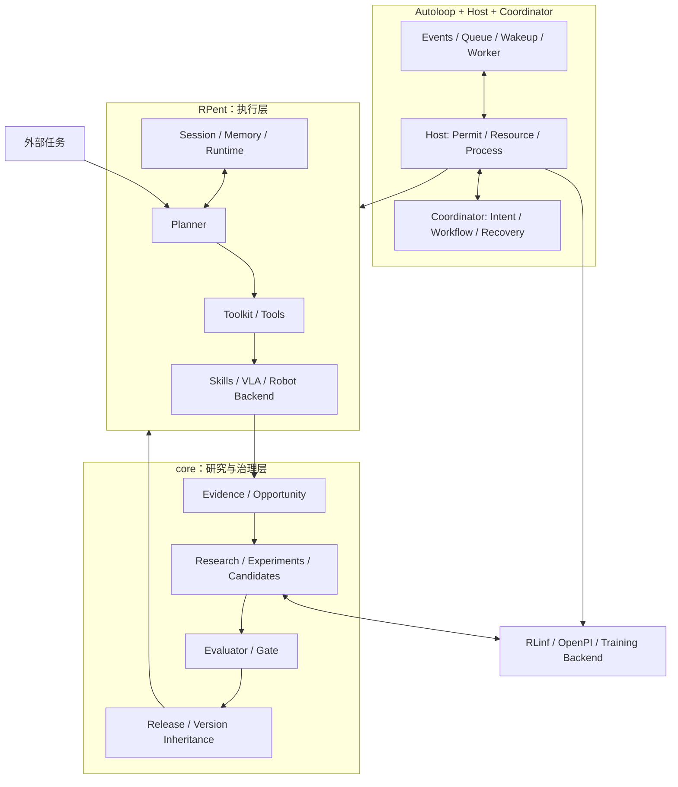
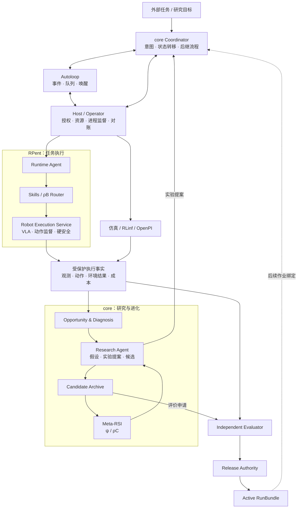
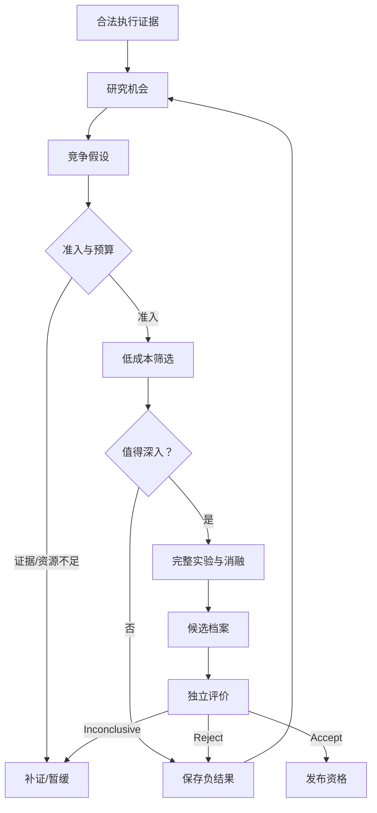
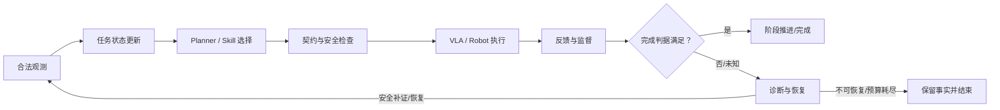

# RSI-Agent-VLA 架构框架设计

> 讨论综合稿｜2026-11-16  
> 本文区分：**现状**（依据本次项目介绍及前序源码检查结论）、**推荐设计**（目标架构，不代表已实现）、**待验证假设**（必须经实验确认）。

## 0. 总体结论

推荐保留 RPent + core + Autoloop/Host 的主体，不再叠加一个拥有最终控制权的全局 LLM Super-agent。目标架构采用：

**确定性控制平面 + 独立 Runtime / Research 决策域 + 可验证 Skills + 受保护的独立评价与发布 + 有预算的候选搜索和 Meta-RSI 元评价。**

自主性不等于 Agent 数量。系统应让不同决策过程拥有明确目标、上下文、权限和交接契约，同时由确定性程序管理状态、资源、安全与版本。

---

# 第一部分：旧框架

## 1. 项目定位与三个循环

RSI-Agent-VLA 是面向机器人操作的持续自进化系统：

1. **任务循环**：观测 → 决策 → 动作 → 反馈 → 诊断 → 恢复。
2. **系统更新循环**：执行经验 → 证据 → 研究机会 → 假设 → 实验 → 候选更新 → 独立评价 → 发布 → 版本继承。
3. **元改进循环**：研究反馈 → 策略诊断 → 研究策略更新 → 后续研究。

系统更新对象使用工作记号：

\[
S=(\theta,\phi,\psi,\rho),\qquad \rho=(\rho_A,\rho_B,\rho_C)
\]

- θ：VLA 模型及处理器。
- φ：任务执行、技能、监督与恢复。
- ρA：信息获取、保留、压缩和路由。
- ρB：职责分配、技能选择、交接和接管。
- ρC：更新对象、方法、顺序和预算。
- ψ：诊断、实验设计、收益判断及研究策略。

这些是职责划分，不要求实现完全独立；例如 ρC 可以是 ψ 的子配置。

## 2. 旧框架逻辑图



这是逻辑职责图，不意味着所有模块同进程，也不代表所有调用均为直接调用。

## 3. 旧框架各层职责

### 3.1 RPent：任务执行与机器人交互

承担 Planner 和模型适配、工具注册调用、会话/观测/记忆、技能与 VLA 调用、执行监督恢复、机器人接入，以及执行事实和原生结果记录。机器人专属实现位于 `robots/<robot>/`，共享能力位于 `rpent/`；LIBERO 是具体集成，不代表系统只能面向 LIBERO。

### 3.2 core：研究、更新与版本管理

承担证据组织、任务完成和研究机会管理、研究请求、实验协调、候选生成与提交、研究策略反馈、数据/训练/模型加载/评价交接、独立评价、发布和版本继承。core 通过适配器调用执行与训练能力，不应成为第二个机器人动作执行器。

### 3.3 Autoloop、Host 与 Coordinator

- **Autoloop**：事件、队列、定时唤醒、worker 等通用运行机制。
- **Host / Operator**：业务操作执行、权限、资源预留、进程监督、回执和清理。
- **Coordinator**：持久化业务意图、操作状态、后继操作选择、恢复与对账。

三者不能都成为“业务总控”：分别回答何时唤醒、能否安全执行、业务下一步是什么。

### 3.4 模型与训练后端

主模型链围绕匹配的 RLinf/OpenPI 实现，支持 π0.5 加载、推理和训练接入。模型、处理器、归一化、动作合约和运行配置共同构成执行版本。同级源码目录与运行时安装实现不能默认相同。

## 4. 旧框架优势与风险

**应保留：**

- RPent 已有 Planner、Toolkit、Memory、机器人接入和动作执行基础。
- core 将研究、评价、发布与任务执行分离。
- Autoloop 提供通用事件和唤醒能力，不需要理解机器人研究语义。
- 独立评价、发布和版本继承是可信自进化的必要治理边界。
- `S=(θ,φ,ψ,ρ)` 为多类可更新对象提供了研究表达。

**应审查：**

1. RPent Session/Journal、core Store、Coordinator、Host、Autoloop 的状态权威和投影关系。
2. 多个模块是否都能推进、重试或恢复同一业务作业。
3. Planner、Research、Evaluator、Coordinator、Autoloop Worker 并非同一抽象层，不能统称 Agent。
4. 经验、记忆、证据和 Skill 的来源、适用条件及验证关系。
5. 代码职责隔离不等于进程、存储写权限和评价数据隔离。
6. 接口存在不等于端到端闭环已经成立。

---

# 第二部分：最终推荐框架

## 5. 总体原则：四个平面

1. **控制平面**：Coordinator、Host、Autoloop，管理状态、授权、调度、资源和恢复。
2. **智能决策平面**：Runtime Agent、Research Agent；可选受限战略规划者。
3. **物理执行平面**：RPent Skills、VLA、Robot Execution Service。
4. **可信评价平面**：独立 Evaluator、Gate、Release。

不设置默认拥有最终控制权的全局 LLM Super-agent。Strategic Planner 如有必要，只能提出提案，不能绕过 Coordinator、Host、Safety Permit、Evaluation 或 Release。

## 6. 最终架构图



这是逻辑架构，不要求每个框都是独立服务。现有 core 组件可以继续承担多个逻辑职责。

### 必须守住的约束

- Research 的实验提案必须经过 Coordinator/Host 的准入、资源和权限检查。
- Research 不得直接启动任意真机动作、修改 Gate 或发布候选。
- Evaluator 消费受保护证据与固定协议，不由 Research 选择评价结果。
- Release 只激活通过资格检查的完整 Bundle。
- 新版本原则上只影响后续任务；运行中的作业固定起点版本。

---

# 第三部分：最终框架各部分结构及设计理由

## 7. 控制平面：Coordinator + Host + Autoloop

### 7.1 Coordinator：业务流程权威

负责稳定业务意图、操作身份、业务状态机、合法后继关系、暂停/等待/补证/恢复，以及副作用操作的提交前对账。

不负责硬实时机器人动作、GPU/设备资源和 Autoloop 事件队列，也不充当通用 LLM Agent。

### 7.2 Host / Operator：作业执行边界

负责授权参数核验、Permit、设备/GPU/仿真资源、预算、隔离进程启动与监督、超时取消、清理、回执和未知提交对账。

### 7.3 Autoloop：持续运行内核

负责事件接收和持久化、队列、定时器、唤醒、Worker 生命周期、退避、熔断和重复事件处理。不负责理解假设、VLA、候选或发布语义。

### 7.4 为什么不合并？

业务流程正确性、外部作业安全执行、通用事件机制是不同问题。合并会把业务语义、资源权限和事件运行机制耦合，降低独立测试和恢复能力。

### 7.5 物理副作用恢复

网络超时不代表机器人动作没有发生。动作恢复规则：

1. 用稳定操作 ID 识别同一逻辑请求。
2. 恢复时先查原生执行记录和设备状态。
3. 能证明未提交才考虑重新提交。
4. 已提交但结果未知时保留 `unknown` 并先补证。
5. 不得把不可逆动作当成普通 HTTP 请求自动重试。

幂等键不能让物理动作天然幂等。

## 8. 智能决策平面：Runtime Agent 与 Research Agent

### 8.1 Runtime Agent

以当前任务或任务阶段为边界，拥有当前目标、观测、任务工作记忆、RunContext、绑定的 RunBundle、已授权 Skills 和有限恢复决策能力。

不拥有全局研究历史任意写权限、正式评价协议修改权或模型发布权。

### 8.2 Research Agent

以研究机会、问题族或改进目标为边界，拥有合法证据引用、竞争假设、实验提案和候选生成能力，以及有界检索、分析、实验和预算权限。

不直接改变运行中 Runtime，不拥有任意真机动作权限，也不能修改正式 Gate 或发布结果。

Research 的长期身份由 ResearchJob、Hypothesis、Experiment、Candidate 等业务状态承担；LLM 会话可短时运行、多次接续，不必维护无限增长对话。

### 8.3 受限战略规划（可选）

输出仅为：

- `ResearchProposal`
- `TaskGraphProposal`
- `BudgetRequest`
- `EvidenceRequest`

提案仍由 Coordinator 审核。它不是新的最终控制中心。

### 8.4 何时委派子 Agent？

只有在任务输入输出相对独立、需要不同上下文或权限、存在明显并行价值且收益超过委派/校验成本时才委派。参数校验、数据统计、状态转移和安全判据应由确定性程序完成。

## 9. 物理执行平面：Tool、Skill、Task Procedure、VLA

- **Tool**：单个底层操作接口，如获取观测、执行动作段、查询状态。
- **Skill**：有输入输出契约、前置条件、完成证据、失败语义和版本依赖的可复用能力。
- **Task Procedure**：由多个 Skills 与条件分支组成的任务过程。
- **VLA / Robot Execution Service**：动作生成、合法性检查、发送、监督和设备安全。

边界：

- Agent 决定做什么、何时切换 Skill、失败后采取什么高层恢复。
- Skill 约束调用条件和完成语义。
- VLA 在给定条件下产生动作。
- Execution Service 管理动作发送、执行状态和安全接管。
- Evidence 记录实际发生的事实。

### Skill 合约示例

```yaml
skill_id: pick_object
skill_revision: v3
input_contract:
  target_object: object_reference
  target_region: optional_region
preconditions:
  - target_visible
  - gripper_available
completion_evidence:
  - verified_object_grasp
failure_semantics:
  - object_not_found
  - grasp_not_verified
  - execution_unknown
compatibility:
  theta_ref: ...
  processor_ref: ...
  action_contract_ref: ...
  robot_backend_ref: ...
validation:
  tested_conditions: ...
  evidence_refs: ...
  unknown_conditions: ...
```

这是建议字段，不表示仓库已有完全相同 YAML。

### 监督粒度

区分 Agent 任务阶段监督、动作段之间状态检查、Execution Service 内部安全监测、硬实时控制器/设备安全。远程 LLM 不承担硬实时安全控制。

## 10. 研究平面：Opportunity、Hypothesis、Experiment、Candidate

每个研究机会至少包含：现象与影响范围、证据引用、竞争解释、可区分预测、最小辨别实验、预期成本风险、起点 Bundle。



迁移 ScientistTwo 等机制：竞争假设、低成本筛选、消融、审查意见转实验、方法/代码/数据/结果完整性审计。不复制多 Agent 数量。开发侧 Critic 可辅助研究，正式 Evaluator 必须独立。

## 11. 候选档案与自我进化

维护多个竞争候选，而不是只围绕当前版本贪心修复。候选建议记录：

- `candidate_id`
- `parent_bundle`
- `changed_components`
- `artifact_refs`
- `hypothesis_refs`
- `experiment_refs`
- `evaluation_status`
- `cost`
- `compatibility_scope`

候选可分支、失败、保留和复用；一个部署范围内只有明确 Active Bundle。借鉴 ADAS、DGM、AlphaEvolve，但采用小规模档案、分层筛选、预算敏感搜索，不做无约束大规模搜索。

## 12. 独立评价与发布平面

正式评价与候选生成分离。评价任务包括任务成功率、失败类型、安全事件、未见任务泛化、旧能力回归、时延成本、证据完整性和模型/处理器/动作合约/Skill 兼容性。

发布状态：

`Candidate → Evaluation → Qualification → Activation → Monitoring / Rollback`

区分技术有效、能力改善、Gate 接受和实际激活。证据不足允许 `Inconclusive`。

## 13. 记忆、证据与知识

不合并为一个 Memory，统一来源、身份、版本和引用规则。

| 对象 | 内容 | 规则 |
|---|---|---|
| 原始执行事实 | 观测、动作、环境反馈、时间、来源 | 追加式保存，不被总结覆盖 |
| 任务工作记忆 | 当前目标、阶段、对象关系、恢复上下文 | 随新证据更新 |
| 跨任务经验 | 常见失败、有效恢复、适用条件 | 派生知识，引用事实 |
| 研究知识 | 假设、实验、负结果、候选谱系 | 绑定研究起点与证据 |
| Skills | 程序性能力及适用条件 | 绑定验证证据和依赖版本 |

保留 L0/L1/L2 思路：

- L0：不可由自适应记忆策略任意隐藏的基础事实。
- L1：可按策略保留、压缩和路由的详细媒体。
- L2：按研究需要获取的专项证据。

ρA 的采样会影响研究数据分布；需记录采样机制，不能把未知采样概率假定为均匀。

## 14. RunBundle 与 RunContext

**RunBundle** 绑定系统版本：

- θ：模型、权重、Adapter。
- Processor、Normalization、Action Contract。
- φ：Planner、运行配置、Skill、监督、恢复程序。
- ρA/ρB：记忆和能力路由策略。
- ψ/ρC：研究作业所用研究策略快照。
- Robot Backend、依赖、配置和源码身份。

如果 ρC 是 ψ 子配置，不要复制成两个可独立漂移的版本。

**RunContext** 记录一次作业条件：Task/Job ID、起点 Bundle、环境、种子、数据快照、授权、Permit、预算、实际加载版本、事件和产物引用。

RunBundle 是系统版本；RunContext 是某次任务使用该版本的具体条件。运行中任务原则上固定起点版本。

---

# 第四部分：三个闭环

## 15. 任务循环



失败诊断保留竞争解释：定位错误、VLA 能力不足、Skill 起态不匹配、ρB 选择错误、环境扰动、反馈缺失。无法区分时保留未决，转化为研究机会。

## 16. 系统更新循环

证据触发研究机会，经过假设、准入、筛选、完整实验、候选、独立评价、发布和继承。Research 只能提案；Coordinator/Host 管理授权与执行；Evaluator/Release 决定资格和激活。

## 17. 元改进循环

元循环研究“如何更有效地研究和改进系统”。ψ 是可冻结、可执行、可比较的研究策略，不只是 Prompt，包含机会排序、证据检索、假设筛选、实验设计、收益估计、候选选择和资源分配。

流程：

`研究反馈 → 策略缺陷诊断 → ψ 候选 → 固定条件比较 → 独立元评价 → 选择性继承`

必须用未见研究问题、相同系统起点、相同证据权限和可比预算，避免把“看过更多历史数据”误判为研究方法进步。

可研究的评价形式：

\[
J_B(\psi)=
\mathbb{E}_{q\sim D_{\mathrm{heldout}}}
\left[
\operatorname{AUC}_{b\in[0,B]}\Delta V_q^\psi(b)
\right]
\]

衡量不同预算下独立验证收益曲线。预算单位、统计方法和安全约束需在实验前定义。

---

# 第五部分：进化管理、成本与验证

## 18. S 的更新对象与依赖

| 对象 | 变化 | 主要验证 |
|---|---|---|
| θ | VLA 权重、Adapter、处理器 | 动作表现、泛化、兼容性 |
| φ | Planner、Skill、监督、恢复 | 成功率、恢复、回归 |
| ρA | 信息保留、压缩、检索路由 | 证据完整性、诊断质量、偏差 |
| ρB | Skill 选择、交接、接管 | 选择质量、交接成功率 |
| ρC | 更新对象、顺序、预算 | 研究效率、资源使用 |
| ψ | 诊断、假设、实验、收益判断 | 未见研究问题上的元改进 |

重要耦合：θ↔φ、φ↔ρB、θ↔ρB、ρA↔ψ、ρC↔ψ、ψ↔系统版本。候选应记录 `changed_components` 和 `dependency_refs`，据此决定重验证范围。

## 19. 探索与利用

先用确定性准入排除技术无效、无证据、无预算和不安全候选，再比较收益、不确定性和成本，并保留探索额度。成本敏感启发式：

\[
Q(h)=
\frac{P(valid\mid h)P(gain\mid h,valid)\mathbb{E}[\Delta V\mid h]}
{\mathbb{E}[C(h)]+\epsilon}
\]

这只是待校准的排序启发式，概率估计不能未经验证当作事实。

## 20. 分层研究预算

1. 证据/逻辑检查：很低成本。
2. 历史回放/静态分析：较低成本。
3. 小规模仿真：中等成本。
4. 完整仿真与多条件评价：较高成本。
5. 原生训练及加载验证：较高成本。
6. 独立正式评价：必要的受保护成本。
7. 真机验证：高成本、高风险。

不要求每个候选都走完所有阶段；但声称机器人能力提升，必须有与声明匹配的机器人任务证据。

## 21. 资源并发与复杂度

区分 CPU/LLM 研究任务、GPU/仿真训练评价、独占或严格安全调度的真机任务。先保守调度，发现瓶颈后再拆分资源锁。

新增机制必须说明解决的问题、是否已有现有能力可完成、是否增加状态/权限/评价路径，以及同等预算下是否提高任务、研究或安全指标。

\[
\Delta U_{\text{net}}=
\Delta U_{\text{task}}+\Delta U_{\text{research}}
-\lambda C_{\text{compute}}
-\mu C_{\text{engineering}}
-\nu R_{\text{failure}}
\]

这是取舍框架，不是已校准效用函数。

## 22. 旧框架与最终框架对比

| 维度 | 旧框架 | 最终推荐框架 |
|---|---|---|
| 总体控制 | Super-agent、Host、Coordinator 控制边界待澄清 | 确定性控制平面拥有状态与授权权威 |
| 全局 Agent | 可能被理解为统一主控 | 不设默认全局 LLM 主控；战略规划仅提案 |
| Runtime | Planner + Tools + VLA | 独立任务上下文、绑定 Bundle、Skill 合约 |
| Research | core 研究流程 | 独立研究身份和上下文，短会话接续 |
| 多 Agent | 角色扩展尚未定 | 两个主要决策域，按需短期委派 |
| Evaluator | 有独立评价方向 | 数据、协议、权限和发布隔离 |
| Skill | 技能调用和复用 | 带适用条件、完成证据、版本依赖的能力资产 |
| Research 方法 | 机会、假设、实验、候选 | 竞争假设、分层筛选、消融、审查反馈 |
| 候选进化 | 候选更新和版本交接 | 小规模分支档案、谱系和预算搜索 |
| Meta-RSI | ψ/ρ 策略反馈 | 未见研究问题上的独立元评价 |
| 记忆 | 分层记忆与证据 | 事实、工作记忆、经验、研究知识、Skill 分层 |
| 版本 | 模型和配置交接 | RunBundle + RunContext |
| 恢复 | 执行监督和作业恢复 | 对账优先，未知物理副作用不盲目重试 |
| 成本 | 有界预算与作业管理 | 分层筛选、资源域配额、复杂度收益评估 |

## 23. 架构决策表

| 架构问题 | 当前设计 | 推荐调整 | 主要依据 | 待验证事项 |
|---|---|---|---|---|
| 全局 Super-agent | 分层控制 | 不设 LLM 最终主控 | Autoloop、DeepSeek | 战略规划是否有增益 |
| Autoloop/Host/Coordinator | 已有分工 | 固定事件、业务状态、作业和授权所有权 | 现有代码与事件驱动机制 | 故障恢复、重复派发 |
| RPent/core | 执行与研究分离 | 有界能力与证据契约交接 | 项目分层 | 是否存在重复状态 |
| Runtime/Research | 职责分离 | 独立上下文、权限、作业身份 | DeepSeek、Claude Code | 隔离成本与收益 |
| Agent 数量 | 可扩展多角色 | 不默认增加常驻 Agent | mini-SWE-agent、LangGraph | 委派净收益 |
| Agent/VLA | Planner、Toolkit、动作后端 | Skill 合约和动作监督边界 | SayCan、Voyager | 动作段监督可靠性 |
| Skills | 技能和记忆机制 | 验证条件、证据、依赖版本绑定 | Voyager | 跨场景复用 |
| Research | 研究请求与候选 | 竞争假设、筛选、消融反馈 | ScientistTwo | 研究效率 |
| 候选 | 候选和实验记录 | 小规模分支档案 | DGM、AlphaEvolve | 是否优于贪心 |
| ψ | 有效策略快照 | 未见问题、统一预算元评价 | ADAS、Co-Scientist | 迁移与稳定性 |
| 证据/记忆 | 分层证据 | 统一身份、来源、版本和可信性 | 项目证据约定 | 采样偏差 |
| 评价/发布 | Gate 与 Release 分离 | 独立性、兼容性和回滚 | ScientistTwo、现有 Release | 端到端发布 |
| 资源 | 有界预算和保守调度 | 按瓶颈拆分资源域 | Autoloop、Host | 并行净收益 |

## 24. 推荐辨别实验

### 控制平面

比较 A 全局 LLM、B 确定性 Coordinator + Runtime/Research、C 在 B 上增加受限战略规划。控制 Agent、任务、模型、工具和授权条件，比较完成率、恢复正确率、重复副作用、成本和人工介入；注入网络中断、回执丢失、重启和资源不足。

### Skill 契约

比较文字描述、结构化前置/完成契约、再加学习型 ρB。测量技能选择错误、交接失败、恢复成本和成功率。

### 候选档案

比较单候选贪心与小规模分支档案，按同等预算统计通过独立验收的有效更新数量，并计入失败实验成本。

### 科研流程

比较直接优化、加入消融、消融后修订、审查意见转实验，评价收益归因、无效修改和未见任务泛化。

### ψ 元改进

基线 ψ₀ 与候选 ψ₁ 在共同未见研究问题、相同起点、证据权限和预算下比较收益曲线、无效实验比例、成本、迁移和旧能力退化，防止候选策略提前接触保留问题。

---

# 最终结论

RSI-Agent-VLA 应继续以 RPent 作为机器人执行底座，以 core 作为研究、证据、评价和版本治理层，以 Autoloop/Host/Coordinator 作为持续作业与控制平面。

最重要的架构演进不是引入更多 Agent，而是：

1. 明确状态事实的唯一权威所有者。
2. 明确业务流程、作业执行和事件唤醒边界。
3. 让 Runtime 与 Research 具备独立上下文、权限和任务身份。
4. 让 Skills 成为带前置条件、完成证据和版本依赖的能力资产。
5. 让 Research 使用竞争假设、分层实验、消融和候选档案。
6. 让 Evaluator/Release 保持独立。
7. 通过 RunBundle/RunContext 保证版本可追溯。
8. 通过未见研究问题和统一预算证明 ψ 是否真的变强。

目标不是“一个会不断反思的 Agent”，而是一个能够从可信机器人执行事实中持续发现问题、选择改进路径、完成可复现实验、独立判断收益，并逐步提升自身研究效率的机器人自进化系统。
