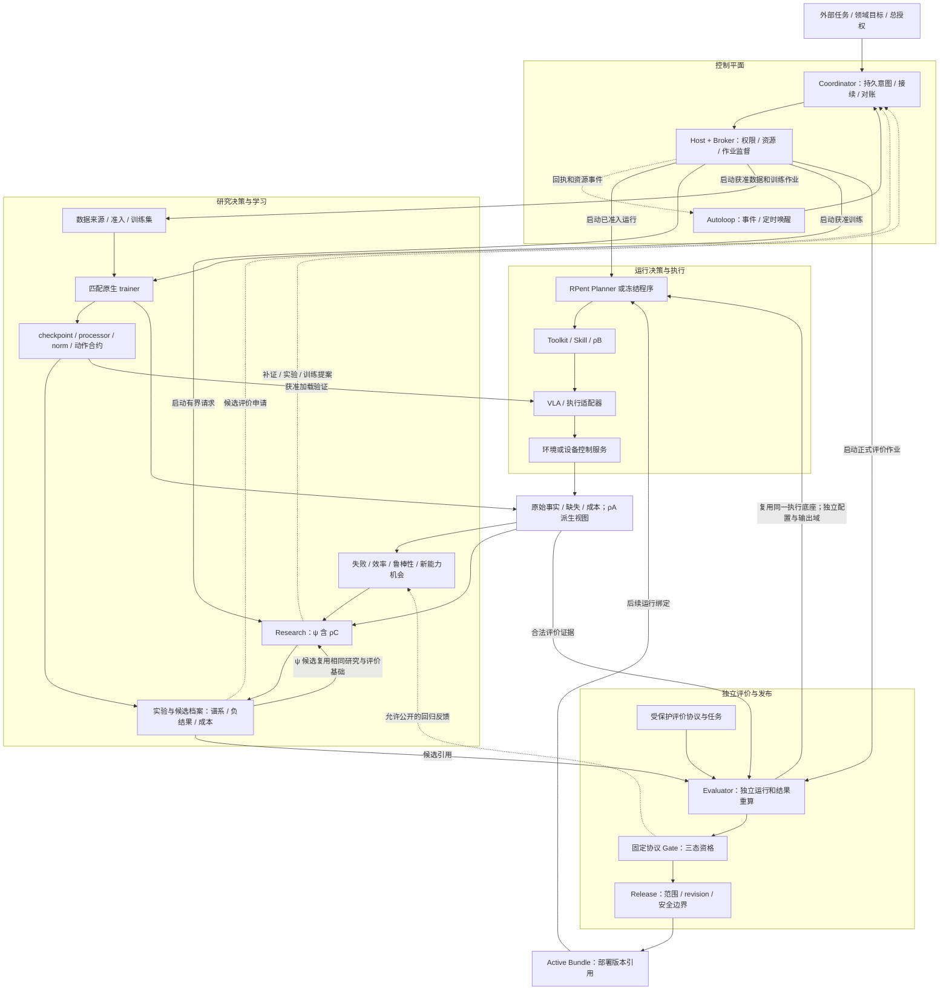
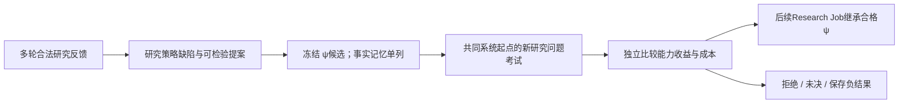

# RSI-Agent-VLA 项目框架设计方案：复核、取舍与定稿

日期：2026-11-17  
对象：机器人操作领域的持续自进化系统  
设计依据：本地当前实现、既有研究承诺、原架构材料、[本轮讨论](04_对话完整记录.md)及一手文献  
配套施工方案：[详细实施方案：框架搭建优先](03_项目框架详细实施方案_框架优先_2026-11-17.md)

## 1. 设计结论

采用 **RPent 执行底座 + core 研究与治理 + Autoloop 事件驱动 + Host 作业监督**。运行任务与研究任务使用独立的上下文和权限；确定性程序维护授权、业务状态转换、资源与发布；LLM 在这些边界内规划、诊断、提出实验和生成候选。

采用 **按适用范围完成框架验收，再进行真实组件接通，随后验证部分、层次和整体能力** 的路线。框架范围覆盖既定全部职责，每部分先交付一种明确、可执行、可继承的基础实现；功能完成与算法收益分别判断。

第四批分范围门槛为 `G_F_sim = F00—F14 仿真适用项 + F16_sim + C01—C07/C09/C10`。通过后可进入适用且获授权的 `P_sim`；C08 未验收、延期。全局 `G_F` 保留 F15、C08、真机 F16 及共享版本兼容要求；不以仿真验收代替真机框架完成。当前状态统一见[04 §1.23](../../项目文档/04_实施路线与执行状态.md#123-第四批仿真验收与准备2026-11-17)。

最终方案固定以下设计决定：

1. **按业务对象确定状态权威。** Coordinator 拥有工作流意图和操作接续状态；研究、评价、发布各自的业务 Store 仍拥有本域事实。不能把“Coordinator 是唯一工作流控制者”扩大成“Coordinator 是全部业务事实的主库”。
2. **把确定性治理与开放研究结合。** 不设拥有最终授权权的全局 LLM；同时允许 Research 在总授权内选择问题、扩展有限实验计划和生成受限代码候选，避免把自主科研收缩成预写分支的回放。
3. **把真实学习链放回架构中心。** 明确数据来源与准入、原生训练、checkpoint 与处理器交接、实际加载、任务收益、独立发布六个不同环节。技能路由和提示优化不能代替 θ 更新。
4. **区分运行版本、研究策略、事实起点和评价协议。** 保留现有 RunBundle 合约，通过引用组织这些内容；避免一次 ψ 变化被误当成机器人运行能力变化，或要求所有运行服务随研究策略一起重发。
5. **区分开发反馈、发布回归与最终封存考试。** 角色分开和结果文件独立不够；还要控制隐藏数据读取、重复测试反馈与评价协议变更。
6. **三个循环复用同一作业与证据基础。** Meta-RSI 是研究策略自身的候选生成与独立考试，不再成为第三个调度中心。研究入口同时覆盖失败、成功但低效、鲁棒性缺口与领域内新能力需求。
7. **冻结工程广度，限制首版深度，按主张配置实验。** F 阶段完成全部必需路径和离线集成；P 阶段取得真实组件兼容与资源证据；V 阶段验证基本能力和整体结果，必要对照由实际科学主张决定。不把每个模块都扩成独立算法课题，也不把科研正结果设为工程完成条件。

本方案保留“一篇论文、完整系统、真正 VLA、三类关系可进化、主动能力增长、H3 元改进努力、Piper 关键真机闭环”的既有目标。架构整理不改变当前实验暂停、授权、预算或历史协议。项目当前完成度仍以[项目文档 04](../../项目文档/04_实施路线与执行状态.md)为准。

## 2. 对原讨论的理解复核

### 2.1 核对范围与证据基线

原设计参考[架构框架设计](01_架构框架设计.md)、[架构诊断完整对话记录](00_架构诊断完整对话记录.md)；[素材目录](架构诊断完整对话记录_素材)包含 10 组 PNG/SVG 图及 4 份 Mermaid 源码。素材是讨论内容的重绘，提供结构说明，不是项目运行证据。

项目目标以[总纲 00](../../项目文档/00_项目总纲与研究边界.md)、[系统设计 01](../../项目文档/01_系统设计与框架复用.md)、[科学问题 02](../../项目文档/02_科学问题与创新路线.md)、[验收协议 03](../../项目文档/03_实验设计与验收协议.md)为依据，行为以源码与实际调用方核实。

本次源码基线是聚合仓库 `3dbc59ad`、RPent `c57b134` 加检查时的本地改动。RPent 当前 `main` 相对本地 `origin/main` 领先 2、落后 2；两级工作树均有既有变化。本方案描述这份本地实现，不将其等同于远端最新版本，也不覆盖已有改动。

### 2.2 哪些理解正确，哪些需要校正

| 原讨论中的理解 | 复核结论 | 当前依据与修正 |
| --- | --- | --- |
| RPent 是主要机器人执行底座 | 正确 | `Planner.solve → Toolkit.execute_tool → 机器人工具 → 环境/模型 RPC` 已有实际接口，详见 [Planner](../../RPent/rpent/planner/base.py)、[Toolkit](../../RPent/rpent/tools/toolkit.py)。 |
| Toolkit 支持读并发、写互斥、取消和等待清理 | 正确，但范围有限 | `_Scheduler` 是单个 Toolkit 实例的进程内协调器；不是跨进程设备锁，不提供硬实时保护，也不提供 OS ACL。 |
| MemoryManager 支持经验积累 | 基本正确 | 当前管理 global、task-family 的草稿合并、证据和冲突归档，并访问 task-specific 语料。不能把它描述成三个对称的在线学习层；见 [manager.py](../../RPent/rpent/memory/manager.py)。 |
| core 已有证据、研究、评价、发布、ψ 快照 | 正确 | 这些是现有模块，不是本轮需要重新建立的服务；见 [core README](../../core/README.md)。 |
| Runtime 与 Research 可以分别接续 | 正确 | 当前 Research 真实入口是有界、text-only、单请求 SDK 调用；通过宿主补证与新请求接续，不是常驻自由调用工具的 Agent；见 [bounded_runner.py](../../core/src/rsi_vla/bounded_runner.py)。 |
| Coordinator 负责状态，Host 负责执行，Autoloop 负责唤醒 | 方向正确，需收窄“状态” | [Coordinator](../../core/src/rsi_vla/protocol10_coordinator.py) 明确 business stores remain authoritative。它保存意图、pending、operation、receipt 与控制信号；不替代研究结果、Gate 或 active 的权威存储。 |
| 已有独立角色隔离 | 有实现，保护范围须逐项说明 | [protocol10_roles.py](../../core/src/rsi_vla/protocol10_roles.py) 与 [run_isolated_role.py](../../scripts/run_isolated_role.py) 提供 broker 和 mount 写域。后者以整个 `/` 的只读挂载为底；**只读不等于不可读**，不能据此声称隐藏测试已对任意候选代码保密。 |
| Skills 已形成通用验证能力体系 | 表述过满 | [skill_routing.py](../../RPent/robots/libero/skill_routing.py) 是有限的、版本绑定的同目标路由与专用证据消费者；[execution_arms.py](../../RPent/robots/libero/execution_arms.py) 实现 D/S/R/A 执行方式。它们不是任意技能学习、通用可行性函数或完整适用域证明。 |
| Robot Execution Service 承担“硬安全” | 属于目标职责，不能认定已实现 | 当前 LIBERO 链是仿真动作执行、预算、取消及记录。工具后的观察不等于 chunk 内实时安全，更不能外推为 Piper 设备安全已经验收。 |
| RunBundle、RunContext、版本固定是新建议 | 主要为已有约定的细化 | [contracts.py](../../core/src/rsi_vla/contracts.py) 已含模型、处理器、φ、ρ、ψ、记忆、协议、后端和源码引用；实际 Runtime context 已存在。无需创建平行版本平台。 |
| 真实训练、发布和 H3 尚须验证 | 正确 | 当前权威记录仍列真实 θ 更新、正式 E1、F2/H3 效果未建立。CPU batch 或源码接口通过不能改写这一判断。 |
| 原框架只是失败驱动的单候选修复 | 不准确 | 总纲已要求正常运行触发、领域内新能力、开放探索；当前研究工具已有多种机会来源和探索入口。候选档案应增强历史利用，而非把既有系统重述为仅支持单线修复。 |

**总体判断：原稿是一份方向合理的架构综合稿，尚不足以直接充当实施规格。** 主要问题是已有机制与新增建议混写、逻辑图简化了真实边界，以及训练、主动能力增长和评价信息流展开不足。

### 2.3 素材图的具体处理

| 素材 | 保留的信息 | 定稿处理 |
| --- | --- | --- |
| 01 现有架构、02 六议题 | 分层和议题依赖基本成立 | 明确 RPent/core 为仓库职责，控制/决策/评价为横跨仓库的逻辑视图。 |
| 03 Super-agent A/B/C | 区分规划与最终权威有价值 | A 与 B 不能用“有无全局 LLM”简单划线；DeepSeek 原型也有确定性 Engine、Policy 和授权。 |
| 04 推荐架构 | Research 提案、评价、发布和版本交接 | 重画控制流与产物流；补 Research 启动作业、正式评价运行、数据训练链。避免纵向布局被理解为所有任务串行经过所有模块。 |
| 05 任务循环 | 观察、执行、反馈和恢复 | 区分正常继续、状态未明、技术故障和真正任务失败；未完成不自动等于需要恢复。 |
| 06 更新循环 | 分层实验、候选、三态评价 | 技术无效保留为故障记录，不归为能力负结果；未决不意味着可无限补测。 |
| 07 候选分支 | 历史父节点与组合探索 | 组合是新候选，重做相应兼容与评价；两个父节点通过不推出组合通过。 |
| 08 RunBundle | 完整引用与共享实现 | 分清执行、研究、事实和协议；不把变化中的证据全集塞进版本定义。 |
| 09 ψ 元评价 | 共同起点、新问题、同预算 | 补上 checkpoint 选择规则、测试反馈隔离、多资源成本与策略生成成本。 |
| 10 Meta-RSI 三层能力 | 诊断、改进、改进研究方法 | 作为能力成熟度视图；不据此新增三层 Agent 或三个运行平台。 |

### 2.4 对本轮讨论的独立判断

[04 对话完整记录](04_对话完整记录.md)包含两轮评估。第二轮用户明确选择“全部框架搭建完成，再验证部分、层次和整体能力”，它约束实施顺序；助手对取舍的解释仍须核对实现和既有承诺。记录末尾重复粘贴的第二轮回答不构成新的证据。

| 讨论观点 | 判断 | 进入方案的具体规则 |
| --- | --- | --- |
| 第一轮建议先缩减到核心闭环，边开发边做真实验证 | 不作为本轮路线 | 与后续明确选择不符。保留全部 F 工作包及全局 G_F，真实重组件验证统一进入 P/V。 |
| 每个部分先完成一种基础实现 | 采纳 | F00 固定支持范围与默认实现，既有合格机制直接复用；不以比较出最优算法作为 G_F 条件。 |
| 接口可先基于源码完成，真实兼容后验 | 有条件采纳 | trainer、loader、设备 API 和动作语义须有真实版本依据；仅由自拟替身支持的适配不能算完成。测量值未知可后置，必需接口未知仍是工程阻塞。 |
| 工程、机制收益、论文贡献分开 | 采纳 | 三类关系均可反馈更新与继承是功能要求；三者各有独立优势需要额外证据，不自动成为三个贡献。 |
| 第一轮建议实施前确定论文主线 | 不设为框架前置 | 已承诺的工程范围可先完成；从现有资料同步分析候选问题，P 阶段通过有界辨别试验确定正式主比较，避免无主张地运行全部矩阵。 |
| 以“改进层级选择”为推荐主线 | 保留为候选，补足近邻约束 | 该问题与 AdaRSI 直接相邻，θ 升级后协作适配与 Robo-COP 相邻；必须找到强直接解法后的具体残余。见 §3.4、§11.4。 |
| 部分关系采用固定/简单策略、ψ 暂不更新 | 限定为实验条件 | 默认算法可以简单；全部框架仍须提供三类关系与 ψ 的真实更新消费者。某场实验冻结它们，不等于删除更新能力。 |
| H3 主线或后续方向二选一 | 不采用硬二分 | 保留本篇内的实质 H3 努力；先做可比较快照考试，是否扩展到元改进程序的可靠性按主张、独立重复和预算判断。负结果/未决可结束已注册验证，不能预先取消目标。 |
| 新能力限定在可物化目标范围 | 改造采纳 | 首版使用受限场景与目标构造语法，仍须覆盖此前未列出的合法组合；只从旧任务清单选题只能算课程选择。 |
| Piper 独立推进、只做关键物理闭环 | 采纳 | 现场未就绪不阻塞独立仿真验证；真机不复制全部仿真矩阵。 |
| 第二动作类型可延期 | 不作为默认删减 | 保留既有有限第二类型验证，只复现选定关键结论；是否缩减承诺需另行决定。 |
| F09 基础档案不必等 F08，F12 公共评价不必等 F11 | 采纳 | 调整包内依赖，提前联调候选、评价和发布；所有必需功能最终仍在 G_F 汇合。 |
| 合并 C01—C10 的夹具、轨迹和运行器 | 采纳 | 共享工程场景与可复用证据，保留全部关键断言。行为不同的策略仍须独立执行，不能靠复用同一轨迹替代。 |
| 精简不能以“无显著差异”证明无损 | 采纳 | 纯包装精简核对语义等价；删除学习机制若主张非劣，预先固定可接受损失和区间标准。证据不足不能写成等效。 |
| 核验 active 原子性与实际加载 | 采纳检查，不预断缺失 | 现有发布有动态锁、基准重读及单文件原子替换；跨文件崩溃恢复和模型加载仍需核验。按实际部署模型修补，不新建分布式事务服务。 |
| 工作量按独立过程、评价点与任务相乘估算 | 采纳并细化 | 区分训练重复、研究过程、ψ 产生历史和评价 episode；优先减少无关比较与时点，再依据精度确定回合数。 |

因此，采用第二轮的工程交付原则，并吸收第一轮关于实验聚焦和依赖简化的建议。完整框架与单篇论文可以共存，条件是限制每个模块的实现深度、复用同一证据链，并使论文只承担有必要对照支持的主张。

## 3. 外部资料支持到什么程度

本节为机制取舍。论文结果属于原论文的任务与条件，迁移到本项目的收益仍是待验假设。下表保留前版的一手来源索引。本轮于 2026-11-17 重新核对 OpenPI、GEPA、DGM、holdout 方法，以及 §3.4 的两项直接近邻；其他条目沿用原设计的资料记录。

### 3.1 Agent、工作流与长期作业

| 一手来源 | 核实到的机制 | 本项目取舍 |
| --- | --- | --- |
| [Claude Code Skills](https://code.claude.com/docs/en/skills) | 用指令和支持文件扩展能力，可按需加载 | 借鉴渐进上下文加载；`SKILL.md` 本身不等于机器人技能验证。 |
| [mini-SWE-agent](https://github.com/SWE-agent/mini-swe-agent) | 极简循环、线性历史、独立 shell 执行 | 用作“少组织结构”的基线思想；机器人保留类型化工具和唯一发送入口，不迁移任意 bash 动作模式。 |
| [OpenHands](https://github.com/OpenHands/OpenHands#architecture) | 当前仓库侧重 Agent Canvas；SDK/Server、Automation 各有仓库职责 | 借鉴会话与执行环境隔离；不把 Canvas 或软件 Agent 当第二套机器人 Runtime。 |
| [Agent-Autoloop](https://github.com/KKKKhazix/agent-autoloop) | 事件、规则、持久状态、退出等待和 worker | 继续复用唤醒能力；通用 worker 成败不决定机器人试验是否重跑。 |
| [DeepSeek Domain model](https://github.com/deepseek-ai/dsh-superagent-prototype/blob/main/docs/001-domain.md)、[Authorization](https://github.com/deepseek-ai/dsh-superagent-prototype/blob/main/docs/002-authorization.md)、[Architecture](https://github.com/deepseek-ai/dsh-superagent-prototype/blob/main/docs/007-architecture.md) | Ticket 与 Session 分离；Mandate 约束工作；Engine 单写领域事实，副作用在事务提交后执行 | 借鉴工作身份、权限与副作用分离。它本身已是模型研判加确定性治理，不能用来证明“纯 LLM 主控”可靠或不可靠。 |
| [OpenClaw](https://github.com/openclaw/openclaw#how-it-fits-together) | Gateway 是会话、工具、事件和渠道控制平面 | 借鉴入口与执行分离；不引入消息渠道系统作为研究业务状态机。 |
| [LangGraph Persistence](https://docs.langchain.com/oss/python/langgraph/persistence)、[Fault tolerance](https://docs.langchain.com/oss/python/langgraph/fault-tolerance) | 区分线程 checkpoint、长期 Store 和重试边界；缺失应答可表示未知 | 用于校正恢复语义；现有 Coordinator 能覆盖的流程不迁移框架。 |
| [CrewAI Flows](https://docs.crewai.com/en/concepts/flows)、[Microsoft Agent Framework](https://learn.microsoft.com/en-us/agent-framework/overview/) | Agent 与显式工作流可组合 | 接受类型化交接，拒绝为每个业务名词创建常驻 Agent。 |

DeepSeek [README](https://github.com/deepseek-ai/dsh-superagent-prototype)明确区分公开研究原型、内部实现和正式产品。其任务授权可持续接续的细节也不能直接覆盖本项目的明确 UTC 期限、硬预算和人工暂停规则。

### 3.2 科研、自改进与候选搜索

| 一手来源 | 支持的设计 | 适用限制与决定 |
| --- | --- | --- |
| [ScientistTwo](https://arxiv.org/html/2609.19644v1) §3.2—3.6、Table 7 | 子集筛选、消融、审查反馈转实验、结果与代码完整性审计 | 采纳研究方法；模拟审稿分数不作为本项目发布判据，不照搬角色数量。 |
| [AI Scientist-v2](https://arxiv.org/abs/2504.08066) | 实验树搜索与实验管理 | 允许分支修订与保存失败；按机器人实验成本缩小搜索规模。 |
| [Co-Scientist](https://doi.org/10.1038/s41586-026-10644-y) | 异步研究、假设竞争、专家反馈；实证验证区别于假设排序 | 借鉴竞争与反馈；内部 Elo 只用于开发排序，不能替代机器人任务结果。Nature 原始地址存在访问重定向，本次通过 DOI 页面与出版方检索内容核对。 |
| [ADAS](https://arxiv.org/abs/2408.08435) | Agent 设计以程序表示，利用历史档案搜索 | φ/ψ 可包含程序候选；不推出机器人上已获持续自进化效果。 |
| [DGM](https://arxiv.org/abs/2505.22954) | 从历史 Agent 档案选父节点、分支自改、经验评价 | 采纳小规模谱系搜索；编码基准收益不是机器人因果诊断或 H3 迁移的直接证据。 |
| [AlphaEvolve 论文](https://arxiv.org/abs/2506.13131)、[官方仓库](https://github.com/google-deepmind/alphaevolve) | LLM 生成程序、外部可执行评价、进化反馈 | 采纳生成与验证分离；公开仓库有最小本地评价实现，不等于完整内部系统；物理效果无法像数学构造一样精确验证。 |
| [GEPA](https://arxiv.org/abs/2507.19457) | 轨迹反馈、反思性修改与 Pareto 候选利用 | 作为 φ/ψ 文本与配置优化的强基线；已有匹配优化器可复用，不因“自研”重复造搜索器。 |

### 3.3 具身执行、数据与评价方法

| 一手来源 | 支持的设计 | 本项目含义 |
| --- | --- | --- |
| [SayCan](https://arxiv.org/abs/2204.01691) | 语言相关性与实际技能可行性结合 | 能力选择必须受当前状态与验证条件约束；没有学习型 value function 时不声称已经实现 SayCan。 |
| [Voyager](https://voyager.minedojo.org/) | 自动课程、可执行技能库和反馈修订 | 补全主动能力增长；Minecraft 成功验证不能转用为机器人起态与物理安全证明。 |
| [Gemini Robotics-ER 1.6](https://deepmind.google/blog/gemini-robotics-er-1-6/) | 高层空间理解、规划、成功检测并调用 VLA/工具 | 支持高低层分工；官方演示不证明本项目视觉判据正确，更不提供硬实时安全保证。 |
| [OpenPI](https://github.com/physical-intelligence/openpi) | 原生训练、归一化统计和推理服务 | 强化数据—训练—加载合约；本地运行链使用匹配 RLinf/OpenPI 分支，不能直接替换成官方主线。 |
| [LIBERO](https://github.com/Lifelong-Robot-Learning/LIBERO) | 面向终身机器人学习与知识迁移的任务基准 | 采用任务族和连续变化评价；一个任务换 seed 不足以证明新机制迁移。 |
| [Dwork 等：Adaptive Data Analysis](https://arxiv.org/abs/1506.02629) | 自适应重复使用 holdout 会导致过拟合 | 发布回归反馈与最终封存考试分开；本方案不引入未经需求支持的差分隐私平台。 |
| [Agarwal 等：Statistical Precipice](https://arxiv.org/abs/2108.13264) | 少次运行的点估计可能不可靠，需报告不确定性 | 配对任务、预定重复、完整分母与区间估计；不把单次成功或最佳 seed 写为系统提升。 |

这些来源支持模块分工和实验方法的合理性；它们没有证明“四个平面”“两个决策域”是普适最优，也没有证明增加候选档案必然更省预算。

### 3.4 本轮推荐研究主线的近邻约束

[AdaRSI v1 §4—§5](https://arxiv.org/html/2610.20474v1)已包含先改 harness、从保存状态诊断失败子步骤、按需微调，以及仅改程序/仅改权重等消融。[Robo-COP v1 §3](https://arxiv.org/html/2610.09228v1)已包含部署数据、按需训练、候选验证和策略采用后的记忆修订。因此，本方案判断“选择改进层级”和“更新后协作适配”有工程与问题辨别价值，但不足以单独确立原创性。

下一步应针对本项目的合法观测、不可精确复位、版本漂移或昂贵干预，找出直接方法仍无法解决的具体代价，再提出可执行规则和区别预测。是否存在这样的残余由 P 阶段辨别证据决定；当前不把某个切口写死为最终论文主线。四方向继续按[科学问题 02](../../项目文档/02_科学问题与创新路线.md)比较。

## 4. 对原新框架逐项取舍

以下按《架构框架设计》主要章节及最终实验建议逐项裁决。“采纳”表示进入目标设计，“改造采纳”表示保留目的并改变具体规则，“暂缓”表示保留研究分支，“拒绝”表示不进入默认方案。

| 原建议 | 决定 | 理由、落点与验证方式 |
| --- | --- | --- |
| 四个平面 | 采纳 | 作为职责视图，底下共享证据与数据基础；不对应四套服务或数据库。 |
| 不设拥有最终控制权的全局 LLM | 采纳 | 授权、预算、设备动作与发布需要可核验的固定边界；全局研究规划仍可存在。 |
| Coordinator/Host/Autoloop 不合并 | 改造采纳 | 保留职责边界，可同进程部署；Host 仍需消费业务准入，不能被简化成无业务约束的进程启动器。 |
| 一个状态只有一个权威 | 采纳并纠正 | 按对象分域，不集中全部事实。Coordinator 保存业务记录引用，最终 Gate/active 分别重读权威域。 |
| 稳定操作身份、对账优先 | 采纳 | 外部作业和动作效果未知时不重放；同一逻辑操作、执行 attempt、动作段分别关联。 |
| Runtime/Research 独立 | 采纳 | 两类职责可短会话执行和多次接续；不固定为两个永远在线的进程。 |
| 专业子 Agent 按需委派 | 采纳 | 需要独立上下文/权限或实际并行收益；计入全部委派、校验成本。 |
| 单独 Strategic Planner | 暂缓 | 先作为 ψ 中的机会选择策略；有跨问题组合规划瓶颈后再对照独立规划者。 |
| Tool/Skill/Task Procedure 分层 | 改造采纳 | 同一工具可承载多种粒度；避免强制每项能力新增三层包装。Skill 验证与前置条件必须被调用方实际消费。 |
| Execution Service“硬安全” | 目标保留，拒绝现状宣称 | 明确仿真检查、软件监督、设备控制与硬安全链的不同层级；真机需现场验收。 |
| 所有失败保留多个假设 | 改造采纳 | 有真实歧义才保留竞争解释。新任务至少一条可检验解释，避免凑两条；历史冻结请求按原规则读取。 |
| 每个候选都走筛选、完整实验与消融 | 改造采纳 | 按拟作主张选择层次。普通正确性修复不必做全套科研消融，机制收益必须有区分性对照。 |
| 审查意见转为实验 | 采纳 | 当意见影响因果解释、适用性或发布资格时形成补证；纯文字问题直接修订。 |
| 小规模候选档案 | 采纳 | 扩展现有 Candidate/Experiment 视图，保留非最优父节点、负结果和成本；不建独立搜索平台。 |
| 独立评价与发布 | 采纳并补足 | 加入读取保密、发布回归与封存考试分离；所有正式运行仍经 Host 资源准入。 |
| “RunBundle 包含一切” | 改造采纳 | 保留完整引用，逻辑分开执行产物、研究策略、事实起点与评价条件；无需把整个历史物化进 Bundle。 |
| L0/L1/L2 与记忆分离 | 采纳 | L0 全覆盖是采集目标，故障间隙必须显式记录；取证选择不获得改写原始事实的权限。 |
| θ、φ、ψ、ρ 独立进化 | 改造采纳 | 作为干预标签；共享实现唯一引用，依赖变化后针对受影响路径重验，不设六套控制器。 |
| ψ 采用未见问题与同预算考试 | 采纳并补足 | 控制起点、事实、模型、工具和评价反馈；允许被测 ψ 的 ρC 随策略变化；见第 11 节。 |
| 原 Q(h) 概率乘积排序 | 拒绝作为默认算法 | `E[ΔV\|h]` 与 `P(gain)` 含义可能重复，概率也未校准。先用明确收益预测、成本区间和可检验性排序。 |
| ΔU_net 复杂度效用公式 | 保留为讨论框架 | 不实现未校准的“工程复杂度分数”；用运行成本、无效试验、修改负担与完成收益作具体比较。 |
| 先保留单作业锁 | 采纳为当前部署选择 | 不冻结为永远串行；分离资源锁前核实吞吐瓶颈和可独立计量的写域。 |
| A/B/C 控制平面对照 | 改造采纳 | 所有对照保留同样的外部授权与安全边界，只改变提案/编排策略；不为实验构造有权绕过治理的 LLM。 |
| 以“有效更新数量”评研究效率 | 降为辅助指标 | 可拆分微小更新刷数量；主指标用相同外部任务上的净能力收益与成本。 |
| 第二 Runtime、第二 Workflow、大型 Skill 数据库、自由多 Agent 网络 | 拒绝默认引入 | 当前无明确消费者缺口，增加状态同步与权限路径；出现具体瓶颈再局部比较。 |
| Meta-Agent 自改 Gate、安全规则与硬额度 | 拒绝 | 这会改变被优化系统的外部评价标准和授权边界。治理修订由外部角色创建新版本。 |

## 5. 最终总体架构

### 5.1 四个职责平面与共同基础

| 平面 | 组成 | 决策责任 |
| --- | --- | --- |
| 控制平面 | Coordinator、Host/Operator、Autoloop、角色 broker | 工作流合法转换、准入、调度、进程监督、计量与对账 |
| 智能决策平面 | Runtime Planner、Research 策略 ψ；按需专业过程 | 任务规划、研究机会选择、诊断、实验提案、候选生成 |
| 执行与学习平面 | RPent Toolkit/Skills、VLA、环境/设备服务、原生训练后端 | 执行获准操作、生成动作与数据、训练和加载产物 |
| 独立评价与发布平面 | Evaluator、Gate、Release | 在外部固定协议下验证资格，控制适用范围内的激活与回滚 |

共同基础包括原始事件、派生证据视图、成本账、版本引用与产物存储。物理上先保留本地模块和现有隔离角色；独立评价的隐藏数据通过实际读权限边界保护。数据量与并发需要出现后再替换存储技术。

### 5.2 总体逻辑图

实线表示启动或数据依赖，虚线表示提案、反馈或唤醒。所有消耗受控资源的启动都经过 Host；Evaluator 自主选择冻结协议中的评价指派，Host 只核准其执行资源，不代替它评分。图中各框不要求独立服务。

### 5.3 三个关键边界

**机器人动作边界。** Planner/ρB 选择能力，Toolkit 校验与调度，VLA 生成动作，设备服务执行。core 不打开设备，不在另一条路径发送动作。运行时只使用协议允许的传感信息。

**研究到执行边界。** Research 返回提案或候选；Host 在已授予的阶段总权限内物化适用 permit，启动对应消费者。补证、试验、数据准备、训练、评价各自保存真实回执；提案字段不能生成新的硬额度或设备权限。

**研究到评价边界。** Research 提交不可变候选引用；Evaluator 从受保护协议取得任务、结果定义和统计规则，独立重算；Release 重读资格及 active revision 后激活。候选不能提供供正式评价任意执行的评分代码。

## 6. 控制、状态与恢复

### 6.1 权威所有权

| 事实或状态 | 权威所有者 | 其他模块如何使用 |
| --- | --- | --- |
| 事件交付、定时器和 worker 轮次 | Autoloop | 作为唤醒；其成功退出不表示机器人任务成功 |
| 工作流意图、pending、操作与后继 | Coordinator | 只引用原业务回执；不自行生成候选分数或 active |
| 总授权、期限与允许操作 | 外部授权记录；Host 执行检查 | 事件、模型输出和 permit 都不能扩大原授权 |
| 作业准入、临时资源占用、进程身份与清理 | Host/对应 supervisor | 向 Coordinator 提供可对账回执 |
| 实际动作、传感反馈、环境结果 | 执行侧生产者 | 追加到事实域；评价和研究各取合法视图 |
| 研究机会、假设、实验与候选 | Research Store | Research 通过限定接口提交；Coordinator 保存引用 |
| 正式评价结果、协议与 Gate | Evaluation 域；受信发布端按协议核验 | Research 只获得允许公开的反馈 |
| 当前有效版本与发布历史 | Release 域 | 新作业绑定其 scope/revision，不能只传显式 Bundle 冒充继承 |
| 实际成本 | 各费用 owner 的原始测量与上层汇总账 | 同一成本只结算一次；汇总保留包含、重叠、未知 |

“同一事实单写”允许派生索引、缓存和汇总；派生记录必须可追到原所有者，不能获得第二份裁决权。无需统一所有 Store，也无需把每条记录改成事件溯源。

### 6.2 操作身份、尝试与物理效果

使用已有 ID 体系关联：研究/任务 Job → 逻辑 operation → 实际 attempt → run/episode → action segment。不同层级可以复用已有字段和映射记录，不要求立即新增一整套类。

恢复按效果分类：

| 情况 | 恢复动作 |
| --- | --- |
| 只读查询发生暂时网络错误 | 在剩余额度内有界重试，保留调用成本 |
| 有证据证明作业未提交 | 在当前授权、资源和原规则允许时提交同一逻辑操作的合法执行 |
| 已启动并仍运行 | 查询原 supervisor/进程出生身份，继续等待或按原策略停止 |
| 动作可能已执行而回执丢失 | 对账原事件与设备状态，效果未知时保留 unknown；不再次发送同段动作 |
| 技术故障已闭合，协议允许恢复 attempt | 保留原故障、费用和分母，用关联的新 attempt 执行获准恢复 |
| 有效任务失败或 Gate reject | 保存科学负结果，进入合法后继；不能映射为 worker 崩溃触发重试 |
| 人工暂停、取消或授权到期 | 按原控制状态停止推进；资源事件和定时器不解除人工暂停 |

稳定 ID 能防止业务重复派发，不能保证物理动作“恰好一次”。模型版本回滚也不恢复机器人、物体和现场环境；恢复动作仍需当前观察和许可。

### 6.3 确定性工作流怎样容纳自主研究

现有 `TaskContinuationBackend` 是预登记有限图，适合受控批次。本方案先继续使用它。长期扩展采用 **有界计划提案 + 既有准入与执行**：Research 在允许的能力、产物、轮次和预算内提交实验计划；确定性消费者校验依赖、输入、资源、停止条件和合法后继，再展开下一段作业。

这不是允许 Research 写任意 shell 到回执。对新机制，允许在已授权工作区生成代码/插件候选，经静态、接口、离线及获准仿真验证后接入实验；Host、评价协议、设备权限和发布代码不进入自主修改范围。没有对应消费者时，先保存明确提案与接口缺口，不伪装成已能执行，也不要求人逐项选择所有领域内研究问题。

一次修订关闭原提案，生成新的有界版本；不在运行中悄悄重写 pending 操作。循环使用有限尝试或有限图展开，不设无上限的“反思直到成功”。

普通任务使用冻结运行版直接执行；仅在机会规则和预算允许时进入 Research。执行侧修订、θ 学习、主动目标与 ψ 考试是按需分支，共享准入、事实、候选和评价。一次更新只经过适用分支，不要求每次动作重新开展研究审批，也不要求每个候选都走三个循环。

### 6.4 资源与并发

硬上限由原总授权约束，阶段分配可在授权内软调整。准入只计算下一必要工作、清理与明确的强制预留；累计消费与临时占用分别记账，占用释放不退款。

当前保留共享动态锁。可独立的文献/CPU 分析先并行；GPU、仿真和训练按最新资源与兼容性准入；真机按设备和现场安全域独占或受控调度。确有等待瓶颈后再拆资源锁，并验证进程清理、设备租约失效和写域互斥。GPU 编号为运行时选择，模型、动作时序和统计任务条件才是相应实验需冻结的因素。

## 7. 任务执行：让高层决策消费可信能力

### 7.1 Planner、路由与控制器的分工

Planner 决定目标、子目标和允许的恢复意图；ρB 在兼容、已授权能力中选择和交接；执行适配器校验输入并调用 VLA；执行服务发送动作并返回实际状态。路由被拒绝、未找到适用能力或状态未知时，要返回具体原因和允许的后继。

D 裸 VLA、S 固定阶段、R 固定条件程序、A 动态 Agent 均保留。它们共享底层模型/处理器、动作协议、观察采集与物理预算，是判断高层 Agent 是否有价值的直接对照。高层决策不是每一任务都必须启用的部件。

当前 LIBERO 使用五步动作前缀，`vla_execute(instruction, max_chunks)` 可循环多个 chunk。每预测一次可记录和检查预算，不等于每次都回到 LLM。更改 chunk 或观察频率会改变控制条件，应建立对应基线，不能把时序收益全部归因给规划算法。

### 7.2 Skill 的最小可消费契约

沿现有机器人技能配置和验证记录组织以下内容；只有存在实际消费需求时补字段：

| 内容 | 必须回答的问题 |
| --- | --- |
| 身份、输入和输出 | 调用的是哪一版能力，参数和结果分别代表什么？ |
| 前置条件和合法观察 | 哪些起态已验证，哪些条件能在运行时观测？ |
| 完成与中断语义 | 调用结束、子目标完成、全任务成功如何区分？ |
| 失败和未知 | 条件不满足、技术失败、效果未知分别如何返回？ |
| 版本依赖和验证范围 | 与哪个 θ、processor、动作合约及场景关联？ |
| 交接 | 前驱留下什么条件，后继需要什么，不能确认时如何处理？ |

“已验证”只指所测条件和证据强度，不代表全状态空间可靠。完成条件须附来源、观测时点和失效条件；例如夹爪闭合不能单独证明持物，曾持物不能证明当前仍持物。

明确两类完成检测器：运行检测器只读合法公开观察，用于推进；独立评价器可读冻结协议允许的私有参考真值，用于检验。私有标签不得通过 Skill completion 或路由判据回流给 Planner。若使用 VLM 判定，评价其错误推进、漏判和 unknown；它不能自行给自己提供独立正确性标签。

### 7.3 监督分层

1. Planner 在子目标/技能边界作高层监督和恢复选择。
2. 执行适配器在预测/动作段边界检查剩余额度、取消与可观察状态。
3. 执行服务按其实际支持的周期检查动作合法性、时序和设备状态。
4. 真机控制器与独立安全链承担现场要求的运动保护、急停与失联行为。

各层分别声明检测周期、停止延迟和覆盖范围。Piper 先沿既有设备副本与薄 RPent 适配接入，core 不另建控制器。已读本地驱动的连接会使能，断连/停止路径含回位或标定；F15 必须追踪底层语义，避免异常清理触发未经许可的运动。全新算法首次真机仍遵循既定“仿真验证 → 独立安全检查 → 人工审批 → 授权测试”；这不妨碍在已批准范围内自主推进常规试验。

## 8. 系统更新：研究、数据与真实学习

### 8.1 机会发现覆盖四类目标

| 入口 | 示例 | 先问的问题 |
| --- | --- | --- |
| 失败/未知 | 抓取后状态不明、抽屉未打开 | 技术反馈缺失、调用条件不匹配还是能力不足？ |
| 成功但低效 | 任务完成却大量重复观察/接管 | 是否在同成功与安全条件下减少总成本？ |
| 鲁棒性和保持 | 初态变化后退化、升级损失旧能力 | 是能力分布变了，还是旧路由/技能边界不再适用？ |
| 领域内新能力 | 现有技能缺少实际需求中的子目标 | 目标是否有外部价值、合法数据与独立可检验结果？ |

研究机会保存现象、来源、合法证据、影响范围、可检验解释、最小区分实验、预期收益与成本、起点版本。技术诊断与能力研究分别记录；修复基础设施不自动计为自主学习收益。

### 8.2 Research 的有界自主权

默认复用当前“短请求—结构化结果—外部实验—新请求接续”。ψ 包含诊断、检索、实验设计、候选选择等规则；ρC 作为其中的更新对象/顺序/预算选择部分，保持唯一权威引用。

Research 可在授权内选择补证、修订调用语义、修改 φ/ρ、数据采集、训练 θ、生成新机制候选或暂缓。当前真实 SDK 为 text-only，文档中的媒体引用不表示模型已看图；只有接通有界媒体输入并记录实际 payload 后才评价视觉研究能力。

竞争解释用于区分真实歧义，不要求每轮为数量凑假设。一次实验至少给出可区分预测和失败含义；同一现象可以涉及多因素，不能把自然语言归因直接写成因果学习标签。

#### 8.2.1 首版可执行修改范围

以下是目标实现的默认深度，现有能力是否满足由 F00 沿调用链确认；不是已经支持的 API 清单。F 阶段完成全部行，正式实验可冻结其中非被测对象。

| 对象 | 首版具体实现 | 合法反馈与停止 | 后续实际消费者 |
| --- | --- | --- | --- |
| θ | 一条匹配 π0.5 的原生有限 SFT 配方、已准入数据选择和最终 checkpoint；资源 pilot 与 learning 分开 | 开发任务、旧能力、训练有效性和成本；固定步数/额度及停止规则 | 原生加载器、RPent VLA 服务、独立评价与候选发布 |
| φ/ρB | 已注册技能内的调用提示、阶段/交接阈值或路由表；复用有界规则和经验均值更新 | 独立交接反馈、错误推进及任务结果分项；无适用反馈保持原版 | Planner/冻结程序、Toolkit 与路由入口 |
| ρA | 已有媒体引用选择更新，并将一种保留规则接到明确的 L1 持久出口 | 事件覆盖/引用成本是代理反馈；实际字节与诊断价值另测；不删除必需审计 | 合法证据投影与媒体写入/保留消费者 |
| ψ/ρC | 已有 contextual 选择与有限探索，加一种补证/算子顺序或研究规则修订；冻结有效程序、提示和检索 | 技术有效、筛选、外部任务收益和总成本分开；候选/请求/轮次均有界 | 实验提案消费者及下一 Research Job 的实际输入/程序 |
| 受限程序候选 | 一个明确的研究规则或技能插件接口，生成隔离补丁并经过适用检查 | 开发实验、接口与费用；超范围、不可执行或额度不足有合法终态 | 既有实验/候选消费者；不开放治理和评分程序 |

冻结 ψ 根据不同输入作不同选择属于同一策略执行。仅当可继承的规则、程序或参数发生变化，且后续作业实际消费，才算策略更新；是否“更会研究”另由独立考试判断。ρC 筛选通过率不是能力收益，ρA 引用覆盖不是视觉质量或存储收益。

#### 8.2.2 诊断只提出证据能够支持的决定

| 已有合法信号 | 当前可采取的动作 | 尚需什么才能扩大结论 |
| --- | --- | --- |
| RPC/动作是否应用未知 | 对账原回执和状态，保持技术未知 | 应用/测量记录；不能直接标成能力不足并启动训练 |
| 起态/调用条件可观测，修正后开发任务改善 | 保留执行侧候选，独立评价 | 匹配起点、预算和对照；不直接断言是唯一原因 |
| 合法条件受控后仍反复失败 | 检查数据覆盖，提出有界 θ 试验 | 充分的条件控制、合格示范和真实训练结果；“反复”本身不证明权重瓶颈 |
| θ 更新后旧 B 发生交接变化 | 比较旧 B、简单校准与候选适配 | 同一 θ 与共同任务条件，区分模型变化和路由作用 |
| 关键视觉状态没有进入 Research payload | 补合法可用证据，或返回诊断未决 | 接通必要的有界媒体输入并记录实际字节，或收窄主张 |

该映射进入机会与计划消费者，不另建诊断平台。错误证据、不可识别状态和真实能力缺口有不同后继；自然语言理由不直接变成监督真值。

### 8.3 训练与推理往返是独立主路径

数据准入核对来源、许可、任务与起态覆盖、图像和动作对齐、单位/坐标、控制频率、实际动作掩码、归一化和 train/eval 分离。失败轨迹可用于诊断或适用训练目标，不能自动作为正确模仿示范；公共示范、教师特权动作和自主执行保留不同来源。

训练继续使用与当前加载链匹配的 RLinf/OpenPI 原 trainer。真实消费的包版本、配方、模型类型、processor、normalization、动作前缀和数据范围一并记录。同级源码目录不代表运行时使用的实现。

明确六层证据：**batch 可读 → 发生梯度更新 → 完整保存 → 原生加载及动作可执行 → θ 独立收益 → 完整系统资格与继承**。每层只支持自己的结论。训练退出码正常、权重文件存在或加载成功均不等于机器人能力提升。

### 8.4 θ 与 φ/ρB 的组合更新

新 θ 首先检验其与执行合约的兼容性及裸模型任务表现，再判断旧 Skill/ρB 的适用性。按具体变化选择冻结 B0、简单阈值校准、常规重训/通用优化及候选机制进行比较。

一次升级可导致旧技能验证“尚未确认适用”，不自动判为失效。动作含义或 processor 变化会直接影响相关验证；只改研究提示则不重验全部物理技能。用依赖引用选择受影响范围，避免全量重认证成为每次修改的固定前提。

### 8.5 候选档案与选择

复用现有候选、实验、Bundle、开发结果与费用记录，增加可查询的父节点、实际修改范围、假设/实验引用、适用范围和选择理由。保留历史非最优候选及负结果；产物按存储预算保留，历史评价元数据保持可追溯。

候选可以从历史父节点继续研究；发布必须相对当前 active 和适用 anchor 重新确认。候选组合产生新 Bundle 与真实差异，不能继承两个单独候选的通过资格。

先采用简单选择：排除不合法/不可执行的分支，再比较外部价值、可检验性、成本区间与现有证据，保留有界探索额度。需要学习排序时再用 contextual ρC、Bandit 或成本敏感方法作对照。技术无效反馈进入可执行性模型，不直接作为机器人能力的负奖励。

低成本筛选可以错过迟显收益的候选，因此保留少量有理由的探索分支；不要求对每个失败候选做全量回归。不确定的获益预测与实际结果分别保存，避免自信描述成为奖励信号。

## 9. 证据、记忆与版本

### 9.1 五类对象分别维护

| 对象 | 用途 | 修改规则 |
| --- | --- | --- |
| 原始事实 | 记录建议、发送、应用/测量、反馈、原生结果、成本与缺失 | 由生产者追加；修正保存新派生版本，不覆盖原事实 |
| 工作记忆/任务状态 | 现场规划、对象关系、阶段与恢复上下文 | 随新证据更新，保留来源和失效 |
| 跨任务经验 | 检索适用经验、减少重复试错 | 可修订或停用；经验不自动获得发布资格 |
| 研究知识 | 假设、实验、失败、候选谱系和策略反馈 | 绑定起点、证据与允许反馈范围 |
| Skill 资产 | 可执行能力和验证条件 | 按实际依赖版本与合法验证继承 |

MemoryManager 的经验合并不是独立能力评价。能影响后续行为的经验、检索配置或语料修订需要固定读取身份，在相应实验中作为干预或受控条件。评价运行的记忆写入隔离，不能让前一测试任务偷偷教会后一任务，除非协议明确定义为在线学习考试。

### 9.2 L0/L1/L2 的使用规则

L0 保留关键身份、版本、动作与结果来源、缺失、成本；ρA 不选择性隐藏这些事实。L1 是可按预算保留、压缩和路由的媒体。L2 是按权限开展的专项对照、内部表示或干预证据。

“记录了模型建议”“已发送”“服务收到”“控制器应用”“传感器测得”分别报告。拿不到的量写 unknown。执行需要的即时观察与研究取证选择分开；ρA 离线减少媒体引用不等于节省持久存储。

记录取证和标注选择机制；需要总体估计时保留受保护随机/分层审计覆盖。已知且满足相应条件的概率才用于校正；未知概率不填 1，零覆盖区域不能靠加权恢复事实。

### 9.3 保留 RunBundle，逻辑区分四类引用

| 引用类别 | 内容 | 激活/使用边界 |
| --- | --- | --- |
| 执行版本 | θ、processor/norm、动作合约、φ、ρB、影响执行的记忆和后端 | 任务或批准安全边界 |
| 研究策略 | 有效 ψ、ρC、研究程序、提示、检索与相关依赖 | Research Job 边界 |
| 事实起点与视图 | 合法记忆快照、开发证据、ρA 选择及遗漏 | 作业开始绑定，新增结果追加 |
| 评价条件 | 协议、任务分布、种子、指标/阈值、权限、信息条件 | 独立评价版本冻结 |

这是一种引用组织方式，不要求立即将 `RunBundle` 拆成四个新数据类。旧 Bundle 保持原字段与语义；新消费者按需补版本化引用。ψ/ρC、φ/ρB 共享代码只保存一份权威产物，并标明实验改变的责任部分。

RunContext 保存某次实际使用的 Bundle、任务、种子、环境、源代码及本地差异、数据起点、许可、限额、实际加载身份和产物引用。声明版本与实际加载有差异时，按真实身份裁定适用性，不能靠配置名称认定加载正确。

研究策略更新只改变后续研究 Job；同一执行版本不因一个与运行无关的 ψ 修订而被强制重新部署。当前兼容合约仍可用复合 Bundle 引用完整系统组合，避免破坏已有历史消费者。

## 10. 独立评价、发布与能力增长

### 10.1 三类评价信息流

| 集合 | 是否可供 Research 修订 | 用途 |
| --- | --- | --- |
| 开发集与诊断实验 | 可按权限提供事件、误差与详细反馈 | 筛选、消融、研究改进 |
| 发布回归集 | 只返回协议允许的反馈，记录查询与候选选择历史 | 日常资格、旧能力保持、部署监测 |
| 最终封存任务与元研究问题 | 不向候选生成过程提供选择反馈；批次冻结后统一报告 | 论文泛化、独立 H3 与最终能力结论 |

同一回归集被反复使用，即使藏住标签仍可能通过 accept/reject 泄漏信息。因此，发布验收通过只支持该协议范围的部署资格，最终泛化需要独立封存证据。可采用预定的新问题批次或外部冻结任务流；没有必要为本项目先建设复杂的通用保密统计平台。

未决后的追加测量、停测和技术恢复规则在结果出现前确定。不能持续补测直到显著，不能在结果出现后调整分母或挑选 seed。技术无效、unknown、有效失败和未完成分别报告，原始尝试保留。

### 10.2 读写隔离必须分别落地

现有 mount 写域可保护 evaluation/release 不被研究角色改写，但不能自动隐藏目录中的内容。正式隐藏任务、标签和未公开元评价结果应只在 evaluator 可读取的挂载/身份中出现；Research 只接收合法开发材料和已过滤反馈。

对能执行的候选程序，验证它不能从共享文件、环境变量、Runtime journal、开放 RPC 或继承上下文读到隐藏结果。运行侧为评价产生的私有真值与 Planner 工具隔离。若某项检查只实现了写保护，就只报告写保护；当前 text-only 无工具的 Research 输入约束不能直接推广到未来任意代码候选。

### 10.3 固定协议、三态 Gate 与统计

沿既有协议，先检查安全、关键旧能力、兼容性和必要实时条件等硬约束，再按预定综合评分比较收益；非关键指标通过综合权衡处理。保留原始指标向量和成本，不能用总体成功率抵消关键安全违反，也不新增未经选择的非关键“一票否决”。

发布比较按项目协议使用候选、当前有效版与长期 anchor；结果重算完整任务指派。统计方法与任务结构匹配，按任务/初态配对，必要时按独立训练或研究重复进行分层分析；同一轨迹的帧不能当独立重复扩大样本量。报告区间与实际增益，样本不足保持 inconclusive。

技术有效、任务改善、Gate accept、发布资格、实际激活和后续继承分别保存。资格有适用范围和基准 revision；active 已变化的候选先确认适用性，再走对应评价，不能直接叠加。

### 10.4 发布与回滚

`候选 → 独立评价 → 资格 → 安全点激活 → 后续作业继承 → 监测/回滚`

一个部署范围保持明确 active 指针；不同设备/研究实验可有各自冻结版本，不要求全项目只能存在一个版本。现有 `ReleaseManager.activate` 在动态锁内核对基准并以 `atomic_json` 替换 active，激活记录与 active 分别写入。F13 核验两次写入之间崩溃的可对账性、重复激活的语义，以及新进程的实际加载回执；单文件原子替换不等于模型服务已经切换。任务中固定加载，切换时核对动作队列、模型历史、processor、现场状态和新 Skill 条件。现有单作业锁可简化此过程。

回滚到有资格、实际激活过且仍适用的版本；确认当前设备/环境兼容，保留发布历史。回滚不删除失败评价，也不消除已经发生的物理效果。

### 10.5 新能力怎样进入外部评价

系统可以在指定领域内提出未预列的新能力目标，先按外部固定的领域价值、权限和可检验性规则准入。首版目标空间固定为已支持 LIBERO 场景、对象与谓词的有界组合，由可信任务物化器形成独立任务定义、指令、初态引用和成功判据绑定，接到现有环境入口。原生 LIBERO 支持 BDDL 文件输入不代表当前 RPent/Host 已接好动态目标链；补齐该消费者属于 F12。Research 可以选择学习目标，不能自行选择只对自己有利的考试题与权重。

新能力通过独立任务检验后，由可信角色生成适用于未来比较的新协议版本，并对必要参考版本按相同新协议重测。不同评分协议的分数不能直接拼为能力增长曲线。报告技能条目增长、实际任务能力扩展和组合迁移三个不同量。

区分旧任务清单中的课程选择、未预列合法组合、全新场景定义和新传感/设备能力。首版必须能消费未预列合法组合，后两项不自动进入 F。现有 `goal_value.py` 只提供目录目标的符号价值依据，不能替代任务物化、物理可行性或独立成功证据；新组合的外部价值规则须在生成前确定，不能由 Research 为自己打分。F 验收构造与接线，P 核验真实任务可初始化和判据可用，V 才判断是否学会。

## 11. Meta-RSI：如何证明“更会改进系统”

### 11.1 元循环复用研究与发布基础

ψ 是可执行研究策略，含 ρC、程序、提示、检索与诊断/实验规则。Meta-RSI 使用同一 ResearchJob、候选、成本和独立评价机制，只改变候选对象与考试任务：

每次元研究有明确预算、候选数/停止条件和作业终点；不再生成无限的“改进元研究的方法”调用链。治理程序由外部维护，不属于递归自改对象。

### 11.2 必要对照与条件

对比早期 ψ₀ 与反馈形成的 ψ₁，同时设置“固定 ψ₀ + 相同合法晚期事实记忆”对照；有耦合时做兼容的有限策略×记忆交叉。共同控制被改进系统 θ/φ/非被测策略、起始证据、工具、模型及推理配置、事实权限和考试预算。被测 ψ 中的 ρC 可以变化，不能一边研究其贡献一边把它固定掉。

考试问题按任务族/失败机制/变化类型划分。只换熟悉任务 seed 是新初态证据。这里的“未见”指未进入本次策略开发与选择过程；基础模型外部预训练暴露未知时明确保留，不能声称全球零暴露。

考试期间冻结研究策略，但允许它按协议改进被研究的机器人系统和工作记忆。允许在线自改 ψ 的方案另立 interactive 条件，不与冻结策略混算。

区分两种证据强度：一次开发生成的 ψ₁ 在多个新问题上的优势，支持这份策略快照在所测范围更有效；若主张元改进程序可靠地产生更优策略，还需独立 ψ 产生历史与研究过程重复。增加同一 checkpoint 的机器人 episode，不能替代这些重复。ψ₀+晚期合法事实与 ψ₁+相同事实是隔离策略作用的核心比较；早期事实参照和兼容性交叉按竞争解释补充，不机械全交叉。

### 11.3 修正原 AUC 指标

仅主张同预算终点收益时可只登记终点；主张更快获得收益、AUC 或达到目标成本时，才需要多个事先固定的里程碑。以下是曲线条件的定义。

原稿的收益—预算曲线有价值，但“每个预算点取隐藏测试上最好的候选”会引入事后选择。改为：在预先固定的预算里程碑，由各 ψ **只用合法开发反馈**选定并提交一个候选；独立评价器在封存任务上评分，结果不回流改变本次选择。未提交候选时使用共同起点。

记该提交候选为 \(c^\psi_{q,j}\)，共同基线为 \(S_{q,0}\)，则可比较：

\[
\Delta V^\psi_{q,j}=V_{\mathrm{sealed},q}(c^\psi_{q,j})-V_{\mathrm{sealed},q}(S_{q,0}),
\qquad
J_B(\psi)=\frac{1}{|Q|}\sum_{q\in Q}\sum_{j=1}^{m}w_j\Delta V^\psi_{q,j}.
\]

其中 \(w_j\) 为事先固定、总和为 1 的预算区间权重。该离散形式可表示归一化 AUC；不对负收益任意截断，也不用封存结果事后取最大值。部署资格的硬约束另行判断。

多资源先保留向量：实际模型请求、GPU/CPU 时间、仿真步、真机交互、存储、墙钟与人工。需要一维预算轴时事先选定主资源或固定换算；其余仍是硬约束。共享 evaluator 的测量成本采用相同独立额度并报告；研究者自己申请的实验评价计入研究成本。

主报告包含同预算终点的外部能力收益、收益曲线、达到预定收益的成本与失败/未达标比例，并报告旧能力保持、无效实验率和总成本。生成 ψ₁ 的历史开发成本单列，在持续运行场景说明摊销条件。不得因永不更新而无错误发布就判其更会研究。

未完成、技术无效或评价缺失的 checkpoint 按事先登记的缺失/保守计分规则处理，保留其指派与成本，不从问题集合或曲线中删除。新增重复和提前停止遵循同一注册规则；重用有效结果，不以选择更好结果为由重跑。

### 11.4 有研究价值、尚需检验的新判断

**优先研究“如何选对改进层级”。** 机器人失败可能来自观测、Skill 起态、路由、模型能力或基础设施；选错层级会浪费最昂贵的物理与训练预算。以同预算下更早获得独立收益为目标，比增加反思轮数更贴近本项目困难。该切口与 AdaRSI 相邻，先检验合法证据不足、不可复位和版本漂移是否带来强基线后的残余，再决定专用机制。

**把升级后协作适配作为关键验证场。** θ 改变后，旧 Skill 与 ρB 的经验不一定继续适用。利用已绑定版本和合法交接证据，比较“保持旧策略、简单校准、常规重训、研究策略选择”的成本与收益，能直接连接 θ、φ、ρ 与 ψ。这一方向须先有真实 θ 更新及独立效果，不预设新算法必需。

**把信息选择的价值落实到研究决定。** ρA 不以“少保存了多少引用”作为最终目标，而看它在保留审计覆盖下是否减少错误归因、无效试验或研究成本；真实存储收益需要实际媒体写入计量。

这些是候选主线，继续与[科学问题 02](../../项目文档/02_科学问题与创新路线.md)中的主动新能力等方向比较；不把三项同时设为论文必达创新，也不删去既有 H3 与结构探索目标。

## 12. 三个循环的交接示例

以“抽屉任务在某类起态下未完成”为例：

1. **任务循环：** Runtime 读取合法图像与公开状态，选择已授权能力，记录预测/发送/反馈。原生未成功且额度耗尽时保存实际任务结果；RPC 效果不明时保留技术未知，二者不混同。
2. **机会形成：** core 根据合法事实登记问题。Research 区分目标/起态不匹配、能力不足与反馈缺失；先请求现有事件，证据足够才设计可区分试验。
3. **研究与学习：** 若是调用语义问题，形成 φ/ρB 候选；若是 θ 能力缺口，核对示范覆盖、数据资格和训练资源，沿原生 trainer 更新。每条路径受相同总预算与相应权限约束。
4. **独立评价与继承：** Evaluator 检查目标任务、关键旧能力、真实加载身份及完整成本；Gate 通过后由 Release 在范围内激活。下一任务实际读取新 active revision；旧任务仍绑定原版。
5. **元循环：** 累积多问题研究轨迹后，提出“先辨别起态与调用，再决定训练”的 ψ 候选。在共同的新研究问题上与旧策略和记忆对照比较，而非把这一个抽屉问题修好就宣布 H3。

若任务已成功但耗时过长，则从效率机会进入第 2 步；若领域缺少新能力，则从有价值的能力目标进入，均复用相同基础，不新增另一套循环控制者。

## 13. 从当前实现到目标框架

### 13.1 模块落点与真实增量

| 当前实现 | 保留 | 本方案需要的增量 |
| --- | --- | --- |
| RPent Planner/Toolkit/Runtime/RobotSpec | 现有调用链、取消清理、机器人薄适配 | 让需要的 Skill 条件和结果语义被实际消费者读取；按具体设备补执行监督 |
| LIBERO D/S/R/A、ρB、journal、finalizer | 当前共同执行链与原生结果来源 | 依实际版本变化补验证范围，保持运行公开状态与评价私有真值分离 |
| core contracts/storage/evidence | 现有身份、冲突检查、事实与视图 | 补引用/索引满足实际候选谱系与依赖；不整体迁库 |
| Coordinator/TaskContinuation/MidtermHost | 稳定意图、回执、对账、有限接续和总预算 | 减少同一恢复决策的重复拥有者；有自主实验需求时增加有界提案消费者 |
| bounded_runner/research_transport/research_tools | 短请求、合法补证、结构化响应 | 新研究目标接通真实实验与评价消费者；媒体输入只在需要时独立扩展 |
| relation_learning/effective_psi | 关系学习、上下文选择、策略与事实分离 | 从引用/接口指标推进到研究决定与成本；落实独立新问题考试 |
| 数据适配/pi05_training/theta_b | 匹配原 trainer、数据与冻结 θ×B 接口 | 正式数据准入、真实更新、加载、能力效果和组合适配的端到端证据 |
| evaluator/evaluation/release/角色隔离 | 固定协议、三态 Gate、revision、安全点、资格桥接 | 隐藏数据读隔离、评价反馈分层、实际加载确认和 scope 内继承 |

### 13.2 全部框架优先的交付顺序

实施统一使用[详细方案](03_项目框架详细实施方案_框架优先_2026-11-17.md)的 F/P/V 编号。全部框架以固定支持范围判断，首版每部分交付一种真实基础实现，不以先获得正收益为条件。

| 阶段 | 覆盖范围 | 完成条件 |
| --- | --- | --- |
| F00—F04 | 范围、版本、工作流、Host、读写隔离 | 真实内部入口、确定性准入、回执接续和本地隔离检查成立 |
| F05—F09 | Runtime/Skill、事实/媒体、Research、全部关系与 ψ 更新、候选 | 各对象有具体更新规则和后继消费者；行为可改变，也可合法保持/拒绝/暂缓 |
| F10—F13 | 数据、原 trainer/loader 对接、各类目标与新目标物化、评价和发布 | 实际 API 有据，离线内部全链完成，重组件仅在边界替换 |
| F14—F16 | 元考试、Piper 基础适配、全部框架集成 | 全部必需模块完成；namespace/RPC/进程边界有相应实测，文档与入口可用 |
| G_F_sim | F00—F14 仿真适用项、F16_sim、C01—C07/C09/C10 | 仿真范围代码与离线接线通过，允许适用 P_sim；C08 延期且未验收 |
| G_F | 全部目标框架交付，含 F15/C08/真机 F16 与共享版本兼容 | 真实模型/训练/设备兼容和效果在适用 P/V 另测 |
| P / G_P | 真实环境、数据、组件兼容、资源测量及正式协议 | 分别确认真实组件兼容与分支准备；无正向收益不回退 G_F，兼容缺陷在负责层修复 |
| V | 部分、任务执行/系统更新/元改进层次、整体能力 | 按冻结协议形成支持、未支持或未决结论；完整系统按 SC1—SC8 另行验收 |

工程开发按接口依赖展开并随包集成，最终统一到 G_F；无需等待所有模块编码结束才做第一次跨模块检查。基础候选档案不等全部更新算法，公共评价不等 θ 训练，Piper 源码核对从 F00 开始。仿真适用分支在 G_F_sim 后进入 P_sim，全局 G_F 仍等待全部范围；实际调用另核当前任务授权、前置与预算。

真实兼容缺陷在负责层修复并重验受影响路径；能力不足进入有界研究；新增支持范围进入明确版本变更。一个实际缺陷可能影响多个模块，以依赖和证据确定范围；既不重开全部工程，也不把接线错误归为科研负结果。

已存在的功能直接复用。历史暂停、终态和冻结实验不回写。本轮只更新两份设计文件；与项目文档 04 中旧“双轨推进”的顺序差异在下一次实施任务接入时写回 owning 文档，不能据本稿改名恢复旧任务。后续架构/接口归项目文档 01，实验定义归 03，状态/TODO 归 04，取舍归 05；本文件保留设计依据。

## 14. 用什么证据决定保留哪些机制

下表是相应主张成立时的比较入口，不是每项默认新开一套实验。控制正确性、隔离、账目和发布继承用工程及真实组件证据验收；只有声称机制带来收益时才增加对应效果对照。

| 决定 | 最小有效比较 | 主要指标与否定条件 |
| --- | --- | --- |
| 是否需要独立战略规划者 | 相同治理下：固定机会选择、Research 内规划、独立规划过程 | 同预算外部收益、延迟、无效试验与人工介入；无净收益则不新增常驻角色 |
| Skill 契约/学习路由是否值得 | 普通描述、实际消费结构契约、加学习 ρB | 任务结果、错误推进、交接失败和总成本；仅文档更完整不算能力增益 |
| 档案是否改善搜索 | 单候选贪心与有界历史分支 | 独立能力收益、到目标成本、全部失败费用；只增加候选数不构成改善 |
| 科研流程是否过重 | 针对同类问题比较直接修订、必要消融、审查驱动补证 | 正确归因、未见任务结果和研究总成本；低影响修复不强制整套流程 |
| θ×B 是否需要专用机制 | 新 θ 上旧 B、简单校准、适用通用优化与候选策略 | 任务/旧能力、交接、适应成本；简单方案足够则拒绝额外复杂算法 |
| ρA 是否产生真实价值 | 相同合法任务流下固定取证与候选取证 | 审计覆盖、诊断/研究决定、实际媒体字节及最终收益；引用减少不等于存储或研究改善 |
| ψ 是否更会研究 | 共同新问题上 ψ₀、ψ₁、固定 ψ₀+匹配事实 | 按主张选择的终点/里程碑收益、成本与保持；记忆/起点解释足够时不支持 H3 |
| 并发是否值得 | 串行与按资源域隔离的并发 | 吞吐、等待、峰值资源、清理与重复效果；吞吐收益小于故障/计量成本则保持串行 |

共同执行条件包括模型/处理器、允许工具、观察信息、动作时序、物理预算、任务分布、重复与选择规则。LLM 推理成本、失败训练、复位和人工均计费。实验规模根据先导方差、目标效应和资源预先确定，不在此虚构固定样本数。

工程完整性沿 [SC1—SC8](../../项目文档/03_实验设计与验收协议.md)验收；H1—H4 与主科学问题分别取证。合理的架构、已有接口和一次 smoke test，都不能替代真实更新、能力改善、元策略迁移或真机结果。

### 14.1 一篇论文的验证组织

全部模块先验收基本能力，再沿任务执行、系统改进、研究策略改进三个层次检验，最后在有限连续任务流中评价整体净收益。局部方法未显著优于基线不阻止已就绪整体实验；整体有效也不能反推每个模块都有独立贡献。

| 证据组 | 默认保留内容 | 扩展的触发条件 |
| --- | --- | --- |
| 真实性与基本能力 | 两类真实更新、三类关系可执行学习、正常/失败及未预列目标入口、独立资格与继承 | 不把每个状态机、契约字段都做成显著性课题 |
| 整体主比较 | 冻结起点、强简单研究流程、候选研究策略；保持相同合法证据、更新操作、开发调优机会与资源上限 | 先确定要回答的机器人问题，再冻结适用强近邻/优化器对照 |
| 关键辨别 | 在预定辨别子集上检验主张的必要解释，如仅 θ、仅执行侧、简单校准 | 声称交互时才做兼容的完整因子比较；声称指定反馈作用时加通道干预 |
| 变化与保持 | 在主运行和预定评价点共享测量旧能力、anchor、连续/组合/未见条件和成本 | SC7 的范围保留；不把所有因素与所有机制全交叉 |
| H3 努力 | 真实 ψ 修订、共同新问题、同事实/同起点/同预算考试 | 主张元改进程序稳定有效时增加独立产生历史；有预算与判别前提才扩展 |
| 物理与有限迁移 | Piper 关键闭环，以及第二动作生成类型上的选定结论 | 只增加主张所需比较，不复制全部仿真矩阵；明确真机实际修改对象 |

D/S/R/A 在开发阶段用于建立强简单执行条件；Runtime 组织若不是论文主张，正式研究比较可冻结开发选定的组织，不再对每条研究路线重跑四臂。ρA/ρB/ρC 都保留学习能力，非主贡献对象采用简单默认实现。复杂档案搜索、独立战略 Agent、控制平面性能和并发消融，仅在对应瓶颈或主张出现后开展。

相同预算指相同资源上限与计费口径；无需让节省资源的方法故意花完。共用原始轨迹可以计算多个预定指标，不能混用开发/回归/封存集合，也不能替代其他策略本应真实执行的研究过程。讨论中的 E0—E4 是临时分组，不重编号[项目验收协议](../../项目文档/03_实验设计与验收协议.md)的 E0—E7。

### 14.2 工作量与停止条件

按实际单元求和估算：对每个比较条件、问题、独立训练/研究重复和预定评价点，统计任务×初态/episode 指派；再加研究内部试错、采集、训练、资源等待、复位、保存/加载与人工。H3 另列独立 ψ 产生历史。评价 episode、训练 seed、研究过程重复和策略产生历史分别计数。

先删去不能改变主结论的比较与评价时点，把必要消融集中到事先确定的子集，再依据波动与最小有用效应确定样本量。已有基线/产物只有在版本、任务、信息、预算、选择及评价规则一致时复用；共享 θ₁ 的多个 B 比较首先是对该 θ₁ 的条件性证据。

每项验证在预定预算、精度与停止规则内形成支持、未支持或未决即可收口；有效负结果不重跑挑选。必要功能未实现仍是工程缺口；SC5 的有意义发布、SC8 的物理闭环等目标未满足时如实保留，不用“验证结束”替代“项目目标已达成”。

## 附录：后续实现的核对入口

| 责任 | 实现与接口的主要核对入口 |
| --- | --- |
| Planner 与工具调度 | [planner/base.py](../../RPent/rpent/planner/base.py)、[tools/toolkit.py](../../RPent/rpent/tools/toolkit.py)、[session/runtime.py](../../RPent/rpent/session/runtime.py) |
| 记忆、技能与动作 | [memory/manager.py](../../RPent/rpent/memory/manager.py)、[skill_routing.py](../../RPent/robots/libero/skill_routing.py)、[execution_arms.py](../../RPent/robots/libero/execution_arms.py)、[tools.py](../../RPent/robots/libero/tools.py)、[pi05_vla_server.py](../../RPent/rpent/robots/components/pi05_vla_server.py) |
| 合约与事实 | [contracts.py](../../core/src/rsi_vla/contracts.py)、[storage.py](../../core/src/rsi_vla/storage.py)、[evidence.py](../../core/src/rsi_vla/evidence.py) |
| 接续与宿主 | [protocol10_coordinator.py](../../core/src/rsi_vla/protocol10_coordinator.py)、[task_continuation.py](../../core/src/rsi_vla/task_continuation.py)、[midterm_host.py](../../core/src/rsi_vla/midterm_host.py)、[task_policy.py](../../core/src/rsi_vla/task_policy.py) |
| 研究与策略 | [bounded_runner.py](../../core/src/rsi_vla/bounded_runner.py)、[research_tools.py](../../core/src/rsi_vla/research_tools.py)、[effective_psi.py](../../core/src/rsi_vla/effective_psi.py) |
| 评价与隔离 | [release.py](../../core/src/rsi_vla/release.py)、[protocol10_roles.py](../../core/src/rsi_vla/protocol10_roles.py)、[run_isolated_role.py](../../scripts/run_isolated_role.py) |
| 训练接入与当前完成度 | [系统设计 01 §8](../../项目文档/01_系统设计与框架复用.md)、[core README](../../core/README.md)、[当前状态 04](../../项目文档/04_实施路线与执行状态.md) |

外部来源已在相关判断旁直接链接；本地代码核对属于静态证据。本轮完成讨论取舍、当前调用链静态核对与两份方案同步；不产生新的仿真、训练、发布、真机或 H3 实验结论。
