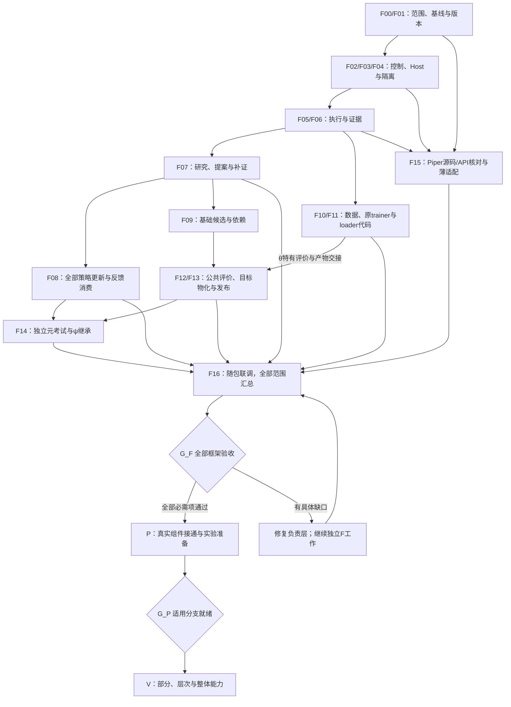

# RSI-Agent-VLA 详细实施方案：框架搭建优先

日期：2026-11-17  
设计基线：[项目框架设计方案：复核与定稿](02_项目框架设计方案_复核与定稿_2026-11-17.md)  
实施基础：现有 RPent、core、Autoloop/Host 及匹配的 RLinf/OpenPI 运行链  
本轮讨论：[04 对话完整记录](04_对话完整记录.md)，取舍见设计方案 §2.4

## 1. 实施目标与顺序

先完成固定范围内的全部框架代码、消费者接线、离线工程验证和维护文档；每部分先采用一种具体基础实现。随后准备真实组件与数据，再分别验证部分、任务执行/系统更新/研究策略改进三个层次，以及整体能力。

框架建设的结束条件是功能与交接成立，能力验证的结束条件是在预定资源和规则下形成支持、未支持或未决结论。科研正结果不作为 G_F 条件；工程缺口也不能用“效果未知”结案。

推荐顺序为：

**仿真分支：F00—F14 仿真适用项 + F16_sim → G_F_sim → P_sim → 适用 G_P → V_sim。全局：全部 F → G_F → 适用 P/G_P/V（含真机及论文证据）。**

第四批 `G_F_sim` 覆盖 C01—C07/C09/C10；C08 未验收、延期。全局 G_F 继续等待 F15、C08、真机 F16 及共享版本兼容。当前状态和授权只在[04 §1.23](../../项目文档/04_实施路线与执行状态.md#123-第四批仿真验收与准备2026-11-17)维护。

第一阶段同时建设任务执行、研究、数据与训练、评价与发布、主动能力增长、关系学习、Meta-RSI 和 Piper 接入代码。不能先运行一批实验，再发现后几项还只有字段定义或手工脚本。

框架搭建包含开发所需的单元测试、CPU 集成测试、故障注入、真实本地进程/RPC/隔离边界检查；这些是工程验证，随代码完成。项目 Planner/Research 模型调用、GPU 仿真、正式数据采集、原生训练、任务调优和效果比较进入后续阶段。开发助手与项目模型请求分开计量。后续发现实际兼容问题时允许在负责层修复，但不把预先已知的框架缺口留到实验阶段。

本文件给出实施计划，不启动工程修改或实验，也不解除已有人工暂停。实际执行仍需采用适用的任务授权、资源和期限。运行状态继续由[项目文档 04](../../项目文档/04_实施路线与执行状态.md)维护。

## 2. “全部框架完成”的范围

### 2.1 第一阶段必须具备的能力

| 能力域 | 第一阶段必须交付 | 后续才产生的证据 |
| --- | --- | --- |
| 控制与作业 | 唯一工作流接续、准入、计量、监督、暂停/取消、未知提交对账 | 长时间真实负载下的无人值守运行与吞吐 |
| 执行与技能 | Planner/冻结程序、Skill 契约消费、路由、结果与动作监督接线 | 真实模型的任务成功率、恢复收益 |
| 证据与记忆 | 原始事实、合法视图、媒体出口策略、工作状态、版本化经验 | 真实存储节约、诊断质量和经验迁移 |
| Research | 有界请求、补证、机会选择、实验提案、受限代码候选的实际消费者 | 自主提出有效改进及研究效率 |
| θ 学习 | 数据准入、训练作业、产物交接、原生加载、θ×B 评价准备代码 | 实际梯度更新、加载和能力收益 |
| φ/ρ/ψ 更新 | 可执行更新算子、真实反馈字段、冻结、候选、资格与继承入口 | 各策略的改善、组合效应和 H3 |
| 独立评价 | 三类评价信息流、隐藏材料读隔离、任务矩阵、统计与三态 Gate | 真实分布上的效应、不确定性及泛化 |
| 发布 | scope/revision 资格、激活、拒绝/未决、回滚与新作业绑定 | 真正有价值更新的激活和后续继承 |
| 主动能力增长 | 目标提案、领域价值检查、学习计划、新协议及参考版比较消费者 | 新能力的独立任务表现与组合迁移 |
| Meta-RSI | ψ 产生、冻结、新研究问题考试、里程碑提交和独立评分运行器 | 后期 ψ 的研究效率是否优于早期及记忆对照 |
| Piper | 设备服务薄适配、动作/观察合约、租约、停止、结果与离线设备替身接线 | 现场标定、安全验收和真实物理闭环 |

框架验收证明这些路径可通过实际入口运行，外部模型、trainer 或设备可在离线测试中由边界替身代替。真实组件兼容与科学效果分别在 P/V 阶段验收。只有接口声明、空实现、恒定 no-op 或手填成功结果不能通过 G_F。

### 2.2 沿最终设计保留的可选项

独立战略规划 Agent、大规模分支搜索、资源并行调度、第二 Workflow/Runtime、任意结构搜索平台、全部机器人的全套迁移，以及 H4 神经内部编辑，不是本轮框架完成的前置条件。保留适用扩展点和对应研究目标；出现具体研究需求后在后续范围内建设。

当前 Research 继续支持并如实声明 text-only。有界图像输入若成为选定研究任务的必要条件，先实施媒体消费者再冻结该实验；不能仅传路径就声称具备视觉诊断。常规文本证据研究不为此新增多模态平台。

### 2.3 与设计、讨论和现行项目记录的关系

设计方案 §13 与本文统一采用 F/P/V：将代码、隔离、结果消费和运行器全部安排在 F；真实组件兼容、数据准入实证、训练结果、发布收益、H3 和现场效果分别归 P/V。P/V 不承担候选档案、元考试、发布消费者或 Piper 基础适配的首次开发；正常配方配置和负责层兼容修复仍可进行。

本轮讨论第一轮的“先缩核心、尽早做真实验证”不作为执行路线，第二轮“全部覆盖、基础实现、分层验证”的原则进入本方案。实验聚焦用于选择证据强度和对照，不默认删除三类关系、未预列目标、H3 努力、Piper 或有限第二动作类型目标。

项目文档 04 当前仍保留旧双轨推进安排与暂停状态。本轮只修改指定的两份方案；新实施任务接入时应将本路线写回现有职责文档和状态入口，保留历史事实、授权与暂停。文档改写本身不启动任何旧队列。

### 2.4 固定本版本范围与基础实现深度

F00 将下表映射到实际源码和消费者；不新增一套范围管理平台。[设计方案 §8.2.1](02_项目框架设计方案_复核与定稿_2026-11-17.md#821-首版可执行修改范围)定义各对象的修改、反馈和停止边界。

| 范围 | 本版本最低实现 | 工程完成时可以仍未知 |
| --- | --- | --- |
| 执行/φ/ρB | 现有 D/S/R/A 和已注册兼容技能；一种有限调用/阶段修订与经验路由更新 | 哪种组织最强、学习路由是否优于校准 |
| θ | 一条匹配 π0.5 的有限原生 SFT—保存—加载路径，资源 pilot 与 learning 分开 | 真实资源包络、数据是否使模型变强 |
| ρA | 现有引用反馈策略，并接通一种明确 L1 保留出口；L0 与必需审计固定保留 | 视觉诊断质量、真实存储和最终收益 |
| ψ/ρC | contextual 有限选择/探索，一种可继承补证或算子顺序/规则修订，冻结与执行入口一致 | ψ₁ 是否更会研究、元改进程序是否稳定有效 |
| 代码候选 | 一个明确研究规则或技能插件接口的隔离补丁、检查和实验消费者 | 能否产生非预置且有价值的算法 |
| 主动新目标 | 已支持场景/对象/谓词的有界组合，至少覆盖未在当前任务清单列出的合法组合，接通物化与评价 | 真实可达性、新能力收益与迁移 |
| Piper | 对已核实设备 API 的薄适配、生命周期、停止/未知和离线链 | 现场兼容、停止延迟、安全与任务效果 |
| 评价/发布/元考试 | 共用真实内部运行器、独立信息流、资格与后续绑定；支持终点和预定里程碑 | 正式效应、泛化与 H3 |

已有更广且有消费者的能力保留；“一种基础实现”不要求删除它们，也不要求每类同时开发多个算法。增加场景、新传感/设备能力、任意结构搜索或另一训练框架属于后续明确范围变更。首版边界可以参数化，但不得用无限“待配置”替代默认可运行路径。

对每个必需项，F00 在现有工作清单记录：支持什么、默认实现、代码/依赖版本、输入输出、实际消费者、适用检查及剩余真实测量。主体实现缺失或实际 API 无法确认，保留为具体工程缺口；其他独立包继续施工。

### 2.5 工程范围与论文主张分开确定

完整框架按上述范围交付。科研主问题保持开放，利用既有源码、历史合法证据和一手文献分析候选，不要求先做正式实验才能开工。P 阶段用有界辨别试验确认机器人代价、强简单解法后的残余和关键对照，再冻结正式主比较。

“选择更新层级”与 AdaRSI、“升级后协作适配”与 Robo-COP 有直接覆盖，不能仅因接口适合就宣布新颖性。H3 保留本篇内实质努力；主贡献是否落在它上面由证据决定，不预设必须删除其他工程能力，也不要求全部方向各自得出独立优势。

## 3. 现有实现与缺口基线

本地聚合仓库基线为 `3dbc59ad`，RPent 为 `c57b134` 加既有工作树改动；RPent 相对本地 `origin/main` 领先 2、落后 2。执行 F00 时重新确认实际状态，不把这些提交号等同于远端最新版本，也不清理已有修改。

| 领域 | 现有基础 | 本轮主要增量 |
| --- | --- | --- |
| 合约与存储 | `contracts.py`、`storage.py` 已有 RunBundle、事件、结果、候选和 Gate | 执行/研究/事实/评价引用的兼容组织、依赖与消费者核验 |
| 工作流 | `protocol10_coordinator.py`、`task_continuation.py` 有稳定意图、有限接续与对账 | 有界新计划消费、跨阶段产物绑定、生产操作完整覆盖 |
| Host | `midterm_host.py`、`fixed_command.py` 已有总账、六类固定作业 permit 与监督 | receipt-bound 后继引用、无模型 CPU 业务操作接线；统一恢复责任 |
| 隔离 | `protocol10_roles.py`、`run_isolated_role.py` 已有 broker 和写域隔离 | 隐藏评价数据读隔离、受限代码候选与实际部署检查 |
| RPent 执行 | Planner、Toolkit、LIBERO D/S/R/A、ρB、journal/finalizer | Skill 条件和验证范围的实际消费、扩展后端一致接线 |
| 证据/关系 | EventLedger、TaskState、ρA/B/C 学习及 contextual ρC | 媒体保留出口的真实消费、反馈目标与版本适用性、知识继承 |
| Research | 有界 high 请求、readable 输入、补证与结构化响应 | 四类机会至真实实验/候选的统一消费；开放代码候选有界验证 |
| 数据/训练 | 公共/教师数据、mixed data、pi05 training、θ×B 接口 | 可独立调用并接到 Host 的数据审核、产物交接和实际加载完整路径 |
| 评价/发布 | evaluator、midterm science/evaluation/deployment、Release、upgrade bridge | 非成功率目标的明确评价、三类信息流、新问题考试、独立加载和继承 |
| ψ | `effective_psi.py` 已冻结策略并分离事实 | ψ 候选生成/执行绑定、独立元评价与后续研究作业继承 |
| Piper | RPent 目前未发现 `robots/piper/`；项目规定沿既有设备副本接入 | 确认具体可用副本与 API，建设薄适配和离线设备替身 |

当前状态记录明确：midterm16 人工暂停，P1 与部分数据准备已有证据，真实 θ 更新、正式 E1、F2/H3 尚未建立；P3 的 receipt-bound late refs / generic CPU model0 消费仍有已知缺口。以上作为任务输入复用，不重新发起原批次或回写历史。

Piper 依赖文档称“lerobotv6 副本”。本地发现 `/home/xzh/lerobot-piper`，尚未确认它是否为允许修改的既有副本。F00 需要查明真实拥有者与可用代码入口；原 lerobot 仓库不修改，不凭名称决定复用边界。

## 4. 总体工作分解与依赖

### 4.1 工作包总表

| 编号 | 工作包 | 直接依赖 | 主要交付 |
| --- | --- | --- | --- |
| F00 | 实现基线、代码归属与接口清点 | 无 | 可执行任务清单、保留/补齐判断、Piper 源码接入结论 |
| F01 | 版本、引用与实际加载身份 | F00 | 兼容版本引用、作业绑定、依赖核对 |
| F02 | 工作流状态、授权与恢复权威 | F01 | 意图—操作—回执一致接续 |
| F03 | Host 全作业接线、晚绑定与费用 | F02 | 后继产物消费、CPU/Research/Runtime/训练/评价统一派发 |
| F04 | 角色读写隔离与候选执行边界 | F01、F03 的角色契约 | 读域/写域、broker、隐藏数据与无设备代码环境 |
| F05 | 执行、Skill、路由与监督 | F01、F02 | 实际 Skill 消费、公开状态、结果链 |
| F06 | 事实、媒体、记忆和 ρA 出口 | F01、F05 | 完整事实、派生视图、保留/删除的真实媒体出口 |
| F07 | Research、机会、提案与代码候选 | F02—F04、F06 | 补证与计划消费，四类机会，受限代码试验 |
| F08 | φ/ρ/ψ 更新、反馈与继承 | F01、F05—F07 | 可执行更新算子、策略/事实分离、行为消费 |
| F09 | 候选档案与更新依赖 | F01、F07；策略特有部分随 F08 接入 | 基础档案先可用，历史父节点、组合依赖与成本可查 |
| F10 | 数据来源、审核和训练集物化 | F03、F04、F06 | 原始 manifest → 审核 → 可用数据的消费者 |
| F11 | 原生训练、加载与 θ×B 编排 | F01、F03、F10 | 真正调用原 trainer/loader 的代码及产物传递 |
| F12 | 独立评价、目标扩展与统计 | F04、F06、F09；θ 分支随 F11 接入 | 公共评价先联调，目标物化、完整矩阵与三态结论 |
| F13 | 资格、发布、回滚与继承 | F01、F03、F09、F12 | 唯一受信激活路径、后续绑定 |
| F14 | Meta-RSI 考试与策略发布 | F07—F09、F12、F13 | ψ 开发—冻结—考试—继承的完整运行器 |
| F15 | Piper 薄适配与设备服务接线 | F00、F01、F03—F06 | 机器人注册、设备服务、停止与离线物理边界测试 |
| F16 | 全框架离线集成、入口与维护文档 | F00—F15 | G_F 验收、统一操作入口和后续准备交接 |

F04 的角色契约可在 F03 完整实现前确认；其他交叉依赖按所需接口推进。表中依赖不是要求每个文件必须串行编辑，也不授权自动创建子 Agent。

### 4.2 推荐施工批次

保留全局 G_F，包内按实际接口依赖联调；施工不要求所有分支依次等待。推荐先关闭共同控制/证据缺口，尽早接通候选—评价—发布的离线路径，再汇合训练、主动目标、元考试和 Piper 的全部工程能力。



箭头表示接口或产物依赖。F09 基础档案不等待 F08 的全部算子；F12 公共评价不等待训练链，θ 特有部分随后并入；F15 从 F00 开始核对，使用所需控制/执行接口。F16 在包间持续集成，最后收齐所有必需项。这里的分支是开发依赖，不授权创建子 Agent。

仿真适用真实组件在 G_F_sim 后进入 P_sim，其他范围按全局 G_F 和适用分支门槛进入 P/V；不因为某一任务更容易出分而跳过其余 F 包。F15 的真实 API 若始终无法确认，必须报告该包未完成及 G_F 未通过，不能通过将其改称可选消除缺口。

## 5. 第一阶段：全部框架搭建明细

本节中的新增字段和接口是实施规格建议，非现有 API 声明。优先扩展已有模块；只有职责无法容纳时再提取小模块，不预先要求每个工作包对应新目录或服务。

### F00：确认实现基线与修改边界

**目标：** 给后续施工提供准确输入，不进行训练数据选择或实验调参。

实施步骤：

1. 核对聚合仓库与 RPent 两个 Git 边界、当前分支、相关 upstream 和未提交差异，建立本轮可修改范围；重叠修改使用独立 worktree 或明确文件归属。
2. 按本方案逐项追踪实际入口、调用者、返回结构、存储域、费用 owner 和测试；已存在且满足目标的路径直接保留。
3. 核实 `.venv` 的 Python、RPent、RLinf/OpenPI 实际导入路径与声明，不启动模型或安装新依赖；缺环境时记录后续 P 阶段事项。
4. 查清 Piper 允许使用的既有副本、设备类、相机与动作接口；读取现有代码确认断连、停止、复位语义，不能把 YAM 或 LIBERO 的行为复制为 Piper 事实。
5. 按 §2.4 固定本版本支持范围、默认基础实现和验收证据；将新增任务与最终设计逐项对齐，保留一篇论文、SC1—SC8、三类关系学习、主动新能力、H3 努力和有限第二动作类型迁移目标。主科学问题未冻结不阻断这项范围明确的工程建设。

**产出：** 更新项目文档 01 的实现映射和 04 的本轮工作清单，引用已有源码与断点；不另建平行运行状态主库。

**完成条件：** 每个必需工作包的支持范围、默认实现、代码拥有者、消费者和检查入口明确；新增想法进入后续范围，不追加为本版本默认阻塞项。未知的源码/接口依赖有明确关闭动作。无法取得的设备后端 API 阻断 F15 的对应完成声明，其他独立开发继续。

### F01：兼容的版本引用与作业绑定

**修改位置：** `core/src/rsi_vla/contracts.py`、`storage.py`、`runtime.py`、`effective_psi.py` 及实际调用方；RPent journal/context 入口。

实施步骤：

1. 保留 RunBundle 现有字段和历史读取。通过版本化引用记录执行产物、研究策略、事实起点和评价条件，明确 processor/norm、动作合约、Skill/路由、后端与源码差异。
2. 同一共享实现仅保留一份权威引用；标明 φ/ρB、ψ/ρC 的实际冻结和修改范围，避免两个副本漂移。
3. 启动作业时冻结实际读取版本。Runtime、Research、训练、评价各保存所需版本和授权；追加结果不改起点。
4. 新 θ 的后继作业读取前驱加载/产物回执，不能通过覆盖初始 profile 伪装继承。实际加载与声明不符时输出具体不匹配和适用性结论。
5. 保持研究策略在 Research Job 边界替换，运行模型在任务/批准安全点替换。纯研究策略变化不强制重部署无关机器人服务。

**交付检查：** 旧 Bundle 可读；同 ID 冲突拒绝；运行中改配置不改绑定；新 ψ 影响新研究作业但不污染旧作业；θ/processor/action mismatch 不能获得兼容资格。

**完成条件：** 引用被实际启动、加载、评价和发布消费者使用，不能只保存在新增 manifest。

### F02：固定状态权威与恢复责任

**修改位置：** `protocol10_coordinator.py`、`task_continuation.py`、`task_completion.py`、`midterm_host.py` 及后端适配。

实施步骤：

1. Coordinator 只拥有工作流意图、pending、操作与后继；Research/Evaluation/Release Store 保持各自业务权威。Host 保存准入、进程、占用与监督回执。
2. 复用现有 Job/operation/run/episode 身份，明确逻辑操作、实际 attempt 和动作段关联，不通过改 ID 隐藏重试。
3. 将“未提交、运行中、已完成、结果未知、等待资源、人工暂停、取消/终止”映射到现有状态及结构化原因；不要在三个模块中各自新增同一状态机。
4. 重启或重复唤醒先 reconcile 原操作。查询可有界重试；效果未知的训练/模型请求/设备动作先核对回执，不能直接重发。
5. 有效任务失败、研究 defer、Gate reject/inconclusive 均为业务结果；只有真实基础设施错误走相应故障恢复。恢复次数与分母沿协议执行，费用不重置。

**交付检查：** 派发前崩溃、提交后回执丢失、Host 重启、重复事件、人工暂停后定时器、费用未知与进程清理失败。

**完成条件：** 每类故障有唯一推进/恢复决定者；不会产生重复副作用，不会因普通资源事件恢复人工暂停。

### F03：补齐 Host 操作、晚绑定引用与计量

**修改位置：** `midterm_host.py`、`fixed_command.py`、`phase_receipts.py`、`task_completion.py`、`task_continuation.py`、`protocol10_roles.py` 及现有 CLI。

这是现有代码最明确的近期接线缺口，优先于研究和训练效果工作。

实施步骤：

1. 在已有登记操作上补齐 CPU 分析、数据审核、基线冻结、结果导入、科学评价、资格和后续准备消费者；已有六类固定作业消费者直接复用。
2. 实现 **receipt-bound late refs**：后继仅引用已结束前驱、允许的回执类型和具体字段；绑定前驱 operation、scope、版本和费用闭合状态。不可从任意模型字符串或 JSON 路径获得文件/命令权限。
3. 对训练产物、实际加载、正式评价与继承等运行前未知的引用，先保存声明式依赖，待前驱结束后物化独立且不可冲突覆盖的后继输入。
4. 对 generic CPU model0 操作明确其资源与副作用：零模型请求仍可能写文件、耗墙钟/磁盘并创建资格；必须经对应准入和监督，不能将 `dynamic=false` 用作绕过现有授权检查的办法。
5. 保持总授权 → 当前阶段准入 → operation permit → supervisor → 原生回执 → 费用结算 → 后继的完整关联。共享动态锁继续用于需要互斥的外部作业，控制状态锁独立。
6. 让资源不足返回 checkpoint 和有限重查；累计消费、临时占用、清理和强制预留不重复计量。对实际未知维度保留 unknown，不能补 0。

**交付检查：** 前驱未结束、引用错 scope、回执漂移、同操作重启、CPU 超时/超存储、零模型作业非法扩权、训练后产物正常接续、重复结算。

**完成条件：** 从同一 Host/Autoloop 入口能完成所有登记作业的接续；不需要主代理逐节点手动调用业务 CLI。

### F04：隐藏材料读隔离和受限执行环境

**修改位置：** `scripts/run_isolated_role.py`、`protocol10_roles.py`、实际角色启动器、证据投影和文件工具边界。

实施步骤：

1. 分别定义每个角色可读输入、可写输出、临时目录、网络需求和设备权限。保留写域限制，同时对隐藏协议、标签、未公开元评价结果建立真正不可读的边界。
2. 优先复用 bwrap/现有角色机制。对绝对路径、父目录只读挂载、symlink、共享日志和继承环境逐条检查，不能只删除 Prompt 中的路径。
3. 将评价控制者与被评价 Runtime/候选执行环境分开：可信 evaluator 可读隐藏判据，被测程序只读任务所需输入并写本次输出。评价使用 RPent 代码不等于允许 Planner 读评价目录。
4. 研究代码候选在已授权工作区/产物副本中执行，限制到允许的代码范围与依赖；无真实设备、无正式发布写权限、无隐藏标签。不得为其传入任意宿主命令执行权。
5. 继续用 broker 固定操作及调用者身份核验。SDK 凭据与现有配置沿最小实际需求提供，原认证文件不复制到研究产物。

**交付检查：** 用真实隔离子进程读取诱饵隐藏文件、写越域目录、通过 symlink/共享回执旁路、申请未授权 GPU/设备或 release 操作；同时验证合法依赖/输入仍可用。

**完成条件：** 读隔离和写隔离均有实测。namespace 环境不可用时报告明确阻塞，不能仅用 mock 宣布该包通过。

### F05：执行、Skill 和任务状态接线

**修改位置：** RPent `robots/libero/` 的 toolkit、tools、execution arms、skill routing、result/runtime evidence；公共逻辑仅在实际多消费者需要时放入 `rpent/`。

实施步骤：

1. 对当前实际使用的 Skill 补齐输入/返回语义、合法前置观察、已验证条件、完成/未知/失败、版本依赖和交接记录。
2. 让 Planner 上下文、ρB 路由和调用入口消费相关条件：起态未知、能力不兼容或未授权时返回可操作原因，不能仅让配置更丰富。
3. 保持唯一动作发送链。D/S/R/A 复用现有 Toolkit/VLA、观察/记录和预算；共同执行合约是参数化能力，不在此选择哪一臂效果最好。
4. 区分工具完成、子目标完成与整任务原生结果；任务关系依据同回合合法事件和实际判据更新。先前持物等关系可被新观察失效。
5. 运行条件只读合法公开观察。私有物体/关节真值用于独立评价，不通过 completion、文件读取或工具反馈回流运行决策。
6. 明确预测边界取消、动作段反馈未知和预算停止的传播；保留模型预测与动作发送的不同事实。

**交付检查：** 条件不满足/未知、旧验证范围、错误推进、重复完成、关系失效、半段 RPC 失败、D/S/R/A 共同底层链和 finalizer。

**完成条件：** 合法调用、拒绝/暂缓和中断都经过同一生产路径并产生可独立消费结果。五步前缀等当前行为保持兼容，改变时序另建新协议。

### F06：证据、媒体出口、记忆和 ρA

**修改位置：** `evidence.py`、`collection.py`、`relation_consumption.py`；RPent journal、flywheel episode/export 和 MemoryManager 的实际消费点。

实施步骤：

1. 保持 L0 身份、动作来源、proposal/send/feedback、缺失、终局结果和成本，不由 ρA 选择性隐藏；断流显式记录。
2. 保持工作状态、跨任务经验、研究知识与原始事实分离；经验修订引用来源，不覆盖历史事件。评价时读取冻结记忆并隔离写入。
3. 在真实 L1 写入/保留出口消费固定策略与反馈策略，区分控制所需即时观察、受保护审计、开发媒体和评价媒体；策略不能删除后两者中的必需证据。
4. 记录媒体保留、结果标注、修复选择机制及已知概率；未知概率和零覆盖不伪造。对既有原始产物保留来源和历史语义。
5. 使用已有 artifact accounting/retention 计量实际持久字节、临时占用和累计写入。只少传媒体引用的模式继续标为引用选择，不能填成存储节约。
6. 数据导出区分自主轨迹、公共示范、教师数据和独立评价轨迹；成功标签不自动形成训练准入。

**交付检查：** L0 不随 ρA 丢失、受保护媒体不被清理、受预算约束的媒体落盘确实改变、取消后的尾段/部分轨迹、未知概率、经验冲突和测试记忆污染。

**完成条件：** 策略影响的是明确出口，费用来自实际产物；控制观察与评价证据不被研究取证策略无意改变。

### F07：Research、四类机会与有界计划消费

**修改位置：** `research_tools.py`、`research_transport.py`、`bounded_runner.py`、`research_cycle.py`、`task_policy.py`、现有 Host/continuation 操作注册。

实施步骤：

1. 失败/未知、成功但低效、鲁棒性/保持、新能力四类入口统一形成可检验机会；技术诊断单独分类，不直接形成能力收益标签。
2. 复用当前短请求、readable 证据、结构化 response、补证和新请求身份。新调用默认 `gpt-6.1-sol/high`，Planner 保持 `gpt-6.1-sol/medium`；历史记录按原配置解析。
3. 实验提案包含起点、目标对象、证据/假设、区分预测、输入依赖、执行能力、成本限额、停止条件与预期产物。新任务至少一条完整解释，有实际歧义时增加竞争解释。
4. 构建有界提案消费者：校验后物化到既有 operation/有限图，固定命令由可信消费者产生；LLM 不在 response 中授予新权限或修改评价。
5. 在总授权内允许根据结果补证、修订计划、选择代码/技能修复、数据/训练或暂缓。新计划版本关闭旧提案，不改正在执行的 pending。
6. 实现一种明确研究规则或技能插件的受限代码路径：变更范围声明 → 独立工作副本 → 语法/接口及适用测试 → 有界实验申请 → 产物/差异/成本回收。治理与正式评分代码不在自主修改域，不先实现任意新损失/新网络/任意组织结构的生成平台。
7. 消费设计方案 §8.2.2 的信号—决定映射：动作效果未知先对账，条件修订形成开发候选，受控后仍失败才提出有界能力试验。text-only 缺乏必要视觉证据时返回未决或合法补证；不凭自然语言归因生成监督标签。

**交付检查：** 四入口均能生成并消费合法计划；无证据/无预算有明确后继；未知算子不会假成功；超范围代码被拒；有效代码沿生产消费者产生候选产物；defer 与合法补证能连续接续。

**完成条件：** 有从机会到下一必要工作再回到研究状态的完整消费者，而非只有 response schema。代码候选验证框架完成不要求本阶段创造新算法。

### F08：φ/ρ/ψ 的实际更新与反馈消费

**修改位置：** `rule_updates.py`、`relation_learning.py`、`cooperation.py`、`relation_evidence.py`、`relation_consumption.py`、`effective_psi.py` 及 RPent 路由/配置投影。

实施步骤：

1. 复用已有有界规则、经验表和 contextual ρC，不先训练新控制网络。ρA/ρB 的经验均值和 contextual ρC 的有限选择作为基础；补一种 ψ 研究规则修订。每个算子固定输入状态、允许动作、反馈目标、更新规则、停止与冻结方式，不在框架阶段比较最优算法。
2. φ 更新对应实际执行提示/阶段/恢复程序；ρA 更新对应证据/媒体出口；ρB 更新对应授权能力选择/交接；ρC 更新对应研究对象和次序。不能同一补丁重复登记为多类独立贡献。
3. 反馈分开技术有效、筛选结果、任务收益、旧能力、安全、费用与缺失；技术无效不直接当能力失败，未识别因果不标已解决原因。沿现实现如实保留 ρA 的事件覆盖/引用数量代理、ρB 的独立起态/交接反馈和 ρC 的开发筛选目标；真实任务收益另存，不能通过改字段名把代理变成能力改善。
4. 让 ψ 候选能改变真实消费的诊断/检索/实验规则或程序；仅增加事实记忆不生成“后期 ψ”。程序快照与执行入口一致，不能只保存从未运行的源码。
5. 冻结并提交策略更新后经过相应开发/评价/发布路径，新作业读取新引用；旧作业保持原快照。保留探索额度消费与历史成本。

**交付检查：** 用可区分的合法反馈驱动至少一次真实策略差异，核验实际消费者行为改变；同时测试保持原策略、unknown、技术故障和不兼容反馈。不能只断言 JSON 不同。

**完成条件：** ρA/B/C 与 ψ 均具备可执行的更新—候选—替换—继承能力；不要求每轮都更新或离线样例证明效果提高。

### F09：候选档案、谱系与组合依赖

**修改位置：** `storage.py`、`research_tools.py`、开发结果/候选记录与既有查询入口；必要时新增小型只读档案视图模块。

实施步骤：

1. 先接通现有 Candidate/base Bundle/changes 与基本查询，扩展实验/假设引用、来源、适用域、完整成本、选择理由和评价状态索引。该部分只依赖 F01/F07，不等待全部更新算子；F08 的特有策略与组合字段随对应消费者加入。
2. 支持从历史合法父节点继续研究，保留失败与非最优分支；运行版本和未通过候选分开。
3. 组合更新产生新的完整 Bundle 与实际差异；索引可记录多个来源，但发布基准仍明确对应当前 active，不能仅继承两个父候选的资格。
4. 按 θ、processor、动作协议、φ/ρB、证据策略与研究程序依赖生成受影响核验范围；保持旧验证记录，区分不适用与尚未确认。
5. 在预算内提供简单筛选和有限探索选择，复用已有策略；不实现未校准的概率乘积或大型全局依赖推理引擎。

**交付检查：** 旧数据读取、历史父节点、冲突产物、组合失配、stale base、全部失败费用、存储保留规则与同一变更重复计数。

**完成条件：** Research 可查询并据此选择父节点，Evaluator/Release 可追到完整组合与成本；档案不是孤立展示页。

### F10：数据来源、独立审核与训练集物化

**修改位置：** `collection.py`、`adapters/libero_public_data.py`、`libero_teacher.py`、`libero_mixed_data.py`、`pi05_training.py` 及已有准备/运行脚本。

实施步骤：

1. 将已有公共、人工、教师、自主轨迹记录组织为有来源区别的 manifest 引用，保留版本、episode、任务、信息权限和实际转移。首条训练链采用现有支持的公共示范/授权示范准入；其余来源保留记录与明确准入结果，不为每种来源同时新建一套训练器。
2. 实现可调度的数据审核消费者：检查完整性、时钟/帧对齐、动作单位/坐标/频率、图像处理、执行掩码、质量条件和评价隔离，返回明确准入范围或拒绝/未决。
3. 让训练集物化只消费匹配的准入记录，生成确定来源的子集、transforms/norm 配置与原生 dataloader 输入；新任务准备和历史 batch 记录不混用。
4. 采集和下载沿已有单独操作与 meter；中断、失败与部分产物均回收费用和清理记录。
5. 将数据准入结论与模型能力结论分开，成功自主轨迹不自动升级为示范，教师特权状态不进入 Planner 输入。

**交付检查：** 小型本地合成/既有许可 fixture 的完整、错位、缺帧、单位不符、跨评价域混入、许可/来源缺失和中断恢复；通过真实审核入口再交到训练准备入口。

**完成条件：** 准入消费者与真实训练准备已接线。本阶段不筛选正式训练数据、不新采集或下载，不把 fixture 审核通过写为实际数据合格。

### F11：原生训练、加载与 θ×B 编排

**修改位置：** `training.py`、`adapters/pi05_training.py`、`theta_b.py`、`fixed_command.py`、`scripts/run_pi05_training.py`、准备脚本和现有科学消费者。

实施步骤：

1. 复用匹配 RLinf/OpenPI 的真实 trainer/loader，训练循环不重写。配方分别记录 resource pilot 与 learning，消费真实数据准入和总授权。
2. 完成 Host 对训练全生命周期的准入、进程树监督、墙钟/GPU/存储/步数计量、保存窗口与清理。训练失败和部分 checkpoint 不作有效模型。
3. 原生输出经明确产物解析映射为 θ、processor/norm、配方和源码引用，后继加载作业使用 F03 的回执绑定，不事先写死一个尚未生成的 θ1 路径。
4. 加载检查走当前实际 RPent 模型服务，保存实际模型/处理器身份、形状、动作解码与兼容信息；将加载可用与独立任务收益分开。
5. θ×B 准备器接通冻结 B0/B1、实际适用性、明确 fallback 与矩阵消费者；不存在 θ 时返回真实阻塞，不能替换成 θ0 继续计 θ1。
6. 把“数据→更新→保存→加载→独立评价→候选资格”编成现有受控图，训练不通过时仍能合法结束和结算。

**交付检查：** 边界替身替代 trainer/model server，内部使用真实 Host、permit、产物解析、后继绑定、候选和评价准备；覆盖超预算、半保存、模型路径漂移、processor 错配、重复派发与 fallback。

**完成条件：** 源码真实调用原生入口，离线检查仅替换外部重组件；不以 fake 权重冒充梯度学习，也不因尚未训练 θ1 推迟框架代码。

### F12：独立评价、主动新能力和统计消费者

**修改位置：** `evaluator.py`、`evaluation.py`、`midterm_evaluation.py`、`midterm_science.py`、`goal_value.py`、`task_policy.py`、协议检查与任务消费者。

实施步骤：

1. 先实现公共任务结果、全指派矩阵、信息流和三态消费者，使用 θ₀ 的执行侧候选与 F13 联调；θ 产物/模型特有评价随 F11 加入，不作为全部公共评价的前置。为开发、发布回归、最终封存/元考试分配数据与反馈规则，后台日志不旁路 F04 的读取边界。
2. 复用完整 task/seed 指派重算和三态 Gate，加入相应任务目标的实际消费者：成功率、效率、鲁棒性、关键旧能力与新能力，未测指标保持 unknown。
3. 效率比较保持预定任务结果/安全条件，统计全尝试成本；鲁棒性指定变化条件；新能力按独立任务判据评价，不能用技能条目数代替。
4. 领域内新目标经外部固定的价值/权限/可检验性规则准入，首版复用 `goal_value.py` 支持的有界 BDDL conjunction 表示和已安装谓词，固定场景/对象范围；至少有未预列合法组合可进入学习计划，而非只在旧任务清单选题。原模块的目录目标匹配仅证明符号功能价值；为新组合补固定外部价值规则及后继物化，不能让 Research 修改规则以使提案通过。
5. 建设可信任务物化器：校验目标/场景/谓词 → 生成独立 BDDL/指令与 task identity → 绑定匹配初态和原生成功判据 → 接通 RPent/Host 任务入口 → 形成学习/独立评价指派。已安装 LIBERO `ControlEnv(bddl_file_name=...)` 与 RLinf 的 BDDL 路径消费是后端依据，不表示现有 RPent 已能接收任意新任务。F 验收解析、引用与消费者，P 验证真实环境可初始化/结果可读；物理可达性保持独立未知。
6. 新目标需要新评价协议时，由受信消费者物化新协议版本，按同一新分布评价必要参考版；Research 不改当前考试题、权重、成功定义或正式评分程序。
7. 实现参数化比较：候选/当前/anchor、配对 task-init、重复/选择规则、统计与工程阈值、unknown/invalid 处理。当前专用中期统计只用于适用协议，不泛化为全部研究目标的唯一检验。
8. 正式评价作业通过 Host 获取资源，任务选择和评分由 evaluator 拥有；允许公开的回归反馈经过固定投影返回研究域，封存评分不能用于挑候选。

**交付检查：** 三态结果、缺槽、重复槽、伪造指标、错误身份、关键能力违反、未知安全、效率分母、无物化后端的新目标、协议变更、封存反馈泄漏和配对统计手算样例。

**完成条件：** 每类被声明支持的目标有“可运行任务→独立结果→评分→资格/未决”的消费者。未支持的任务构造明确不准入，不能所有新目标永远返回占位拒绝来冒充主动增长框架。

### F13：发布、回滚与后续实际继承

**修改位置：** `release.py`、`upgrade_bridge.py`、`midterm_deployment.py`、Runtime 启动和 Research 启动消费者。

实施步骤：

1. 沿现有 Release 单写入口核对正式结果、协议、scope、硬约束、当前 active/revision、兼容性与实际候选差异。
2. 将 accept、具备资格、实际激活和后续继承分开；reject/inconclusive 都保持原 active。
3. 激活消费独立可信的安全点、队列和加载状态证据，不能仅将调用者布尔参数视为真实设备已安全。离线 fixture 中的安全点属于合成工程证据。
4. 新 Runtime 从有效版入口读取绑定，新 Research Job 从合格 ψ 入口读取绑定；显式 Bundle 参数不能被当成已发布继承。
5. 回滚核对实际激活历史、当前 revision、仍适用目标与当前设备状态；保留所有发布回执和失败历史。
6. 核验现有动态锁、基准重读和 active 的 `atomic_json` 替换；针对“激活记录已写、active 未切换”注入崩溃，沿原操作对账。区分 active 期望版、已启动服务实际加载版和新任务绑定：实际加载不匹配时阻断受影响运行，保留原作业版本。按当前单写部署补齐恢复，不新增分布式事务服务。
7. 未完成动作或未知费用/清理按对应边界阻断受影响激活，继续独立只读与证据闭合工作。

**交付检查：** accept/激活/新启动全链、写激活记录与切 active 之间崩溃、重复提交的对账、加载身份不匹配、拒绝和未决、stale base、跨 scope、伪造安全点、运行中版本不变、回滚非祖先与物理状态未知。

**完成条件：** 使用隔离角色和同一真实发布入口可演示资格、激活、继承与回滚状态转换；正式部署收益留待 V。

### F14：Meta-RSI 独立考试与研究策略发布

**修改位置：** `effective_psi.py`、ResearchJob/候选与 continuation、既有 evaluator/Release；必要时增加小型元评价运行器并接入同一 CLI。

实施步骤：

1. 建立 ψ 开发/修订→有效策略冻结→独立研究问题考试→策略资格→后续 Research Job 继承的完整流程，复用已有作业系统。
2. 考试注册保存问题族/机制划分、共同 θ/φ 与非被测策略、合法事实起点、模型/工具和资源预算；被测 ψ 的 ρC 可随快照变化。
3. 支持 ψ₀、ψ₁、固定 ψ₀+匹配合法晚期事实；核心策略比较使用相同事实，早期事实参照和有限交叉按兼容性/竞争解释添加。只有事实变多时不能物化虚假的策略候选。
4. 支持单终点与多里程碑两种注册：仅主张同预算终点收益可用终点；AUC、较早收益或达到目标成本采用多个预定预算点。各点由策略仅根据开发反馈提交候选，独立 evaluator 评分；封存结果不回流，未提交/技术失败/缺失按预定规则计入，不评价每一个内部候选。
5. 实现终点及适用曲线/到目标成本、旧能力与全部费用输出；单终点注册不伪造曲线和未测到达时间，ψ 产生阶段成本另列。不得用隐藏测试上的事后最优候选计算曲线。
6. 注册区分 ψ 产生历史、研究过程重复和机器人评价 episode；一次 ψ₁ 生成不能冒充元改进程序被多次验证。若只完成一份策略的考试，报告快照层面的结论。
7. ψ 受相同权限与硬总额约束，在 Job 边界激活；考试中自改策略另立协议，不新增元调度中心。

**交付检查：** 小型合成研究问题通过真实运行器产生不同实验选择、候选、里程碑和评价；记忆污染、起点不同、结果提前暴露、无更新和超预算均有反例。

**完成条件：** 可冻结、可执行、可比较、可继承，产物由独立评分消费者计算；不是先留一个 AUC 函数等实验时再接线。

### F15：Piper 执行服务与 RPent 薄适配

**修改位置：** 计划新增 RPent `robots/piper/`；沿 F00 确认的既有设备副本/服务接入，原 lerobot 仓库保持不修改。按现有 RobotSpec、Env/VLA 和 runtime 契约编写。

实施步骤：

1. 核对真实设备类与受支持动作：关节/末端、单位、坐标、夹爪、频率、观察和相机时钟、命令队列、停止和失联行为。当前只读核对的 `/home/xzh/lerobot-piper/lerobot/common/robot_devices/robots/piper.py` 中，`connect()` 调用 `arm.connect(enable=True)` 并标定，`disconnect()` 调用 `safe_disconnect()`（其注释说明回位）再禁用，`teleop_safety_stop()` 调用标定。故连接、停止、析构/清理均须追到底层实际副作用，不可按函数名认定无运动。该源码线索不能确定其修改授权，F00 仍须确认可修改副本。
2. 完成 `get_robot_spec/get_toolkit`、RunConfig、参数校验、PromptBundle、Env client/facade、必要 VLA 编码与解码、finalizer 和标准运行入口。
3. 复用已支持模型/设备服务与 runtime owned/borrowed 生命周期，保持单一设备发送入口；不要将 LIBERO 七维动作直接发给 Piper。
4. 设备服务消费独占所有权、许可、动作合法性和本地停止条件；读状态、启用运动、停止、回位/人工恢复是不同操作。退出、异常和取消不能隐式调用未经许可的回位；需要时在确认副本中补无运动关闭接口。没有底层支持时保留具体缺口，不能把高层 wrapper 命名为 stop 就当已完成。物理复位不能用模拟器 reset 语义代替。
5. 借鉴 YAM 的租约、operator receipt、恢复等职责设计，按 Piper API 重新适配；文件锁只协调遵守该锁的程序，不能代表所有外部控制器已停止。
6. 绑定采集/实际动作证据、人工接管、任务成功判据和版本，接到同一 Host、证据、评价与发布链。
7. 建立无设备的 RPC/设备替身、无运动模式与 operator 诊断入口；离线模式不得实例化会连接、使能或在析构时运动的真实驱动。SDK 使用点延迟导入，基础发现/帮助无需硬件即可工作。

**交付检查：** 注册/CLI、动作单位和形状、合法/非法命令、过期许可、租约竞争、失联/超时、半段效果未知、取消、owned/borrowed 清理、人工复位、结果与版本关联。

**完成条件：** 设备适配已针对实际源码 API 完成并经离线接线验证。仅有占位目录或虚构设备 client 不算完成。现场标定、停止延迟实测、急停/工作区验收和真实动作全部放在 P/V，届时才声明对应设备能力。

### F16：全框架集成与 G_F 交付

**修改位置：** 既有 CLI/scripts、Autoloop bridge、core/RPent 测试及维护文档。复用入口，不另建总控平台。

实施步骤：

1. 将下节的端到端工程场景接到生产 Host/Coordinator/角色/业务消费者，外部重组件只在明确边界替换。
2. 从 Autoloop 事件或本地同一业务入口提交，自动完成准备、派发、回执、下一步和停止。操作员只发初始指令/控制信号，不补逐节点业务 CLI。
3. 输出统一可读状态：当前 Job/operation、绑定版本、原始回执、费用、等待原因、继续条件和未测能力；避免另建新数据库。
4. 更新 `core/README.md`、项目文档 01/03/04/05、必要 RPent 中英文行为文档。源码职责与行为变化分别写回 owning 文档。
5. 按影响范围完成离线检查、必要 namespace/RPC/进程测试和提交前必需检查，整理 G_F 结果及 P 阶段输入。

**完成条件：** F16_sim 汇总 F00—F14 仿真适用交付及 C01—C07/C09/C10，生产消费者、故障费用、隔离及共享版本兼容均成立后才可通过 G_F_sim，并记录“仿真完成、真机待补齐”。全局 F16 仍须 F15/C08 和真机适用接口；缺少必需项时全局 G_F 未通过。已完成包及有效检查继续复用。

## 6. G_F：框架验收设计

### 6.1 必需端到端工程场景

| 场景 | 使用的真实内部链 | 验收重点 |
| --- | --- | --- |
| C01 任务与失败研究 | Runtime 边界替身→事实→机会→有界 Research 回应→实验→候选 | 结果语义、费用、起点与后继，不要求候选一定改善 |
| C02 正常效率机会 | 成功记录→效率机会→有界方案→独立效率消费者 | 成功不是研究关闭条件；指标和分母完整 |
| C03 主动新能力 | 合法目标→领域价值→任务物化→学习计划→新协议比较 | 不是只给目标文字打分；无后端能力明确阻断 |
| C04 θ 更新与继承 | 数据审核→trainer 替身→checkpoint 回执→loader 替身→独立矩阵→资格→新启动 | 晚绑定、版本与 processor、拒绝/未决/激活分支 |
| C05 θ×B | 两个明确模型身份→B0/B1 绑定→评价准备/结果消费 | 无 θ 不 fallback 冒充新模型；适用性 unknown 保留 |
| C06 关系与 ψ | 真实反馈算子→ρ候选/ψ候选→冻结→新作业使用 | 行为实际变化、共享实现不重复计贡献 |
| C07 元评价 | 问题注册→多 ψ 条件→研究作业→里程碑候选→独立评分→策略继承 | 共同起点、事实对照、封存反馈不回流 |
| C08 Piper 边界 | RPent 注册→Toolkit→设备服务替身→事件/结果→Host 收尾 | 单一发送、单位、租约、取消、未知与人工恢复，连接/清理不隐式运动 |
| C09 恢复与计量 | 真实本地轻进程、事件重复、Host 重启、回执丢失 | 不重复动作/请求/训练，不重置成本，不自动解除暂停 |
| C10 读写与发布边界 | 真实 namespace 子进程、诱饵隐藏文件、现有 release 消费者 | Research/候选读不到隐藏内容、写不了 release；合法路径可运行 |

测试输入明确标记 synthetic/offline，输出不能进入真实实验 Store 取得部署资格。选择不同输入覆盖接受、拒绝、未决，不通过篡改 Gate 或强制输出 accept 让全链“成功”。

全局 C01—C10 是必须覆盖的断言集合；第四批 G_F_sim 采用 C01—C07/C09/C10，C08 留待 F15 与真机 F16，不计作通过。可以使用以下共用场景组织，无需十套独立夹具：执行侧更新全链复用 C01/C02 与 F13；训练—加载全链复用 C04/C05；共同反馈夹具覆盖 C06；新目标、元考试和 Piper 分别覆盖 C03/C07/C08；故障/费用与读写反例覆盖 C09/C10。共享生产运行器、记录和适用输入，保持每项要求有对应证据。

离线验收必须覆盖更新后的真实消费差异、保持原策略、拒绝和未决。合法分支结束不要求输出 accept；但若更新算子在所有有效样例中均不改变行为，仍未证明其功能。边界替身不能绕开内部数据审核、Host、产物解析、评价或发布消费者。

### 6.2 检查层次与现有入口

| 检查 | 时机 | 结果含义 |
| --- | --- | --- |
| 受影响单元测试 | 每工作包实现时 | 合约与具体回归行为正确 |
| 真实本地 RPC/进程/namespace | 对应框架工作包 | 工程边界实际工作，无须模型/设备 |
| 跨包 CPU 全链 | F16 | 生产消费者已接通，外部重组件仍未实测 |
| 仿真/model/trainer/真机真实链 | P/V | 实际组件兼容或效果，不能提前计入 G_F |

从聚合根执行现有 core 离线入口：

```bash
PYTHONPATH=core/src RPent/.venv/bin/python -m unittest discover -s core/tests -v
```

开发期间优先运行直接受影响的测试模块，例如 Coordinator/Host 使用已有 `test_protocol10_coordinator.py`、`test_task_continuation.py`、`test_midterm_host.py`、`test_fixed_command_host.py`；训练/评价使用 `test_training.py`、`test_midterm_training.py`、`test_midterm_science.py`、`test_midterm_deployment.py`。新增行为扩展这些测试或按职责新增文件。

RPent 在其仓库根按 CONTRIBUTING 的提交前要求执行：

```bash
pre-commit run --all-files
pytest tests/unit_tests -v
```

修改 Sphinx 内容时构建中英文；仅独立 Markdown 时检查语义、路径和链接。基本环境选择遵循 [tests/README.md](../../RPent/tests/README.md)、[verify-change](../../RPent/.agents/skills/verify-change/SKILL.md)。需要 socket/namespace 的检查在具备条件的实际源码路径运行，不通过在不适用沙箱反复重试或跳过检查获得“全通过”。

本方案不预填未来测试数量、耗时或成功率。成功检查在代码、输入、环境与假设不变时复用；相关修复后重跑受影响检查，交付时完成适用必需检查。

### 6.3 G_F 通过标准

1. 所有必需工作包有实际消费者，无占位实现和未接入入口。
2. 四类机会、θ/φ/ρ/ψ 更新、独立评价、发布/继承、元考试、Piper 代码路径均有上述层级对应的工程证据。
3. 角色读写边界、未知效果对账、人工暂停、费用结算与清理经过适用实测。
4. 旧配置/历史数据仍按原语义可读，原冻结批次和 active 不被新框架改写。
5. 文档和状态明确区分离线通过、实际组件待测和效果未知。

G_F_sim 是上述仿真适用范围的工程验收，G_F 是保留全部必需项的全局交付；两者均不要求各模块在真实任务上显著优于基线。通过后保留包级证据；P/V 的局部修复仅重验受影响依赖，扩范围则建立明确的新版本。

G_F 后可称“目标框架代码与离线接线完成”。原生模型/训练和现场证据尚未取得时，不称“完整项目已通过”或“全部真实后端已验收”。

## 7. 第二阶段 P：实验准备与实际组件就绪

仿真适用分支在 G_F_sim 通过后可进入 P_sim；真机与全局完成声明仍遵守 G_F 和对应分支条件。准备工作不要求产生正向研究效果，但必须得到真实、适用、可计量的运行条件。

| 编号 | 准备工作 | 具体动作与产物 | 就绪条件 |
| --- | --- | --- | --- |
| P01 | 环境与依赖 | 固定实际 Python/安装包/源码差异、模型服务、仿真版本、驱动与可用 GPU；必要安装/下载按授权完成 | 原生组件能在登记环境加载，基础帮助/发现及隔离仍可用 |
| P02 | 数据与来源 | 核验已有公共/自主/教师数据；按覆盖缺口筛选或获准采集；通过 F10 正式审核，冻结训练/开发/评价划分 | 数据与动作、时钟、norm 匹配；不存在评价材料混入；规模不足有明确补齐决定 |
| P03 | 问题辨别、基线和任务流 | 在开发条件完善 D/S/R/A 与简单基线；用合法证据和有界试验辨别主问题及强近邻后的残余；准备正常/失败/变化/未预列目标任务 | 主比较可表达、对照操作/调优机会合理；不要求所有局部机制有优势 |
| P04 | 原生功能验收与资源 pilot | 有界模型请求、VLA 动作链、原生 batch、资源训练 pilot、保存/加载；通过 Autoloop/Host 真实运行 | 真实源与回执可追，GPU/墙钟/存储/清理包络有实际依据；pilot 不用于挑能力 checkpoint |
| P05 | 正式协议与统计 | 按 §8 的证据矩阵选主比较/辨别子集，区分任务 episode、训练/研究重复及 ψ 产生历史；按先导波动确定精度、分母、配对、缺失/恢复与停测，冻结信息流 | 适用 protocol、完整 assignment、主指标、重复/选择/评价点、费用与接受规则在结果前固定 |
| P06 | 总资源与运行准入 | 按测得包络提出任务级硬总额、软阶段分配、清理/强制预留、期限、恢复和等待规则，物化适用 permit | 下一必要阶段资源可用，预算不重叠，当前授权覆盖具体执行 |
| P07 | Piper 现场准备 | 现场确认设备与相机、标定、动作语义、工作区/负载/速度、急停、失联、停止延迟、人工接管与复位；先无运动再授权小动作 | 适用设备/算法审批与独立安全检查成立，真实组件接口通过 |

P03 的基线开发和任务参数配置属于实验准备；若发现需要新增未完成的通用消费者，退回对应 F 包补齐后重新确认受影响 G_F 条目，不能用手工干预绕开。

P04 采用有界调用和明确停止条件，完成真实模型请求、动作往返、batch、更新/保存/加载的兼容与资源测量，不因某次任务不成功就反复调到成功。P03 的诊断性试验和基线开发单独登记，不能计作正式主结果。

P04 是真实工程功能和资源测量，不承担正式能力比较。保持其配置、数据和产物与正式 learning/validation 的用途区分；训练包络应包含保存、加载和清理，不能只按前几步显存估算整个流程。

沿用当前原生训练消费者时，先完成并独立验收本任务 scope 下的真实无人值守 P1，之后才启动其要求该回执的训练 pilot、learning 或 load-check。旧任务的 P1 与 G_F 离线结果不能替代新的适用运行回执；Host 持续核对暂停、期限和资源。

P07 不阻塞与设备无关的仿真准备。G_P 按分支分别报告“仿真/训练/元考试/真机就绪”；未完成 Piper 现场准备时可开展已就绪且获授权的仿真 V，但不能开展真机 V。

### 7.1 第四批 P03—P06 准备交接

P03/P05 草案见[实验设计 §9](../../项目文档/03_实验设计与验收协议.md#9-第四批-p03p05-草案2026-11-17)，当前为待实测数值明确的草案，未冻结正式比较。P04/P06 的本批硬限、原生无人值守前置、单作业准入和真实费用见[04 §1.23](../../项目文档/04_实施路线与执行状态.md#123-第四批仿真验收与准备2026-11-17)；单次训练/load 启动额度不因技术失败重置，未知费用保持 unknown。P07、F15、C08 与真机 F16 延期。

### G_P：准备就绪标准

对即将开始的验证分支，真实环境、合格输入、共同对照、冻结协议、实际资源包络、授权与对应安全条件均具备。已有数据可复用但须适用于新协议，不因文件存在自动重新准入。

具体任务、样本量、GPU 卡号、步数和预算在本阶段据真实条件确定。本方案不重用历史 120 槽或某个旧卡号作为新任务的强制规格。

## 8. 第三阶段 V：部分、层次和整体能力验证

按“真实链基本能力→适用层次→整体净收益”组织。各项在真实组件就绪后按依赖开展，不等待所有模块证明正优势。框架已通过不保证效果；组件有效不保证组合有效。SC1—SC8 与 H1—H4 保持原定义，各次验证按固定预算形成支持、未支持或未决结论。

### 8.1 部分、层次与整体的证据映射

| 视角 | 核心问题 | 使用的验证与可共用证据 |
| --- | --- | --- |
| 各个部分 | 执行/恢复、合法证据研究、θ 学习、三类关系更新、目标物化、评价发布是否完成职责？ | V01 的真实功能及 V02/V04/V05 的必要专门测量；无须每个模块单独提出论文创新 |
| 任务执行层 | 在共同模型、观察、时序与物理预算下能否执行、监督和恢复？ | V02 的代表性 D/S/R/A 和 Skill/路由比较；组织非主张时开发选定后冻结 |
| 系统改进层 | 能否用证据得到真实更新、保持旧能力并进入下一任务？ | V01/V03/V04；当前任务、旧能力、错误交接和成本可从同批合法运行测量 |
| 研究策略改进层 | 改变后的 ψ 是否在共同新问题上更会改进系统？ | V05；同事实对照、共同起点和策略生成成本必需 |
| 整体 | 多轮组合后是否比冻结系统和强简单流程更有效、成本是否合适？ | 一条预定连续任务流复用 V01/V03/V04 的运行，关键物理闭环用 V06；独立封存与各策略执行分别保留 |

工程断言由 F/P 证据负责，机制收益由 V 比较负责，论文贡献还需排除关键竞争解释。同一指标不自动支持这三种结论。

### 8.2 验证工作包

#### V01：真实系统闭环与两类更新

使用真实 Runtime/Research、原生训练和独立评价，分别闭合规则/技能更新与 θ 更新。逐层取得执行事实、研究提案、真实产物、实际更新/保存、加载兼容、独立任务结果、资格、激活与新任务绑定。核实后续从有效版入口继承，而非只显式传入候选 Bundle。

拒绝/未决保持现版；回滚与异常语义复用工程反例及适用真实记录，不为覆盖状态机在真机故意制造故障。至少一次有意义的合法更新被接受并实际继承，才满足对应 SC5；本轮没有可发布候选时保留已证实环节和未完成目标，不强行发布。

#### V02：执行组织、Skill 与关系学习

先按共同条件完成代表性的 D/S/R/A 开发比较，建立足够强的简单执行程序。Runtime 组织不是科学主张时，研究主实验冻结选定组织，不把四臂乘到全部任务、更新与真机矩阵。

三类关系都需有真实合法反馈、实际策略更新和后续消费的基本证据；各自改善多少按主张决定比较强度。Skill 契约作为共同正确性基础，默认不逐字段消融。若主张学习 ρB 的收益，比较结构契约+简单路由/校准；若主张 ρA 有收益，核对审计覆盖、诊断决定和实际持久字节；若主张 ρC 更高效，保持相同更新操作、合法证据和资源上限。

统计任务/旧能力、安全、错误推进、交接、恢复、研究决定和全部费用。额外信息、时序改变和更多开发预算不能混为机制效果。冻结关系可作对照，不取消框架中可学习的实现。

#### V03：θ 更新后的协作适应与更新层级辨别

按既定正式升级协议先确认真实 θ₁ 的独立效果与兼容，再固定 θ₁ 比较旧 B₀、简单校准和候选 B₁；适用常规重训/通用优化属于相应强简单对照。无正向 θ₁ 时仍可报告真实更新与失效诊断，但不冒充正式成功升级。

若主张是“选对改进层级”，在预定辨别子集加入仅 θ、仅执行侧等必要条件。若主张是“新 θ 上适配 B 有价值”，固定 θ₁ 的比较即可回答。只有主张额外交互时才开展兼容的 2×2：

\[
I=[V(\theta_1,B_1)-V(\theta_1,B_0)]-[V(\theta_0,B_1)-V(\theta_0,B_0)].
\]

不兼容组合记不可执行，不能填成低分计算交互。组合优于初始版不单独证明交互；共用 θ₁ 的比较首先支持对该模型的条件性结论。旧 B 适用或简单校准足够时保留直接方案。该方向与 Robo-COP、AdaRSI 的具体区别按设计方案 §3.4 和项目科学问题文档复核。

#### V04：主动能力增长、变化与连续保持

在预定领域内验证正常与失败机会、系统提出未预列合法组合、真实任务物化、学习和独立结果。固定旧清单选题属于课程选择，不能替代 SC3 的未预列目标。若主动目标选择是核心主张，再按必要性比较固定课程、失败优先、随机或适用 Bandit/VOI；基本新能力证据本身不要求全套选题算法竞赛。

SC7 的环境/感知、新技能、动力学，以及连续、组合和未见条件保留分阶段覆盖；选与主问题有关的代表条件，按已注册任务族推进，不要求与每个机制全交叉。把关键旧能力、长期 anchor、有限多轮继承、未知/无效和成本并入整体主运行的预定评价点。

新协议对必要参考版同口径评价，不同评分协议不能直接拼为增长曲线。有限轮次支持所测持续更新结论，不外推无界稳定运行。

#### V05：ψ 元改进的实质验证

在开发问题上产生真实早/晚 ψ，冻结后在共同新研究问题、相同 θ/φ 起点、工具/模型/事实权限和资源上限下考试。核心策略对比使用 ψ₀+相同合法晚期事实与 ψ₁+相同事实；早期事实参照和有限交叉用于必要竞争解释。ρC 若属被测 ψ 可随快照变化。

本篇保留真实策略修订和独立考试努力。一次 ψ₁ 产生并在多个问题验证，首先支持快照结论；若主张元改进程序可靠有效，再按精度和预算安排独立 ψ 产生历史与研究过程重复。机器人 episode 不替代这两层重复。

只主张同预算终点收益可登记终点；主张更早收益/AUC/到目标成本才设多个预定里程碑。每点提交只依赖开发反馈，封存成绩不回流选择；未提交使用共同起点，技术无效/缺失按注册规则处理。策略生成、研究内部实验和共享独立测量的成本分别报告，全部计入适用总账。

区分策略作用、记忆增长、底座增强、更多尝试和普通优化。预算内形成负结果/未决可结束该次验证；这不代表 H3 目标实现，也不要求因此重新否定已完成的 F 框架。

#### V06：Piper 关键闭环与有限第二类型迁移

P07 通过且设备/算法授权适用后，验证执行—事实—研究—合法更新—独立回归—重新部署—后续实际使用。保留真实尝试、人工介入和成本；改规则只支持规则更新闭环，声称真机 θ 学习则须有对应真实数据—训练—加载—效果证据。

真机只复现代表任务与选定关键比较，不复制 D/S/R/A、所有关系、θ×B 和 ψ 的完整仿真矩阵。现场模型/策略切换按安全边界处理，停止、回位与代码回滚分别判断。

有限第二动作生成类型验证保留，优先复用已有支持类型，只迁移选定关键结论；不要求新增通用多类型平台。H4、任意结构演化与独立战略 Agent 仍为有前提的分支，不挤占既定系统证据。

### 8.3 整体主比较与必要辨别

默认整体比较包含三类角色；P03/P05 根据实际主问题确定实现、任务与主要指标，不预定候选必胜。

| 条件 | 公平比较要求 | 主要用途 |
| --- | --- | --- |
| 冻结系统/共同起点 | 固定任务流、版本与允许信息，记录无更新表现 | 识别实际能力增长及基线波动 |
| 强简单研究流程 | 拥有与候选相同的合法证据、θ/执行侧更新入口、合理开发调优机会与资源上限 | 排除“只是有更多干预”和普通固定次序已经足够 |
| 候选研究策略 | 在相同边界内按证据选择更新对象、顺序和必要实验 | 评价完整改进过程的外部净收益 |

强简单流程可以按合理固定规则先检查调用/交接，再在明确条件下沿相同配方训练；也可以采用匹配的已有优化器/近邻实现。只允许简单流程改 B、却允许候选改 θ+B 的比较，只能检验干预集合差异。适用强近邻无法复现实装时说明替代覆盖，不能宣称直接胜过原论文。

相同资源上限不要求相同实际支出，节约资源无需人为耗尽。封存评价的共同开销按相同规则独立报告，研究者自行请求的试验评价计入其成本。选择少量主指标与主比较，其他指标和次要比较保留其证据级别。

### 8.4 实验取舍与证据复用

| 保留级别 | 本轮要求 | 可以减少的工作 |
| --- | --- | --- |
| 系统基本证据 | 两类真实更新、SC1—SC8 的对应证据、三类关系学习、未预列目标、H3 实质努力、Piper 与有限第二类型 | 共享运行器、适用任务流、完整记录和预定评价点，不要求每模块独立显著优势 |
| 核心科学比较 | 整体策略与强简单流程、必要机制辨别、旧能力与泛化范围 | 消融集中于事先确定的辨别子集；不穷举所有因子 |
| 主张触发比较 | 专用 ρA/ρB/ρC 收益、指定反馈因果、交互、档案搜索、AUC、元改进程序稳定性 | 未提出对应主张时不追加该组正式比较；功能实现保留 |
| 后续可选研究 | 控制平面性能、并发、独立战略 Agent、广泛结构搜索、条件 H4 | 无具体瓶颈或前提时不默认运行 |

保持、效率、泛化与连续更新可在主运行中共同测量；开发、发布回归和封存信息流仍分开。同一合法轨迹可算多个预定指标，但不能替代另一策略、独立训练或研究过程的真实执行。讨论中的 E0—E4 不替换项目验收协议中的 E0—E7；本文继续用 V01—V06 对接它们。

仅包装/重复表示的简化用工程回归确认语义；删学习机制若要主张非劣，P05 事先固定可接受损失、硬约束和区间判据。“没有显著差异”不能自动写为等效或无损。

### 8.5 工作量、重复层级与停止

实际按各比较单元求和：

\[
N_{\mathrm{eval}}=\sum_{a,q,r,j}n_{a,q,r,j},
\]

其中 a 为方法条件，q 为任务/研究问题，r 为独立训练或研究过程，j 为预定评价点，n 为该单元完整 task-init/episode 指派数。H3 另按独立 ψ 产生历史汇总。总预算还包括内部试错、采集、训练失败、保存/加载、复位、等待、清理、模型请求、存储和人工。

不把一个 checkpoint 的大量 episode 计成独立训练，不把同一研究过程的多个候选计成独立研究，不把一次 ψ 开发后的大量问题计成多次元生成。区间与分析单元匹配；独立重复数按目标精度和先导变异决定，不使用“几个 seed 一定足够”的通用规则。

优先移除非核心主张、比较臂和不必要时点，再把辨别实验集中到预定子集，复用仍适用的基线/训练产物，最后依据精度调整 episode 数。每次实验在注册预算、分母、选择和停止规则下收口；未决按允许的有限补证处理，有效负结果不为追求好结果重跑。

### 8.6 V 阶段依赖与完成判断

| 验证 | 前提 | 可继续的独立工作 |
| --- | --- | --- |
| V01 规则/技能 | 仿真、Research、独立评价与发布就绪 | θ 资源不足时完成该路径 |
| V01 θ | 合格数据、实际训练与加载就绪 | 真实负结果可报告，不能用 θ₀ 冒充 θ₁ |
| V02 | 适用共同条件与强简单基线 | 可固定 θ₀，不等待真机或局部显著收益 |
| V03 | 真实 θ₁、兼容与独立收益，冻结 B 和适应预算 | 条件不足保留该分支缺口，继续其他验证 |
| V04 | 新目标/变化任务和独立判据就绪 | 按已准备任务族推进，保持全指派和变化范围 |
| V05 | 真实 ψ 修订、共同新问题/事实及考试预算 | 不要求 V03 先成功；底座与更新工具按该考试冻结 |
| V06 | Piper 现场/算法准入；第二类型的对应真实分支就绪 | 现场受阻继续独立仿真，保留 SC8 缺口 |

每项区分“验证已完成且支持”“已完成但未支持”“预算内未决”和“真实工程/组件阻塞”；正式实验未完成指派则按其注册规则处理，不靠事后改称探索回避。SC5 的有效发布和 SC8 的物理闭环等实际目标仍须满足；单项负结果可结束研究验证，不能据此宣布全部项目目标已实现。

## 9. 必须保持的接口交接

下列是逻辑交接，可由现有记录承载；不是要求新建十个服务。

| 交接 | 最小内容 | 接收方必须实际核验 |
| --- | --- | --- |
| 任务/研究准入 | scope、operation、起点版本、授权期限、资源向量 | 当前适用权限与下一必要工作是否匹配 |
| 前驱回执→后继输入 | 前驱身份、终态、产物类型与引用、实际费用、版本 | 完成与费用闭合、字段允许、无跨域漂移 |
| Runtime→事实域 | run/episode/序号、建议/发送/反馈、来源、结果/缺失 | 身份连续、一致性、原生与推断分离 |
| 事实域→Research | 合法事件、选择与遗漏、媒体发送模式、实际来源 | 开发权限、hidden 不可读、text-only 不冒充图像 |
| Research→实验 | 目标/假设/预测、起点、能力、输入、限额、停止条件 | 算子存在、计划有界、授权与资源不扩张 |
| 数据→训练 | 原始来源、独立准入、子集/时钟/动作、transforms/norm | 准入适用性、评价隔离、真实消费范围 |
| 训练→加载→候选 | 保存完整性、模型/processor、配方、实际更新/加载记录 | 真实产物、兼容、无 θ0 冒充 θ1 |
| 候选→Evaluator | 完整组合、变化、父节点、开发证据、成本 | 正式协议与独立指派，不能自行选择最好结果 |
| Gate→Release | 三态资格、scope/protocol、current revision、结果依据 | 未过期、基准未漂移、安全点/队列/许可适用 |
| ψ→新 Research Job | 有效策略、ρC、事实起点、资格/适用范围 | 真正执行冻结策略，与事实增量分开 |

## 10. 工程组织、变更管理与交付

### 10.1 仓库与模块组织

- RPent 负责通用运行与机器人专属适配；LIBERO/Piper 语义留在各自机器人目录，core 不发送设备动作。
- core 负责研究、证据、操作接续、评价和版本治理；模块名中的 protocol10/midterm 不要求本轮统一重命名，只有明确消费者需要时抽取共享职责。
- RLinf/OpenPI 训练与模型网络复用原生实现；训练适配记录真实安装源，不通过更换仓库路径宣布完成迁移。
- 产物、原始日志、数据和权重留在登记 artifact 目录；代码提交不带凭据或大产物。
- 设备副本的修改范围在 F00 明确；原 lerobot 仓库不修改，机器路径写入本地配置。

### 10.2 变更批次与兼容策略

按第 4 节施工批次形成可审查变更；同批内保持接口生产者与消费者一并可运行。合约先兼容扩展，再接通调用者，最后删除确认无实际消费者的冗余路径；不做全仓库清理。

旧冻结协议、历史分母、原始记录和终态保持原样。新任务使用新身份与明确协议版本；历史 SDK medium Research 仍可离线解析，新请求按 high 默认。旧兼容能力有实际消费者时保留，不能为简化代码悄悄失效。

代码审查、检查和必要修复属于每个工作包。提交、PR、合并与部署按后续实际任务授权处理，本方案生成本身不触发这些动作。

### 10.3 范围内异常处理

普通可逆修复在负责层完成，重跑受影响检查；未提交作业可按既有授权修正准备输入；提交未知先查原回执/进程/原生事实。资源短缺使用有限等待和 checkpoint，不重置费用或协议。

故障影响不明时暂停受影响外部动作，继续独立源码、文档或离线工作。改变硬总额、期限、主要目标/验收或新增硬件/封存数据权限时才需要新的明确授权；不逐项重新请求已授予的常规操作。

F 阶段遇到必须通过真实模型/现场测量才能确认的参数，将其作为 P 的实际测量项，代码保留显式可配置和未验证状态；无法确定的实际 API 或未实现消费者属于框架缺口，不归入“效果待测”。

### 10.4 状态和交接记录

| 记录 | 权威位置 | 内容 |
| --- | --- | --- |
| 架构与接口 | 项目文档 01、core README、RPent 开发文档 | 实际模块、生产者/消费者、权限与使用入口 |
| 实验定义 | 项目文档 03 与冻结任务协议 | 部分/层次/整体的复用关系、主比较、指派、重复层级、统计、恢复和证据要求 |
| 当前状态/TODO | 项目文档 04 | F/P/V 工作包完成度、具体阻塞、最新下一步 |
| 设计取舍 | 项目文档 05、本轮设计方案 | 采纳依据、变更理由与限定 |
| 检查证据 | core/OFFLINE_CHECKS.md 及既有检查/任务输出 | 命令、实际环境、结果、失败/未测范围 |

阶段交接记录实际提交/源码差异、产物引用、已通过检查、费用与剩余额度、未决事实、授权和下一步。复用已有记录，不为每个文件或每次读操作创建新证明包。

## 11. 工期与资源安排方式

F00 后按已存在能力与真实缺口估算工程工作量；P03/P04 后按 §8.5 的独立过程、任务和评价点计算实验工作量及资源包络。未知吞吐采用待测项，不按历史 GPU、旧任务额度或预设现场周时长推算工期。软阶段分配不改变用户批准的硬总额。

| 资源 | F 阶段用途 | P/V 阶段用途 |
| --- | --- | --- |
| CPU/本地磁盘 | 开发、离线 fixture、RPC/namespace/进程检查 | 数据物化、分析、回归与产物管理 |
| 项目模型请求 | 框架测试使用边界替身；开发助手费用如任务要求另记 | 实际 Planner/Research、补证、候选与元考试 |
| GPU/仿真 | 不用于本方案定义的 F 工程开发验收 | 模型/环境就绪、资源 pilot、训练和正式比较 |
| 真机/现场 | 离线设备替身和服务适配，不打开硬件 | P07 标定安全与 V06 物理闭环 |
| 费用账 | 原始 owner、占用、实际消费、强制预留的实现与检查 | 真实所有尝试、失败、等待、保存/加载/清理与人工 |

先保留当前动态单作业互斥，避免并行扩展占用框架主线。阶段软分配可在授权硬总额内调整，但下一必要工作、清理和明确保留额必须准入。环境依赖安装、下载、GPU/模型/硬件动作均以实际任务授权为准。

## 12. 最终交付与完成判断

本计划分三个明确交付点：

1. **框架交付 G_F：** 全部必需代码与消费者接通，离线边界和全链检查通过，文档可指导运行；未取得真实组件/效果证据的范围逐项标明。
2. **准备交付 G_P：** 对下一验证分支，真实环境、数据、基线、协议、资源和权限就绪；真机未就绪不冒充就绪，不阻断独立仿真准备。
3. **能力与研究交付：** 分别报告各部分、三个能力层次和整体表现；按 SC1—SC8、实际更新/独立发布/后续继承，以及 H1—H4 的实际主张判断。三类关系、未预列目标、H3 努力、Piper 及有限第二类型的承诺保留，机制独立优势按必要证据验证。负结果、未决、验证完成和项目目标达成分开报告。

建议实际开工从 **F00→F01→F02/F03/F04** 开始，关闭晚绑定、CPU model0 作业和读隔离这些已识别接线缺口；然后连续完成后续全部 F 包与 G_F。实验准备和效果验证统一安排在其后。

## 附录：实施时的主要源码入口

| 责任 | 入口 |
| --- | --- |
| 设计与目标 | [最终框架设计](02_项目框架设计方案_复核与定稿_2026-11-17.md)、[项目总纲](../../项目文档/00_项目总纲与研究边界.md)、[系统设计](../../项目文档/01_系统设计与框架复用.md)、[验收协议](../../项目文档/03_实验设计与验收协议.md) |
| 控制与 Host | [Coordinator](../../core/src/rsi_vla/protocol10_coordinator.py)、[TaskContinuation](../../core/src/rsi_vla/task_continuation.py)、[TaskCompletion](../../core/src/rsi_vla/task_completion.py)、[MidtermHost](../../core/src/rsi_vla/midterm_host.py)、[fixed_command](../../core/src/rsi_vla/fixed_command.py) |
| 隔离 | [角色 broker](../../core/src/rsi_vla/protocol10_roles.py)、[隔离入口](../../scripts/run_isolated_role.py) |
| 研究与版本 | [contracts](../../core/src/rsi_vla/contracts.py)、[ResearchTools](../../core/src/rsi_vla/research_tools.py)、[bounded_runner](../../core/src/rsi_vla/bounded_runner.py)、[relation_learning](../../core/src/rsi_vla/relation_learning.py)、[effective_psi](../../core/src/rsi_vla/effective_psi.py) |
| 执行与记录 | [LIBERO execution arms](../../RPent/robots/libero/execution_arms.py)、[skill routing](../../RPent/robots/libero/skill_routing.py)、[flywheel](../../RPent/rpent/flywheel/episode.py)、[evidence](../../core/src/rsi_vla/evidence.py)、[collection](../../core/src/rsi_vla/collection.py) |
| 数据与训练 | [pi05_training](../../core/src/rsi_vla/adapters/pi05_training.py)、[training](../../core/src/rsi_vla/training.py)、[theta_b](../../core/src/rsi_vla/theta_b.py)、[训练运行入口](../../scripts/run_pi05_training.py) |
| 评价与发布 | [evaluation](../../core/src/rsi_vla/evaluation.py)、[midterm_science](../../core/src/rsi_vla/midterm_science.py)、[goal_value](../../core/src/rsi_vla/goal_value.py)、[release](../../core/src/rsi_vla/release.py)、[midterm_deployment](../../core/src/rsi_vla/midterm_deployment.py) |
| 新机器人 | [RobotSpec](../../RPent/rpent/robots/robot_spec.py)、[注册机制](../../RPent/rpent/robots/base.py)、[runtime helpers](../../RPent/rpent/robots/runtime.py)、[机器人接入指南](../../RPent/docs/source-en/rst_source/development/add_robot.rst)、[add-robot skill](../../RPent/.agents/skills/add-robot/SKILL.md) |

本文件是基于现有实现的施工与验收方案；工作包名称、计划中的新增能力和未来完成标准均不表示已经实施。
