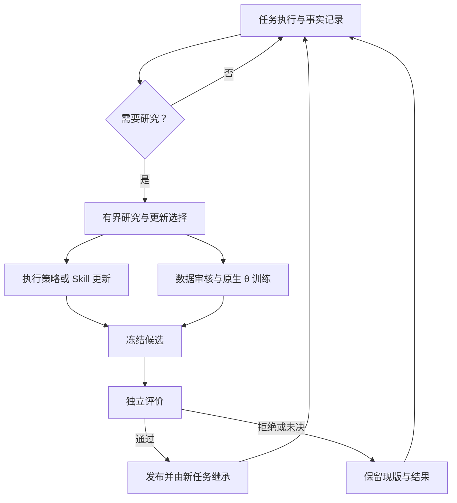

# 对话完整记录

> **导出范围**：本次 RSI-Agent-VLA 项目框架评估对话，自最初的方案评估请求起，记录两轮完整问答，并包含本轮导出请求。这里不包含导出文件生成后的助手回复。
>
> **保真方式**：两次助手长回复分别采用用户补充的第一轮 `.txt` 原稿与第二轮消息中粘贴的原稿；除新增消息边界和附件索引外，正文不作归纳、删改或重排。原稿中的 Markdown 表格、LaTeX 公式、Mermaid 图源码和链接均予保留。第三次用户消息中再次粘贴第二轮助手答复，以下按原有重复保留。
>
> **图像和附件**：两轮问答正文未包含独立的照片或位图；第一轮助手答复包含 **1 幅 Mermaid 流程图源码**，在支持 Mermaid 的 Markdown 阅读器中可直接渲染。第一轮用户上传的两份 Markdown 方案以及本轮补充的第一轮答复原稿，均以原始文件保存于同名附件目录；另存一份第二轮粘贴稿供逐项核对。原答案中的历史 `sandbox:` 链接按原文保留，是否仍可访问取决于原会话环境；本包中的原始附件请使用下面的相对路径打开。

**附件索引（辅助资料，不属于原始发言正文）：**

- [项目框架设计方案_复核与定稿_2026-11-17.md](对话完整记录_附件/项目框架设计方案_复核与定稿_2026-11-17.md)
- [项目框架详细实施方案_框架优先_2026-11-17.md](对话完整记录_附件/项目框架详细实施方案_框架优先_2026-11-17.md)
- [第一轮助手回答原稿：粘贴的文本 (1)(2).txt](%E5%AF%B9%E8%AF%9D%E5%AE%8C%E6%95%B4%E8%AE%B0%E5%BD%95_%E9%99%84%E4%BB%B6/%E7%B2%98%E8%B4%B4%E7%9A%84%E6%96%87%E6%9C%AC%20%281%29%282%29.txt)
- [第二轮助手回答原稿：用户粘贴原文.md](对话完整记录_附件/第二轮回答_用户粘贴原文.md)

---

## 消息 1｜用户

1.这是现在暂定的项目框架设计方案和实施方案，按照你的思路做出全面系统评估。2.完成全面系统评估后，额外思考两个问题：1）流程是否过于复杂，有没有哪个步骤在精简后完全不影响最终效果；2.实施方案的工作是否过于复杂，尤其是实验部分的工作量是否远超一篇论文的工作量，哪些实验是必要的，哪些可以取舍

**此条消息附带的原始文件（附件元数据）：**

- [项目框架设计方案_复核与定稿_2026-11-17.md](对话完整记录_附件/项目框架设计方案_复核与定稿_2026-11-17.md)
- [项目框架详细实施方案_框架优先_2026-11-17.md](对话完整记录_附件/项目框架详细实施方案_框架优先_2026-11-17.md)

---

## 消息 2｜助手

我的总体判断是：**这套架构值得保留，但实施方案需要明显收缩首轮范围，实验方案需要围绕一条主要研究结论重新组织。**

目前最突出的问题，是把“长期完整系统应该具备的能力”，较多地转化成了“开始验证核心效果之前必须完成的工作”。这会让真实学习、实际接口兼容性和研究方法有效性的反馈来得太晚。

对你额外提出的两个问题，我先给出明确判断：

- **流程可以精简。** 重复表示、重复调度、重复验证和不必要的前置依赖，可以合并或取消。对于学习型取证、路由、主动目标选择、Meta-RSI 等机制，是否删除后效果不变，需要实验判断；不能凭架构分析保证。
- **实验范围确实偏大。** 如果 V01—V06 中的各个方向都要形成充分、独立的科学结论，范围已经超过一条聚焦的论文主线。可以压缩到一篇论文，但需要明确哪些是核心贡献，哪些只是工程支撑，哪些保留为后续研究。

以下依据你提供的两份文件：

- 项目框架设计方案_复核与定稿_2026-11-17.md[项目框架设计方案_复核与定稿_2026-11-17.md](sandbox:/workspace/scratch/b553aea63e7c/upload/项目框架设计方案_复核与定稿_2026-11-17.md)，下文简称“设计稿”。
- 项目框架详细实施方案_框架优先_2026-11-17.md[项目框架详细实施方案_框架优先_2026-11-17.md](sandbox:/workspace/scratch/b553aea63e7c/upload/项目框架详细实施方案_框架优先_2026-11-17.md)，下文简称“实施稿”。

本次是对两份方案的完整审查，未重新核验仓库源码和真实实验结果。因此，文档中“当前已有”“已经通过”的内容，我作为方案报告的现状使用；未附上的 SC1—SC8、H1—H4 完整定义，也不自行补全。

---

# 一、全面系统评估

## 1. 总体架构的主要方向是成立的

这套方案已经解决了不少容易让 Agent 系统失控或难以评估的问题。以下部分应当保留。

| 方面 | 评价 | 为什么重要 |
|---|---|---|
| Runtime 与 Research 分离 | 合理 | 执行任务与研究改进所需的上下文、工具和权限不同，分离后更容易控制行为与解释结果。 |
| 确定性程序管理授权、预算、状态转换和发布 | 必要 | 这些约束不应随一次模型判断改变，也便于恢复、核算和复现。 |
| Coordinator、Host、Autoloop 按职责分工 | 合理 | 意图接续、资源监督和事件唤醒各有明确责任；业务事实仍由对应 Store 拥有。 |
| 真实训练、保存、加载、效果、发布分别取证 | 非常关键 | 防止把“训练脚本退出正常”误写成“VLA 已经改善”。 |
| 开发、发布回归、最终封存评价分开 | 必须保留 | 持续根据评价反馈选择候选，会改变测试结果的统计意义。 |
| 执行版本、研究策略与事实记忆分开 | 合理 | 既减少无关部署，也为区分“研究方法变好”和“知道的事实更多”提供条件。 |
| Skill 条件和结果由实际调用方消费 | 必要 | 能力描述只有真正约束调用、推进和交接，才具有运行价值。 |
| Meta-RSI 复用既有作业、候选和评价机制 | 合理 | 研究策略是一类新的被改进对象，无须再建立一套调度平台。 |
| Piper 通过 RPent 薄适配接入 | 合理 | 可以保持单一动作发送链，减少设备控制与研究逻辑之间的耦合。 |

以上判断对应设计稿 §5—§11。

尤其需要肯定的是，设计稿已经明确：

- 四个职责平面不对应四套服务。
- θ、φ、ρ、ψ 是干预对象，不对应六套控制器。
- 不要求每个候选都有多个假设、完整消融和全量回归。
- 不因纯研究策略更新而重新部署机器人。
- 不为了档案、元研究或新能力另建一个运行平台。

**因此，不能简单根据框图中的方框数量，认定它已经过度设计。** 同样，实施稿的 17 个 F 工作包是工作分解，并不意味着要创建 17 个新模块；C01—C10 是工程验收场景，也不等于十套论文实验。

真正需要调整的地方，在下面几个方面。

## 2. 最优先的问题：首次真实验证被放得过晚

实施稿的顺序是：

> 全部框架完成 → 全局 G_F 通过 → 真实环境、数据与组件准备 → 效果验证。

其中，“全部框架”包含三类关系更新、主动新能力、完整元考试和 Piper 接入；模型调用、GPU 仿真、原生训练等实际组件验证都被放到后面。（实施稿 §1、§2.1、F16、§6.3、§7）

我不建议保持这一约束。

### 问题出在哪里？

离线替身可以验证：

> 如果 trainer、模型服务和设备后端按照约定返回，这些内部消费者能否正确接续。

它无法充分验证：

> 真实 trainer、模型服务和设备后端，是否符合这些假定，以及这些假定是否足以支撑目标任务。

例如：

- checkpoint 的实际结构是否能被当前运行服务加载；
- processor、归一化和动作解码是否一致；
- 数据中的动作频率与执行时序是否匹配；
- 模型输出和真实 RPC 的异常语义是否符合消费者假定；
- 最小训练更新是否具有合理的资源包络；
- 当前可用证据是否足够让 Research 作出有价值的选择。

官方 OpenPI 的流程本身就把数据映射、归一化、训练配置、checkpoint 和策略服务推理连在一起；这支持尽早验证这些交接，而不是仅通过各自的接口声明推断兼容性。你的项目仍应使用实际匹配的 RLinf/OpenPI 分支。[Physical-Intelligence/openpi · GitHub](https://github.com/Physical-Intelligence/openpi?utm_source=chatgpt.com)

这里需要准确区分：**实施稿没有用 mock 冒充真实效果。** 它明确说明了 G_F 的证据边界，这一点是正确的。问题在于，它让影响最大的一批真实风险，在大量后续框架工作完成后才暴露。

### 建议怎么改？

保留“框架优先”，但改成：

> **当前核心闭环的框架先完成；最低成本的真实接口验证随对应模块进行；正式效果实验在相应分支验收通过后开展。**

例如：

- Research 接口完成后，验证一次受限真实请求及其结构化结果消费。
- 训练适配完成后，验证原生 batch、实际更新、保存与加载。
- Runtime 接口完成后，验证少量真实仿真动作往返。
- Piper 按独立分支推进，阻塞真机验证，不阻塞仿真研究。

这些是工程兼容性验证，不用于挑选最优 checkpoint，也不承担正式能力结论。

实施稿已经允许 G_P 按仿真、训练、元考试和真机分别就绪。**最有价值的修改，是把这种“按分支验收”的原则提前到 G_F。**

## 3. 第二个问题：工程能力、机制收益和论文贡献还没有充分分开

两份文档保留了以下目标：

- 真正的 VLA 参数学习；
- 三类关系可进化；
- 主动能力增长；
- θ 更新后的协作适配；
- ψ 元改进；
- Piper 真机闭环；
- 有限第二动作生成类型迁移。

这些目标可以共存于一个长期项目，但不应自动拥有相同的当前优先级。

我建议明确区分三个层次：

| 层次 | 需要证明什么 | 典型例子 |
|---|---|---|
| 工程能力 | 功能真实可执行、可冻结、可继承 | ρB 更新后，新任务确实读取并执行新路由规则。 |
| 机制收益 | 相比合理基线，某个机制改善结果或成本 | 学习路由比简单校准更有效。 |
| 论文贡献 | 改善能排除主要竞争解释，并在适当范围成立 | 在未参与开发的问题上，同预算仍优于强简单方法。 |

**三类关系都能够更新，不意味着三类关系都必须各自成为一项经过完整消融的论文贡献。**

设计稿 §11.4 已经提出“不把三项同时设为论文必达创新”。但实施稿仍将这些研究方向的大部分基础设施纳入第一阶段必需范围。这样即使最后不做所有效果实验，也会先承担“让所有方向都具备正式研究条件”的开发成本。

应当在实施之前确定：本篇论文究竟主要回答哪个问题。

## 4. 第三个问题：更新对象很清楚，首版具体改什么还需要收敛

θ、φ、ρA、ρB、ρC、ψ 的职责区分基本清楚，但这些符号覆盖的可能修改范围很大。

例如，“允许修改 ψ”可以只是调整一个研究顺序规则，也可以扩展到修改检索、诊断、代码工具、候选搜索和实验设计程序。两者的实施规模差别很大。

建议为首版补一张**具体更新操作表**，无需新增架构层：

| 对象 | 首版实际允许的修改 | 执行方式 | 合法反馈 |
|---|---|---|---|
| θ | 一种明确训练配方下的参数更新、有限数据选择 | 原生 trainer | 开发任务表现、旧能力、实际训练成本 |
| φ／ρB | 有限的调用提示、阶段规则、交接条件或路由参数 | 现有规则与配置消费者 | 错误推进、交接失败、任务表现 |
| ρA | 一个明确的取证或媒体保留出口 | 现有出口策略 | 诊断价值、实际持久字节和成本 |
| ψ／ρC | 改进对象、补证顺序、实验顺序或预算分配规则 | 有界研究请求与既有消费者 | 同预算收益、无效试验和总成本 |

对于每个启用对象，至少回答：

> 改什么、谁来执行、根据什么反馈更新、何时停止、更新后由谁实际消费？

这比继续扩充“支持哪些类型的自进化”更有助于开工。

同时需要明确：**依据当前证据作出不同研究选择，并不自动等于 ψ 已经进化。** 一个冻结的 ψ 本来就可以根据不同输入选择不同动作。只有其实际策略、规则或程序发生了被后续作业消费的改变，才进入元改进讨论。

## 5. 第四个问题：诊断能力必须与实际可获得的证据匹配

设计稿已经正确区分：

- Runtime 可以读取的公开观察；
- Evaluator 可以读取的私有真值；
- 当前 text-only Research 实际收到的内容。

下一步要落实的问题是：

> 当前 Research 得到的这些证据，究竟能区分哪些故障？

以抓取失败为例，它可能来自：

- 调用目标或起态不合适；
- 路由选择错误；
- VLA 的动作能力不足；
- 执行反馈缺失；
- 完成检测错误。

列出这些解释比较容易，区分它们需要具体信息和干预。

因此，建议围绕选定任务，列出一个很小的“观察信号—可区分问题—允许干预”映射。例如：

- 动作是否执行仍未知：优先对账，不能直接据此训练。
- 同一底层模型在修正调用条件后稳定成功：支持执行侧修订的价值。
- 合法起态与调用条件受到控制后仍存在能力缺口：再考虑数据与 θ 更新。
- θ 改变后旧路由条件不再适配：优先比较简单校准与更复杂适应方法。

这仍然是可检验的判断过程，不能把 Research 的自然语言归因直接当作正确原因。

如果某类关键判断必须看图，而当前 Research 只收到文本，就应当为该路径接通有界图像输入，或者收窄诊断主张。**不必因此先建设一个通用多模态科研平台。**

## 6. 第五个问题：主动新能力的成本主要在任务物化和评价

“系统提出一个新目标”不是很重的接口。

但实施稿 F12、C03 要求的是：

> 提出目标 → 外部价值检查 → 构造可执行任务 → 形成学习计划 → 独立评价 → 新协议下比较参考版本。

这已经包含一套任务构造与评价能力。

因此，需要明确“新目标”属于什么范围：

1. 从既有任务集合中自主选择下一项；
2. 在固定构造语法内提出此前未列出的组合；
3. 创建新的环境任务定义；
4. 需要新的感知方式、设备能力或成功判据。

这四种情况的工作量差异很大，支持的科学结论也不同。

我的建议是：**若主动新能力不是本篇核心贡献，先将它限定为已有任务后端能够物化的目标范围。**

若只在固定任务集合中选择，应当称为自主课程或任务选择；若提出新的组合并完成独立验证，可以支持受限领域内的新目标生成。两者都不宜直接表述成开放世界能力发现。

## 7. 还有几项需要核验，但不值得再扩建架构

这部分应落实到现有 F00、F01、F13 的实现检查：

- 发布时，预期 active revision 的检查与 active 更新在哪个原子操作完成？
- 发布记录已写入，但进程崩溃或实际模型尚未切换，如何恢复？
- active 指针与新任务实际加载身份不一致时，由谁阻止继续？
- 同一个 φ／ρB 或 ψ／ρC 共享实现，是否被重复登记成两项独立贡献？
- 原生训练究竟消费了哪份数据、processor、norm 和代码版本？

这些问题可能已有实现。应当先核实和复用，不能仅根据文档的概括程度就断言源码缺失，也无须为此增加新服务。

---

# 二、问题一：流程是否过于复杂，哪些可以精简而不影响效果？

## 1. 核心运行流程并不需要像总体框图那么长

总体框图描述的是能力全集。实际每轮只应经过适用分支。

核心流程可以表达为：

Coordinator、Host、Autoloop、版本和费用记录支撑整个流程。它们不应变成每次 VLA 动作都要重新穿过的一串模型审批。

同时：

- 正常任务不必逐次触发 Research。
- 执行侧修复不必每次训练 θ。
- 普通候选不必进行 ψ 元考试。
- 每次改进不必包含主动新目标生成。
- 研究没有足够收益或预算时，可以合法结束。

这些原则多数已在设计稿中存在，实施时需要让“默认路径”和“条件分支”更加明确。

## 2. 可以按行为不变来精简的部分

严格来说，适合称为“无损精简”的，是减少重复表示和不必要的操作，同时保持权限、结果、恢复和评价语义。

| 可精简部分 | 具体做法 | 必须保留的边界 |
|---|---|---|
| 按四个平面拆成独立服务 | 首版采用现有本地模块和受控调用 | 隐藏评价材料与不可信候选代码仍须隔离 |
| Coordinator／Host／Autoloop 的不必要进程跳转 | 可信控制组件可同进程部署 | 唤醒、接续、资源监督的责任不混淆 |
| 四类机会分别建立流水线 | 一个入口，以目标类型和证据区分 | 成功、效率、鲁棒性、新能力的评价语义不同 |
| 候选、实验、假设、谱系各建独立平台 | 使用现有记录和查询视图 | 来源、父节点、修改范围与费用可追溯 |
| Tool／Skill／Procedure 强制三层包装 | 只保留实际消费者需要的层次 | 调用条件、结果、版本适用性仍被核验 |
| 数据审核依赖另一个“审核 Agent” | 用可信确定性消费者自动检查 | 数据来源、动作时钟、质量与评价隔离 |
| 资格、激活、继承之间重复人工操作 | 自动接续，分别保留真实状态 | 通过评价不等于已经加载和继承 |
| 纯 ψ 更新触发机器人重部署 | 只更新后续 Research Job 的绑定 | 真正影响执行的依赖仍要重新确认 |
| 不变条件下重复检查和重新统计 | 复用有效检查、同批轨迹计算多个指标 | 适用版本、输入、协议和环境条件一致 |
| 所有分支完成后才能验证核心链 | 删除无关分支对核心验证的阻塞 | 每条被启用分支仍须完成自己的验收 |

前面多数已经是设计稿允许的做法，应落实为首版实现约束。**最后一项是当前实施方案中最明确、最值得直接修改的依赖。**

需要说明：调整顺序可以更早发现问题、减少等待和返工，但如果最终仍要求所有目标全部完成，它不会自动消除这些目标本身的总工作量。

## 3. 可以收缩，但不能保证“效果完全不变”的部分

以下取舍能明显降低工作量，不过它们会改变能力范围或研究主张。

| 可以采用的简化 | 直接减少的工作 | 相应限制 |
|---|---|---|
| 固定 ρA，采用可靠取证策略 | 自适应媒体与取证优化 | 暂不证明学习取证策略的收益 |
| ρB 先采用简单规则或校准 | 专用路由学习算法 | 暂不证明复杂协作适应更优 |
| ψ 暂时冻结 | 元策略生成与独立元考试 | 可以证明系统改进，不能证明研究者自身改进 |
| 先支持有限配置和规则修改 | 广泛代码生成、插件验证和结构搜索 | 自主修改空间较小 |
| 保存完整档案，但先用简单候选选择 | 历史父节点搜索与复杂分支组合 | 不主张档案搜索提高效率 |
| 新目标限制在已有任务构造范围 | 通用任务生成与新评价协议建设 | 能力扩展范围有限 |
| 第二动作生成类型延期 | 额外适配与迁移实验 | 结论先限定在已测试类型 |

这些取舍是否影响当前主任务表现，要通过合理对照判断。

而且，“没有测出显著差异”不等于“证明效果一样”。如果要据此删除一个复杂机制，应先规定可接受的性能损失范围，再检查简化方案的差异区间是否支持非劣结论，同时确认关键约束和成本更合适。

因此，我会区分两种说法：

- **“删掉重复包装，不改变既定行为。”** 可以通过实现和回归验证支持。
- **“删掉某个学习机制，不影响最终表现。”** 只能在明确任务分布和证据范围内判断。

## 4. 不应为缩短流程而删除的部分

以下部分直接决定项目结果是否可信：

1. **实际版本和加载身份。** 否则无法确定究竟运行了什么。
2. **数据准入与真实训练—保存—加载链。** 否则不能支持 VLA 参数学习结论。
3. **独立评价及其读取边界。** 否则候选可能利用评价反馈或隐藏信息。
4. **关键旧能力评价。** 否则新任务提升可能只是能力转移和遗忘。
5. **未知副作用对账。** 否则重试可能重复训练、请求或物理动作。
6. **发布后的实际继承。** 否则只有离线候选，没有持续改进闭环。
7. **适用于真机的动作、停止和现场恢复边界。** 代码版本回滚无法恢复物理场景。

开发、回归和最终封存也不应为省事合并成同一个评价集合。自适应重复使用 holdout 会产生过拟合风险，这正是设计稿三类评价信息流需要保留的依据。[arxiv.org](https://arxiv.org/abs/1506.02629?utm_source=chatgpt.com)

---

# 三、问题二：实施与实验是否超过一篇论文的合理工作量？

## 1. 如果全部方向都要求充分证明，范围确实过大

当前计划同时覆盖了几个可以独立展开的研究问题：

- 动态 Agent 执行是否优于合理简单程序；
- Skill 契约和学习路由是否改善执行；
- 取证选择是否提高研究效率；
- 如何选择更新层级、顺序和预算；
- θ 更新后是否需要协作适配；
- 如何主动提出并掌握新能力；
- 研究策略本身是否越来越有效；
- 如何在连续更新中保持旧能力；
- 关键机制能否迁移到真机及另一动作生成类型。

这些并不是同一组实验换几个指标就能全部回答的问题。

不过，也不应把方案误读成要求所有因素完整交叉。实施稿 V02 已经说“按拟作主张选择”必要对照，V06 也没有要求全部矩阵迁移。**当前缺少的是把这些选择真正做出来。**

我不会给出“这一定等于几篇论文”的机械判断。团队规模、已有代码、模型表现和实验吞吐都会影响工作量。但可以明确说：

> **按全部方向都形成独立科学结论的标准执行，这是平台建设计划加多条研究线；按一条核心结论组织，其余作为支撑能力，则可以收敛为一篇系统论文。**

## 2. 我最推荐的论文主线

结合现有架构和文档中报告的缺口，我建议优先验证：

> **在真实 VLA 系统中，依据执行证据选择修改高层执行策略还是底层模型，在有限总资源下取得可独立验证、可继承、并保持关键旧能力的提升。**

这条主线能够自然连接：

- Runtime 产生证据；
- Research 判断改进对象；
- φ／ρB 提供执行侧更新；
- θ 提供真实模型学习；
- ρC 承担改进对象和顺序选择；
- Evaluator 验证收益；
- Release 让改进真正进入下一轮。

它也允许非核心对象先保持简单：ρA 可以固定，Runtime 可以先冻结为一种合适组织方式，ψ 可以暂不做元更新。

这里有一个清楚的限制：**冻结 ψ 的系统可以持续改进机器人，但它尚不能证明“改进系统的方法也在自我改进”。** 如果论文要把递归自改进作为中心主张，就必须保留后面讨论的 H3 证据。

此外，这条主线目前只是我建议优先检验的问题，还不能仅凭架构判断创新性已经成立。反思优化、程序候选和历史档案利用等要素，在 GEPA、DGM 等工作中已经存在；论文价值需要落到机器人中的具体决策困难、实际预算收益和可区分的机制上。[arxiv.org](https://arxiv.org/abs/2507.19457?utm_source=chatgpt.com)

## 3. V01—V06 应如何取舍

| 原计划 | 我的建议 | 最小保留内容 | 缩减后的限制 |
|---|---|---|---|
| **V01：真实规则／技能更新与 θ 更新** | 必须保留，进入核心实验 | 真实产物、训练保存加载、独立结果、合法继承 | 单次闭环只证明可运行，不能证明普遍持续提升 |
| **V02：D/S/R/A** | 先在开发条件做代表性比较，再冻结 Runtime | 动态 Agent 与合理强简单程序的比较；裸 VLA 用于定位 | 若执行组织不是贡献，不扩展到所有研究任务 |
| **V02：Skill 契约与学习 ρB** | 契约作共同基础；学习收益按主张验证 | 若主张学习路由有效，保留“结构契约＋简单路由”对照 | 不为每个契约字段单独做效果消融 |
| **V02：ρA、ρB、ρC 分别学习** | 不建议三者同时作为独立创新 | 主线涉及的对象做关键对照，其余采用简单可执行策略 | 不能声称三类关系均已证明有独立收益 |
| **V03：θ 更新后协作适应** | 适合作为关键机制实验 | 新 θ 上旧 B、简单校准、候选 B | 复杂方法若不胜简单校准，就保留简单方案 |
| **V04：旧能力保持** | 必须保留，并入主评价 | 关键更新时点上的共同旧任务与 anchor | 结论限定在所测范围 |
| **V04：鲁棒性** | 并入主实验的预定变化条件 | 与主线相关的变化及未见条件 | 不同时展开全部单因素、连续和组合变化 |
| **V04：主动提出新能力** | 非核心时延期或收窄 | 若保留，必须有真实任务物化与独立结果 | 固定任务改进不能表述成开放目标扩张 |
| **V04：长期运行** | 做有限多轮真实更新 | 更新、拒绝、继承、旧能力与成本 | 有限轮次不支持无界长期稳定结论 |
| **V05：H3 元改进** | 核心主线或探索分支二选一 | 核心时必须做新研究问题、同起点和匹配事实对照 | 案例或接口完成不等于 H3 已成立 |
| **V06：Piper** | 保留关键真机闭环，不复制仿真矩阵 | 更新前后比较、独立回归、重新部署和后续使用 | 真机规则更新不能表述成真机 θ 自学习 |
| **V06：第二动作生成类型** | 可延期；保留时只复现关键结论 | 一个适用迁移场景 | 延期后不主张跨类型普遍有效 |

另有几类实验，可以直接从“本篇默认必做”中移出：

- **A/B/C 控制平面性能比较**：若论文不研究编排方式，工程正确性验证即可。
- **候选档案搜索消融**：保存档案可以是基础设施，不必同时主张历史分支搜索更高效。
- **串行与并发比较**：出现真实吞吐瓶颈后再研究。
- **独立战略 Agent 对照**：设计稿本来已暂缓，应保持暂缓。

## 4. 支撑一篇论文的最小充分实验包

这里的“最小充分”是相对于上述推荐主张而言，不是通用样本量标准。

### E0：工程真实性与闭环验收

证明：

> 数据／证据 → 改进提案 → 真实更新 → 保存和加载 → 独立评价 → 资格 → 激活 → 新任务继承。

需要保留拒绝、未决、未知效果、暂停、费用和读写边界的验证。

这部分主要使用工程测试和真实接口证据。**不需要为每个治理模块做一套机器人显著性实验，也不需要为了覆盖拒绝和异常分支，反复在真机上制造故障。**

但工程通过不能替代后续任务收益。

### E1：一个主实验，比较完整改进过程

核心比较建议先控制在三个条件：

| 条件 | 作用 |
|---|---|
| 冻结系统 | 给出初始表现和无更新参照 |
| 强简单研究流程 | 使用相同可用更新操作，按合理固定规则选择和执行 |
| 你的研究策略 | 根据证据选择改进对象、顺序和必要实验 |

这里最重要的是第二个条件。

例如，一个合理简单流程可以规定：

> 先检查低成本调用与交接问题；满足明确条件时修订执行策略；仍存在能力缺口时使用相同原生训练配方。

它应当拥有与候选方法相同的合法证据、训练入口、执行侧修改操作和资源上限。

否则，如果你的方法可以改 θ 和 B，而对照只能改 B，结果不能区分：

- 研究策略更聪明；
- 可用干预更多。

各方法拥有相同资源上限，并报告实际使用量即可；简单方法没有花完的预算，无须为了“配平”而故意消耗。

### E2：一个针对核心机制的辨别实验

如果主张是“选对改进层级”，优先加入：

- 只允许 θ 更新；
- 只允许执行侧更新。

这些对照可以集中在**事先选定、具有代表性的辨别任务子集**，不必自动扩展到所有任务、所有变化和所有真机条件。

如果主张进一步落在“θ 升级后的协作适应”，则在固定 θ₁ 上比较：

- 旧 B₀；
- 简单校准；
- 候选 B₁。

这里用 B 简称与 θ 配套的执行／路由策略。

只有明确声称“θ 与 B 存在超出各自改善的交互收益”，才需要完整且兼容的 2×2：

\[
I=
[V(\theta_1,B_1)-V(\theta_1,B_0)]
-
[V(\theta_0,B_1)-V(\theta_0,B_0)].
\]

最终组合比初始组合好，不能单独证明这种交互。

如果 B₁ 对 θ₀ 根本不兼容，也不能把无效执行硬填成低分来计算交互，应当收窄结论。

### E3：泛化、旧能力保持和有限连续更新

这些证据尽量由 E1 的运行和预定评价时点共同产生：

- 当前目标任务是否改善；
- 未参与开发的条件是否改善；
- 关键旧能力是否退化；
- 多轮更新是否真实继承；
- 总成本和无效试验如何变化。

**无需为“保持”“效率”“连续更新”分别建立三套实验流程。** 同一真实轨迹可以计算多个预定指标。

但共享原始运行记录，不意味着可以混用开发与封存数据，也不能用同一轨迹替代另一个策略本应执行的真实结果。

对于 LIBERO，可以围绕研究问题选取有解释力的任务范围；不需要因为基准包含多类知识迁移与任务顺序问题，就把这些问题全部纳入本篇。任务范围和选择依据应当先于正式结果确定。[arxiv.org](https://arxiv.org/abs/2306.03310?utm_source=chatgpt.com)

### E4：Piper 的关键真实闭环

保留少量代表任务，验证：

> 执行产生问题或机会 → 系统提出合法改进 → 独立回归 → 重新部署 → 后续运行使用改进。

真机不复制全部 D/S/R/A、ρA/B/C、θ×B 和 ψ 对照。

需要明确真机上到底改了什么：

- 如果只改执行规则，就证明执行规则更新闭环；
- 如果声称真机 VLA 自学习，就必须真实完成对应数据、训练、加载与效果链；
- 演示视频和一次成功不替代完整尝试记录。

这组证据的论证链是完整的：系统真实运行、优于强简单流程、收益来源可解释、保持与泛化边界明确、关键流程在物理环境成立。

## 5. H3 为什么特别容易使工作量膨胀？

H3 需要把两个问题分开。

### 问题 A：两份研究策略快照，哪份更有效？

例如，在相同合法事实 \(M_1\) 下比较：

\[
\psi_0 + M_1
\quad\text{与}\quad
\psi_1 + M_1.
\]

这主要检验策略差异。

“ψ₀＋早期事实 M₀”可以作为历史参照，但若目标只是隔离策略作用，它不一定必须与所有条件完整交叉。存在策略—记忆兼容性耦合时，再补必要交叉。

### 问题 B：元改进程序是否稳定地产生更有效的研究策略？

这比问题 A 更强。

只产生一次 ψ₁，再测试很多机器人 episode，主要说明这份 ψ₁ 的表现。若要证明“元改进程序可靠有效”，还需要考虑独立生成 ψ₁ 的重复。

工作量因而可能包含：

> ψ 开发重复 × 新研究问题 × 研究过程重复 × 候选／训练尝试 × 机器人评价。

实施稿 F14/V05 已经很好地控制了冻结、共同起点、事实匹配和封存反馈，但**ψ 产生过程自身的随机性，应当在工作量和结论范围中明确列出。**

如果 H3 是本篇核心，我建议：

- 固定 Runtime 组织；
- 固定 ρA；
- 不再把三类关系分别作为独立贡献；
- 暂不展开开放新目标生成；
- 暂缓第二动作生成类型迁移；
- Piper 只保留关键闭环。

同时，指标也按主张选择：

- 只主张同预算终点收益更高，可以使用预定终点。
- 主张更早获得收益、收益曲线或达到目标所需成本，才需要多个预定预算点。
- 无须对每个候选都进行封存评分。
- 封存成绩不能被用于事后选择“最好候选”或反过来修改研究策略。

**H3 可以成为一篇很有力度的主线，但应替换其他主线，而不是作为所有既定实验之外再加的一层。**

## 6. 工作量应按独立研究过程计算

只看“有几张表、几个实验名字”，容易低估成本。

对一个简化评价计划，评价回合数近似为：

\[
N_{\mathrm{eval}}
=
A \times K \times R \times J \times n,
\]

其中：

- \(A\)：比较条件数；
- \(K\)：评价任务数；
- \(R\)：独立训练或研究过程重复数；
- \(J\)：预定评价时点数；
- \(n\)：每任务每时点评价回合数。

**仅作算量示例，不是样本量建议：**

\[
4 \times 6 \times 3 \times 4 \times 20
=
5760
\]

即 5,760 个评价 episode，尚未包括研究内部试错、数据采集、训练、失败恢复和真机复位。

H3 还可能增加独立研究问题和 ψ 开发重复。

因此，减少工作量时，我建议依次考虑：

1. 删除非核心科学主张及其比较条件。
2. 减少不必要的评价时点。
3. 将机制消融集中到预定辨别子集。
4. 复用确实适用的基线结果、训练产物和工程检查。
5. 最后再根据精度要求调整每组评价回合数。

几个容易混淆的地方必须保留：

- 一个 checkpoint 测 100 回合，不等于 100 次独立训练。
- 一次研究过程产生多个候选，不等于多次独立研究。
- 一次 ψ 开发后测很多任务，不等于元改进程序被重复验证。
- 同一 θ₁ 可以供多个 B 对照使用；但这首先支持对该 θ₁ 的条件性比较。
- “3 个 seed”不是通用的充分标准。

有限独立运行下，点估计可能隐藏很大的不确定性；应依据实验层级报告区间和变异，而不是只给最好一次或总体均值。[arxiv.org](https://arxiv.org/abs/2108.13264?utm_source=chatgpt.com)

---

# 四、我建议怎样修改实施方案

## 1. F00—F16 不必推翻，但应改变范围和依赖

| 工作包 | 建议处置 |
|---|---|
| **F00** | 保留，增加“当前版本支持范围”和“本篇核心主张”的明确清单。长期目标不再自动成为首轮阻塞项。 |
| **F01—F04** | 保留核心部分，优先关闭文档点名的晚绑定、CPU 作业、恢复责任和隐藏材料读隔离问题。 |
| **F05—F06** | 保留真实执行、Skill 条件、完整事实、记忆绑定与成本；ρA 可先固定。 |
| **F07—F09** | 完成当前主线需要的有限更新操作、提案消费和候选记录。广泛代码搜索、复杂历史分支利用后置。 |
| **F10—F11** | 保留一条完整、真实、匹配的训练加载路径。先支持一种适用数据来源和明确配方，再扩展来源。 |
| **F12—F13** | 保留独立评价、关键旧能力、资格、发布和继承；主动目标物化及所有目标类型的通用评价不必同时完成。 |
| **F14** | H3 为主线时保留；否则保留 ψ 版本和真实读取能力，完整元考试后置。 |
| **F15** | 独立推进，按真机分支验收；不阻塞无依赖的仿真与训练准备。 |
| **F16** | 改为核心范围集成与分支集成。未启用分支明确未完成，不能用空实现通过验收。 |

另外，两项依赖可以直接松开：

- **F12 的公共评价能力，不必等待完整 F11。** 执行规则／Skill 候选可以先在 θ₀ 上独立评价。
- **F09 的基础候选记录，不必等待完整 F08。** 保存不可变候选、父节点、差异与成本，不需要所有关系和 ψ 更新算子都先完成。

## 2. 建议采用的实施顺序

### 第一阶段：公共骨架与一个执行侧闭环

完成必要控制、证据、版本、隔离、有限研究操作和评价发布。

闭合：

> 任务 → 证据 → 执行侧候选 → 独立评价 → 发布或保持现版 → 后续任务绑定。

这个阶段验证消费者真实工作；不要求强行制造正向更新。

### 第二阶段：真实 θ 更新链

完成适用数据准入、原生训练、保存、加载及后续独立评价。

最低成本真实接口验证随模块进行，尽早发现数据、模型和资源问题。

### 第三阶段：核心论文实验

冻结主比较、基线、任务、预算、重复和评价规则，执行 E1—E3。

这里优先回答：

> 复杂研究策略相对强简单流程，究竟有没有值得保留的净收益？

若简单方案已经足够，应当保留简单方案，不再为了符合框架设想增加优化算法。

### 第四阶段：关键真机闭环与选定扩展

Piper 作为独立轨道推进，验证核心结论。

随后根据论文主张和已有证据，选择 θ 升级适配、主动新能力或 H3 中最相关的扩展。没有必要默认全部展开。

## 3. 工程验收可以合并组织，关键断言不能减少

C01—C10 可以组织成：

- 一个执行侧更新全链场景；
- 一个训练—加载—继承全链场景；
- 一组共用恢复与费用故障注入；
- 一组真实读取隔离、发布权限与版本反例；
- 当前启用分支的专门测试。

这样减少重复夹具和重复串联。

主动新目标、元考试、Piper 的专门场景，随相应分支启用。C06 的行为变化检查随实际启用的更新对象加入。

**范围收缩应体现在“本版本暂不支持”，不能体现在“支持但用 no-op、假产物或手填结果通过”。** 实施稿对证据真实性的要求应完整保留。

## 4. 最值得改写的是实施稿总原则

我建议将其调整为以下含义：

> 先完成当前版本主线所需的核心框架、消费者接线和离线验收。模块开发期间允许开展有界的真实接口、保存加载和资源验证，这些验证不用于候选择优或科学效果结论。正式效果实验在对应分支的框架与准备验收通过后开始。主动新能力、Meta-RSI 和 Piper 分别建设和验收，未完成范围明确记录，并且不阻塞没有依赖关系的核心工作。

这仍然坚持框架优先，同时避免在核心学习可行性尚未确认时，先建设所有潜在研究分支。

---

# 五、对当前版本的具体取舍建议

如果由我确定下一版方案，我会采用以下范围：

- **保留核心架构**：RPent 执行、确定性控制、有界 Research、原生训练、独立评价和实际继承。
- **优先研究“改进层级选择”**：把真实 θ 学习和执行侧修订连接成一条清楚的科学主线。
- **保留旧能力与有限多轮更新**：作为主实验的一部分，不单独扩成研究平台。
- **保留关键 Piper 闭环**：解除它对仿真工作的前置阻塞，避免复制完整实验矩阵。
- **ρA、候选搜索和 Runtime 组织先保持简单**：只有出现具体收益证据，再增加复杂度。
- **H3 明确二选一**：作为本篇核心时，压缩其他研究方向；作为后续方向时，不把完整元考试设为当前前置。
- **第二动作生成类型与广泛主动目标扩张后置**：相应收窄本篇的外推范围。

最大的工作量节约，来自**减少同时要证明的科学主张**。合并服务、记录和测试夹具可以降低实现负担；它们无法让全部原目标都以同样证据强度、同样完成标准，自动变成一条轻量研究任务。

我建议先修改实施稿第 1、2、6、7、8 节中的范围与阶段门，再调整各 F 包的细节。这样保留了架构的长期扩展方向，也能让当前工作更快回答最关键的问题：**这个系统是否真的能用合理成本，持续产生比强简单方法更有效、能够进入下一轮运行的改进。**

---

## 消息 3｜用户

我的想法是先完成全部框架的搭建，再分别验证各个部分的能力、各个层次的能力和整个框架的能力，避免框架搭建卡在某处长期不能完成，这种想法是否合理？

---

## 消息 4｜助手

**合理。按照你现在明确的目标，我支持保留“先完成全部框架，再分别验证各部分、各层次和整体能力”的总体顺序。**

你的核心考虑是：**让框架建设能够形成一个明确、完整的工程交付，避免开发过程被某个模块的效果优化、训练调参或研究负结果长期拖住。** 这个考虑成立。

我前一轮的建议更侧重“尽早取得真实反馈、降低返工风险”，因此偏向先完成核心闭环，再扩展其他分支。现在需要调整的是：**提前验证真实接口是一种降低风险的选择，不应被当作你必须采用的唯一实施顺序；也没有必要因此默认缩减全部框架的建设范围。**

真正需要明确的是：**“全部框架完成”以什么为完成标准。**

---

## 一、你的思路解决的是一个真实的问题

如果框架搭建和效果研究交织在一起，确实容易出现这种情况：

1. 做好一个模块的基本代码。
2. 开始测试，发现效果不够好。
3. 反复调参、换算法、改输入和补数据。
4. 为了改进这个模块，又修改其他接口。
5. 后面的模块一直没有真正接上。
6. 项目长期处于“局部已经很深入，整体仍不完整”的状态。

对你的项目来说，这个风险尤其明显，因为训练、关系学习、主动能力增长和 Meta-RSI 都包含研究不确定性。

如果规定“θ 更新必须先带来明显收益，才能继续搭建后面的框架”，那么数据质量、训练资源或模型效果就可能阻塞整个工程。

同样，如果规定“ψ₁ 必须优于 ψ₀，Meta-RSI 模块才算开发完成”，实际上就把一个科研结果变成了工程交付的前置条件。

**你希望先完成整体框架，再集中研究这些能力是否成立，可以切断这种不必要的绑定。**

它还有一个好处：整体框架建成后，各部分可以在相同的版本、证据、评价和成本体系下验证，减少实验过程中临时拼接脚本、手动传递结果和重复建设公共设施的情况。

---

## 二、关键是区分三种“完成”

我建议你明确保留下面三个不同的交付层次。

| 交付层次         | 完成意味着什么                                               | 此时允许仍然未知的事情                   |
| ------------ | ----------------------------------------------------- | ----------------------------- |
| **框架工程完成**   | 全部规定模块具有具体实现；生产者和消费者接通；内部工作流、状态、产物、评价和继承可以运行；离线工程检查通过 | 真实模型、训练后端和设备的全部兼容性；各机制是否有正向收益 |
| **真实组件接通**   | 真实模型、数据、trainer、仿真和设备能够按约定与框架协作                       | 算法是否优于基线、提升是否稳定、能否泛化          |
| **能力效果得到验证** | 组件、层次与整体能力获得相应实验支持，收益、成本和限制可解释                        | 未研究的任务分布、长期运行和其他模型上的表现        |

**这三个层次可以按照你提出的顺序推进。**

不能因为第三层尚未成立，就否认第一层已经完成；也不能因为第一层完成，就认为后两层自然成立。

实际上，你现有的项目框架详细实施方案_框架优先_2026-11-17.md在 §2.1 和 §6.3 中已经明确：

- G_F 证明代码和离线接线完成；
- 外部重组件可以由边界替身代替；
- 真实兼容与科学效果留到 P/V 阶段；
- 不允许空实现、恒定 no-op 或手填成功结果。

**这部分设计本身是合理的，应该保留。** 我前一轮对“全部框架先完成”的批评，需要收窄为对实施风险的提醒，而不是否定这一组织方式。

---

## 三、全部框架可以先做完，但每个部分先完成一种明确的基础实现

我认为最适合你的原则是：

> **全部规定能力都覆盖，每个部分先完成一种具体、真实、可接续的基础实现；框架阶段不要求所有部分都采用复杂算法，也不要求它们已经证明优于基线。**

这里的重点是**控制实现深度，而不是默认减少模块范围**。

### 各部分可以这样划定完成标准

| 部分            | 框架阶段应完成                                 | 留到能力验证阶段             |
| ------------- | --------------------------------------- | -------------------- |
| 控制与作业         | 准入、派发、回执、计量、暂停、恢复和接续真实工作                | 长时间真实负载下的稳定性与吞吐      |
| Runtime／Skill | 条件、路由、调用、结果和交接由实际消费者处理                  | 动态规划、恢复和路由对任务表现的贡献   |
| θ 学习链         | 对接明确的原生 trainer／loader；数据、产物、版本和后继消费者接通 | 真实训练加载兼容、任务改善与旧能力保持  |
| ρA／ρB／ρC      | 有具体更新规则；消费反馈后能产生实际策略变化，并被后续作业读取         | 三类关系学习是否各自有收益、何时值得启用 |
| 主动能力增长        | 在明确任务构造范围内，目标能够物化、形成学习计划并进入独立评价         | 提出的目标是否有价值、是否确实掌握新能力 |
| Meta-RSI      | ψ 候选产生、冻结、实际执行绑定、独立考试和结果消费接通            | 后期 ψ 是否比早期 ψ 更会改进系统  |
| Piper         | 基于已确认实际 API 的适配、动作与观察契约、停止和离线边界接线       | 现场兼容、安全实测和真实任务闭环     |

例如，关系学习可以先采用已有的有界规则、经验表或简单统计更新。只要它确实根据反馈改变策略，并且实际消费者使用了改变后的策略，就具备了可验证的框架能力。

没有必要在框架阶段就同时开发多个复杂更新算法，再确定哪一个最好。

同样，Meta-RSI 框架可以完整接通，即使后续实验发现 ψ₁ 没有超过 ψ₀。这时应当记录：

- 元改进流程已实现；
- 这次策略更新没有得到收益支持；
- H3 在当前条件下未成立或仍未决。

不需要据此把整个框架重新判为“尚未搭建完成”。

### 但是，“基础实现”必须能够做事

以下情况仍然不能通过框架验收：

- 更新算子始终返回原策略；
- 新目标永远返回占位拒绝；
- 所谓训练路径没有真正对接原生入口；
- 只保存 ψ 文件，却没有消费者执行它；
- 候选评价后仍需人工逐节点调用脚本才能完成继承。

**框架阶段可以不要求效果好，但必须要求功能和交接真实存在。**

---

## 四、工程测试仍应随搭建进行，能力实验可以统一后置

这里是你的方案最需要守住的一条界线：

**把能力效果验证放到框架完成后，同时把接口、接线、状态和故障处理的工程验证留在开发过程中。**

### 框架阶段需要验证什么？

主要是这些问题：

- 合法输入是否能到达正确消费者；
- 产物是否被正确绑定到后继作业；
- 更新后的策略是否真正改变后续行为；
- 拒绝、未决和失败是否能合法结束；
- 重启和重复事件是否造成重复副作用；
- 实际加载身份是否与声明相符；
- 不可信候选能否读取隐藏评价材料或写入发布域；
- 全部模块通过既定入口能否接续。

这些检查的目的，是证明程序按照约定工作。

### 框架完成后再验证什么？

再研究这些问题：

- Planner 是否提高任务成功率；
- θ 更新是否改善能力；
- 学习路由是否优于简单路由；
- 主动选择目标是否更有效；
- ψ₁ 是否优于 ψ₀；
- 多轮运行后整体收益是否增加；
- 收益是否足以抵消训练、推理、交互和维护成本。

这些属于能力与方法的实证问题。

**跨模块接线的第一次检查，应当发生在框架阶段。各模块组合后的真实能力验证，则可以放到后面。** 这样既能完成整体工程收口，又不会把所有集成问题积累到最后。

---

## 五、真实 GPU、模型和机器人验证是否必须提前？

**不必把它们全部提前，也不必把提前运行当成采用你这套方案的条件。**

如果你明确希望：

> F 阶段只建设框架并进行离线工程验收，P/V 阶段再正式接入真实模型、GPU 仿真、训练和设备。

这个安排可以成立，前提是接口依据可靠。

### 可以留到后面的问题

例如：

- 真实训练需要多少显存和时间；
- 某份数据训练后是否改善任务；
- 真实模型的延迟和成功率；
- Piper 在现场的实际停止延迟；
- 某个研究策略是否产生有效候选。

这些不必阻塞全部框架编码与离线接线。

### 不能完全靠假设的问题

例如：

- 使用哪个 trainer 入口；
- checkpoint 如何组织；
- loader 需要哪些字段；
- 动作的单位、坐标和含义；
- Piper 实际 API 是否支持某个操作；
- 取消、失联和结果返回采用什么语义。

这些需要依据实际源码、明确版本、已有接口或可核实的文档确定。

**外部效果可以暂时未知，必要接口不能完全凭想象定义。**

如果没有 GPU，但原生训练和加载接口明确，可以先完成代码与离线接线。如果连真实设备 API 都未确认，就只能把相关适配标为待确认，不能制作一个完全符合自己假设的替身，然后据此宣布适配完成。

提前做一次低成本真实调用，可以降低后续返工风险；选择不提前做，也可以，但要明确保留“真实兼容待验证”的状态。

后续真实接入发现问题时，局部修复并重验受影响路径即可。**框架交付并不意味着以后不再修改代码。**

---

## 六、怎样避免“全部框架”本身又卡在某处？

你的顺序可以避免被科研效果拖住，但还需要配合几条工程规则，否则“全部”容易不断扩大。

### 1. 冻结当前版本的全部范围

需要明确：

- 本版本包含哪些模块；
- 每个模块支持哪些操作；
- 哪些后端和任务范围必须覆盖；
- 每个部分采用哪一种基础实现；
- 什么证据足以说明已经完成。

施工中产生的新想法，先进入后续版本或能力优化清单。

例如，已经规定支持受限任务语法中的新目标，就不应在施工中自然扩张为“支持任意自然语言生成环境任务”。

**完整性要针对一个固定范围判断。范围持续增长，框架就很难真正完成。**

### 2. 每个模块采用可结束的工程验收标准

框架阶段的完成条件应当是：

> 输入正确进入，消费者真实执行，产物合法产生，结果能够接续，异常能够处理。

不应当是：

> 必须在正式任务上优于基线，或者不断优化到表现满意。

后者会重新引入你希望避免的无限调试。

### 3. 各模块按接口独立推进

某一部分暂时遇到外部问题时，其他分支继续开发。

例如：

- Piper 现场未就绪，不妨碍研究和评价模块编码。
- θ 的实际效果未知，不妨碍元评价运行器实现。
- Research 暂未产生有价值的候选，不妨碍候选、资格和继承消费者接通。

最终仍可以进行一次全部规定模块的 G_F 验收，但不要求开发过程串行等待。

### 4. 区分三类后续问题

| 问题类型            | 处理方式                |
| --------------- | ------------------- |
| **正确性或兼容性缺陷**   | 在负责模块修复，重验受影响路径     |
| **能力不足或性能不佳**   | 进入能力优化，保留已成立的工程完成状态 |
| **新增能力或扩大支持范围** | 进入明确的新版本或范围变更       |

这样可以防止每出现一个效果问题，就重新打开整个框架建设。

### 5. 验证也要有结束条件

这条同样重要。

如果后续规定“所有模块都取得正向效果，能力验证阶段才能结束”，那么长期卡住的问题只是从 F 阶段移到了 V 阶段。

能力验证的结束条件应该是：

> 在预定资源和实验规则下，获得足够证据，形成支持、未支持或未决的判断。

负结果不等于研究目标已实现，但可以意味着这项验证已经完成，下一步需要决定继续优化、保留简单方法，还是限制使用范围。

还有一个无法绕过的边界：如果某个必需功能确实尚未实现，或者关键接口始终无法确认，就不能宣称全部框架完成。你的方案可以消除不必要的等待，但不能消除真实工程依赖。

---

## 七、“部分—层次—整体”的能力验证顺序也合理

我赞同你提出的这三个视角，因为它们回答不同问题。

### 第一类：各个部分的能力

检查模块是否达到自己的职责目标。

例如：

- Runtime 能否正确执行和恢复；
- Research 能否利用合法证据提出可执行、有辨别力的改进；
- θ 更新是否改善相应能力；
- 关系更新是否改善取证、路由或研究选择；
- 评价与发布是否正确处理真实候选。

这一层有助于定位问题。

### 第二类：各个能力层次

可以沿你的三个循环组织：

| 能力层次       | 核心问题                          |
| ---------- | ----------------------------- |
| **任务执行**   | 系统能否在给定能力和资源下完成任务？            |
| **系统改进**   | 系统能否利用运行经验产生有效更新，并在后续任务中继承？   |
| **研究策略改进** | 研究策略自身的变化，能否在共同新问题上提高改进效率或结果？ |

这可以避免将一次任务成功、一次模型更新和 H3 混为同一个结论。

### 第三类：整个框架的能力

检查组合运行后是否获得净收益：

- 改进是否进入实际后续运行；
- 多轮更新是否保留关键旧能力；
- 模块之间是否出现相互抵消；
- 治理、评价和训练成本是否过高；
- 系统能否在预算内合法结束、保持或回滚。

**组件单独有效，不保证组合后有效，因此整体实验不能省略。**

不过，不需要等待所有组件都证明“显著优于基线”，才开始整体评价。只要对应真实链已经就绪，就可以按依赖开展层次和整体实验。否则，后续验证仍可能被某个局部研究结论长期阻塞。

---

## 我对你当前方案的调整建议

**保留“全部框架搭建完成，再分层验证能力”的总体路线。** 第一阶段的范围可以继续覆盖关系学习、主动能力、Meta-RSI 和 Piper，不必因为暂时没有正向实验结果就删除这些模块。

同时，将第一阶段的要求明确为：

> **所有规定模块都有一种具体基础实现，真实消费者与完整交接已经接通，工程边界得到验证；算法优化、真实后端效果和科研收益在后续阶段分别验收。**

这条路线能够满足你希望先完成整体工程交付的目标。它需要重点防范的是**范围不断扩大、基础实现变成占位实现，以及工程完成条件被科研正结果绑住**。

上一轮关于实验范围过宽的判断仍然需要单独处理：全部框架先建成之后，可以验证所有部分的基本能力；至于哪些机制需要完整比较、充分消融和泛化证据，应再按照具体研究主张确定。**框架覆盖全部能力，与一篇论文必须证明全部机制都有独立优势，是两项不同的要求。**

---

## 消息 5｜用户（本轮导出请求）

生成对话完整记录.md，逐字记录对话原文，包含图片等其它所有内容，我提供两次对话你的回答的原文稿方便你查阅。

**合理。按照你现在明确的目标，我支持保留“先完成全部框架，再分别验证各部分、各层次和整体能力”的总体顺序。**

你的核心考虑是：**让框架建设能够形成一个明确、完整的工程交付，避免开发过程被某个模块的效果优化、训练调参或研究负结果长期拖住。** 这个考虑成立。

我前一轮的建议更侧重“尽早取得真实反馈、降低返工风险”，因此偏向先完成核心闭环，再扩展其他分支。现在需要调整的是：**提前验证真实接口是一种降低风险的选择，不应被当作你必须采用的唯一实施顺序；也没有必要因此默认缩减全部框架的建设范围。**

真正需要明确的是：**“全部框架完成”以什么为完成标准。**

---

## 一、你的思路解决的是一个真实的问题

如果框架搭建和效果研究交织在一起，确实容易出现这种情况：

1. 做好一个模块的基本代码。
2. 开始测试，发现效果不够好。
3. 反复调参、换算法、改输入和补数据。
4. 为了改进这个模块，又修改其他接口。
5. 后面的模块一直没有真正接上。
6. 项目长期处于“局部已经很深入，整体仍不完整”的状态。

对你的项目来说，这个风险尤其明显，因为训练、关系学习、主动能力增长和 Meta-RSI 都包含研究不确定性。

如果规定“θ 更新必须先带来明显收益，才能继续搭建后面的框架”，那么数据质量、训练资源或模型效果就可能阻塞整个工程。

同样，如果规定“ψ₁ 必须优于 ψ₀，Meta-RSI 模块才算开发完成”，实际上就把一个科研结果变成了工程交付的前置条件。

**你希望先完成整体框架，再集中研究这些能力是否成立，可以切断这种不必要的绑定。**

它还有一个好处：整体框架建成后，各部分可以在相同的版本、证据、评价和成本体系下验证，减少实验过程中临时拼接脚本、手动传递结果和重复建设公共设施的情况。

---

## 二、关键是区分三种“完成”

我建议你明确保留下面三个不同的交付层次。

| 交付层次         | 完成意味着什么                                               | 此时允许仍然未知的事情                   |
| ------------ | ----------------------------------------------------- | ----------------------------- |
| **框架工程完成**   | 全部规定模块具有具体实现；生产者和消费者接通；内部工作流、状态、产物、评价和继承可以运行；离线工程检查通过 | 真实模型、训练后端和设备的全部兼容性；各机制是否有正向收益 |
| **真实组件接通**   | 真实模型、数据、trainer、仿真和设备能够按约定与框架协作                       | 算法是否优于基线、提升是否稳定、能否泛化          |
| **能力效果得到验证** | 组件、层次与整体能力获得相应实验支持，收益、成本和限制可解释                        | 未研究的任务分布、长期运行和其他模型上的表现        |

**这三个层次可以按照你提出的顺序推进。**

不能因为第三层尚未成立，就否认第一层已经完成；也不能因为第一层完成，就认为后两层自然成立。

实际上，你现有的项目框架详细实施方案_框架优先_2026-11-17.md在 §2.1 和 §6.3 中已经明确：

- G_F 证明代码和离线接线完成；
- 外部重组件可以由边界替身代替；
- 真实兼容与科学效果留到 P/V 阶段；
- 不允许空实现、恒定 no-op 或手填成功结果。

**这部分设计本身是合理的，应该保留。** 我前一轮对“全部框架先完成”的批评，需要收窄为对实施风险的提醒，而不是否定这一组织方式。

---

## 三、全部框架可以先做完，但每个部分先完成一种明确的基础实现

我认为最适合你的原则是：

> **全部规定能力都覆盖，每个部分先完成一种具体、真实、可接续的基础实现；框架阶段不要求所有部分都采用复杂算法，也不要求它们已经证明优于基线。**

这里的重点是**控制实现深度，而不是默认减少模块范围**。

### 各部分可以这样划定完成标准

| 部分            | 框架阶段应完成                                 | 留到能力验证阶段             |
| ------------- | --------------------------------------- | -------------------- |
| 控制与作业         | 准入、派发、回执、计量、暂停、恢复和接续真实工作                | 长时间真实负载下的稳定性与吞吐      |
| Runtime／Skill | 条件、路由、调用、结果和交接由实际消费者处理                  | 动态规划、恢复和路由对任务表现的贡献   |
| θ 学习链         | 对接明确的原生 trainer／loader；数据、产物、版本和后继消费者接通 | 真实训练加载兼容、任务改善与旧能力保持  |
| ρA／ρB／ρC      | 有具体更新规则；消费反馈后能产生实际策略变化，并被后续作业读取         | 三类关系学习是否各自有收益、何时值得启用 |
| 主动能力增长        | 在明确任务构造范围内，目标能够物化、形成学习计划并进入独立评价         | 提出的目标是否有价值、是否确实掌握新能力 |
| Meta-RSI      | ψ 候选产生、冻结、实际执行绑定、独立考试和结果消费接通            | 后期 ψ 是否比早期 ψ 更会改进系统  |
| Piper         | 基于已确认实际 API 的适配、动作与观察契约、停止和离线边界接线       | 现场兼容、安全实测和真实任务闭环     |

例如，关系学习可以先采用已有的有界规则、经验表或简单统计更新。只要它确实根据反馈改变策略，并且实际消费者使用了改变后的策略，就具备了可验证的框架能力。

没有必要在框架阶段就同时开发多个复杂更新算法，再确定哪一个最好。

同样，Meta-RSI 框架可以完整接通，即使后续实验发现 ψ₁ 没有超过 ψ₀。这时应当记录：

- 元改进流程已实现；
- 这次策略更新没有得到收益支持；
- H3 在当前条件下未成立或仍未决。

不需要据此把整个框架重新判为“尚未搭建完成”。

### 但是，“基础实现”必须能够做事

以下情况仍然不能通过框架验收：

- 更新算子始终返回原策略；
- 新目标永远返回占位拒绝；
- 所谓训练路径没有真正对接原生入口；
- 只保存 ψ 文件，却没有消费者执行它；
- 候选评价后仍需人工逐节点调用脚本才能完成继承。

**框架阶段可以不要求效果好，但必须要求功能和交接真实存在。**

---

## 四、工程测试仍应随搭建进行，能力实验可以统一后置

这里是你的方案最需要守住的一条界线：

**把能力效果验证放到框架完成后，同时把接口、接线、状态和故障处理的工程验证留在开发过程中。**

### 框架阶段需要验证什么？

主要是这些问题：

- 合法输入是否能到达正确消费者；
- 产物是否被正确绑定到后继作业；
- 更新后的策略是否真正改变后续行为；
- 拒绝、未决和失败是否能合法结束；
- 重启和重复事件是否造成重复副作用；
- 实际加载身份是否与声明相符；
- 不可信候选能否读取隐藏评价材料或写入发布域；
- 全部模块通过既定入口能否接续。

这些检查的目的，是证明程序按照约定工作。

### 框架完成后再验证什么？

再研究这些问题：

- Planner 是否提高任务成功率；
- θ 更新是否改善能力；
- 学习路由是否优于简单路由；
- 主动选择目标是否更有效；
- ψ₁ 是否优于 ψ₀；
- 多轮运行后整体收益是否增加；
- 收益是否足以抵消训练、推理、交互和维护成本。

这些属于能力与方法的实证问题。

**跨模块接线的第一次检查，应当发生在框架阶段。各模块组合后的真实能力验证，则可以放到后面。** 这样既能完成整体工程收口，又不会把所有集成问题积累到最后。

---

## 五、真实 GPU、模型和机器人验证是否必须提前？

**不必把它们全部提前，也不必把提前运行当成采用你这套方案的条件。**

如果你明确希望：

> F 阶段只建设框架并进行离线工程验收，P/V 阶段再正式接入真实模型、GPU 仿真、训练和设备。

这个安排可以成立，前提是接口依据可靠。

### 可以留到后面的问题

例如：

- 真实训练需要多少显存和时间；
- 某份数据训练后是否改善任务；
- 真实模型的延迟和成功率；
- Piper 在现场的实际停止延迟；
- 某个研究策略是否产生有效候选。

这些不必阻塞全部框架编码与离线接线。

### 不能完全靠假设的问题

例如：

- 使用哪个 trainer 入口；
- checkpoint 如何组织；
- loader 需要哪些字段；
- 动作的单位、坐标和含义；
- Piper 实际 API 是否支持某个操作；
- 取消、失联和结果返回采用什么语义。

这些需要依据实际源码、明确版本、已有接口或可核实的文档确定。

**外部效果可以暂时未知，必要接口不能完全凭想象定义。**

如果没有 GPU，但原生训练和加载接口明确，可以先完成代码与离线接线。如果连真实设备 API 都未确认，就只能把相关适配标为待确认，不能制作一个完全符合自己假设的替身，然后据此宣布适配完成。

提前做一次低成本真实调用，可以降低后续返工风险；选择不提前做，也可以，但要明确保留“真实兼容待验证”的状态。

后续真实接入发现问题时，局部修复并重验受影响路径即可。**框架交付并不意味着以后不再修改代码。**

---

## 六、怎样避免“全部框架”本身又卡在某处？

你的顺序可以避免被科研效果拖住，但还需要配合几条工程规则，否则“全部”容易不断扩大。

### 1. 冻结当前版本的全部范围

需要明确：

- 本版本包含哪些模块；
- 每个模块支持哪些操作；
- 哪些后端和任务范围必须覆盖；
- 每个部分采用哪一种基础实现；
- 什么证据足以说明已经完成。

施工中产生的新想法，先进入后续版本或能力优化清单。

例如，已经规定支持受限任务语法中的新目标，就不应在施工中自然扩张为“支持任意自然语言生成环境任务”。

**完整性要针对一个固定范围判断。范围持续增长，框架就很难真正完成。**

### 2. 每个模块采用可结束的工程验收标准

框架阶段的完成条件应当是：

> 输入正确进入，消费者真实执行，产物合法产生，结果能够接续，异常能够处理。

不应当是：

> 必须在正式任务上优于基线，或者不断优化到表现满意。

后者会重新引入你希望避免的无限调试。

### 3. 各模块按接口独立推进

某一部分暂时遇到外部问题时，其他分支继续开发。

例如：

- Piper 现场未就绪，不妨碍研究和评价模块编码。
- θ 的实际效果未知，不妨碍元评价运行器实现。
- Research 暂未产生有价值的候选，不妨碍候选、资格和继承消费者接通。

最终仍可以进行一次全部规定模块的 G_F 验收，但不要求开发过程串行等待。

### 4. 区分三类后续问题

| 问题类型            | 处理方式                |
| --------------- | ------------------- |
| **正确性或兼容性缺陷**   | 在负责模块修复，重验受影响路径     |
| **能力不足或性能不佳**   | 进入能力优化，保留已成立的工程完成状态 |
| **新增能力或扩大支持范围** | 进入明确的新版本或范围变更       |

这样可以防止每出现一个效果问题，就重新打开整个框架建设。

### 5. 验证也要有结束条件

这条同样重要。

如果后续规定“所有模块都取得正向效果，能力验证阶段才能结束”，那么长期卡住的问题只是从 F 阶段移到了 V 阶段。

能力验证的结束条件应该是：

> 在预定资源和实验规则下，获得足够证据，形成支持、未支持或未决的判断。

负结果不等于研究目标已实现，但可以意味着这项验证已经完成，下一步需要决定继续优化、保留简单方法，还是限制使用范围。

还有一个无法绕过的边界：如果某个必需功能确实尚未实现，或者关键接口始终无法确认，就不能宣称全部框架完成。你的方案可以消除不必要的等待，但不能消除真实工程依赖。

---

## 七、“部分—层次—整体”的能力验证顺序也合理

我赞同你提出的这三个视角，因为它们回答不同问题。

### 第一类：各个部分的能力

检查模块是否达到自己的职责目标。

例如：

- Runtime 能否正确执行和恢复；
- Research 能否利用合法证据提出可执行、有辨别力的改进；
- θ 更新是否改善相应能力；
- 关系更新是否改善取证、路由或研究选择；
- 评价与发布是否正确处理真实候选。

这一层有助于定位问题。

### 第二类：各个能力层次

可以沿你的三个循环组织：

| 能力层次       | 核心问题                          |
| ---------- | ----------------------------- |
| **任务执行**   | 系统能否在给定能力和资源下完成任务？            |
| **系统改进**   | 系统能否利用运行经验产生有效更新，并在后续任务中继承？   |
| **研究策略改进** | 研究策略自身的变化，能否在共同新问题上提高改进效率或结果？ |

这可以避免将一次任务成功、一次模型更新和 H3 混为同一个结论。

### 第三类：整个框架的能力

检查组合运行后是否获得净收益：

- 改进是否进入实际后续运行；
- 多轮更新是否保留关键旧能力；
- 模块之间是否出现相互抵消；
- 治理、评价和训练成本是否过高；
- 系统能否在预算内合法结束、保持或回滚。

**组件单独有效，不保证组合后有效，因此整体实验不能省略。**

不过，不需要等待所有组件都证明“显著优于基线”，才开始整体评价。只要对应真实链已经就绪，就可以按依赖开展层次和整体实验。否则，后续验证仍可能被某个局部研究结论长期阻塞。

---

## 我对你当前方案的调整建议

**保留“全部框架搭建完成，再分层验证能力”的总体路线。** 第一阶段的范围可以继续覆盖关系学习、主动能力、Meta-RSI 和 Piper，不必因为暂时没有正向实验结果就删除这些模块。

同时，将第一阶段的要求明确为：

> **所有规定模块都有一种具体基础实现，真实消费者与完整交接已经接通，工程边界得到验证；算法优化、真实后端效果和科研收益在后续阶段分别验收。**

这条路线能够满足你希望先完成整体工程交付的目标。它需要重点防范的是**范围不断扩大、基础实现变成占位实现，以及工程完成条件被科研正结果绑住**。

上一轮关于实验范围过宽的判断仍然需要单独处理：全部框架先建成之后，可以验证所有部分的基本能力；至于哪些机制需要完整比较、充分消融和泛化证据，应再按照具体研究主张确定。**框架覆盖全部能力，与一篇论文必须证明全部机制都有独立优势，是两项不同的要求。**

**此条消息附带的原始文件（附件元数据）：**

- [粘贴的文本 (1)(2).txt](%E5%AF%B9%E8%AF%9D%E5%AE%8C%E6%95%B4%E8%AE%B0%E5%BD%95_%E9%99%84%E4%BB%B6/%E7%B2%98%E8%B4%B4%E7%9A%84%E6%96%87%E6%9C%AC%20%281%29%282%29.txt)
