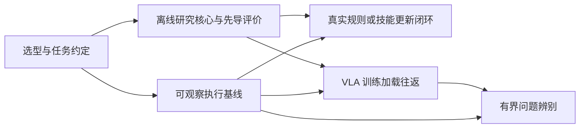

# 实施与执行记录（2026-11-09—13）

归档日期：2026-11-13。保留整理前的批次条件、结果和执行说明；当前状态见 [04 实施路线](../../项目文档/04_实施路线与执行状态.md)，协议入口见 [06 先导协议](../../项目文档/06_先导协议与版本边界.md)。


版本：V5.1 工作方案 · 2026-11-09。本文件是本套文档中当前状态、待办、待决与后续实验注册的唯一入口。定义见 [00](../../项目文档/00_项目总纲与研究边界.md)，实现见 [01](../../项目文档/01_系统设计与框架复用.md)，科学候选见 [02](../../项目文档/02_科学问题与创新路线.md)，验收见 [03](../../项目文档/03_实验设计与验收协议.md)。

**GPU 选择规则（2026-11-13 更新）：** 后续作业和服务按当前显存、负载及模型/环境兼容性自主选择可用 GPU，不预先绑定卡号或限定卡号集合，也不要求等待 GPU0。GPU 编号是运行资源选择，不是冻结的实验条件；可按各次启动时的资源情况选择不同设备。启动前按实际选择保持配置、许可和运行参数一致，并记录实际设备。已有显存准入、GPU 数量/时间、等待和阶段预算继续适用。本文历史卡号、旧许可及旧的固定卡号条款只说明当时记录，不再约束后续选卡。

## 1. 当前状态与证据

当前进展、授权、停止与阻塞统一见 §1.17；任务政策调整见 §5.4。第四批前次准备及第三批补件见 §1.16。第三批原交付见 §1.15。第二批唯一开发回合及原始解释见 §1.14，第一批修复及历史静态计划见 §1.13。

以下表格与 §1.1—1.16 保留各次交付时的状态，不覆盖 §1.17 的最新记录；其中“当前”“唯一”和“待授权”均限定于各自批次。

| 事项 | 当时可确认的状态 | 依据与范围 |
|---|---|---|
| 输入材料 | 两份 MD、V4 PDF、问答和自由审查均已阅读 | 原件入口见 00 §2 |
| 用户决策 | 本轮 Q01—19 的最终修订已映射到方案 | 05 §1；暂定选择保留其暂定性 |
| 代码基础 | 聚合目录存在七个上游源码目录 | 本地文件与选定函数静态阅读，05 §4 |
| 自研研究 core | 已实现标准库离线 core、版本/事件/合法视图、固定 ρ 与初始 ψ/记忆、候选和三态 Gate | §1.4；只通过离线行为检查，关系学习与自主更新未完成 |
| 执行/训练/发布联调 | 其它终端已完成一次 Codex/MCP/VLA/LIBERO-PRO 单回合工程冒烟；训练、独立验收及发布未接通 | §1.2 的真实日志；环境结果字段仍为空，不计正式基线或 SC1—SC6 完整通过 |
| Piper 本项目闭环 | 本轮未打开设备或执行，没有本轮验收证据 | 既有他项目路径不替代 SC8 |
| 主科学问题/算法 | 尚未选定 | Q10/Q18/Q19；R1—R4 为候选 |
| H1/H2/H3/H4 | 均无本轮新实验结论 | 实验协议不是已完成结果 |
| 文档重构与复核 | 已形成 V5.1 工作方案 | 完成跨文档逻辑与表达复核，补充近期任务、首次发布前提和 H3 变量归属 |
| 首条链资产与本机配置 | π0.5、归一化、Tokenizer、SAM3 已绑定；Python 3.11 与匹配依赖已安装；Codex 在线工具调用、VLA CUDA 加载/推理及所测 LIBERO-PRO 场景已有运行证据 | §1.1—§1.2；SAM3 分割调用、任务独立结果和训练链仍待验收 |

旧方案中的“两张共享 RTX 4090D、单臂 Piper、每周约 12–16 小时现场、六个月阶段窗口”只作为历史规划输入。显卡可用性、模型占用、现场时间和设备状态均需在实际执行前核实；不沿用历史空闲磁盘数作为当前条件，也不据历史数值承诺完成日期。

当前聚合根已是Git仓库（main/c4d7fd9b，本地origin/main同位）；RPent仍有独立Git边界。先前“聚合非Git”的记述保留为历史状态，当前以§1.17实际检查为准；本轮交付仍是未提交改动。

### 1.1 首条链资产与匹配环境（2026-11-09 更新）

本机配置在 [config/models.local.sh](../../config/models.local.sh)，启动入口在 [scripts/run_libero.sh](../../scripts/run_libero.sh)。本次更新只读检查其它终端的产物、安装元数据、源码和运行日志，复用此前文件结构与下载来源证据。实际运行证据来自下方 §1.2 的其它终端日志。

| 对象 | 已完成及证据范围 | 仍需完成 |
|---|---|---|
| 主 VLA | `checkpoints/RLinf-Pi05-LIBERO-130-fullshot-SFT`；既有下载 revision `6222623f635769bfc73c9472e29fab9b7fd8e027`；`model.safetensors` 7,473,091,464 字节，既有结构检查为 812 tensors；`metadata.pt`、`optimizer.pt` 存在。§1.2 日志确认匹配加载器加载到 CUDA，并实际调用 `pi0_pick` | 多任务/多初态独立基线、真实训练产物重新加载及保持评价；下载的 optimizer 文件不代表本项目已经训练 |
| 归一化与处理链 | `PI05_NORM_STATS_PATH` 指向 checkpoint 内 `physical-intelligence/libero/`；既有 JSON 检查的 state/actions mean/std/q01/q99 各 32 维；实际 VLA 日志确认读取该统计量并加载模型 | 将实际图像/状态处理、动作解码、模型 horizon 与执行 chunk 记录到 T02；不套用其它模型的统计量 |
| PaliGemma Tokenizer | `OPENPI_DATA_HOME=$HOME/.cache/openpi`；`big_vision/paligemma_tokenizer.model` 4,264,023 字节，`sentencepiece` 已安装；VLA 指令推理已有运行证据。checkpoint 已含视觉/语言 backbone | 无首次执行所需的额外整套 PaliGemma/SigLIP 下载任务；训练侧消费者在训练往返时验证 |
| SAM3 | 复用 `/home/wd/下载/sam3.pt`，3,450,062,241 字节；已安装 `RLinf/sam3`，包内 BPE 资源存在；两次冒烟均记录权重加载后 RPC 服务监听 | 所测回合未见 `segment` 调用，仍缺一次有界真实图像/提示分割功能证据；原权重下载 revision 未溯源 |
| Planner | Codex SDK 已安装；`gpt-6.1-sol` 已完成在线图像/工具交互，第二次冒烟 `error=null`，27 次工具调用 | 明确后续实验 reasoning effort、模型/记忆版本和调用预算；不再把在线登录与工具连接列为未接通 |
| Python 与依赖 | `RPent/.venv/bin/python` 为 3.11.13；Torch 2.7.1+cu126、torchvision 0.22.1+cu126、RPent 0.1.0、RLinf 0.4.0、rpent-openpi 0.2.2、rpent-libero/rpent-liberopro 0.2.0、SAM3 0.1.0、openai-codex 0.167.0、sentencepiece 0.2.3、safetensors 0.9.0rc1、omegaconf 2.4.1rc2、transformers 4.57.6、MuJoCo 3.3.0、robosuite 1.5.2、LeRobot 0.3.3 已安装 | 首条执行链已运行，不安排重复安装；SFT 所需环境、数据和配置另按实际消费者验证 |
| LIBERO-PRO | `~/.liberopro/config.yaml` 已绑定当前 .venv 包内 assets、BDDL 和 init_files，路径存在；§1.2 确认 `libero_object_swap/task 2/seed 0` 的场景、初态及渲染实际可用 | 所测一个场景不代表所有资产验收；首批任务集合待定。该配置的 datasets 路径不存在，训练数据未就绪；旧 `~/.libero` 配置不作为当前 PRO 链的阻塞项 |
| 上游记忆 | 已下载 `GPT_5.5_xhigh`，快照 `47f301ef33bf8d0e8c770342f16b3c39c6a0e8c1`；冒烟有实际读取。`gpt-6.1-sol` 未映射专用记忆，日志记录回退到该版本 | 后续显式固定 memory 版本、合法信息及基线预算；当前任务特定参考有缺失，记为覆盖缺口，不假定全任务均有 recipe；该记忆不是本项目学习成果 |
| Research LLM 与 core | Planner 后端可复用；离线 core 及持久快照已实现，见 §1.4 | 研究 Toolkit、自主机会/假设/真实实验、独立运行发布与反馈学习尚待接通 |
| 更新后的 VLA | 未找到本项目训练产物 | 匹配的 π0.5 SFT 配置、合格训练数据、真实更新—保存—加载—独立评价；首次执行不需要先下载完整训练集 |
| Molmo/第二动作类型/H4 | 当前 Codex 主链不要求 Molmo；其余分支未验收 | 按 T15/T16 及具体机制需要准备，不阻塞当前主链 |

本次安装元数据与模块发现路径核对：RPent 对应当前工作副本，RLinf/OpenPI/LIBERO/SAM3 对应 `.venv/lib/python3.11/site-packages/`。安装来源记录如下：

| 安装项 | 请求分支 | 实际安装 commit |
|---|---|---|
| RLinf | `release/v0.4` | `2348ece3df113874671478be1360ae3115b346e3` |
| RPent OpenPI | `rpent` | `a560f4dd8205b8423ecd4c8a0fabb5f54140b8a0` |
| RPent LIBERO | `rpent` | `a8323074d93a09e32bd898630a70531b1f51bc77` |
| RPent LIBERO-PRO | `rpent` | `d1e11fb181b8544487d27742c0caa3a4d46452ad` |
| SAM3 | `main` | `c1f6b1e83967c912f675d8975d437ccdc41e17d8` |

`models.local.sh` 没有设置 `RPENT_RLINF_ROOT`，当前运行实际使用已安装的匹配包。同级 `RLinf/` 仍只是另一份源码，不因路径大小写问题而强行切换到它；替换消费者前先核对其兼容性。

### 1.2 其它终端已执行的工程冒烟与剩余判定缺口

以下为 2026-11-09 运行产物的事后只读复核，不是本轮新启动的任务。日志目录名记录启动时间，最后一项动作和退出时间以日志为准。

| 记录 | 可确认的实际结果 | 支持范围 |
|---|---|---|
| [smoke-20261109-222216](../../RPent/logs/smoke-20261109-222216/run.log) | VLA 模型和环境/SAM3 服务已启动；Codex 请求因 `reasoning.effort=none` 不被 `gpt-6.1-sol` 接受而终止，工具调用为 0 | 配置失败记录，不是机器人任务失败样本或有效基线回合 |
| [smoke-20261109-222602](../../RPent/logs/smoke-20261109-222602/run.log) | `libero_object_swap/task 2/seed 0`，任务为沙拉酱入篮；使用 `reasoning-effort=low`，Codex SDK 完成、`error=null`、27 次工具调用。`states.json` 有初态及 7 次动作记录，其中一次 `pi0_pick` 执行 8 chunks，其余为几何移动；末步 `terminated=true`，视频/recipe/transcript 已保存 | 实际 Codex→MCP→VLA→仿真混合执行链已通；不等于裸 VLA 整任务能力、正式成功率、自主更新或 SC1—SC6 完整通过 |

第二次冒烟的 VLA `model ready in 80.3s`；实际服务器先执行 `.cuda().eval()` 再报告 ready。该回合证明历史运行窗口中的 CUDA 加载/动作推理可用。本轮只读会话的 `nvidia-smi` 仍无法访问驱动，这只能说明本会话的查询条件，不能据此推翻已有运行证据或判定宿主 GPU 损坏；后续新作业需核当时可用资源。

**优先修复结果语义**：第二次 transcript 的 `finish.status=success` 来自 Planner，`environment_success=null`；末步仍闭合夹爪，已有任务记录也注明终止发生在释放前。分别保留环境原生终止、抓取启发式、Planner 声明及释放/落稳等过程条件，不能互相替代。实际 CLI 中 `environment_success` 的赋值受 `robot_spec.finalize_run` 分支控制，是需要核对的结果写入接点。下一步补齐独立原生结果与过程标签，不把 Planner 声明自动升级为已验收完整成功，也不擅自改变原 benchmark 的成功定义。

**调用配置与预算**：当前启动脚本默认 `reasoning-effort=medium`，已完成回合使用 `low`；两者不能写成同一套已验证配置，后续实验显式固定。第二次日志记录 input 699,228、cached input 639,488、output 2,317 tokens；缓存项作为输入子项报告，不重复相加。transcript 的 `elapsed_s=209.3` 与服务启动/退出时间戳不覆盖同一时间区间，完整作业墙钟按 `run.log` 的启动至退出统计，不能把 209.3 秒直接用于全链吞吐预算。

### 1.3 更新后的剩余任务与执行顺序

已完成的主权重/配套定位、首条链依赖安装、Codex 在线连接、VLA CUDA 加载与单场景执行从前置缺口中移除。下表只列剩余交付，沿用 T 编号，不改变 §2 的总体目标。先复用现有证据；只有配置改变、明确缺证或新失败才重验相应部分。

| 顺序 | 剩余工作与 T 编号 | 下一项具体交付与通过条件 |
|---|---|---|
| 1（离线完成） | 结果与运行配置收束（T01/T02/T03） | 登记已验证模型/依赖/记忆/effort；补独立任务结果落盘及过程标签，分开成功/失败/未知、Planner finish 和 terminated；用离线样例核标签流。SAM3 分割若后续工具确需使用，再按具体预算补一次功能验证，不重装或重下权重 |
| 2（协议完成） | 首批任务、评价和预算（T02/T04/T08/T09） | 确定基础/受控变化/旧能力任务及开发、发布回归、封存划分；固定关键能力、综合评分、分母、未知/重试、接受标准和资源上限。新运行先授权；一条冒烟不外推为基线规模或可靠成功率 |
| 3（离线完成） | 自研维护位置与离线核心（T17/T03/T05/T10） | 明确 core 仓库与最窄 RPent 接口；实现 RunBundle、ExecutionEvent、EvidenceView、ExperimentResult、Candidate、GateDecision 及固定 ρ 基线；保存初始 ψ/合法记忆快照。离线检查覆盖未知、重复提交、版本恢复、拒绝/未决不发布 |
| 4 | 动作证据与小规模原生基线（T01—T03） | 复用现有 states/transcript/video，补动作建议—发送—反馈、来源、版本、缺失及全成本；按已定协议做有界任务/初态基线，取得正常、失败/未知与适用恢复记录；运行与证据接入不混为一次验收 |
| 5A | 首条自主规则/技能更新（T05/T06/T08） | 研究者从合法证据提出竞争解释，真实执行有界修复，独立 Gate 接受/拒绝/未决；完成有意义的接受、后续继承和适用回滚，拒绝样例维持原版 |
| 5B | 训练数据、π0.5 配方与真实模型往返（T01/T02/T08） | 明确公共示范/自采数据来源、任务/episode 映射和动作合约，验证匹配 SFT 配置及小批读取；有界真实更新—保存—实际加载—独立任务/旧能力评价。先测显存/步耗时再定训练预算；LeRobot 0.3.3 已安装不代表数据已通过 |
| 6 | 问题辨别与核心关系学习（T05—T10/T12） | R1 可先复用轨迹；R2 等合法版本对，R3 用独立新能力价值判据；持续保存 ψ，条件具备后做新问题考试。补齐三类关系反馈学习和 SC1—SC6，不以固定/no-op 规则替代 |
| 后续 | 长期、多变化、Piper 与有限迁移（T11—T16） | 按 M4—M6 和 SC7/SC8 完成关键机制、持续/复合变化、现场独立安全与审批、物理更新闭环及选定迁移；H4 与结构演化按具体前提推进 |

顺序 2、3 可交错推进，顺序 5A、5B 按各自前提推进，无需等待另一条先成功。当前已有有限先导评价协议和离线研究 core；尚无已验收训练数据/本项目新 checkpoint、动态独立发布或自主更新。`/home` 本次只读查询约余 142 GB，是本次快照而非容量承诺；新增数据、模型和媒体预算先计入存储，无授权不清理现有资产。此次状态更新不新增下载、装包、GPU、LLM 请求、仿真或设备授权。

### 1.4 本轮代码、协议与离线交付（2026-11-09）

本轮完成 §1.3 第 1—3 项的代码、配置、协议和针对性离线检查。未启动新模型请求、下载、安装、训练、GPU/仿真或设备操作。历史冒烟继续按 §1.2 的证据范围引用；新增结果出口与显式固定配置尚待授权动态验收。

| 交付 | 权威产物 | 完成范围 |
|---|---|---|
| 独立结果 | `RPent/robots/libero/result.py`、LIBERO toolkit/RobotSpec、CLI/Dashboard 消费接点 | 原生 benchmark 成功与 Planner finish、工具启发式、terminated/truncated、附加过程标签分开；无证保留 unknown。历史 step 7 经匹配安装链的明确语义离线恢复 benchmark_success=true，释放/落稳仍未知；原文件保留，派生结果在 artifacts/offline-20261109/runtime/recovered-smoke/result.json，不计新运行或正式基线 |
| 固定运行链 | [run_profile_v1.json](../../config/run_profile_v1.json)、[runtime_observed_v1.json](../../config/runtime_observed_v1.json)、[check_runtime.py](../../scripts/check_runtime.py)、[run_libero.sh](../../scripts/run_libero.sh) | 匹配安装元数据、模型/归一化、外部记忆 revision、原生 5-action chunk/5-step 推理等静态记录。该次交付的后续 Planner 配置固定 low；2026-11-10 已由 §1.5 的 v2 medium 配置接替。原 v1 与历史结果不改写 |
| 首批任务与评价 | [06 先导协议](../../项目文档/06_先导协议与版本边界.md)、[pilot_v1.json](../../config/pilot_v1.json) | 基础/位置交换/旧能力探针，开发、重复发布回归与封存初态，有限工程评分、完整分母、恢复/reset 和资源上限。阈值不代表统计显著性；未获得动态执行许可 |
| 最小研究 core | [core README](../../core/README.md)、`core/src/rsi_vla/`、`core/configs/`、`core/tests/` | 聚合目录自有维护，标准库，无装包或训练器改写。RPent 通过结构化结果与 states/transcript 文件接入；不替换 .venv 的 RLinf/OpenPI。固定 ρ 和初始 ψ/合法记忆可保存恢复，不计为关系学习 |
| 当前验证 | [离线检查记录](../../core/OFFLINE_CHECKS.md) | 记录命令、当前结果、历史数据派生证据与未运行项目；仅支持所测离线逻辑 |

维护边界：RPent 子仓库维护通用结果消费及 LIBERO 原生结果生产；聚合目录 `core/` 维护本项目研究数据合约、合法视图、预算和本地版本状态机；`config/` 固定本项目先导协议。聚合目录仍无 Git，本轮未初始化 Git、提交或替换依赖。正式独立 evaluator/发布者需由受保护进程持有有效版本写权限；本地类与不同角色参数只验证状态转换，不构成进程安全隔离。

剩余工作从第 4 项继续：动作级 L0 全覆盖、授权的独立结果动态验收和多任务基线，随后自主规则/技能更新及原 trainer 往返。旧能力任务当前只是保持探针，需先建立真实锚点。完整自主更新、独立正式发布、ρA/B/C 反馈学习、H3 新问题考试和 SC1—SC8 总体验收均未完成。

### 1.5 第 4、5A、5B 项推进（2026-11-10）

主终端协调了 A Runtime、B 训练、C 研究三条隔离工作，无继续委派。主会话与三名编码子代理的实际 `turn_context` 均为 `gpt-6.1-sol / high`，记录见 [model-settings.json](../../artifacts/offline-20261110/model-settings.json)。usage limit 中断后主终端接手集成与收尾；已通过且仍适用的检查沿用原日志，仅补受影响的共同接口和中断前尚未验收的监督修正。

| 检查点 | 本轮交付及证据 | 当前判断 |
|---|---|---|
| 1：第 4 项运行基础 | [run_profile_v2.json](../../config/run_profile_v2.json)、[pilot_v2.json](../../config/pilot_v2.json)，新起点 `initial-medium`；启动入口从冻结 RunBundle 生成显式参数；RPent 记录动作 proposal/send/RPC feedback、动作来源及 run/episode/bundle/protocol；独立原生结果、JSONL 导入和分项成本；实际进程组墙钟/GPU占用包络/存储采样监督 | 针对性离线检查通过；动态验收未通过且未运行。初始化/reset内部动作、控制器应用量/测得运动、后台模型确认和部分成本仍明确缺失；不能称动作全覆盖或完整成本已验收 |
| 2：medium 小规模基线 | 开发 8 槽、发布回归 8 槽的串行计划；固定起点及 release benchmark 使用 v2 medium 独立身份；原权重、任务、评分、阈值保持 | 16 槽均未启动，牛奶/抽屉仍为未证实能力探针。没有 medium 成功率或已验收锚点，历史 low 不计入分母；封存 seed 5/6 不调度 |
| 3：5A 规则/技能更新 | `research_tools.py / rule_updates.py` 接通合法开发证据、机会、竞争解释、实验、真实产物差异及 Candidate；Runtime 实际读取有限规则文件；Research LLM 请求准备显式 medium，未调用时 effective=null | 仅离线工具/产物交接通过，未提出或实施基于真实 medium 开发证据的更新。当前有限对象是 chunk 前缀，改变控制时序，启动入口要求新的匹配 profile/协议/基线；不作为本轮已有效修复，也未接受、继承或回滚真实候选 |
| 3：5B 模型更新 | 实际安装链的 π0.5 配方、数据/动作合约、小批入口、原 trainer 监督、保存布局及 Runtime descriptor 交接；读取实际归一化和 checkpoint header，CPU 原生配置及 worker序列化检查通过 | 未找到合格 LIBERO 本地数据；没有真实小批读取、训练、保存新模型、实际重新加载或任务/旧能力评价。预备报告为 `blocked_no_qualified_dataset`，静态 handoff 不是模型往返验收 |

后续运行的 Planner、Research LLM 均由 v2 profile 显式绑定 `gpt-6.1-sol / medium`。`run_profile_v1.json / pilot_v1.json`、历史 low 日志和既有快照保持原样，仅复用仍适用的依赖、接口与所测场景证据。`initial-medium` 是未验收的不可变起点身份，不是已测能力锚点。

本轮聚合代码版本为 `aggregate-core-v0.2.0`，仍未初始化聚合 Git。RPent 在 `c41c0e6` 的独立 detached worktree 中开发，继承原目录全部未提交成果；主终端只集成新增差异，不覆盖其它终端改动、不 stage/commit。实际源码和增量补丁保存在 [本轮归档](../../artifacts/offline-20261110)，针对性结果见 [OFFLINE_CHECKS.md §5](../../core/OFFLINE_CHECKS.md#5-2026-11-10-第45a5b项的离线集成)。

**真实阻塞与顺序。** 当前配置授权仍全部为零。除此之外，现有 Codex SDK 没有已验证的逐请求多模态输入计数及 provider 输出上限，有限 token 预算下会在创建 Planner/启动模型前拒绝；不能用请求后的 usage 或离线 ResearchJob 代替约束。需先接通可约束请求的实际后端，再验证一个已见场景回合的独立结果/身份/成本；缺失仍须为 unknown。独立 evaluator 已按全部槽读取实际原生结果和动作文件，但 safety、compatibility、critical_progress、resource_limits 未获对应独立证据时仍为 null；受保护评价/发布的操作系统权限部署也未验收。检查点 1 动态通过前，不启动 medium 矩阵或两类真实更新。

**集中待授权方案（均未授权、未启动）。**

1. 模型请求监督缺口解决后：仅 `libero_object_swap/task 2/seed 0`、`initial-medium` 一个回合；单 GPU、900 秒启动至清理、Planner 600 秒/20 turns、2000 步、40 工具、input 100万（含cached）/output 8000、产物1GiB，不含训练、下载、安装、硬件。不自动扩大为矩阵；若更换预算依据或后端须先另行明确，不默认豁免 token 上限。
2. 数据分两段：先对已安装 `pi05_libero` 配置引用的 `physical-intelligence/libero` 解析不可变 revision、核元数据，最多8MiB；再按固定元数据选择沙拉酱入篮的前2个匹配示范，仅下载所需 parquet/两路媒体，最多512MiB，保留原 episode 映射。revision/episode IDs 当前未知；不兼容、超额或不能确认与评价信息隔离则停止，不扩展全量下载。
3. 合格数据小批读通且第4项验收后，另行授权训练资源测量：1张指定GPU、microbatch1、最多3个optimizer step、900秒/900 device-seconds占用包络、产物上限64GiB（不是下载额度），全局单作业。当前 RLinf OpenPI 只支持本配方的 `no_shard`，不能据两张卡推断能分片；可能显存不足，记录实测后再定正式规模。实际加载及独立任务/旧能力评价另按授权排队，不由仿真额度代授权训练。

后续5A的一次medium研究请求/实验，以及开发和发布矩阵，均在检查点1通过后按实测成本申请具体额度。两路径各自独立Gate；拒绝/未决保持当前版，不为闭环演示强制接受，也不先组合两类变化。

### 1.6 第 4 项动态授权与执行登记（2026-11-10）

用户已授权“补齐第4项缺口并完成动态验收，再开展两条真实更新”，随后明确选择保留Codex、token改为记录项，以墙钟、模型请求数、工具数和环境步数为硬上限，并另建协议版本。另单独授权仅替换本项目`.venv`的pyarrow为16.1.0，NumPy及其它包不动。原版本实际为26.0.1；替换后分发包元数据仅此一项变化，NumPy仍为1.26.4，LeRobot导入与原生CPU子集/loader合成fixture已通过，真实示范尚待下载。

新授权配置为 `config/run_profile_v3.json / config/pilot_v3.json`，起点 `initial-medium-v3`。任务、评分、阈值与封存范围不变；v1/v2及原快照保留。新运行每回合完整墙钟900秒、Planner600秒、模型HTTP转发前限20请求、40工具、总环境步2000（包含setup/reset）、1GiB项目产物，单GPU且全局串行。token/cached子项/output完整记录，不再声称token或货币硬上限。模型及effort在每次HTTP实际请求体核验，后端返回模型与usage另记录。本地请求计数接点已通过HTTP fake和真实Codex SDK→本地假模型联通，不把该测试算外部模型能力。

主终端先运行已见swap/task2/seed0的一个有界回合；成功或失败均由原生结果判，缺失/中断为unknown，不计正式基线分母。其运行基础验收通过后再按v3冻结矩阵测开发8槽、发布回归8槽，保留未启动/未知/无效全部槽；封存不调度。两条真实更新按各自前提分开排队，不组合、不强制接受。当前状态：离线补缺已集成待动态启动；运行证据统一在 `artifacts/authorized-20261110/` 登记。

### 1.7 真实诊断、缺陷修复与 v5 首槽验收（2026-11-10）

| 真实作业 | 事实及成本 | 独立判断 |
|---|---|---|
| `stage4-medium-smoke-01`（v3） | 模型CUDA加载，30个setup步；首个gpt-6.1-sol/medium请求成功，第二请求usage limit 429；104.934秒，2次模型转发 | 0策略步，unknown；原始结果保留，清理完成 |
| `stage4-planner-connectivity-01` | 限额恢复时间后1个实际medium请求返回READY，5.611秒、无GPU | 仅验证账号和转发，不算机器人能力 |
| `stage4-medium-smoke-02`（v4） | 30 setup+66策略步；460.939秒、8模型转发；第8请求上游超时后下游HTTP未结束，主监督提前停止 | unknown；已修复错误分支发送502并关闭连接，无自动重试；新增失败回归通过 |
| `stage4-vla-grasp-diagnostic-03`（独立组件bundle） | 12次真实VLA预测、60策略步+30 setup；184.165秒、8模型请求；独立原生false、正常闭合failure。完整任务目标并未完成 | 动作/RPC/身份/原生结果/实际模型配置已验证；发现另有4个继承PyCharm读取未进RPent计数，实际10工具超过该诊断剩余6，因此整体未通过；未回填为成功 |

v4依据checkpoint自身metadata显式记录`discrete_state_input=false/max_token_len200/action_horizon10/model_action_dim32`。旧日志True来自缺省配置；实际tokenizer本已消费False，未找到网络中该标志的行为分支，不断言曾造成弱基线。checkpoint记录`num_steps=10`，当前保留既定Runtime采样5；该实际计算差异单列，不称完整复刻原采样配方。源证据见 `checkpoint-config-diagnosis/`。

针对实际暴露的工具绕行，v5在运行子进程禁用所有继承MCP，仅启用RPent；用户全局PyCharm配置不改。原生Codex配置消费者已确认PyCharm=false、RPent=true，并用真实SDK连接本地假模型验证配置可运行。正式回合再逐条核SDK原始工具来源和预算；不能仅凭配置声明通过。

当前后续配置为 `config/run_profile_v5.json / config/pilot_v5.json`，起点`initial-medium-v5`，原v1—v4与诊断原件保留。任务、评分、阈值不改。下一阶段预指派开发8槽、发布8槽，串行，总墙钟/GPU占用包络各14400秒、320次模型请求，每回合900秒/20请求/40工具/2000总步/1GiB。先仅执行首个完整任务槽作为v5独立运行基础检查；其技术证据未通过则停止余槽、无自动重试，全部槽仍保留。通过后推进余下medium矩阵，再判断5A/5B各自前提，真实更新仍未启动。

### 1.8 v6 实际运行基础通过、medium 矩阵进行中（2026-11-10）

v5首个开发槽因新串行入口未传SAM3路径而启动失败，40.6秒runner区间、43.942秒完整阶段耗时，无策略动作；该槽为技术无效/unknown，另外15槽停止保留。v6把SAM3与OPENPI_DATA_HOME纳入冻结profile，启动前检查已有资产；A已只读追踪三个服务实际消费者，没有发现其它当前必需环境遗漏。旧v5原件不改写，v6新技术修订队列扣除了旧阶段已消耗的墙钟、GPU占用包络与setup步，没有退回其成本。

v6首个完整任务 `development/base_salad/seed1` 已独立验收：原生benchmark_success=true、terminated=true、attempt_closed=true，无技术error；完整369.555秒，424环境步=30 setup+394 policy；20模型HTTP请求，40个RPent派发，SDK另记录1次未派发/被拒绝的工具尝试（可见工具事件共41）。工具来源全部走受计数RPent；身份、顺序、RPC proposal/slot映射、实际model/medium、模型实际加载与推理、完整usage、预算和进程清理检查均true。

[checkpoint1](../../artifacts/authorized-20261110/medium-v6-baseline/checkpoint1.json) 只授予当前完整任务Runtime运行基础通过，不是整个medium矩阵、正式发布或完整系统通过。当前串行队列在测其余开发/发布槽；首槽为原冻结矩阵的一项，不属于此前组件诊断，也未替换v3—v5的失败或unknown。medium成功率、牛奶/抽屉起点与固定锚点须等完整对应矩阵；两类真实更新仍未开始。

### 1.9 用户暂停与续接断点（2026-11-10 14:52）

**最新指令**：用户先要求第三槽收口后直接转5A、再5B，其余基线槽保留未完成；随后要求5A完成后暂停5B；最新因额度不足要求“暂停并简单交接”。当前全面暂停，未排新作业，5A进程已退出且cleanup_confirmed=true/remaining_process_ids=[]。先前动态授权不覆盖本次暂停，须等后续恢复指令。

- 第4项：v6前两开发槽success/failure原件保留。第三槽已依据完整原生false、40次准入/finish预算拒绝和清理证据生成`independent-budget-result.json`，独立outcome=failure；原result的unknown/SDK interrupted不改。其后3次模型转发的停止传播缺口仍判false，不能追认为历史控制合格。独立补件和`independent-budget-audit.json`在原第三槽目录。固定8开发槽结果`baseline-v6-partial-development`保留unknown5；其余13个开发/发布槽未启动，不缩分母；旧能力锚点和完整medium基线未建立。
- 第4项增量修复：client/server共享首个原子`budget_stop.json`；工具40次准入即标记，已准入工具收尾后Codex记录明确原因并中断；Gate阻止停止后的新模型转发，外部取消/技术错误仍unknown。A新增13项+受影响既有28项通过；主新增Gate假HTTP1项、预算补件3项、v3实际Planner消费者3项通过。实际Runtime源代码在后续run的`code_snapshot/`留存，不生成hash。新停止分支尚未取得“真实预算耗尽且无技术错”的动态验收。
- 5A真实研究：`research-medium-01/`一次实际gpt-6.1-sol/medium请求，完整37.803秒、1模型请求、13606输入/977输出；依据开发证据提出保留最后1次工具用于诚实finish的有限提示，保留3竞争解释。SDK枚举格式与已解析result_id引用的本地校验问题已离线修复并复用原响应，没有再次调用模型。唯一phi修改`planner_finish_reserve_calls:0→1`，θ/processor/ρ/ψ/memory/profile及chunk5冻结。研究store为`state-v6/research`，job=`research-v6-finish-reserve`，experiment=`finish-reserve-experiment`，试验bundle=`finish-reserve-v6-trial`。
- 5A真实试验：`5a-finish-reserve-candidate-01/`，position_swap_salad/seed1；Runtime提示已实际进入Planner，VLA已加载且预测8次。14次模型转发、25次工具准入，完整371.977秒；第14次转发遭上游transport错误并返回本地502，runner exit1，无自动重试。独立outcome=unknown/technical_invalid；不能当任务失败、规则无效或能力改善。完整独立audit已保存；该失败请求token不可确认，已返回13次请求usage只是观测下界，不能冒充完整费用。
- 5A仍待：先把本次试验已知硬成本及未知token状态写入ResearchJob/研究finding，再生成正式Candidate、独立Gate和有效版保留记录；不自动重试。完整release/current/anchor及旧能力缺失，正式Gate不得accept。尚未执行有效版激活、继承或回滚；不强制接受候选，也不把未运行的配对比较当收益证据。
- 5B暂停在准备阶段：已授权单包pyarrow16.1.0兼容修复、原生CPU合成fixture、匹配动作专家partial-SFT配方及精确PID/Ray短路径监督代码通过适用离线检查；真实metadata已固定revision并选择816/822两个示范（239帧，主体32495450字节）。未下载示范主体、未读真实batch、未训练/保存/实际加载/任务或旧能力评价。metadata在`dataset-metadata-01/`，后续须用户恢复后才调度。

待集成的主终端离线增量保存在`artifacts/authorized-20261110/continuation-1422/pending-integration.patch`：当前v6静态消费者/default引用、core README/06说明，以及已通过的部分矩阵规则观测回归（1项）。该补丁尚未集成，静态checker改动尚未执行；不要把它们计为当前通过。主工作隔离区`/tmp/rsi-stage2/main`、A/B/C原隔离区和未提交成果均保留；RPent原有staged .idea及其它终端改动未动。没有提交、推送、迁移目录或修改全局Codex配置。

省略其余基线槽可继续验证候选消费及训练往返接口，但缺少完整medium成功率、关键旧能力与固定锚点，不能证明能力改善/保持或获得正式发布资格。用户另要求在全部任务结束后讨论RPent提交组织和新路径终端Codex记忆/配置续接；该后续事项尚未展开。当前core/config/scripts/项目文档仍在聚合目录，RPent单仓提交不会包含它们；新终端先读本节及core/OFFLINE_CHECKS.md，不可从旧授权自动启动动态作业。

### 1.10 每回合工具上限调整（2026-11-10）

用户要求仅将后续每回合工具上限设为 **60**，其它配置再议。配置入口为 `config/pilot_v7.json`，准备起点为 `initial-medium-v7-tools60`（沿用 v6 的模型、processor、规则、ρ/ψ、合法记忆及执行 profile，不代表已验收能力或当前有效版激活）。`scripts/run_medium_baseline.py` 从协议读取单回合工具上限，原累计 640 次额度保留。v6 及前三槽/5A 记录不改写；新预算比较须使用匹配结果。动态工作继续暂停，没有启动新作业；减少测试槽数、常驻服务、压缩上下文等方案尚未实施。静态准备可用 `prepare_runtime` 配合 `state-v6`、`pilot_v7.json` 和新起点；启动仍需恢复指令及对应作业预算。


### 1.11 离线执行基础集成与单回合静态计划（2026-11-11）

**状态：继续暂停。** 本轮没有真实Planner/Research请求、仿真、GPU推理/训练、下载/安装或设备访问，没有恢复作业、重试5A、提交或激活候选。聚合目录仍无Git；RPent既有staged `.idea`及其它终端成果保留，只合入逐文件适用的增量。`continuation-1422/pending-integration.patch`已先检查适用性再集成，默认静态consumer进一步指向v7工具60。

**5A已完成离线记录收尾。** 复用原Research响应和试验独立audit，在 `state-v6/research` 补记 `finish-reserve-experiment` finding及Candidate `finish-reserve-v6-candidate`；原始试验保持unknown/technical_invalid，传输中断不支持提示无效、任务能力失败或能力改善。试验14请求、25工具、371.977秒、180总环境步；研究+试验账本累计15请求、25工具、409.780秒，只有两笔对应charge。第14请求token未知，试验13份usage的604493 input/544512 cached input/2151 output仅为观测下界；Candidate累计下界另加原Research的13606/0/977，完整总token仍缺失。cached始终为input子集，不额外相加。

`state-v6/release/decisions/finish-reserve-v6-missing-release.json` 由既有独立Gate生成inconclusive（candidate/current/anchor发布结果均缺），`current_retention.json` 保留 `initial-medium-v6`。这是本次离线登记当前起点，未执行Runtime激活，不追认历史发布合格。没有配对收益比较、有效继承或回滚；原有三槽、5A的result/audit/响应和技术缺陷记录不改写。

| 状态 | 具体交付 |
|---|---|
| 已实现 | `robots/libero/task_input.py` / CLI：启动传入任务、必要动作/权限/失败边界、现有技能入口、三份相关原始外部先验；专用任务记忆缺失显式登记，完整指南/索引按需可读。没有生成或冒充学习成果 |
| 已实现 | `back_project_batch`逐点复用原`back_project`，统一step，保留顺序、逐点结果/错误/缺失；只读，无隐藏动作合并 |
| 已实现 | `RuntimeJournal.budget_snapshot`及工具反馈读取Gate/环境owner快照，显示剩余工具、实际请求、墙钟和总环境步；不重复扣费，缺失为null，监督仍是权威 |
| 已实现 | 原子budget stop及进程停止标记阻止后续请求/新工具；允许已准入操作在剩余步数内收尾。请求上限、外部取消传播；较低permit还传入实际CLI步数限制 |
| 已实现 | 复用原生finalizer和外部监督，Launcher自动保存`independent_result.json`、停止分类、`cost_breakdown.json`；保留原始result。正常失败、预算耗尽、取消、超时、技术错分开；中断/缺证仍unknown |
| 已实现 | 复用模型加载timer、tool_end和请求计时，补媒体/daemon清理时间；完整墙钟为外包络，动作工具/媒体等为包含或重叠诊断项，不相加。input/cached/output独立，缺失为null并保留观测下界；辅助模型加载分项仍缺失 |
| 离线通过 | 定向fixture/本地不转发假服务、协议/较低授权传递、批量定位及无效输入、CLI精简视图消费、自动收尾与历史关联。命令、实际数量、日志和跳过项统一见 `core/OFFLINE_CHECKS.md §6` |
| 待真实验收 | 单回合是否无需重复准备、输入是否够用、真实停止传播/独立结果、实际usage、分项耗时与清理；离线通过不证明模型理解、任务能力或实际收益 |
| 尚未实施 | 四槽发布协议、成本评分调整、常驻VLA、新多步自主技能；5B仍缺示范主体/真实batch、训练—保存—实际加载—任务与旧能力评价 |

**历史静态计划（已由 §1.12 取代，原件保留）。** 配置入口 `config/pilot_v8.json / config/run_profile_v8.json`，协议 `rsi-libero-pro-pilot-v8-offline-runtime-tools60`，bundle `initial-medium-v8-offline-runtime`，代码 `aggregate-core-v0.4.0`，输入 `libero-startup-v1`。静态交付为 [development_plan.json](../../artifacts/offline-20261111/development_plan.json)、`task_input.json`、`source_manifest.json`和未签发的`single-job-permit-proposal.json`。仅 `position_swap_salad / seed1` 开发初态，工具60及其它现有单次/阶段上限；绑定实际源码副本、冻结模型/processor/合法记忆/profile/协议。历史工具40只作诊断，不能作新输入/预算下的公平收益对照；不预排第二回合。

恢复后的第一步是用户明确恢复后，复用本轮 `phase_budget_snapshot.json` 已核对的原campaign/prior链历史消耗；仅在有新消耗时刷新，按较低剩余额度签发这一回合permit并核对源码/输入是否仍匹配快照；然后才允许单回合。当前计划包含暂停和缺permit阻塞，未创建运行输出目录，未执行该计划；Launcher仅在mock监督的fixture下验证。所有本轮公共执行基础优化归于离线工程工作，不记为RSI自主改进。5B保持原数据/训练断点。

### 1.12 有界 VLA 连续执行离线交付（2026-11-11）

**状态：暂停，未执行。** 本轮仅离线工程改造；无真实 Planner/Research 请求、仿真、GPU、训练、下载、安装或设备访问。没有提交、推送、删除历史或新增子代理，不记为 RSI 自主学习成果。RPent 的既有未提交修改和 staged `.idea` 保留；本轮原内容及增量保存在 `artifacts/offline-20261111-vla-v9/`。

- 新工具 `vla_execute(instruction, max_chunks)` 已经实际 Toolkit/MCP 暴露。Planner 下达任务/子目标并监督执行段，VLA 在 1—24 次显式预测额度内使用最新观测，每 chunk 仍五步；首轮暂定可用24。整回合所有上限不变，剩余总环境步数含 setup，余量不足完整 chunk 即停止。返回原生结果、chunk/确认步数、不确定步数、停止原因、观测与预算；未成功耗尽额度不自动判阶段失败。
- 复用 `_vlm_chunk`、原 processor/action/RPC/原生终止、预算 owner、自动收尾及 usage 实现；新增推理结束/动作段耗时及推理关联。成功状态落盘后 Toolkit、Codex、RequestGate 共同关闭后续 Planner 准入；正常成功不误记取消或技术错误。
- startup-v2 描述新分工，保留旧抓取/接触/几何路径。默认相关记忆改为带条件、single-shot 强度和全文入口的原文节选，省略其它场景绝对高度；匹配 `libero_object_swap/t2` 的专用记忆仍缺失，不生成配方。完整上游原文及旧 hybrid 指南原样保留，并注明适用路径。
- Planner 反馈选择 `calibrated`，实际 MCP 只发送标定全局/腕部图；`full` 可按需回退。VLA 自身图像/方向/分辨率、processor、磁盘原始媒体和独立评价证据不变。
- CPU 离线证据、具体数量及首轮 fixture 修复见 `core/OFFLINE_CHECKS.md §7`。未验收真实任务能力、Planner 请求节约、实际耗时收益或训练效果。

**唯一待运行回合：** `position_swap_salad / seed1`，已见开发初态；入口 `config/pilot_v9.json`、`config/run_profile_v9.json`，protocol=`rsi-libero-pro-pilot-v9-bounded-vla-tools60`，bundle=`initial-medium-v9-bounded-vla`，code=`aggregate-core-v0.5.0-bounded-vla`，input=`libero-startup-v2-bounded-vla`，execution=`bounded-vla-v1`。静态计划 [development_plan.json](../../artifacts/offline-20261111-vla-v9/development_plan.json) 关联 `source_manifest.json`、`task_input.json` 和未签发 permit 提案；v8 只保留为历史，不再是另一个待运行回合。首选新工具，必要时 Planner 可选已有工具；不规定必须几次 Planner 请求，不把历史工具40的结果当公平收益对照，不预排第二回合。

模型/effort、工具60、模型请求20、900秒完整作业/600秒 Planner、总环境步2000、存储1GiB及其它既有单回合/阶段上限保持。复用上一轮已核对的 `phase_budget_snapshot.json`，历史消耗继续记账，未重置阶段额度或调整发布矩阵、评分、Gate。下一真实回合应从 transcript/事件保留实际介入原因（缺失则未知）、新工具指令/停止原因与切换细粒度工具的原因，记录任务结果与技术有效性、请求/推理/chunk/动作量、input/cached/output、分项耗时及成功后额外请求/拒绝尝试。

**恢复后的第一步：** 等待明确恢复与匹配单作业许可；先核对快照/输入/工具/配置仍匹配实际源码，只有新增消耗才刷新阶段账本，并把许可压到较低剩余额度。随后才可执行这一个回合。当前没有许可、未创建运行输出目录；5B 及其余历史作业继续暂停。已知缺口仍包括专用记忆、辅助模型加载独立耗时、真实停止/清理与模型能力证据，以及正式发布/旧能力/训练链的原有未决项。

### 1.13 VLA 技术错误传播与离线验收（2026-11-12）

**状态：本批离线工作完成，继续暂停。** 没有真实 Planner/Research/其它模型请求、仿真、GPU推理、训练、下载、安装或设备访问，没有恢复队列、重试历史作业、提交、推送或删除产物。本轮证据见 [core/OFFLINE_CHECKS.md §8](../../core/OFFLINE_CHECKS.md#8-2026-11-12-vla-技术错误向最终结果传播修复)。RPent 起点为 main，HEAD `c57b134`，本地 origin/main 比较领先2/落后2；未联网更新上游。聚合目录无 Git，RPent 原有 staged `.idea`、AGENTS.md 和其它终端文件保留。

根因是 `vla_execute` 捕获技术异常后仅返回工具错误和事件，RPent finalizer 仍可因 Planner 正常退出，把上次原生 false 关闭为任务 failure/valid；launcher 未消费这些执行事件，acceptance 默认读原始结果。修复使执行段、推理及动作 proposal/RPC 通过序号关联；Toolkit 已存段与绑定回合的事件进入 finalizer，launcher 独立复查事件。acceptance 默认读取 launcher 的独立结果，显式原始路径也核对执行故障；evaluator 和轨迹导入消费技术无效结论。实际源码及改动范围见新快照的 `source_manifest.json`，不要求修改未受影响的执行接口。

| 事实/停止情况 | 独立结论与技术状态 |
|---|---|
| 原生成功、正常清理与自动收尾 | success / valid / completed；原生成功事实保持 |
| 无技术故障，原生截断或有原生 false 的正常关闭 | failure / valid / completed |
| 仅 chunk 额度结束且未关闭尝试 | unknown，运行状态 unknown；执行健康可为 clear，不能作为已完成任务结果 |
| 有证据的预算耗尽并完成负向收尾 | failure / valid / budget_exhausted；不是技术故障 |
| 取消 | unknown / cancelled；取消原因与执行健康分别保留 |
| 推理、动作 RPC 或不确定执行故障未解决 | unknown / technical_invalid / technical_error；保留事件及其来源 |

原始 `result.json` 和历史产物不改写。派生 `independent_result.json.native_task_result` 保留原生标志、service 最后信号和来源引用；`execution_health` 保存故障、停止事件及身份/序号缺口。技术有效性不改写环境事实。普通参数纠正不会永久否决任务；已有预算派生恢复语义经历史记录验证保留。当前没有执行故障的明确恢复判据，因此后续工具成功、原生成功、Planner finish 均不消除已记录故障；该缺口保留为 unresolved，不新增恢复框架。

**唯一待运行回合仍是 `position_swap_salad / seed1`，一个已见开发回合。** 新入口为 [development_plan.json](../../artifacts/offline-20261112-vla-result/development_plan.json)，profile=`config/run_profile_v9_resultfix.json`，bundle=`initial-medium-v9-resultfix`，code=`aggregate-core-v0.5.1-vla-result-validity`。协议继续使用 `rsi-libero-pro-pilot-v9-bounded-vla-tools60` / `config/pilot_v9.json`；本次纠正原有技术有效性传播，评分、矩阵、Gate及评价语义未改变，不另建协议。execution=`bounded-vla-v1`，input=`libero-startup-v2-bounded-vla`；新输入快照与旧输入字节一致。§1.12 的 v9 计划作为旧快照保留，由本计划替代，不是第二个待运行回合。

模型/effort、工具60、模型请求20及其它单回合/阶段上限保持。新计划复用原阶段预算快照和消耗，未签发 permit，`execution_authorized_now=false`，未创建运行输出目录。当前没有离线检查已知、必须先修才能准备该单回合的代码缺陷；实际执行仍缺明确恢复指令和匹配许可，真实任务能力、服务/停止清理及既有正式发布/旧能力/训练缺口仍待动态证据。本批在此停止，不进入第二批或接入研究调度/发布继承。

### 1.14 第二批唯一开发回合、技术验收与第三批事实输入（2026-11-12）

**状态：唯一回合已结束，再次停止。** 本批仅恢复 `position_swap_salad / seed1`，没有恢复历史队列、重试、Research 模型请求、候选更新、训练、下载、安装、设备操作、发布或新增子代理；没有提交、推送、删除历史或修改源码、发布矩阵、评分和 Gate。本回合属于**执行基础验收，不是 RSI 自主更新完成**。技术链正常、独立任务成功；固定 `max_chunks=24` 条件存在第二段取12的偏差，不能登记为该固定条件完整通过。

**身份与执行前核对。** run=`development-v9-resultfix-position-swap-salad-s1-01`，episode=`position_swap_salad-s1`，bundle=`initial-medium-v9-resultfix`，protocol=`rsi-libero-pro-pilot-v9-bounded-vla-tools60`，code=`aggregate-core-v0.5.1-vla-result-validity`，execution=`bounded-vla-v1`，input=`libero-startup-v2-bounded-vla`。使用 §1.13 唯一静态计划及冻结 profile，Planner 实际为 `gpt-6.1-sol / medium`，原 π0.5 权重/processor/归一化/采样5与五步 action chunk、外部记忆均保持。RPent main/HEAD `c57b134`、本地 origin/main 领先2/落后2；未联网更新上游，聚合目录仍无 Git。45份快照文件逐字节匹配实际源码，复用第一批错误传播及消费者检查。旧输入快照保留旧 run/bundle 元数据；提示与来源内容一致，launcher 按本回合 context 重新生成身份，实际 startup identity 检查通过。宿主 GPU0 空闲后仅使用该卡，全局锁串行。许可、源码/输入核对及未重置的阶段余量见 [second-batch-preflight.json](../../artifacts/offline-20261112-vla-result/second-batch-preflight.json)、[second-batch-permit.json](../../artifacts/offline-20261112-vla-result/second-batch-permit.json)。

**结果与证据入口。** [独立结果](../../artifacts/development-v9-resultfix-position-swap-salad-s1-01/independent_result.json) 为 `success / valid / completed`，`benchmark_success=true / terminated=true / truncated=false`，停止原因为 `native_success`，`execution_health=clear`；原生来源为 LIBERO `_check_success()`，不是 Planner finish。本回合没有调用 finish，原始 result 保留。SDK 原始 stream 的 interrupted 是成功时主动关闭 Planner；最终 `interrupted=false/error=null`、runner exit0，不能当技术取消。[独立 audit](../../artifacts/development-v9-resultfix-position-swap-salad-s1-01/independent-audit.json) 的19项检查全部true，覆盖身份/源码/工具计数/动作映射/原生结果/实际配置/usage/预算/清理。`supervisor.json` 记录 cleanup_confirmed=true、remaining_process_ids=[]，没有自动重试。技术错误分支本回合未触发，其修复证据仍为第一批离线链与本次源码匹配。

| 本回合事实 | 数量、原因与范围 |
|---|---|
| 工具与模型请求 | 3次受计数 RPent 工具、3次 SDK 可见工具，外部绕行0；实际 HTTP Planner 请求4次，均200且有完整usage；工具次数不等于模型请求次数 |
| 请求1 | 仅声明先看第0步，未调用工具、未取得新环境反馈；input12512/cached0/output70，3.502秒。为何拆成单独文字请求，日志未说明 |
| 请求2 | 执行 `view_env_state(step=0)`；input12977/cached12416/output59，3.572秒。与请求1之间无状态变化，不称一次任务恢复 |
| 请求3 | 根据第0步任务语言/图像确认目标与篮子，调用 `vla_execute("Pick the salad dressing and place it in the basket", max_chunks=24)`；input16107/cached12800/output157，7.690秒 |
| 第一执行段 | 24次预测、24 chunks、120确认动作、0不确定动作；原生false且未截断，stop=`chunk_allowance`，是未完成，不是失败 |
| 请求4 | 根据第一段最新反馈，Planner 声明瓶子在篮子上方但原生仍false，改下达放入并释放子目标；调用同一工具 `max_chunks=12`；input19880/cached16128/output116，6.881秒。持有状态是 Planner 图像判断，没有新增独立 holding 标签 |
| 第二执行段 | 12次预测、12 chunks、60确认动作、0不确定动作，原生成功。本次12在工具schema的1—24范围内，但偏离冻结首选值24；现有启动输入只说明范围和“24暂定”，未约束后续参数，audit也不检查这一冻结条件。原结果不改写，计划符合性单列false |
| VLA与动作总量 | VLA工具2次、实际模型预测36次、36个五步chunks；180个策略动作均有service确认，RPC不确定0。总环境步210=30 setup+180 policy；2次原生setup/reset都发生在policy之前，没有中途reset或重试；控制器实际应用量/实测运动/内部物理tick仍缺失 |
| 最新观测 | 源码每次从 `_last_obs` 预测、每chunk后以 `chunk_obs[-1]` 调用 `set_obs`，连续工具无旧 `raw_obs` 覆盖；35个相邻预测边界均先收到前chunk反馈。支持持续消费最新返回观测；journal未记录每次推理的不可变 observation ID/图像状态绑定，不能逐帧独立复核输入 |
| 细粒度切换与恢复 | 没有切换几何/抓取工具，也没有显式恢复。第一段额度结束后由 Planner 选择继续；不是预写成功脚本。第二段成功不能区分“子目标措辞起作用”与“同任务再给12 chunks也会成功” |
| 成功后行为 | 从service首次原生true（sequence704）与client完成标记（sequence228）两条时间线检查，成功后模型转发0、拒绝0、没有新VLA预测/段或重复finish；同一个已准入末chunk还执行1动作（service send706），原五步chunk内语义保持 |
| 重复准备与观察 | `view_env_state`仅初态1次，两个执行段各自返回最新标定全局/腕部图；没有read_file、guide/memory重读、segment、back_project或反复定位。请求1是可研究的纯文字开销；没有证据说明删掉它的收益或行为影响 |

**成本。** [cost_breakdown.json](../../artifacts/development-v9-resultfix-position-swap-salad-s1-01/cost_breakdown.json) 保存完整作业161.179秒，单GPU占用包络同值（不是利用率积分）；实际 input **61476**、cached input **41344**、output **402**，四份usage齐全，cached为input子集，非缓存input20132，不能再把cached相加。output内含21 reasoning tokens，不能额外加到output。字符数和约1MiB的工具反馈序列化大小不是token；精确图像/文本token拆分及货币账单未取得，未估算费用。

| 计时项 | 秒 | 解释 |
|---|---:|---|
| 主VLA加载 | 62.529 | 实际模型ready；SAM3等辅助加载没有独立timer |
| Planner HTTP请求 | 21.645 | 4个请求的传输span总和；SDK整体65.6秒包含工具等待，不是全作业墙钟 |
| VLA推理 | 21.947 | 36个推理span |
| VLA动作RPC | 9.068 | 36个chunk执行span，确认180动作；不等于控制器运动耗时 |
| 全部动作工具 | 40.270 | 包含推理、RPC和记录等，不能与前两行相加 |
| 状态媒体/末尾媒体 | 9.124 / 0.262 | 前者是工具span内的记录项 |
| setup/reset | 20.248 | 原生2次setup/reset，包含在服务/作业包络中 |
| daemon清理/监督进程组额外清理 | 10.473 / 0 | 正常daemon退出已完成；监督无需额外终止 |

项目产物31,580,845字节（30.118MiB），远低于1GiB；最终逻辑字节与本回合阶段增量以 [phase_budget_snapshot.json](../../artifacts/offline-20261111/phase_budget_snapshot.json) 中本run的charge为准，audit的artifact_bytes是当时测量值，不包含其后派生报告。只有本次新增消耗刷新该原账本，历史4回合仍计费；本次新增4请求/3工具/210步/1回合/161.179秒墙钟与GPU包络。原阶段剩余变为257请求、517工具、30616步、11回合，墙钟13079.955秒、GPU包络13080.844秒；这些余量**不是追加执行许可**。原5A研究/试验独立账本未改写。

**下一决定与第三批事实输入。** 基础执行链可支持第三批做开发证据接线；本批在此停止，不自动进入第三批、5A或5B。

- **先修的具体问题：** 若后续验收要求固定单次24，须把冻结的段额度传入实际工具边界并检查计划符合性；本次24/12已发生，不能事后改计划或补跑。`core/src/rsi_vla/adapters/rpent.py` 的高层 `action_source` 仅识别 `pi0*`，本回合两个 `vla_execute` transition 被标为 `tool`，应在第三批修正该分类；动作级source=vla及segment raw_event完整，未影响本次原生结果或动作计数。第一批的技术错误传播链没有本次新故障；失败/预算分支的真实动态覆盖仍缺。
- **能否进入 ResearchTools：** 在临时离线store中将本回合构造成一条合法开发 `ExperimentResult`，真实 `query_development` 消费通过，轨迹只读导入237事件、末结果success；没有写入正式研究store、扣研究额度或调用ResearchLLM。仍需正式导出 `result_id/bundle/protocol/benchmark/role=development/evidence_level/criteria_ref/assignments/costs/data_refs`，绑定本bundle的ResearchJob与独立授权预算，并提供合法EvidenceView。本回合不用虚构7个未运行槽已完成；完整矩阵消费仍须保留8槽及unknown。原结果里的valid保持，24/12计划偏差也须随证据导出。
- **实际接口缺口：** 现有自动发现只读 premature finish 和工具40的finish预算拒绝，本回合两者均为空；研究响应schema仅 `propose_finish_reserve_hint/defer`。尚无执行段/Planner介入/工具切换/观测新鲜度/成本机会的通用只读提取与合法引用接口，也无相应候选动作schema；raw segment/inference关联保存在事件中，但尚未提升为研究者可消费的结构化摘要。每次推理的观测ID、独立holding/交接标签、辅助加载timer及执行故障恢复判据仍缺。需要哪些字段由第三批具体消费者决定，不在本批增加研究调度或恢复框架。
- **值得研究的现象与竞争解释：** 第一次24 chunks未完成，Planner续段改子目标后12 chunks成功；要区分指令贡献与纯额度贡献，需要事先匹配的续段条件。纯文字请求1、主模型加载、约9.1秒状态媒体与10.5秒清理是已测成本入口；是否值得优化取决于匹配任务收益与全成本。没有细粒度切换、失败或恢复样本，不能从缺样推断这些路径可靠或不必要。本次不追加辨别回合。
- **证据用途：** 本回合可用于开发、执行基础验收、合法问题发现和成本定位；不能作为RSI自主更新、稳定VLA能力、正式发布、旧能力保持或公平收益比较。工具40历史只作诊断；请求少、一次成功及与旧日志的数值差异都不足以证明优化有效。没有选择有利的发布初态。
- **后续协议待决：** 匹配起点须绑定源码、bundle、θ/processor/φ、ρ/ψ/合法记忆、初态及执行额度/指令策略，固定seed不证明中途状态可恢复；确定固定24还是允许Planner选1—24，再建立匹配比较。发布矩阵/current/固定anchor及旧牛奶/抽屉能力仍无完整证据；不能把本次已见seed1改作有利发布起点。需决定unknown/invalid/计划偏差如何进入分母与技术/任务状态，保持当前协议直到显式修订；成本收益须同时看任务结果、完整墙钟/请求/token/GPU/媒体/失败成本，明确cached子集、缺失项与权衡标准。四槽/八槽测试、矩阵/评分/Gate或发布继承均未在本批实施。

逐请求/段/成功后行为/临时导入事实见 [offline-diagnostics.json](../../artifacts/development-v9-resultfix-position-swap-salad-s1-01/offline-diagnostics.json)；原始入口为同目录 `action_events.jsonl`、`environment_service/action_events.jsonl`、`model_requests.jsonl`、`states.json`、`transcript_object_swap_t2_s1.json`、SDK stream、视频和日志。具体命令与复用范围沿 [core/OFFLINE_CHECKS.md §9](../../core/OFFLINE_CHECKS.md#9-2026-11-12-第二批唯一开发回合) 登记，不新增交接文件。

### 1.15 第三批：离线补正与最小闭环接线（2026-11-12）

**状态：完成离线接口交付，停止。** 本轮没有模型请求、仿真、GPU、训练、安装、下载、设备访问、提交、推送或真实候选激活，没有恢复队列、重跑前两批或新增子代理。人工工程接线及合成响应检查不计为自主研究、关系学习、能力提升或元改进。模型/medium、工具60、请求20和已有单次/阶段上限不变。旧静态计划及其源码清单是第二批的历史输入；当前源码已变化，不能继续使用原许可/清单启动。没有签发新许可或运行后续计划。

**补正一：段额度语义。** 对照 `RPent/robots/libero/task_input.py` 的原启动提示、第一批 `task_input.json / development_plan.json.preferred_execution`、`config/run_profile_v9_resultfix.json.vla_segment` 和第二批实际调用：工具范围是1—24，`provisional_first_segment_max_chunks=24`，提示称24为暂定段额度，静态计划首选24；后续段没有要求与首段相同。§1.14及原 `offline-diagnostics.json.plan_adherence` 将首选/暂定值解释为全段固定的“冻结条件”，存在表述歧义。原记录、偏差布尔值及来源全部保留，本节为事后补充解释，不追认为事前注册。

本次支持的结论为：**首段24、后续段在1—24范围内由Planner选择的有界执行实际完成任务。** 实际第二段12；“每段固定24”没有验收。无需为该文字歧义重跑，也未新增固定24限制。后续协议应分别冻结允许范围、Planner选择权限、首段建议、提示版本及策略版本，不默认所有段长度相同。

**补正二与正式输入。** `core/src/rsi_vla/adapters/rpent.py` 将 `vla_execute/pi0_pick/pi0_doubled` 归为VLA动作，已知几何primitive归为scripted，其余unknown；高层事件另存Planner调用发起、指令/额度选择与任务选择事实。原始journal的VLA预测、proposal/send/feedback及segment事件仍完整保留，不将VLA执行成功解释为自主选择任务。来源修正不修改原事件。

正式入口 `python -m rsi_vla import-development` → `development.import_development` → EventLedger/EvidenceView/ExperimentResult → `ResearchTools.query_development` → `BoundedResearchAdapter.prepare_request`。它核对run/episode/bundle/protocol、任务及开发seed、独立结果/成本/audit身份；只接受协议开发划分。完整L0（含缺失、unknown和原始结果）随研究请求传入，媒体仅引用实际已有文件，原始证据路径保留。可一次读取多个同类result，无需逐回合请求模型。

版本化正式store为 [batch3 state/research](../../artifacts/offline-20261112-batch3/state/research)；真实回合派生记录为 `development-v9-resultfix-s1-origin-v2`，237事件、两个VLA高层transition。新来源索引 [research-derivation-v2.json](../../artifacts/development-v9-resultfix-position-swap-salad-s1-01/research-derivation-v2.json) 指回原回合及store；旧 `offline-diagnostics.json`、旧临时导入解释均保留。同一store同run/result等值重放幂等，冲突拒绝；变更导入语义需新的版本化store，不在旧events上覆盖。成本作为历史执行成本引用，不再扣研究/阶段账本。真实回合离线消费、重复导入和合成defer均通过，研究charge为空。这里的输入检查job仅用于离线消费，没有研究运行许可。

**有限研究入口。** 旧 `run_research_review.py` 和v1 finish-reserve响应保留。新增 `scripts/prepare_bounded_research.py` 使用已有预算job、人的domain policy和 `BoundedResearchAdapter` v2；只准备输入/校验已有响应/生成有限规则产物，不调用模型或启动实验。机会可来自正常成功但低效、失败/unknown或能力边界；至少两种竞争解释、区别预测、实际修改及停止条件可回溯到同一请求。证据或算子不足时defer并列缺口。本次真实成功记录合成暂缓，未强造修改。

| 允许对象 | 实现与真实消费者 | 必要检查/前提 |
|---|---|---|
| `chunk_steps`，1至原生cap内且非no-op | `rule_updates.rule_update/write_rule_trial` → `runtime.prepare_runtime` → `RPent/robots/libero/tools.py._vlm_chunk` | 规则schema、固定theta/processor；改变时序须新匹配profile/协议及基线，现有launcher拒绝不匹配前缀；本轮仅合成离线产物 |
| `finish_requires_native_success=true` | 同一规则工厂 → `RPent/robots/libero/toolkit.py` native finish guard | simulation实验须有合法开发的Planner success/native false错配；真实新回合没有此触发证据，不能据成功强开 |
| `planner_finish_reserve_calls=1` | 同一规则工厂 → `RPent/rpent/session/runtime.py` 的Planner预算提示 | simulation实验须有同身份工具40的已计数finish拒绝证据；新工具60回合不满足旧触发，不能外推收益 |

人的职责是设定领域、允许对象、权限、预算和独立评价；研究者在范围内选机会、解释及补证/实验提案/候选或暂缓。允许列表仅上述已有消费者，不包含任意代码、学习算法、评价规则或有效发布写入。`ResearchTools`仍持有实验成本/结果和Candidate链；合成结果入账只验证候选接口，标为offline，不能形成真实运行证据。新准备脚本没有动态实验后端，后续执行仍须独立明确授权。响应携带停止条件及无执行授权记录。

**可信发布消费。** `ReleaseManager.deployment_bundle` 在task boundary/approved safe point读取可信active；`scripts/run_libero.sh --deployment-release <trusted-root>` 经现有runtime入口冻结选择。显式 `--bundle` 保留实验、评价、候选运行和历史复现，两种选择互斥。选版一次后，已准备/启动作业保持原bundle及参数，不热切换。模型、processor、phi规则和合法memory快照分别进入现有环境变量、规则context、memory CLI及启动输入消费者；不再仅从backend profile借用memory。

accept与activate仍分开；reject/inconclusive、scope不匹配、安全点不符、基线/有效版revision过期均不能改变有效版。新增revision绑定防止回滚到同一bundle后重放旧accept。回滚限曾激活祖先；下一部署读取回滚后的版本。simulation的未验收bootstrap不能作为可信部署起点，未将 `initial-medium-v9-resultfix` 改称合格发布版。本轮只有隔离临时store的模拟Gate/激活/回滚，真实active未写。

研究端只写开发证据、机会、实验和候选；评价端持有冻结协议及独立结果；发布端重新计算Gate并拥有active写权。当前是本地单worker API边界，**OS账户/ACL及受保护服务隔离尚未部署验收**；目录分开不代表隔离已成立。普通部署需要可信发布端提供已合格有效版；显式实验运行不赋予发布资格。

**评价草案与后续条件。** 推荐方案及用户待决选择见 [06 §第三批评价草案](../../项目文档/06_先导协议与版本边界.md#第三批评价草案未生效)。`config/run_profile_eval_draft.json` 仅准备四任务输入适配，沿现有 `prepare_runtime`/`build_task_input`/CLI消费；四任务静态计划检查通过，没有生效Gate或矩阵修改。静态验证和完整命令见 [OFFLINE_CHECKS §10](../../core/OFFLINE_CHECKS.md#10-2026-11-12-第三批离线补正与接线)。

| 后续批次 | 具体前置条件与当前阻塞 |
|---|---|
| 第四批5A | 用户先确定评价取舍/统一接受标准和本次执行授权；可信端权限部署、匹配起点与旧能力anchor尚缺。研究job需单独预算和合法开发证据；当前真实成功回合未支持现有finish算子，chunk修改还缺时序匹配基线。研究者可补证或暂缓，不能把本次人工接线当自主结果。真实研究请求/有界实验/独立Gate/接受后继承及适用回滚均待对应授权和证据；旧v6试验原样保留 |
| 第五批5B | 先有合格且来源/动作合约明确的数据、匹配π0.5配方及真实小批读取，再核资源并授权训练预算；保存新模型/processor、实际加载、独立任务及旧能力评价、可信发布消费分别验收。当前无合格本地数据、本项目训练产物或真实往返；本次仅验证参数接线，未授权下载/训练/GPU/矩阵，不必等待5A成功但不能跳过自身前提 |

### 1.16 第三批补件与调整后的第四批准备（2026-11-12）

**完成离线补件和具体方案，动态工作继续暂停。** 复用前三批有效证据，没有重导入/重跑原回合，没有外部模型、网络假服务、仿真、GPU、训练、下载、安装、设备、真实激活、旧队列恢复、提交、推送或子代理。聚合目录仍非Git；RPent main/c57b134相对本地origin/main领先2/落后2，未联网更新上游，原用户改动保留。§1.15为历史交付；其“首次Research必须先有发布anchor/ACL”的过强依赖由本节分层修正，旧记录保留来源。

**技术诊断入口。** `ResearchTools.discover_opportunity(source=technical_diagnostic)` 接受有合法开发引用的invalid/unknown记录，原生事实、技术有效性、故障来源和缺失仍保存在完整ExperimentResult/EvidenceView；它只允许诊断/补证/暂缓，不转为正常任务failure或证明规则/技能失效。原failure入口继续只消费有效失败/unknown，未用capability_boundary绕过。`plan_rule_experiment`拒绝将技术诊断机会直接当行为算子前提。定向反例覆盖有效失败、成功、技术unknown、无证据/无引用、发布/封存非法输入。

**独立关键推进。** 依据pilot_v9原critical_progress定义和实际 `vla_execute → _vlm_chunk`：有界路径没有消费几何坐标、TaskState完成提交或holding/落稳标签，逐项写不适用依据；只查实际指令/额度和最新观测绑定。其它技能/混合路径当前缺独立前提/失效坐标/提交证据则None，不统一默认通过。正式evaluator汇总独立报告及引用，False可触发Gate拒绝、None保持未决。第二批原记录缺逐推理观测ID，离线结果仍None（见 `historical-critical-progress.json`），未用native成功或19项audit代替。今后 `set_obs`仅新增observation_update序号，inference_start记录对应序号和latest/override；动作、指令和预算不改，历史不回填。

**传输补件。** 完整不可筛选的L0仍在原EvidenceView/store；`research_transport.pack/unpack`对整个现有bounded envelope做可逆字段表/重复子树/常量共享，没有删事实、用模型写摘要或学习ρA。所有细节已在首屏传输，引用的媒体仍只是原合法媒体引用，不引入按需检索平台或额外模型/工具请求。第三批同一真实回合：原文件917431字节/字符；原压紧JSON 546216字节/字符；新传输211040字节/字符；模型实际prompt含前缀211358字节/字符。精确roundtrip恢复237个L0事件全部字段、重复嵌套、missing/unknown/故障/来源/引用。这里字符均为该ASCII材料实际计数，不是token；已装VLA SentencePiece不适用于Research模型，未报告token或承诺节省比例/模型理解效果。具体计量见 `transport-measurement.json`。

实际新入口 `run_bounded_research.py` child使用 `model_prompt(transport)`，不会再把展开的evidence_views附在prompt中。完整旧请求保存在bounded_requests，新factored传输在bounded_transports，旧派生不变。64k输入/4k输出仍只是observed_only参考，不声称硬token cap或已验证上下文适配。

**请求前可执行性。** `research_preflight.operator_preflight` 在临时store生成真实规则/差异并调用现有prepare_runtime，不运行任务。产物可生成不等于可试验，具体结果见 [operator-preflight.json](../../artifacts/offline-20261112-batch4-preparation/operator-preflight.json)。

| 对象 | 该批证据/真实消费者 | Runtime结果与当时阻塞 |
|---|---|---|
| chunk_steps:5→2 | 本回合没有支持缩短prefix的区别证据；规则文件由write_rule_trial生成，消费者为_vlm_chunk | prepare_runtime拒绝changed action timing；需要统一事前的允许prefix/共享原生合约/各版配置与配对协议及匹配起点，不能去掉时序保护强跑 |
| finish_requires_native_success:true | 新回合无Planner成功/原生失败错配；消费者为Toolkit native finish guard | 可生成产物并准备参数，但缺算子触发证据及新许可，当前不可试验 |
| planner_finish_reserve_calls:1 | 新回合工具60/成功自动收口，无旧工具40的finish拒绝触发；消费者为session/runtime Planner提示 | 可准备参数但没有收益/触发依据；不机械重跑v6，当前不可试验 |

三个均不适用，所以当前A为**不启动Research**，不是花1次额度取得已知defer。最多一个后续φ扩展建议：`planner_segment_handoff_hint`（待批准，未加入allowlist/schema）。依据第二批首段额度用尽仍未完成、随后Planner改为放入/释放子目标的真实调用；Planner关于持有状态的图像解释仍未独立证实。建议只允许“无提示”与“额度结束后显式说明原生状态及剩余子目标再选择指令”的提示差异，接入既有 `task_input.build_task_input` 操作边界文本及runtime_rules→context适配；五步chunk、1—24范围、Planner选择权、工具60/请求20和原生成功规则不变。先实现有限字段/真实文本消费者和CPU渲染/无动作语义变化检查，再重做该新增算子的离线预检和新输入绑定；未经用户批准扩大真实研究范围前，不向真实Research开放。现有证据仅支持研究这个交接机会，不证明提示有效；不增加任意代码执行能力。

**新的可执行传输接口（本轮未执行）。** `scripts/run_bounded_research.py`默认dry-run；实际execute复用RequestGate、原进程监督、dynamic_job_lock、usage与ResearchJob记账，固定gpt-6.1-sol/medium。它要求显式新permit精确匹配job/bundle/protocol、完整input、输出位置、job预算、阶段余额与新源码副本；从不读取历史authorization=true恢复运行。预检没有可试验算子会在网络/子进程启动前拒绝。单请求、无自动重试、输出存在拒绝再次dispatch；`--reconcile`只重解析原SDK/transport记录，研究和原阶段charge幂等，schema/消费错误保留供离线修复。SDK配置沿现有build_codex_config关闭shell/apps/multi-agent/web和外部MCP，不开放研究文件工具。此处是接口与进程内替身证据，未部署OS ACL，未验证真实网络传输。

**两级待执行方案。** 当前具体输入/方案为 [development-plan.json](../../artifacts/offline-20261112-batch4-preparation/development-plan.json)，request为同目录development-request.json，job=`research-batch4-development-01`，请求=`research-batch4-development-request-01`，证据只含正式v9开发记录。旧research-plan.json是仅准备过的输入草案，保留但不调度；新job总预算将Research与任务分列相加，不重置阶段额度。源bundle=`initial-medium-v9-resultfix`只是研究起点身份，原生模型/processor/phi/合法记忆冻结；未来候选和匹配起点须显式绑定新源码/配置，不能沿用旧源码许可。

| 资源 | Research单次上限 | A开发任务单次上限 | A合计上限 | B：4起点+4候选+1继承的逐任务上限之和 | 原阶段当前余额 |
|---|---:|---:|---:|---:|---:|
| 模型请求 | 1 | 20 | 21 | 180 | 257 |
| 完整墙钟秒 | 300 | 900 | 1200 | 8100 | 13079.955315762898 |
| GPU包络秒 | 0 | 900 | 900 | 8100 | 13080.843568180688 |
| 工具 | 0 | 60 | 60 | 540 | 517 |
| 环境步（含setup） | 0 | 2000 | 2000 | 18000 | 30616 |
| 存储字节 | 10485760 | 1073741824 | 1084227584 | 9663676416 | 16862450993 |
| 仿真回合 | 0 | 1 | 1 | 9 | 11 |

上限来源：现行pilot_v9每任务提案、原阶段 `phase_budget_snapshot.json`；Research为本次≤1请求/300秒/10MiB的未授权提案，总job请求21是Research1+任务20，**不是把单任务上限调成21**。任务Planner timeout600秒/turn20，恢复1/reset重试0及其它既有限额不变；训练/下载/设备均0。没有新的货币/token硬承诺。历史v9任务实耗161.178683秒、4请求、3工具、210步、31580845字节，v6研究37.803秒/1请求仅作估量参考，跨版本不可比；可靠预计用量目前未知，20是硬上限，绝不承诺只需4请求。加载/执行/完整墙钟、input/cached/output保留分项。

A+B为10任务回合+1Research，逐任务请求上限之和201、墙钟9300秒、GPU9000秒、环境步20000、存储10747904000字节；其中工具合计600比原余额517多83。故这些不是已预留保证：所有实际消耗共用原stage剩余额度，不扩大原限额；分段逐回合核账，准备下一可比任务时不足完整原单次限额即停止/待审查，不能给candidate较低预算制造不可比结果。本轮阶段used/remaining及charge未变。B能否收齐取决于获准后实际消耗，不预授权额外83工具或重复。

A：先批准至多一个新提示算子的真实研究范围、有限实现/预检与新输入，再单独许可≤1次真实Research。可选补证/实验提案/候选或defer；无算子零请求，defer零任务，最多1候选、position_swap_salad/seed1开发回合1次。该seed是已见开发初态。研究响应仅准备Candidate；原生结果未知/技术故障/成本或触发不足即停止，不自动追加、重试或发布。任务本身还需要与生成候选、新代码和预算匹配的独立single-job permit；Research permit不授权仿真。首次Research不依赖先建立发布anchor或ACL，开发试点不计完整5A。

B：用户先批准新统一协议（四槽seed3或保留八槽、关键能力/综合权衡、能力/效率分支、成本/重复/未决规则），再做匹配起点4槽和候选4槽；current=anchor时共用起点完整结果，不跑12槽。满足条件的完整匹配结果可复用，本次开发回合不能填发布槽。独立结果/全部硬约束通过后，还需可信评价/发布权限部署和合格有效版才能真实activate。以后普通deployment入口在任务边界消费获准版并运行单独授权的后续任务，形成真实继承；拒绝/未决维持原版，回滚仅返回适用已激活历史。当前无B授权，无合格current/anchor，无真实候选/发布/继承证据。

可审查命令（从聚合目录执行，当前只应运行第一条；第二条是后续明确授权且预检通过后的形状）：

```bash
PYTHONDONTWRITEBYTECODE=1 RPent/.venv/bin/python scripts/run_bounded_research.py --plan artifacts/offline-20261112-batch4-preparation/development-plan.json
# 待用户批准有限对象、完成对应实现/预检并另发新permit；当前三个对象均不可试验，下面不会获准dispatch。
PYTHONDONTWRITEBYTECODE=1 RPent/.venv/bin/python scripts/run_bounded_research.py --plan artifacts/offline-20261112-batch4-preparation/development-plan.json --execute --permit /path/to/new-reviewed-research-permit.json
# 已有响应发生本地schema/消费错误时，只做离线重解析：
PYTHONDONTWRITEBYTECODE=1 RPent/.venv/bin/python scripts/run_bounded_research.py --plan artifacts/offline-20261112-batch4-preparation/development-plan.json --reconcile
```

`development-permit-proposal-not-issued.json.authorized=false`不是许可。当前无具体候选bundle，任务命令须在Research实际产物后由既有runtime生成并绑定candidate、源码、protocol及单作业permit，不能虚构候选ID提前调度。任务计划形状：`scripts/run_libero.sh --artifacts <candidate-store> --protocol <approved-common-protocol> --bundle <actual-trial-bundle> --task-key position_swap_salad --seed 1 --split development --run <new-run> --output <new-output>`，默认只准备，真实execute另加匹配的authorization。

**仍待用户决定：** 是否批准唯一交接提示扩展；Research/开发试点的具体新许可；发布采用四槽还是现行八槽、关键旧能力清单/容忍范围、非关键综合权衡、效率分支及10%建议/噪声/重复规则；根据分段实际余额决定后续授权，不能扩大预算。5B的数据/训练/真实模型往返前提维持原记录，不在本轮授权。验证见OFFLINE_CHECKS §11；本轮交付仅离线接口和准备，不是自主研究、真实实验、完整5A、发布、能力提升或元改进。

### 1.17 5A 数据、经验、有限往返与资格准备（2026-11-13）

后续任务提示词的自主处置、恢复边界与完成标准见 [§5.1](#51-任务提示词编写参考)；具体执行仍按该轮明确授权准入。

#### continuation10：计量、续用与新协议准备（2026-11-13）

**唯一当前状态：必要工程已完成，正式动态在第6槽真实上游传输故障后停止，尚未完成8槽；实际发布未发生。** 本次真实Runtime6启动，前5槽独立评价技术有效（success3、failure2）；第6槽 `old_milk/seed1` 第4次已计费请求遭 `RemoteProtocolError`/502，无完整响应，原生结果及完整token用量unknown，独立评价为技术无效。费用及清理已闭合，但两份预留技术恢复身份及未签发permit模板只绑定两侧 `base_salad/seed0`，不覆盖该槽；原生产协调器按协议闭合于 `baseline_technical_stop`，pending为空。`old_drawer/seed0、seed1` 两个原槽未启动，未重开campaign、改绑恢复槽或新建run。完整起点J、Research、候选、比较Gate、独立资格、升级激活和继承均未形成。真实active仍为 `initial-medium-release08-deployment09`、revision1、hint=false。新增GPU等待0.250588255秒仅计原第三批独立池，旧298.241417232秒及一次amendment保留。所有本轮正式进程、请求及共享锁已清理，停止新增动态与临时服务。[交付与准确断点](../../artifacts/continuation-20261113-protocol10/batch3/operator/resume-20261113/delivery.json)、[全部槽与尝试](../../artifacts/continuation-20261113-protocol10/batch3/operator/resume-20261113/formal-slot-closure.json)、[费用](../../artifacts/continuation-20261113-protocol10/batch3/operator/resume-20261113/accounting.json)、[清理](../../artifacts/continuation-20261113-protocol10/batch3/operator/resume-20261113/cleanup.json)。

##### protocol10 本次恢复的工程补正与正式技术断点（2026-11-13）

三项必要补正已接入实际消费者：所有物理GPU均可按显存、负载与模型/环境兼容性选择；同campaign未提交作业通过 `revise_protocol10_gpu.py` 同步配置、参数、permit和pending，保留旧字节及原operation，拒绝已派发/完成/记账作业切卡。每个Runtime保存实际Candidate、bundle、backend profile、规则和引用快照，独立import与qualification前逐槽比对，漂移不解释为已评价。回滚消费已验收不可变发布/import回执，核对有效授权、真实激活祖先、revision及预登记触发条件，独立验证目标完好；故障候选不再因正向变换失败而自锁。

GPU相关12个不同CPU方法通过，包含真实Backend重开和prepare参数；桥接11个方法与62个相关消费者通过，增加真实prepare快照断言后定向通过。一次误写测试名的loader错误、沙箱/缓存限制及后续定向成功均保留，未重复成功整套。首个正式Runtime前完成420份精确来源登记，旧冻结副本、manifest和发布注册保留，无新hash；真实evaluation角色mapping_valid=true，既有五角色隔离验收复用。[CPU原件](../../artifacts/continuation-20261113-protocol10/batch3/operator/resume-20261113/engineering)、[来源修订](../../artifacts/continuation-20261113-protocol10/batch3/operator/resume-20261113/source-freeze-r2.json)、[生产映射](../../artifacts/continuation-20261113-protocol10/batch3/operator/resume-20261113/production-mapping-r2.json)。

新增唯一控制修订 `continuation10-protocol10-gpu-wait-control-r2-20261113` / charge `continuation10-protocol10-batch3-new-gpu-admission-wait-v1` 首探测即准入，完整外层实耗0.250588255秒，只归原第三批独立池。首次选择物理GPU1（RTX4090 D，UUID `GPU-d4fa0025-16d2-d2fb-bd57-7ef4083c249f`），他任务显存3084MiB，12288MiB阈值未放宽，共享锁空闲；每槽启动前按新鲜资源重新选择，本次6槽均实际使用GPU1。原首operation已先reconcile，再经guard首次execute；无矩阵外冒烟。逐操作真实UTC及具体permit有效，行政到期仍为2026-11-14 06:58:16 UTC。

| 任务 | seed | 原生结果 | 独立技术评价 |
| --- | --- | --- | --- |
| base_salad | 0 | success | valid |
| base_salad | 1 | success | valid |
| position_swap_salad | 0 | failure | valid |
| position_swap_salad | 1 | failure | valid |
| old_milk | 0 | success | valid |
| old_milk | 1 | unknown（上游502） | invalid / technical |
| old_drawer | 0 | 未启动 | 未评价 |
| old_drawer | 1 | 未启动 | 未评价 |

第6槽原请求4已转发后发生RemoteProtocolError，未自动重发。环境服务保存150步、last_native_success=false；原输出没有完整响应或完整token证据，不能通过重解析补成有效success/failure。原评价拒绝准确，未修改评价规则、重绑历史结果或再次执行。费用硬维度已知且清理完整；现有总额度尚有剩余，但无覆盖该槽的已登记恢复身份/permit，故障已解决也未获证实。生产协调器以 `baseline_technical_stop` 结束，不能绕开既有闭合状态推进另外两槽。原8+8固定槽及两份未使用恢复身份全部保留；下一未启动正式run为 `p10b2-baseline-old_drawer-s0`，并非新的pending提交。Research0，候选0，无完整起点J或新比较Gate；发布、继承及回滚未触发。[原请求证据](../../artifacts/continuation-20261113-protocol10/batch2/runtime/p10b2-baseline-old_milk-s1/model_requests.jsonl)、[独立评价](../../artifacts/continuation-20261113-protocol10/batch2/operator/protocol10/backend/receipts/p10b2-baseline-old_milk-s1-attempt_evaluation.json)。

本次正式费用：Runtime 6启动、模型请求41（含故障请求）、工具20、环境步1435、完整墙钟1656.377545秒、分配单卡墙钟GPU包络1656.377545秒，采样累计新增逻辑字节下界920084038。实际HTTP设置为gpt-6.1-sol/medium；token仅有input下界727107（含cached子集下界583296）、output下界3411，完整三项均null。完整GPU利用率遥测、编程usage、货币及完整历史实际仍unknown/null。第三批独立池总限额3600秒/2147483648字节不变，新增工程/失败/等待/收尾只记该池，不重复原离线池，测量下界及余额以同一[费用回执](../../artifacts/continuation-20261113-protocol10/batch3/operator/resume-20261113/accounting.json)为准；清理不退款，不把下界余额称完整实际余额。

本轮owned Runtime/请求均闭合，共享锁空闲；未启Autoloop或临时host服务，原通知关闭与allow_advance=false保持。**工程完成=true；正式动态完成=false；实际发布=false。**

以下为本次恢复前的准备、授权和GPU阻塞记录，当前状态以上述正式交付为准。

计量覆盖完整命令进程与 output/scratch/Codex 会话日志缓存等写域，分别保留累计逻辑增长下界、当前占用、采样峰值与共享预留；清理不退款。监督停止后的评价文件增长继续加在 output＋scratch 成本上，费用回执独立于评价且可幂等续程。历史日志恢复了部分短命令的 3.35 秒舍入区间下界，完整历史墙钟和已删除 fixture 字节仍 null；不把区间、估算或预留当实际。[计量](../../artifacts/continuation-20261113-protocol10/accounting.json)、[历史补记](../../artifacts/continuation-20261113-protocol10/historical-reconciliation.json)、[编程 usage](../../artifacts/continuation-20261113-protocol10/programming-usage.json)。阶段账仅追加已测费用下界，完整历史实际余额不可从 unknown 推成精确值。

旧部署授权到期时间为 2026-11-13 04:43:03 UTC，核对时尚未到期；直接 API 仍拒绝过期。新增独立续用授权通过 ReleaseManager 与 Runtime CLI 消费新 scope、任务来源、有效期、不可变旧资格/active、具体 permit 和 output/scratch 写域，不修改旧授权或再次初始化有效版。新 scope 五种真实 OS 角色允许/拒绝通过；新授权仅有未签发方案。[生命周期与方案](../../artifacts/continuation-20261113-protocol10/authorization-lifecycle.json)、[角色证据](../../artifacts/continuation-20261113-protocol10/operator/isolation-acceptance.json)。

protocol10 固定四项桌面任务、公开 seed0/1，每侧 8 槽；development 为 seed2、最多 2 槽，必须随唯一 Research 候选在新开发结果前登记。新起点 initial-deployment09-protocol10 显式派生自当前有效版；候选身份 candidate-protocol10-01 已预留，未生成。保留 J=.40B+.35C+.25O、min_gain=.02 与旧能力保护；完整新起点 J=1 就停止 Research 和候选，不变更样本/指标寻找 accept。此分布增加应用覆盖，不保证起点低于天花板，不称 H3。执行、评价和调度分别登记；跨写域预算停止可能影响结果，必须新起点与候选共同使用。[协议与实际消费者](../../artifacts/continuation-20261113-protocol10/protocol-design/protocol-design.md)、[源码关系](../../artifacts/continuation-20261113-protocol10/source-bindings.json)。

完整包络为 22 Runtime 启动、1 Research、441 请求、1320 工具、44000 环境步、21180 墙钟秒、19800 GPU 秒、24763170816 字节。22 包含起点8、候选8、development2、技术恢复2、条件继承1及其恢复1；离线1200秒/1GiB包括已耗、全轮最多300秒GPU等待和收尾，预留不预扣。现阶段 episode 余额仅1，逐维准入拒绝。单起点准备与本批协调入口均调用真正 prepare_runtime；Research→development→候选矩阵→独立 Gate 已接通离线链，后续真实执行仍需新 scope 的适用授权、合法领域对象和源码/permit 冻结。**本轮动态0启动/0 Research，无新 Gate、发布或继承；不得把静态交付当整轮实施完成。** [实时准入](../../artifacts/continuation-20261113-protocol10/resource-admission.json)。

5B 原生 CPU 配置/processor/norm 检查通过；固定 revision 的两个真实 episode 主体缺 32495450 字节，上游声明 CC-BY-4.0，动作数值语义、评价隔离及下载许可待补，真实 batch 未读、训练 not_admitted。自主270转移保持原资格。5B 下载和一次CPU读取已纳入同一补充授权请求，没有下载/安装/训练/专项模型加载。[数据核准与具体命令](../../artifacts/continuation-20261113-protocol10/data-qualification/README.md)。

**历史待答复状态（2026-11-13，第三批授权前）：** 当时需集中答复后应用阶段变更、准备同 scope 的 Research 输入、策略、permit 与来源冻结。该答复已由下文“protocol10 第三批授权”记录接续；当前停止原因和断点统一以上方“唯一当前状态”为准，不再由本段施加待答复禁令。

##### protocol10 第三批授权、工程与正式准入（2026-11-13）

用户本轮消息新增授权，不追认为先前已批准。按第二批 `resource-admission.json` 的 `additional_required` 原值追加唯一 amendment `continuation10-protocol10-user-20261113-dynamic-amendment-v1`，历史used与unknown保留。第三批独立scope为 `continuation10-protocol10-batch3-offline-20261113`，上限3600完整命令秒/2147483648字节，不重复进入原离线池；实际模型请求、GPU与Runtime不扩额。已签发本轮行政授权及固定8个起点permit，实际prepare_runtime无blocker；行政授权到期为 **2026-11-14 06:58:16 UTC**，所有操作还须满足自身permit期限。候选/development/Research/继承permit未因预留身份而虚构签发。[授权与一次应用](../../artifacts/continuation-20261113-protocol10/batch3/operator/authorization-application.json)、[起点具体准备](../../artifacts/continuation-20261113-protocol10/batch3/operator/baseline-permit-preparation.json)。

preflight从当前development矩阵选择seed2，保留领域、开发证据、非no-op及真实消费者条件。两个允许考察的有限规则可真实prepare，但当前起点无匹配bundle/protocol的合法development证据，允许列表为空；历史repair05结果未重绑，旧hint不复活，chunk timing不变。完整起点尚未形成，因此Research阶段未进入；即使后续起点可继续，也须先满足原协议的完整评价与合法输入条件。[领域核对](../../artifacts/continuation-20261113-protocol10/batch3/operator/research-domain-admission.json)。

所有CLI改用各自broker socket，status原子读、event独立持久化；长advance期间可查状态/登记pause，普通事件不解除pause，回执与费用仍只消费一次。Autoloop通过既有command adapter→文件RPC→固定host→core CLI/受限角色，服务仅本地home/requests可写，无真实阶段账、active或GPU写权。本人卡片回答核对card/about/by/choice；正常等待、有效failure、reject和未明回执不触发自动重做。官方局部Node24.13.0已保存，不替换系统Node，不注册自启动，全部通知关闭。真实CPU服务链覆盖重复、并发、等待/本人回答及重启恢复；生产专用实例实际连到真实core状态，重复事件去重、动态0，验证后停止。生产模板 `allow_advance=false`，正式推进仍由host core消费者负责。[生产入口证据](../../artifacts/continuation-20261113-protocol10/batch3/verification/main/production-entry/result.json)、[可重启启停命令](../../artifacts/continuation-20261113-protocol10/batch3/verification/A/production-templates/START.md)。

[独立部署登记](../../artifacts/continuation-20261113-protocol10/batch2/operator/deployment11-registration.json) 在正式结果前冻结了比较baseline与真实active的九类行为/版本映射、逐文件源码差异、独立资格条件、新协议与部署候选身份、真实active parent、时限、写域和回滚条件。418份注册源码副本一致；新共享计量/停止语义对两侧共同适用，不把deployment09旧结果推成新运行等价。真实五角色对本轮生产写域的允许/拒绝及evaluation映射检查均通过。evaluation/release分别产生新证据导入/资格/决定；release仅写原真实active拥有域，正常激活在共享锁内复核安全点、队列及精确active/revision；旧comparison_only、run/result/Gate和旧资格不改。无正式候选/独立导入时，生产evaluation和release均给出拒绝，未建立新资格/决定。继承与回滚均未触发。[生产映射验证](../../artifacts/continuation-20261113-protocol10/batch3/operator/production-mapping-validation.json)、[拒绝回执](../../artifacts/continuation-20261113-protocol10/batch3/operator/upgrade-refusal.json)。

正式资源等待完整计量 **298.241417秒**，包括查询，在300秒上限内保留约1.759秒收尾余量；最后两卡其他任务显存为13703/19244MiB，均高于12288MiB，共享锁空闲。未扩大等待、抢占他人任务或运行矩阵外冒烟。真实生产advance已保存首槽 `not_submitted/submission_absent=true` 和资源阻塞；两侧固定各8槽全部保留，实际尝试/选择均为空、原生结果null，起点J及独立比较Gate未产生，不能称任务failure或Gate reject。保持active `initial-medium-release08-deployment09`、revision1。[准入原件](../../artifacts/continuation-20261113-protocol10/batch3/operator/gpu-admission.json)、[全部槽与选择关系](../../artifacts/continuation-20261113-protocol10/batch3/operator/formal-slot-closure.json)、[交付证据](../../artifacts/continuation-20261113-protocol10/batch3/operator/delivery.json)。

费用在原唯一阶段账记账：GPU准入等待只记原continuation10离线池；第三批独立scope目前观测下界 **142.065327秒/269822912字节**，包括失败、局部Node、来源副本、外部入口及收尾，后续收尾增量以同一费用回执为准，不计入原离线池。嵌套服务驻留不叠加完整外层命令；清理不退款。未测完整命令、已删fixture、编程usage/费用和完整历史实际仍为null，下界余额不当完整实际余额。[计量与缺口](../../artifacts/continuation-20261113-protocol10/batch3/operator/accounting.json)、[完整清理](../../artifacts/continuation-20261113-protocol10/batch3/operator/cleanup.json)。检查详见OFFLINE_CHECKS §29。**工程完成=true；正式动态完成=false（GPU准入阻塞）；实际发布=false。**

##### protocol10 第二批补正与动态边界（2026-11-13）

本批延续同一冻结协议和未启动的 scope。已修复真实冻结协议→runtime_projection→ResearchTools→Protocol10ResearchAdapter 的 observed_only 准备与费用消费；生产 CLI 与每次派发前用真实 UTC 核对行政授权及单次 permit，旧 admission 时间不能延长权限。Runtime/Research/development 统一核对原唯一阶段账、操作身份、协议、bundle、output/scratch、注册来源及逐维上限，Research 不得超过冻结 180 秒；既有 transport 更窄的 10MiB 存储界限保留。技术失败的 clean_completion 与 owner/进程/请求清理分别判断：非零退出保持 invalid/technical，费用和清理完整后进入评价及原恢复判断。[准入实现](../../core/src/rsi_vla/protocol10_admission.py)、[清理消费者](../../core/src/rsi_vla/runtime_cleanup.py)。

生产 CLI 的 host broker 接入实际 bwrap operator/runtime/research/evaluation 入口，各角色仅自身域可写；host phase owner 核验业务回执后写原阶段账，不另立账。Runtime 写模型传输与原始运行，Research 写请求消费/finding/Candidate，evaluation 写独立评价；跨域回执核对来源/操作，错误评价保留旧版后修复重解析，丢确认和不确定启动不重派。Research 使用自身 SDK scratch、只读凭据链接和网络，不能访问 GPU。另补嵌套 output 与 scratch 的计量基数，避免重复计费及遗漏后处理增长。[角色实现](../../core/src/rsi_vla/protocol10_roles.py)。

真实隔离 CPU 业务链以替身模型/Runtime 走完 8 起点＋1 Research＋2 开发＋8 候选及独立 Gate，保存 18 runtime、8 research、38 evaluation 角色回执，其中 1 份旧评价错误及修复版本保留；重复消费不重执行/扣费，跨域写入被拒绝。它验证角色和消费者，**不计正式槽、真实请求、实际 GPU 费用或能力提升**。最终计量和 uncertain-launch 补正分别用定向消费者承接，未重复整链。原四项测试问题已分别修复，17 项通过；共享 core 去重检查 361 项中 359 通过，宿主两个短墙钟监督用例仍失败。宿主约 1851 PID、单次扫描约 75–92ms；相同用例在本批真实生产 PID namespace、原断言及原上限下均通过。宿主失败与隔离通过两套记录同时保留，不报告宿主全套通过。[证据索引](../../core/OFFLINE_CHECKS.md#28-2026-11-13-protocol10-第二批补正与生产角色验证)、[CPU 原始回执](../../artifacts/continuation-20261113-protocol10/batch2/verification/isolated-cpu/operator/validation.json)。

[具体生产配置](../../artifacts/continuation-20261113-protocol10/batch2/operator/configuration.json)、[行政授权模板](../../artifacts/continuation-20261113-protocol10/batch2/operator/administrative-authorization.json) 和逐操作 permit 仍全部未签发。固定登记两侧各 8 槽、seed2 开发备选及两次具体恢复身份，开发响应最多选择两个槽；本批不执行继承，原继承/恢复预留只算一次。202 份实际执行/评价/调度源码精确副本已登记，未生成新 hash，冻结协议保持等值；实际派发仍会复核来源。新起点沿用 deployment09 的模型、processor、合法记忆、输入、动作与采集绑定，Planner 配置 gpt-6.1-sol/medium、Research 配置 high；尚无实际模型设置证据。Research allowlist/preflight 为空，未虚构干预、输入或候选。取得批复后先经准备入口物化合法派生和当前 admission，再从首个正式起点槽按协调器推进；命令见 [core 使用说明](../../core/README.md#protocol10-本地阶段协调入口)。

主代理只向 [原唯一阶段账](../../artifacts/offline-20261111/phase_budget_snapshot.json) 追加本批已测离线下界 **96.003951776 秒、17751436 字节**，完整会话/已删除 fixture 等缺口仍 null，未清理退款、未扩额、未重置历史 used；原 token/费用未知保持。[费用口径](../../artifacts/continuation-20261113-protocol10/batch2/accounting.json)。已测账余额为 Runtime 1、请求174、工具631、环境26311步、墙钟8527.013559223秒、GPU9213.219217483秒、存储14473430545字节；这是历史已测下界账，不能推成完整实际消费已知。包含既往离线已耗和一次预留后，完整剩余包络仍差 Runtime21、请求267、工具689、环境17689步、墙钟12486.894630095秒、GPU10586.780782517秒、存储10264286466字节。[最新逐维准入](../../artifacts/continuation-20261113-protocol10/batch2/resource-admission.json)。共享 Codex 写域原 10967102 字节预留仍计在离线池内，未重复加总；GPU/共享锁的空闲探测不授予权限。

**停止点：等待集中补充授权的明确批复、获准的阶段变更及同 scope 的当前行政授权/具体 permit。** 本批正式 Runtime、Research、Planner、工具、环境步、GPU 等待和 GPU 消耗均 0；没有起点评价、正式 Candidate、Gate、发布或继承。正式有效版保持 initial-medium-release08-deployment09、hint=false，comparison_only 的 accept 仍无发布资格。旧 campaign 不重开；本轮停止新增动态。后续若完整起点 J=1 按冻结协议停止，若无合法干预则零 Research 结束分支，不为收齐后半链扩展对象。

##### protocol10 第一批离线协调交付（2026-11-13）

本批只完成离线工程，不启动真实动态任务。开始复核时聚合仓库为 `main/c4d7fd9b`、本地 `origin/main` 同位；RPent 为 `main/c57b1345`，本地上游领先/落后各 2，已有未提交修改保留。只读参考 Autoloop 为干净的 `main/c9ec4a187cab49627947e7e33db265ec143db3b8`，未修改、安装或启动。解释器为 `RPent/.venv/bin/python` 3.11.13，实际 core/RPent 导入位置分别为本工作区 `core/src/rsi_vla` 和 `RPent/rpent`。

[协调层](../../core/src/rsi_vla/protocol10_coordinator.py) 在外部操作前保存稳定 intent，用本 campaign 的独立锁串行化继续；[业务适配器](../../core/src/rsi_vla/protocol10_backend.py) 从已有事实决定下一操作，调用 Runtime、bounded Research、research_cycle、ResearchTools、独立 evaluate_matrix 和 Gate。固定链为新起点 8 槽→起点评价/天花板→唯一 Research→候选和最多 2 个 seed2 开发槽登记→development→唯一 Candidate 提交→候选 8 槽→独立 Gate→比较资格交接。Research stop、无合法/非法响应结束分支；已拒绝 hint 不复活，动态 chunk timing 改动需另行匹配起点，未扩展领域对象。

控制检查点记录 `current_stage`、完成操作、pending、绑定协议/版本/授权引用、回执和等待继续条件；阶段账、Runtime 尝试、Research findings、独立结果和正式有效版分别仍由原消费者维护。完成 Runtime 的确认丢失时核对原身份的 supervisor/launcher 回执；评价失败只续消费，unknown 不换 run。费用独立于开发评价保存，同身份补到真实缺维时只追加差额，保留原未知观测和全部尝试；完整剩余包络调用既有 admit_resources，继承/恢复预留不重复计算。用户暂停和关闭不由计时器解除，资源释放仍核对 owner/清理。锁忙的事件明确拒绝，调用方在操作边界后用同 ID 重送；本地入口不负责运行中抢占。

本地 [run_protocol10.py](../../scripts/run_protocol10.py) 提供 `status/advance/reconcile/event`，完整配置与命令见 [core 使用说明](../../core/README.md#protocol10-本地阶段协调入口)，精确检查与未覆盖项见 [OFFLINE_CHECKS §27](../../core/OFFLINE_CHECKS.md#27-2026-11-13-protocol10-可恢复阶段协调第一批离线交付)。离线 fixture 走实际协调入口与可替换进程/边界报告，使用全新临时 `scope=offline` 账，不写真实阶段账、permit、资格或 active。生产 CLI 拒绝 fixture 配置。

第一批离线工程完成不等于完整动态实施完成。当前没有新的真实 Research、Runtime、比较结论或发布资格；正式有效版仍为 `initial-medium-release08-deployment09`。后续真实工作须取得适用授权、完整预算、具体合法干预与新 scope 的来源/permit 冻结，并按等待条件恢复。comparison_only accept 仍 `release_eligible=false`，本批交接不调用初始化或候选发布路径，deployment09 已完成资格、隔离、首次发布及继承不重做。

#### initial deployment09：已测起点首次发布与继承（2026-11-13）

**deployment09 历史收尾状态：③必要工程已接通实际消费者；hint=false 起点真实资格、OS隔离实测、首次发布和真实继承均完成。继承正式启动a1技术无效，原因/费用/清理核清后唯一技术恢复a2为原生success、技术valid；共2次启动、1次技术恢复，后续动态暂停。** [结果与全部尝试](../../artifacts/initial-20261113-release08-deploy09/round-summary.json)、[真实发布回执](../../artifacts/initial-20261113-release08-deploy09/release/publication-receipt.json)、[继承独立评价](../../artifacts/initial-20261113-release08-deploy09/state/evaluation/attempt-a2/inheritance-result.json)。这是已测起点的首次发布，不构成RSI改进收益；release08八槽valid、起点四槽success/J=1、hint候选success/failure/success/success/J=.65及独立Gate=reject全部保留。候选不激活、不继承，未重跑比较矩阵。

来源限定`initial-medium-5a-release08`，显式派生`initial-medium-release08-deployment09` / `rsi-libero-pro-initial-release08-deployment09`；未修改旧comparison_only、release_eligible或run/protocol身份。原v1和正式v2评价分别保留，主代理以真实evaluation身份用已接入生产的v2审计统一复核八槽保存事实，结果与原v2一致。可信operator核准源模型、processor、hint=false、合法记忆、Planner输入、动作、采集和执行源码后，受保护evaluation身份导入原身份结果，release身份写入`initial-release08-qualified09`；新协议/profile/bundle、独立部署授权、资格快照、ReleaseManager和Runtime部署选择相互消费。[可信核准与兼容](../../artifacts/initial-20261113-release08-deploy09/operator/compatibility.json)、[导入](../../artifacts/initial-20261113-release08-deploy09/state/evaluation/initial_evidence_imports/release08-tested-initial-import09.json)、[来源与实际源码](../../artifacts/initial-20261113-release08-deploy09/source-bindings.json)。137项执行生产者逐字节不变；部署控制、评价和调度分别版本化，原比较证据不追称已具备OS隔离。

部署使用已有`bwrap`的user/mount/pid namespace与`cap-drop ALL`：根、父目录、源码/入口/解释器/依赖、历史证据、permit和其他角色域只读，每个research/runtime/evaluation/release角色仅自身域及scratch可写，operator域另作真实探针。相同UID之外有实际挂载强制边界，真实允许/拒绝及嵌套namespace remount拒绝均通过；不依赖dry-run或fixture。复用同一host动态锁inode。既有记忆同步锁单文件可写，语料和父目录只读；SDK会话/缓存位于项目scratch，登录和配置只读链接，未复制或修改凭据。[隔离验收](../../artifacts/initial-20261113-release08-deploy09/operator/isolation-acceptance.json)、[实际探针](../../artifacts/initial-20261113-release08-deploy09/verification/os-runtime-a2.json)。无需新系统身份或宿主配置。

首次发布前确认旧`initial-medium-v6`仅为bootstrap、没有既有有效版本，新active不存在；核对host队列/请求清理后在共享互斥保护的task_boundary建立`qualified_initial/revision=1`。后续使用真实`--deployment-release`选择该版本，不传`--bundle`；实际模型类/权重路径/processor/config、合法记忆快照及hint=false加载绑定通过。[旧active核对](../../artifacts/initial-20261113-release08-deploy09/operator/prior-active-check.json)、[实际启动命令](../../artifacts/initial-20261113-release08-deploy09/operator/runtime-returned-a2.json)、[实际模型加载](../../artifacts/initial-20261113-release08-deploy09/runtime/inheritance09-position_swap_salad-s1-a2/model_load.json)。

| 尝试 | 原生结果 / 技术有效性 | 请求 / 工具 / 环境步 | 完整墙钟与GPU包络秒 | 原输出字节 |
|---|---|---|---:|---:|
| a1正式继承 | unknown / invalid | 0 / 0 / 0 | 40.620691 | 1847905 |
| a2唯一技术恢复 | success / valid | 8 / 4 / 300（30setup＋270policy） | 220.052519 | 105358487 |

a1在环境构造前打开`~/.liberopro/.config_lock`遭只读拒绝；raw身份/工具/环境/usage缺失保持原样。独立启动前闭合依据实际异常链、执行源码顺序及Gate实测0请求核准费用计数，不把一般缺失填0。a2仅将既有只读LIBERO配置链接到项目scratch，让配置锁在scratch创建；新调度源码/permit单独版本化，未改变模型输入、策略、动作或采集。恢复前原故障、费用及清理核清；另有一次恢复dry-run拒绝采集根仍指向a1，保留该未启动permit与拒绝记录，未占用第三次启动。[a1闭合](../../artifacts/initial-20261113-release08-deploy09/state/evaluation/attempt-a1/preinitialization-closure.json)、[a2调度适用范围](../../artifacts/initial-20261113-release08-deploy09/operator/recovery-compatibility-a2.json)。按时间首个技术有效尝试选择a2，全部费用保留。

本任务Runtime合计2回合、8请求、4工具、300步、260.673210完整墙钟/GPU包络秒、107206392原输出字节。a2八请求均HTTP200/response.completed，input132306/cached-input子集88448/output829；SDK工具4始/4末，L0全闭合，SDK缺终态[]。a1观测token usage为null；编程主代理/两名直接子代理本地token_count另列，不估货币账单。[逐请求](../../artifacts/initial-20261113-release08-deploy09/per-request-closure.json)、[编程usage](../../artifacts/initial-20261113-release08-deploy09/programming-usage.json)。采集270转移已校验完整数组，pending=null、unflushed=0、errors=[]；controller-applied/setup完整轨迹/未返回RPC转移仍缺，训练not_admitted。两次supervisor、RequestGate和host PID/共享锁清理均核准。[清理](../../artifacts/initial-20261113-release08-deploy09/cleanup-check.json)。

新增费用只追加新scope权威阶段账，不改release08收尾快照或源Candidate提交费用。保留物、临时副本和实际源码正增长分别计量；共享Runtime scratch保守计入离线派生池且阶段不重复扣费。完整进程已测墙钟与实际保留字节可核对；部分短读写命令及已清理合成fixture未精确累计，缺口保留null，A的128MiB逻辑文件上界只作准入余量，不冒充实际消费或退款。[离线计量](../../artifacts/initial-20261113-release08-deploy09/offline-meter.json)、[计量边界](../../artifacts/initial-20261113-release08-deploy09/accounting-supplement.json)。GPU等待、真实上游429/故障/断流、超时取消等未动态遇到分支仅保留原离线证据；无第二次恢复、候选升级、回滚、训练、sealed、安装下载、Research/development或账号验证模型请求。下一次动态须新授权，本轮停止新增动态。

#### release08 独立比较与动态暂停（历史，2026-11-13）

**release08收尾状态：③已闭环，独立比较 Gate=reject；正式8槽、实际8次启动、技术恢复0次、未启动0槽。起点技术可比较性passed=True，起点部署资格纯检查passed=True；deployment_ready=False，未建立真实资格或改变现有有效版本，动态继续暂停。** [本轮汇总](../../artifacts/release-20261113-repair05-seed3-compare08/round-summary.json)、[独立Gate](../../artifacts/release-20261113-repair05-seed3-compare08/independent-gate.json)、[正式槽与选择](../../artifacts/release-20261113-repair05-seed3-compare08/formal-matrix-and-selection.json)。

| 侧 | 任务 | seed | 首个技术有效结果 | 有效性 | 实际尝试数 |
|---|---|---|---|---|---|
| initial | base_salad | 3 | success | valid | 1 |
| initial | position_swap_salad | 3 | success | valid | 1 |
| initial | old_milk | 3 | success | valid | 1 |
| initial | old_drawer | 3 | success | valid | 1 |
| candidate | base_salad | 3 | success | valid | 1 |
| candidate | position_swap_salad | 3 | failure | valid | 1 |
| candidate | old_milk | 3 | success | valid | 1 |
| candidate | old_drawer | 3 | success | valid | 1 |

起点J=1.0，候选J=0.65。程序理由：gain below fixed minimum。A与B分别由纯检查生成：A为“initial technical comparison requirements satisfied”，B为“current initial requirements satisfied”；能力failure不冒充技术缺证，起点旧能力失败也不冒充候选违规。current=anchor共用本轮同一完整新起点；没有拼接历史结果。J=.40B+.35C+.25O、min_gain=.02、anchor_max_drop=.02、候选基础与每项关键旧能力成功且不低于current/anchor的要求保持；效率仅诊断、10%例外关闭。comparison accept的release_eligible=False，资格、激活和部署实际消费者拒绝comparison-only，比较结论不建立真实资格或授予部署许可。

新scope `repair05-fresh-release08-eight-slots-two-recoveries-only` 及 `pilot_5a_release08.json` / `run_profile_5a_release08.json` 由最新合法 `development-5a-repair05-experiment-finish-audit-v4-candidate` 程序派生 `candidate-hint-5a-release08`。正式8槽、最多10启动、全轮最多2恢复/每槽1恢复与1次未授权继承预留分别接线；每次准入核准剩余正式槽、未消费恢复、继承和剩余离线包络。每次新run/output/具体permit，串行物理GPU0/1只读准入≤12288MiB，不在启动后换卡、重启旧进程或以有效failure找成功。完整尝试、无效/被替代尝试和全部费用保留，最终统一评价按时间选择首个技术有效尝试。[执行记录](../../artifacts/release-20261113-repair05-seed3-compare08/execution-record.json)、[全部尝试](../../artifacts/release-20261113-repair05-seed3-compare08/SDK-L0-and-attempt-results.json)。

共同源码 `aggregate-5a-comparison-only-release08` 的185文件逐字节冻结，覆盖实际finish、工具、SDK、Journal、RequestGate、closure、模型输入、动作、采集、driver和配置。实际生产者与release07字节一致，新增比较/资格消费者、scope、调度与有界恢复接线；原开发、事后finish-audit-v4评价与本轮新执行源码分别保存。首次Runtime前唯一只读关键复核发现未选中尝试critical_progress=False可能遗漏，已补同身份确认违规汇总及False→reject/None→inconclusive定向回归；复核前源码和报告保留。第四起点完整原生成功后，v1读取审计误要求显式max_chars并误将其它VLA缺SDK终态归入读取失败。独立v2从冻结源码AST核准默认40000，保持读取自身完整始末及既有严格local-stop/L0规则；14项隔离正反例通过后，四起点统一重评为success/valid、A/B通过、J=1，未重跑起点。原v1评价与4启动停止记录保留；主代理随后调用原冻结prepare/execute/GPU/permit/charge函数，只将评价回调派往独立v2，执行文件不变。本轮运行后评价修订数1，最终统一版本 `release08-evaluator-v2-read-default-and-sdk-closure`；子代理审查不替代独立程序evaluator/Gate。[源码关系](../../artifacts/release-20261113-repair05-seed3-compare08/semantic-compatibility.json)、[冻结与实际绑定](../../artifacts/release-20261113-repair05-seed3-compare08/source-bindings.json)、[检查命令/结果](../../artifacts/release-20261113-repair05-seed3-compare08/verification)、[准入](../../artifacts/release-20261113-repair05-seed3-compare08/preflight.json)。初始与候选唯一行为差异仍为hint false→true；模型、processor、合法记忆、任务输入、观测、动作、五步chunk、1—24范围、Planner选择权和采集语义保持。

源Candidate费用按源提交快照继承，源Candidate、源提交快照、本轮派生时观察快照与逐次准入账分别保存；派生重复同值且不重charge，不刷新旧费用快照。后续准备、评价、恢复与Runtime费用进入同一权威阶段账。预算唯一amendment `20261113-release08-eight-ten-starts-plus-inheritance` 精确22→28回合、320→349请求、684→817工具；全部历史used和其它上限保留。[费用来源](../../artifacts/release-20261113-repair05-seed3-compare08/candidate-derivation.json)、[幂等](../../artifacts/release-20261113-repair05-seed3-compare08/derivation-idempotency.json)、[预算修订](../../artifacts/release-20261113-repair05-seed3-compare08/budget-amendment.json)。

准备时主代理误复制756257057字节临时历史基线，超出原268435456字节本地上限；5384份历史文件逐字节核准后清理，实际消费全额记账且不退款。用户随后明确授权本轮继续，新增[精确例外](../../artifacts/release-20261113-repair05-seed3-compare08/budget-exception.json)仅将这份已清理基线从本地准入累计中排除，后续派生仍受256MiB和600秒离线墙钟限制，阶段上限未再扩大；原零启动停止记录保留，不能用该例外恢复已启动campaign。[原件核准](../../artifacts/release-20261113-repair05-seed3-compare08/immutable-check.json)、[原停止事实](../../artifacts/release-20261113-repair05-seed3-compare08/execution-record-pre-continuation-v1.json)。离线墙钟以保存的完整工具作业监督计时去重记账，测试内部计时仅作分项，动态监督等待不重复计为离线。

**release08最终余额：** 182请求、635工具、3回合、26611环境步、8999.207924秒墙钟、9473.892428 GPU秒、14736453335字节；硬成本未决[]。本轮实际增量：8回合、38请求、25工具、1645步、1683.604835墙钟秒、1373.934571 GPU秒、1328335861字节（包含已清理临时基线）。继承包络可容=True，未授权或执行。[权威最终快照](../../artifacts/release-20261113-repair05-seed3-compare08/phase-after.json)、[离线计量](../../artifacts/release-20261113-repair05-seed3-compare08/offline-meter.json)。

每请求终态/HTTP/完整usage来源、SDK原错误与缺终态、L0、原生结果、媒体/采集和owned进程/请求清理分别保存；缺失不填0，原有缺口不补造。[逐请求](../../artifacts/release-20261113-repair05-seed3-compare08/per-request-closure.json)、[SDK/L0](../../artifacts/release-20261113-repair05-seed3-compare08/SDK-L0-and-attempt-results.json)、[采集](../../artifacts/release-20261113-repair05-seed3-compare08/independent-collection-check.json)、[清理](../../artifacts/release-20261113-repair05-seed3-compare08/cleanup-check.json)。编程主代理与两名直接子代理token_count单列，cached为input子集、reasoning为output子集，不推算货币账单。[编程协作usage](../../artifacts/release-20261113-repair05-seed3-compare08/programming-usage.json)。hint原开发实际交付及可见后续规划成立，本轮交付按SDK事实记录；因果收益未建立，训练not_admitted。[hint事实](../../artifacts/release-20261113-repair05-seed3-compare08/hint-check.json)。

历史repair05原stop/Candidate=null、finish-audit-v4合法Candidate、release05原SDK错误/缺终态/费用/Gate、release06原冻结资格失败/停止后v5补审通过/候选四槽未启动/两版Gate=inconclusive、release07 success/success/success/failure且J=.875/四槽技术valid且critical_progress=true/old_drawer有效失败使critical_old_preserved=false/其余必要硬约束true/候选四槽未启动/Gate=inconclusive均保留。没有Research、诊断、总结、账号验证请求或development Runtime，没有训练、依赖安装下载、模型专项、真实硬件、提交或推送。

下一阶段仅准备，真实资格、可信写域/OS权限部署、安全点激活、继承和回滚均未执行。比较已形成完整有效结论；按Gate结果保留现有有效版本或准备适用资格与独立部署授权。[下一阶段准备](../../artifacts/release-20261113-repair05-seed3-compare08/next-stage-preparation.json)。恢复、GPU等待、真实上游故障/取消等未动态遇到分支继续以对应离线证据为限，不能从正常任务结果推出这些分支已动态覆盖。动态继续暂停。

**下一阶段决策（本轮仅规范与方案更新）：** 通用长任务持续执行规则已写入全局Codex指令，适用于工程、研究、写作、数据和运维，不只③。release08的③完整reject保持；hint候选不能升级发布。下一任务默认进行[③工程补充与④发布准备](#52-release08之后的③补充与④方案)；只有用户明确选择起点初始化，才追加hint=false起点的真实资格、OS隔离、首次发布与继承，不以此自动替代被拒候选升级目标。当前尚无真实资格或部署许可；[下一轮提示词](#53-下一轮可直接采用的执行提示词)只有在用户明确采用后才授权执行。当前动态仍暂停，不新增Runtime或重写历史账。

#### 全新 release07 共同版本比较与暂停（2026-11-13）

**历史 release07 停止状态：③尚未闭环，独立 Gate=inconclusive；实际启动 4/8 槽，未启动 4 槽；起点资格纯检查 passed=False。没有建立真实资格或改变有效版本，动态工作继续暂停。** [完整汇总](../../artifacts/release-20261113-repair05-seed3-finish07/round-summary.json)、[独立Gate](../../artifacts/release-20261113-repair05-seed3-finish07/independent-gate.json)。

直接复用六项筛选全true的 `development-5a-repair05-experiment-finish-audit-v4-candidate`，程序派生 `candidate-hint-5a-release07`。新协议/profile为 `pilot_5a_release07.json` / `run_profile_5a_release07.json`，scope为 `repair05-fresh-release07-eight-slots-only`，common code_ref为 `aggregate-5a-finish-audit-release07`；静态消费者双向绑定新scope与身份，八槽/release-only/Research0/development与sealed未授权/单槽一次/自动重试0均成立。原repair05 stop/Candidate=null、全部1104份原件、旧Candidate/快照、原费用及release05/release06停止状态保留；未恢复旧队列或拼接跨版本结果。[派生及费用时点](../../artifacts/release-20261113-repair05-seed3-finish07/candidate-derivation.json)、[幂等](../../artifacts/release-20261113-repair05-seed3-finish07/derivation-idempotency.json)、[原件核准](../../artifacts/release-20261113-repair05-seed3-finish07/immutable-check.json)。

共同源码冻结227文件，覆盖实际finish/工具注册/SDK/Journal/RequestGate/closure、采集、关键推进、evaluator/Gate、发布派生、driver、静态检查和准备入口，逐字节及AST核准且没有生成新源码哈希。开发原执行、旧release06实际运行、v5事后补审和本轮执行源码分别保留。新两侧唯一行为差异仍 `planner_segment_handoff_hint false→true`；模型/processor/合法记忆/输入/观测/动作/五步chunk/1—24范围/Planner选择权和采集语义保持。finish补审只核准已保存的CommonTools.finish，不把Planner终结声明当原生成功，也未放宽VLA前提。旧release06四槽success/failure/success/success、J=.65，冻结资格失败后停止；v5补审四槽critical_progress=true、纯检查通过，四候选未启动及原/补审Gate=inconclusive的事实仍保留。[本轮源码绑定](../../artifacts/release-20261113-repair05-seed3-finish07/source-bindings.json)、[兼容性](../../artifacts/release-20261113-repair05-seed3-finish07/semantic-compatibility.json)、[复用证据与一次只读复核](../../artifacts/release-20261113-repair05-seed3-finish07/verification/B/final-key-path-review.json)。

| seed3任务 | 全新起点（current=anchor） | 全新候选 |
|---|---|---|
| base_salad | success/valid；completed；progress=True | unknown/valid；unstarted；progress=None |
| position_swap_salad | success/valid；completed；progress=True | unknown/valid；unstarted；progress=None |
| old_milk | success/valid；completed；progress=True | unknown/valid；unstarted；progress=None |
| old_drawer | failure/valid；completed；progress=True | unknown/valid；unstarted；progress=None |

未启动槽的valid是占位，不是技术验收；其J贡献不表示测得候选能力。新起点 J=0.875，由本轮原生结果重算，未预设历史J=.65。 起点四槽完整且技术valid；`old_drawer`原生failure使 `critical_old_preserved=false`，其余必要硬约束均true，停止是关键旧能力准入未满足，未出现新的finish/SDK审计缺口。[停止解释](../../artifacts/release-20261113-repair05-seed3-finish07/initial-admission-explanation.json)。起点与候选J分别为0.875、0.0。J=.40B+.35C+.25O，min_gain=.02、anchor_max_drop=.02、原基础和两项关键旧能力要求保持，效率仅诊断、10%例外未启用。Gate原因：candidate result incomplete/unknown/invalid；critical old capability evidence incomplete。资格纯检查只读取独立结果，没有调用真实资格接口。[资格纯检查](../../artifacts/release-20261113-repair05-seed3-finish07/initial-qualification-check.json)、[八槽原生/SDK/L0](../../artifacts/release-20261113-repair05-seed3-finish07/SDK-L0-and-slot-results.json)。

每槽前只读检查物理GPU0/1其它作业显存≤12288MiB，串行单卡；每槽一次启动、20请求/60工具/完整900秒/Planner600秒20turns/2000步含setup/900GPU秒/1GiB/恢复1/reset0/自动重试0。普通有效failure继续，技术错误、未知路径、预算停止、硬费用未决或清理缺口停止后续调度；未中途修改执行/评价源码或追认放行。SDK开始/完成合计13/12、L0准入13，SDK缺终态保留，未补造；已取得25份请求记录，全部HTTP200、response.completed且usage完整，逐请求终态与缺失项均列明。input/cached-input子集/output观测合计为{'input_tokens': 433705, 'cached_input_tokens_subset': 351616, 'output_tokens': 2222}；缺失不填0，不估货币账单。采集与清理按独立程序审计，训练仍 `not_admitted`。[请求及usage](../../artifacts/release-20261113-repair05-seed3-finish07/per-request-closure.json)、[媒体采集](../../artifacts/release-20261113-repair05-seed3-finish07/independent-collection-check.json)、[清理](../../artifacts/release-20261113-repair05-seed3-finish07/cleanup-check.json)。

`derive_release_candidate(..., release_admission_snapshot_ref=...)`新增可选准入快照接口；`scripts/check_pilot.py`严格消费新scope与身份，driver拒绝错任务/重复run或output并在critical_progress未知时停止。Candidate.costs及cost_snapshot_ref精确继承源 `finish-audit-v4` **提交时刻**的阶段历史快照，不是release07派生时自动刷新的费用。`cost_provenance`分别记录源Candidate、源提交快照和本轮不可变准入快照；本轮后续准备/评价/Runtime费用继续进入权威阶段账，源快照不再charge，Gate成本算法不改。阶段仅追加simulation_episodes 18→22（+4）、tool_calls 671→684（+13），其它上限和全部历史used保留。新离线监督墙钟和派生存储实际计费后再读权威账，完整9槽包络9回合/180请求/540工具/18000步/8100墙钟及GPU秒/9663676416字节可容；继承只是准入预留，未预扣或执行第9次Runtime。[预算修订](../../artifacts/release-20261113-repair05-seed3-finish07/budget-amendment.json)、[启动前最新准入](../../artifacts/release-20261113-repair05-seed3-finish07/dynamic-admission.json)、[权威账](../../artifacts/offline-20261111/phase_budget_snapshot.json)、[最终费用快照](../../artifacts/release-20261113-repair05-seed3-finish07/phase-after.json)。

本轮主代理＋2个直接子代理，子代理均gpt-6.1-sol/high、没有继续委派，完成者复用一次只读关键路径复核。聚合根main/c4d7fd9b与本地origin同位；RPent main/c57b134领先2/落后2，既有工作树和staged成果保持，无fetch/提交/推送。编程协作与项目Runtime分列：编程usage取本地token_count最新已取得快照（不是模型HTTP请求数），全编程作业墙钟未计时；测试进程完整外层监督区间由本地启动/终态时间恢复并注明包含轮询等待，没有用unit-test内部时长冒充完整墙钟。[编程usage](../../artifacts/release-20261113-repair05-seed3-finish07/programming-usage.json)、[检查时间来源](../../artifacts/release-20261113-repair05-seed3-finish07/verification/A/recovered-timing.json)。项目新增Research/诊断/总结/账号验证请求和development Runtime均为0。hint原开发加载、实际交付和可见后续规划成立；本轮起点hint=false，候选四槽未启动，因此本轮没有候选hint实际交付，也没有因果收益证据。[hint证据](../../artifacts/release-20261113-repair05-seed3-finish07/hint-check.json)。

缺证/停止原因见独立Gate与逐槽审计；未启动槽保持完整分母。当前授权不恢复、不重试；下一步先离线关闭具体缺口，再取得新共同版本/完整新矩阵的明确授权和预算，成功前语义变化另需development验证授权。④未执行。 未动态覆盖的真实上游429/其它传输故障、超时取消及未遇到的清理故障仍只有对应离线反例证据；原SDK错误及历史release05 unknown/invalid和原reject不改，其版本化重评价inconclusive保持。[下一阶段条件](../../artifacts/release-20261113-repair05-seed3-finish07/next-stage-preparation.json)。

**release07最终余额：** 191请求、527工具、5回合、28256环境步、10682.812759秒墙钟、10847.826998 GPU秒、16064789196字节；硬成本未决[]；继承最大包络可容=True，未授权/执行。 本轮实际增量：4回合、25请求、13工具、965环境步、835.082847秒墙钟（含新增离线）、788.791625 GPU秒、312484074字节。

#### SDK 收尾、不可变回流与全新 release06（2026-11-13）

**历史状态（release06，2026-11-13）：③尚未闭环，独立 Gate=inconclusive；新 campaign 启动 4/8 槽，起点 4/4、候选 0/4 完成，未启动 4 槽。冻结评价的起点资格纯检查未过；停止后v5补审的纯检查通过；没有建立真实资格或改变有效版本，④未执行，动态工作继续暂停。**

程序完成 `sdk-closure-v3` 独立修订，六项开发筛选全 true，产生 `development-5a-repair05-experiment-sdk-closure-v3-candidate`，再派生 `candidate-hint-5a-release06`。原 repair05 stop/Candidate=null、实际读取与关键推进事实、旧 Candidate 和全部费用保留；1104 份历史文件逐字节不变，原 stopped job 未重开，重复 revision 返回同一 cycle 且 job/阶段账字节不变。新增审计约 9.309 秒，CPU/派生存储单计。Candidate `cost_scope=authoritative_phase_history_at_submission`，包含原 Research、旧失败和其它已消费；费用字段映射到实际 Runtime evaluator 维度，未知 token 不填零。[真实重解析及幂等](../../artifacts/offline-20261113-release06-closure/actual-reparse-check.json)。

本轮主代理＋3 个直接编程子代理，子代理均 `gpt-6.1-sol/high`，无继续委派。文件所有权分离，主代理独占真实账、许可、GPU 与 Runtime；复用完成任务的子代理做了一次只读关键路径复核。聚合根仍 main/c4d7fd9b，与本地 origin 同位；独立 RPent main/c57b134 对本地 origin 领先2/落后2，既有工作树和 staged 成果保留，无 fetch/提交/推送。编程协作 usage 与项目 Runtime 分列，项目 Research/诊断/总结/账号验证请求仍为0。[协作消费](../../artifacts/release-20261113-repair05-seed3-sdk06/programming-usage.json)。

SDK 收尾新增本运行身份绑定的 `local_model_stop.json` 和未转发拒绝序号；保存原始 `sdk_errors`，不再依赖丢失的本地错误字符串。结构化429仅在 receipt、原生完成/预算标记、媒体落盘、L0 工具闭合、已转发请求终态及 usage、无其它故障与清理都满足时才能识别；工具执行/写入未结束时在原 Planner 剩余时限内排空，超时、上游429、其它错误和清理失败仍保留。新 old_drawer 槽真实复现同形generic429后success/valid：原SDK错误保留，SDK开始2/完成1、L0两次闭合，三个上游200/完整终态usage、本地等待/拒绝各1，状态/媒体持久化及清理通过；缺失SDK完成ID未补造。SDK item ID 合并开始/完成，缺终态与失败也核算；L0 rejected 不伪造准入，无法唯一关联的总费用保持未决。正常原生控制停止、历史真实generic429形状及反例的覆盖分别记录。[验证索引](../../artifacts/offline-20261113-release06-closure/verification)。

旧 release05 首槽仍 native success、独立 unknown/invalid，SDK started2/completed1、L0 started/terminal各2，三上游200/response.completed/完整usage，本地等待/拒绝各一次；旧其余七槽未启动。原 Gate=reject 不改；最终源码 v6 重评价为 inconclusive，八槽分母及缺失 SDK 终态保留，不能据零成功推断候选退化。已确认硬违规仍 reject，即使别处缺证；一般技术错误只使证据不完整。[旧/新 Gate 差异](../../artifacts/offline-20261113-release06-closure/old-matrix-reevaluation-v6/independent-gate-v6.json)。

新共同版本 `aggregate-5a-sdk-closure-release06`、协议 `pilot_5a_release06.json` / profile `run_profile_5a_release06.json` 冻结221文件。原开发运行源码、新重解析源码、实际新 Runtime 快照和评价源码分别记录；精确副本无新源码哈希。逐字节/AST核准已有 Journal 方法、原模型/工具/Env/VLA/动作/输入/观测/采集生产者及 SDK 输入配置保持，Gate新增证据消费不改变策略。新起点与候选唯一行为差异仍 `planner_segment_handoff_hint false→true`。不把修订结果改成新 development 执行，也不拿 seed1 填 release seed3。[语义证明](../../artifacts/offline-20261113-release06-closure/semantic-compatibility.json)、[实际源码绑定](../../artifacts/release-20261113-repair05-seed3-sdk06/source-bindings.json)。

| seed3任务 | 新起点 | 新候选 |
|---|---|---|
| base_salad | success/valid；completed | unknown/valid；unstarted |
| position_swap_salad | failure/valid；completed | unknown/valid；unstarted |
| old_milk | success/valid；completed | unknown/valid；unstarted |
| old_drawer | success/valid；completed | unknown/valid；unstarted |

未启动槽的 valid 是 evaluator 占位，不表示技术验收；候选 J=0 是缺证槽固定贡献，不是测得候选能力为0。

起点 J=0.65；Gate 原因：candidate result incomplete/unknown/invalid；critical old capability evidence incomplete。 current=anchor 共用同一完整起点结果；J=.40B+.35C+.25O、min_gain=.02、anchor_max_drop=.02及原基础/关键旧能力要求不变。效率仅诊断，10%例外未启用；hint 开发加载、实际交付及可见后续规划成立，因果收益未建立，新发布实际交付见独立证据。[Gate](../../artifacts/release-20261113-repair05-seed3-sdk06/independent-gate.json)、[资格纯检查](../../artifacts/release-20261113-repair05-seed3-sdk06/initial-qualification-check.json)、[hint](../../artifacts/release-20261113-repair05-seed3-sdk06/hint-check.json)。

阶段仅追加授权修订 simulation_episodes 16→18、tool_calls 640→671，旧 used/费用和其它上限保持。调度前复算八槽加继承预留9回合/180请求/540工具/18000步/8100墙钟及GPU秒/9663676416字节，均可容；每槽前只读核查GPU0/1其它作业显存≤12288MiB，串行单卡，未抢占或向其它作业发信号。实际新 Runtime 消费：4回合、22请求、13工具、910环境步；完整Runtime墙钟739.231867秒、单GPU包络739.231867秒、原输出已计310069908字节。新增离线CPU、源码副本和派生存储另外按实际计费，原消费只复用一次。[授权修订](../../artifacts/offline-20261113-release06-closure/budget-amendment.json)、[权威账](../../artifacts/offline-20261111/phase_budget_snapshot.json)、[最终快照](../../artifacts/release-20261113-repair05-seed3-sdk06/phase-after.json)。

冻结评价中受控槽调用 `finish`，原审计器把非bounded路径保留unknown，程序据此在起点四槽后停止。停止后仅补实际CommonTools.finish：冻结源码/注册/未启用覆盖路径、SDK参数和返回、L0闭合、终结后无动作及关闭的原生结果逐项核准；finish只返回Planner终结声明，不代替原生结果。v5独立重评价中该槽critical_progress unknown→true，其余三槽保持true，起点资格纯检查通过，Gate仍inconclusive；冻结评价/停止/原Gate全部保留，不恢复campaign。5项新增反例及2项既有关键推进回归通过，VLA_control_checks AST不变。全新 `finish-audit-v4` 程序修订又产生合法Candidate，完整筛选/幂等通过；后续发布准备不可执行，新8槽+继承资源还缺4回合/13工具，未继续扩额。[补审/纯检查](../../artifacts/release-20261113-repair05-seed3-sdk06/post-evaluation-v5/report.json)、[新修订Candidate](../../artifacts/offline-20261113-release06-closure/actual-reparse-finish-v4-check.json)、[不可执行准备](../../artifacts/release-20261113-repair05-seed3-sdk06/prepared-next-release.json)。

逐请求终态/usage/本地拒绝、SDK/L0、采集、进程和 RequestGate 清理分别保存；本轮22请求终态/usage齐全，input380927、cached input子集286336、output2051；cached是input子集，历史repair03第6次usage仍unknown，不补0或估算货币。完整采集保留原始状态/两路图像/输入/proposal/发送反馈与原生动作合约；控制器实际应用、setup轨迹与未返回RPC转移仍声明缺失，训练not_admitted。[逐请求](../../artifacts/release-20261113-repair05-seed3-sdk06/per-request-closure.json)、[SDK/L0](../../artifacts/release-20261113-repair05-seed3-sdk06/SDK-L0-and-slot-results.json)、[采集](../../artifacts/release-20261113-repair05-seed3-sdk06/independent-collection-check.json)、[清理](../../artifacts/release-20261113-repair05-seed3-sdk06/cleanup-check.json)。

停止原因：initial four-slot qualification check failed: initial qualification lacks complete matched independent evidence。本轮不重启 campaign、不补跑、不删分母。继承最大包络仍单独预留，不代表执行授权；真实资格、可信写域/OS权限部署、激活、继承及回滚均未执行。accept 的资格/写域/安全点/继承准备、reject 的保留版本理由、inconclusive 的缺证与恢复条件均按实际 Gate 分支保存。[下一阶段准备](../../artifacts/release-20261113-repair05-seed3-sdk06/next-stage-preparation.json)。


**最终余额（本轮离线与派生单计后）：** 216请求、527工具、5回合、29221环境步、11517.895605秒墙钟、11636.618624 GPU秒、16377273270字节；硬成本未决为空。一份继承最大包络（20请求/60工具/1回合/2000步/900墙钟及GPU秒/1073741824字节）仍可容且未执行。权威账与发布phase-after为最终财务依据；新的8槽加继承缺4回合/13工具，未进一步扩额。


**历史状态（repair05审计闭环及首次发布停止）：原开发的完整修订审计由程序产生合法 Candidate；首次发布只启动起点 base_salad/seed3 一槽，原生环境成功，但本地成功后准入拒绝被 SDK 表述为通用429错误，独立结果 unknown/invalid；其余七槽未启动。现行 Gate 程序给出 reject，未建立资格或改变有效版本；动态工作继续暂停。** 原 repair05 的原始 stop、Candidate=null、audit/result/receipt/finding 与费用全部保留。新的派生 Candidate 不覆盖这些历史记录。证据：[离线审计闭环](../../artifacts/offline-20261112-repair05-audit-closure/actual-reparse-check.json)、[本轮程序汇总](../../artifacts/release-20261112-repair05-seed3/round-summary.json)、[独立 Gate](../../artifacts/release-20261112-repair05-seed3/independent-gate.json)。检查见 OFFLINE_CHECKS §20。

#### repair05实际读取审计、不可变重解析与首次发布（2026-11-12）

**源码和审计。** 聚合根 main/c4d7fd9b 与本地 origin 同位；独立 RPent main/c57b134 对本地 origin 仍领先2/落后2。没有 fetch、提交、推送或子代理，既有工作树和 staged 成果保留。本轮修改聚合 core 的关键推进、读取来源核准、开发 importer/collector、修订记录与 Candidate 消费、发布派生、独立评价/资格纯检查，以及两个 CLI、静态协议检查和定向测试；RPent 运行实现逐字节保持 repair05。Runtime 的改动仅扩展源码快照清单，AST 已核对其余执行代码不变。没有改变模型、processor、合法记忆、任务输入、观测、五步 chunk、1—24 范围、首段建议24、Planner选择权、原生成功或预算规则。

repair05 的 `read_text_file` 实际路径为 `/home/xzh/.codex/skills/stop-that-shit/SKILL.md`，max_chars=12000，SDK返回完整8197字符，未截断。调用链是 RPent MCP（实际 server 标识 `rpent`）→ LiberoToolkit计数/调度 → CommonTools → MemoryManager.authorize_read/record_read；绝对路径位于运行记忆和 RPent/memory 之外，既有 `_authorize` 允许读取。普通 MemoryManager 的 record_read 只有docstring，无写入动作；实际处理为锁内UTF-8读取，readonly标记只说明调度/自动state捕获方式，未被当成副作用或权限证明。SDK调用ID、参数、返回、L0调用/终态、时间及4次工具计数一致。

旧运行快照没有通用文件、注册、权限等8份源码。依据运行前已保存的干净Git路径、c57b134版本内容、保存的 launch cwd/RPENT_REPO_ROOT 及冻结的具体Toolkit/MemoryManager构造核准来源，逐字节保存于新的 source-origin；这些是**事后来源核准，不是运行前冻结**，没有补写旧 code_snapshot。读取不再提前终止审计：两段指令、max_chunks24/16与states相符，29次推理各绑定最新观测，proposal→五步原生发送→服务执行mask、两段终态、setup/动作前提全部通过。无几何坐标参数、holding布尔前提或completion-commit消费者，非适用性分别由具体vla_execute/文件消费者支持；控制器测得应用和内部physics ticks仍未取得，没有把它们冒充已测量事实。其它工具及混合几何路径仍不在本次支持范围。[完整修订审计](../../artifacts/offline-20261112-repair05-audit-closure/audit/critical-progress.json)。

**重解析与原件。** 新 `--reparse --revision-id actual-read-v2` 入口只读取已有运行输出，在 `trial_collection_revisions/research_finding_revisions/research_cycle_revisions` 中保存派生身份、审计版本、原引用和check差异；新 development_result 仍关联原run/dispatch/experiment/trial/rules/diff/Research，不伪造新试验、Research或Runtime，也不重开 stopped job。六项完整筛选均true，程序产生 `development-5a-repair05-experiment-actual-read-v2-candidate`。164份原输出和493份既有非财务记录逐字节不变；相同CLI再次返回同一cycle，job/phase字节不变，没有重复charge。原模型/工具/回合/环境/墙钟/GPU/存储只复用一次；新CPU审计和派生存储单列。Candidate的成本快照引用完整权威阶段历史（含原Research、旧失败及其它既有消费），不只取新job；后续发布/评价费用另入同一阶段账。审计所用源码、原运行源码和新发布/评价源码分别保存。[消费链及幂等证据](../../artifacts/offline-20261112-repair05-audit-closure/actual-reparse-check.json)。

**发布派生与许可。** 新 `pilot_5a_release05.json` / `run_profile_5a_release05.json`、`initial-medium-5a-release05` / `trial-hint-5a-release05`、`candidate-hint-5a-release05` 有显式原Candidate/协议/cycle关联，原development结果不改身份、不填release seed3槽。共同版本 `aggregate-5a-read-audit-release05` 的109文件清单覆盖通用工具/注册/权限、采集、请求代理、独立收尾/关键推进/开发回流和发布评价；精确副本无新哈希。release-only入口、旧development入口和实际资产静态检查通过；不是改标签绕过split。唯一行为差异仍是 hint false→true。八槽完整最大包络及硬成本余额通过；每槽新run/output/实际卡/完整限额/输入/源码绑定的新permit，未恢复旧许可或队列。

| seed3任务 | 起点槽 | 候选槽 |
|---|---|---|
| base_salad | 原生环境success；独立unknown/invalid；启动1次 | unknown/valid占位，未启动 |
| position_swap_salad | unknown/valid占位，未启动 | unknown/valid占位，未启动 |
| old_milk | unknown/valid占位，未启动 | unknown/valid占位，未启动 |
| old_drawer | unknown/valid占位，未启动 | unknown/valid占位，未启动 |

未启动槽的valid是现行evaluator的未发现invalid占位，不表示技术验收通过。八槽分母保留，current=anchor共用同一份四槽起点结果。首槽选择GPU0，准入时GPU0/1其它作业均1744MiB，未发信号给其它作业。三个上游请求全部HTTP200/response.completed/usage完整，后续本地等待一次、拒绝一次，没有第四次上游转发。实际完成24次预测、120策略步并产生原生成功；全部L0工具终态闭合、关键推进true。完整落盘后本地429被SDK折叠为 `exceeded retry limit`，现有 `_Recorder.observe_native_gate_rejection` 需要的具体本地消息丢失，留下SDK error/launcher exit1；不把原生成功或critical_progress替代技术valid。SDK只有will_retry=false错误事件，没有实际重试事件；Runtime重试0。此分支现在有动态触发及失败证据；下游断管、在途drain/取消、上游故障、超时取消仍只复用§17离线证据，不追加动态覆盖。[本地拒绝独立审计](../../artifacts/release-20261112-repair05-seed3/local-rejection-audit.json)。

起点资格**纯检查**未通过，没有调用真实资格建立/激活接口。独立evaluator保留起点unknown4/invalid1、候选unknown4/invalid0；现行Gate的 `critical_preserved` 对缺少成功证据的旧能力仍比较最低1，程序给出reject，分数均为固定缺失/invalid零贡献的J=0。这不是测得候选能力为0或能力退化，匹配比较尚未形成。保持J=.40B+.35C+.25O、min_gain=.02、anchor_max_drop=.02及原硬约束；效率仅诊断，10%例外未启用。若未来完整起点J=1，现行正能力增益仍不可能满足，不能用速度或hint交付代替。没有改写本轮原结果或Gate来解除停止。[Gate解释](../../artifacts/release-20261112-repair05-seed3/gate-interpretation.json)。

**请求、数据与费用。** 本轮新增仅release的3模型请求/2工具/1回合/150环境步（setup30＋policy120），预测24；完整Runtime墙钟与单GPU占用包络各171.4808468609117秒。所有原Research、旧失败、repair05费用保留。新增离线重解析CPU9.463031093589962秒、发布前核验0.6663716798648238秒、各槽/矩阵独立评价和最终完整数组/来源/清理CPU审计单计；以阶段账为最终值。token input41587/cached34048/output285，三请求无usage缺失，cached是input子集；旧repair03第6usage仍unknown，不补0，token及货币继续observed_only。

| 新请求 | 终态/HTTP | input | cached input子集 | output |
|---|---|---:|---:|---:|
| 1 | response.completed / 200 | 12510 | 8832 | 70 |
| 2 | response.completed / 200 | 12975 | 12416 | 59 |
| 3 | response.completed / 200 | 16102 | 12800 | 156 |

完整采集根为发布首槽output/data，一份120转移通过独立 `validate_episode(spec=LIBERO_SPEC)` 数组验证，pending=null/unflushed0/errors=[]；原repair05的一份145转移仍完整保留。控制器实际应用遥测、setup轨迹和未返回RPC转移仍是声明缺失，训练not_admitted。hint在repair05已加载、实际交付且后续规划可见，因果收益未建立；新起点hint=false，候选根本未启动，不声称本轮候选hint使用或收益。[逐请求](../../artifacts/release-20261112-repair05-seed3/per-request-closure.json)、[采集](../../artifacts/release-20261112-repair05-seed3/independent-collection-check.json)。

**清理与下一阶段。** supervisor cleanup_confirmed、remaining=[]，宿主确认env/VLA/SAM3 PID143759/143760/143761均不存在；代理cleanup_complete、unfinished=[]，清理0.0036198990419507027秒。保留7槽未启动，不恢复或自动补跑。下一步先补本地拒绝的真实SDK错误形状离线回归及严格身份/终态收尾，再冻结适用版本；任何改变策略/动作/输入/采集语义的修改都需新的开发证据，不能冒用repair05。新动态工作需新的明确授权和新run/output/permit，本轮不恢复这个停止矩阵或复用首槽。后续资格、可信写域/OS权限、任务边界激活和一次普通部署继承的步骤已准备在程序证据中，均未执行；文件评价不是OS隔离验收。[下一阶段准备](../../artifacts/release-20261112-repair05-seed3/next-stage-preparation.json)。

**本轮最终财务快照。** 新增模型3、工具2、回合1、环境150步；完整Runtime墙钟/GPU各171.4808468609117秒，全部新增墙钟（含单计CPU审计）185.398642秒、新增存储51720020字节。阶段最终余额：模型238、工具509、回合7、环境30131步、墙钟12320.567627秒、GPU12375.850491秒、存储16696835888字节；硬成本未决=[]。新增原始输出、派生、CPU及财务元数据的口径见 [权威阶段账](../../artifacts/offline-20261111/phase_budget_snapshot.json) 和 [最终快照](../../artifacts/release-20261112-repair05-seed3/phase-after.json)。

原余额按8槽最大包络加1次继承缺1回合/29工具。本次实际只花1回合/2工具后，余额7回合/509工具；余下7槽最大包络再加一次继承需要8回合/480工具，仍缺1回合，工具已有29余量。单独一次同上限继承当前资源向量可容，但既无合格版本也无继承授权，不作执行承诺、不扩额。最终余额见下方财务快照与权威阶段账，交付文档/派生存储继续按实际单列。[继承核算](../../artifacts/release-20261112-repair05-seed3/inheritance-resource-check.json)。


#### repair05新授权、独立技术通过与关键推进停止（2026-11-12）

**repair05审计前状态（历史）：原生success、valid/completed，独立技术audit全部通过；关键推进审计对实际read_text_file调用仍unknown，程序stop、Candidate=null；动态工作继续暂停。** 用户追加“两个卡均可使用，授权继续推进”，将物理GPU范围改为0/1任选一张，保留其它作业显存≤12288MiB、全部单次限额及其它边界。本轮选择GPU0（其它作业5226MiB），GPU1其它作业21782MiB；只启动1次Runtime，没有恢复repair04或旧许可。证据根：[bounded-20261112-5a-repair-05](../../artifacts/bounded-20261112-5a-repair-05)，程序事实为round-summary.json和原research_cycles，检查见OFFLINE_CHECKS §19。

新起点 `initial-medium-5a-repair05`、trial `trial-hint-5a-repair05`、job `development-5a-repair05-job`、experiment `development-5a-repair05-experiment`和run `development-5a-repair05`使用独立state/output/permit。共同源码为 `aggregate-5a-native-stream-closure-repair05`，协议config/pilot_5a_repair05.json、profile为config/run_profile_5a_repair05.json；91文件精确冻结，实际生产代码与repair04相同。动作合约、采集、请求代理、独立closure/audit及开发import/筛选/记账消费者均覆盖，没有哈希、源码兼容放宽或生产代码修改。

原Research仍 `request-5a-frozen-20261112-pilot02`的真实gpt-6.1-sol/medium响应，validated-response/trial/rules/diff逐字节副本保留；新增Research、诊断/总结模型请求0，未来Research默认high保持，Planner仍medium。base/trial共享动作合约及流收尾修复，相同模型、processor、记忆、输入、采集和控制；唯一行为差异仍hint false→true。五步chunk、1—24选择权、首段建议24、原生成功规则和所有限额保持。新协议检查、具体permit绑定与既有development入口dry-run通过后，只执行1次--execute。

原生反馈序号214后约0.001655秒发布planner_admission_closed，序号215；完整native_completion序号219比早期标记晚6.030909秒，在Toolkit保存状态/媒体后建立（media_state_end是其外层耗时记录，顺序不代表另一次落盘）。原生反馈后新增准入0、该时刻已准入在途0、实际上游转发9、本地拒绝0。9次请求均response.completed、HTTP200、完整input/cached/output usage和正常流返回。无transport_error、request_incomplete或下游断管；代理cleanup_complete=true、unfinished=[]，清理0.0028793951496481895秒，处于既有5秒与原作业时限内。早期标记分离与正常收尾有真实证据；成功后的新请求本地等待/拒绝、在途drain/取消、断管及真实上游故障分支本次未发生，继续复用§17适用离线证据，不追加覆盖请求。

独立audit的全部20项检查通过，outcome=success、validity=valid、execution_health=clear、完整usage和资源核算通过。任务首段24chunk/120策略步用完额度而未完成，真实交付hint；SDK完整工具结果含hint，后续Planner公开说明尚需放置并调用新子目标，选择max_chunks16，实际5chunk/25步原生成功。合计29预测/145策略步，总175步含setup30、unknown0，无中途reset。hint加载/交付均true、有后续可见规划；没有明确归因于hint，不能建立因果使用或收益。

开发筛选仍未通过：Planner先通过既有计数工具read_text_file读取 `/home/xzh/.codex/skills/stop-that-shit/SKILL.md`，工具正常完成且计入4次总工具（view1/read1/vla2）。现有critical_progress只覆盖view_env_state/vla_execute路径，对其它实际调用要求独立前提/坐标/提交审计，返回unknown而非自动true。程序因此产生finding和stop、Candidate=null，其余五项筛选均true。没有人工创建Candidate、把原生成功替代关键推进证据或修改审计范围；这也不是新的传输故障或任务能力失败。具体SDK参数与返回、progress missing及程序判定见hint-and-screening-check.json/critical-progress-check.json。

采集完整：一份episode、145个返回策略转移，两路图像、原始精度状态、任务/子目标指令、29组模型输入/proposal及发送反馈映射/native action spec均保存。pending=null、unflushed=0、errors=[]，独立validate_episode(spec=LIBERO_SPEC)完整数组/边界检查通过。数据位于development-output/data，仅保存与开发诊断，training_admission=not_admitted；controller实际应用量及setup完整轨迹仍不冒充已知。

新增消耗：模型9、工具4、VLA29、回合1、环境175步。完整launcher墙钟/GPU包络各243.67328591598198秒；额外独立CPU数组/关键推进审计2.2496391721069813秒单独计入job/phase墙钟，合计245.92292508808896秒，GPU不重复计。input156783/cached119296/output656，每请求完整、cached为input子集；旧repair03第6usage未知保持。存储新增67401578字节（原输出66050484＋新增派生1351094，含后测输出增长2163），无重置或重复charge；91文件准备/冻结沿既有约定单列，不混作运行数据消费。

阶段实际余额：模型241、工具511、回合8、环境30281步、墙钟12505.966268966673秒、GPU12547.331337704789秒、存储16748555908字节，硬成本未决=[]。原上限8发布槽需160请求/480工具/8回合/16000步/7200秒墙钟与GPU/8589934592字节，余额可覆盖；再加同上限继承需9回合和540工具，分别超余额1回合、29工具。没有承诺额外继承、扩额或改门槛。

Candidate为空，不生成实际Candidate四槽清单或可执行发布许可，不进入③。current=anchor共用四槽起点、release seed3且development seed1不填槽、现行能力Gate和效率仅诊断/无10%例外均保持。最小下一步是利用现有SDK参数/结果和冻结消费者，离线补齐实际read_text_file前提的独立critical_progress审计；在证据核准前保持unknown，本轮不扩审计或重跑。发布授权、初始资格/可信Gate等仍缺。

supervisor completed/exit0、cleanup_confirmed、remaining_process_ids=[]，代理无在途/未完成请求；宿主确认所属env/VLA/SAM3 PID452359/452361/452362均已消失，其它GPU作业未发信号。new job已stopped。无第二次Runtime、Research、发布矩阵、训练/资格/激活/继承/回滚、设备、依赖变更、提交/推送或子代理。**本轮已停止，动态工作继续暂停。**

**repair04历史状态（单次开发准入停止）：新共同版本已冻结，GPU0其它作业显存21826MiB超过12288MiB阈值，Runtime未启动，Candidate=null；动态工作继续暂停。** 用户明确授权必要冻结/绑定/离线准入及最多一次新Runtime启动、Research新增0；本次在GPU准入时停止，不等待重试、不换卡、不抢占。证据根：[bounded-20261112-5a-repair-04](../../artifacts/bounded-20261112-5a-repair-04)，程序事实见round-summary.json，检查见OFFLINE_CHECKS §18。原repair03及离线流收尾修复证据保持原件和原判。

#### repair04冻结、GPU准入与停止（2026-11-12）

新工程起点 `initial-medium-5a-repair04`、trial `trial-hint-5a-repair04`、job `development-5a-repair04-job`、experiment `development-5a-repair04-experiment`共同绑定 `aggregate-5a-native-stream-closure-repair04`，使用config/pilot_5a_repair04.json及config/run_profile_5a_repair04.json。89文件源码清单覆盖动作合约helper、采集、RequestGate、RuntimeJournal、独立closure/audit、开发import/筛选与记账消费者；逐字节核对，无哈希、无源码清单兼容改动。§16动作合约修复和§17流收尾修复的现有有效离线证据按精确源码复用，没有重跑已通过的37用例或全仓检查。

原Research `request-5a-frozen-20261112-pilot02`的validated-response、trial、rules、diff保存逐字节副本；实际来源仍gpt-6.1-sol/medium，后续Research默认high保持，新增Research/诊断/总结模型请求均0。新base/trial共享动作合约和原生成功准入/流收尾修复，模型、processor、合法记忆、任务输入、采集与控制配置与repair03匹配；唯一行为差异仍hint false→true。五步chunk、1—24范围、Planner选择权、首段建议24及原生成功规则保持，没有缩段或追加动作。

机械绑定方案包含实际trial、完整rules/diff、源码/输入/采集路径、20请求/60工具、完整900秒、Planner600秒/20turns、2000步含setup、GPU0一张/900device-seconds、1073741824字节、局部恢复1/reset重试0、单次启动/自动重试0。阶段硬成本无未决、余额足以覆盖该单次上限。GPU查询后未通过准入，故仅保存authorized=false的development-permit-not-issued.json，未签发可执行permit。沿scripts/run_development_trial.py的dry-run确认其余静态项无阻塞，仅缺未签发许可；GPU停止另列。新job通过既有defer记录准入停止并关闭，不恢复旧job/许可/队列。

本轮Runtime启动0、Planner/全部外部模型请求0、运行时工具0、VLA预测0、仿真回合0、环境/setup/policy步0、动态作业墙钟/GPU包络0、动态输出字节0。没有新原生结果、独立audit/import/finding或运行时usage；逐请求终态/usage清单为空，不将未运行写成技术通过。hint只在冻结trial中启用，未被Runtime加载、交付或Planner消费；全部动态分支未覆盖，适用离线证据保留。planned data路径为新development-output/data，目录未创建、没有新采集，training_admission=not_admitted。GPU查询2条是宿主只读准入检查，不是Planner/工具模型消费。

阶段账与phase-before逐字节不变：模型250、工具515、回合9、环境30456步、墙钟12751.889194054762秒、GPU12791.00462362077秒、存储16815957486字节，硬成本未决=[]。新增冻结/离线准备文件的逻辑字节单列于final-checks.json，沿既有约定不当作未启动的动态任务消费；历史费用和repair03第6usage未知保留，未重置/重复charge，cached仍为input子集。

Candidate为空，没有准备可执行发布许可或实际Candidate的四槽清单。能力Gate与效率仅诊断保持。仅作资源算术：8个发布槽按原单槽包络需160请求、480工具、8回合、16000步、7200秒墙钟/GPU及8589934592字节，当前余额可覆盖；再加1个同上限继承任务需540工具，超过515余额25次。当前9回合尚未消费，但未来若单次开发实际使用1回合，将只剩8，不能承诺8槽比较加额外继承；不扩额或降低门槛。current=anchor须共用同一份四槽起点结果，development seed1不能填release seed3。

本轮没有拥有的动态进程、在途请求或服务，输出未创建，其它GPU作业保持。后续新作业在自主选择的可用GPU满足准入条件后，取得新单次开发授权，以新身份/许可验证真实SDK/仿真收尾；不能恢复已停止repair04。后续还缺技术有效开发Candidate、发布授权、初始资格和可信Gate等条件。本轮结束，动态工作继续暂停。

**流收尾修复历史状态：代码修复与定向验收完成。** 本轮按用户“按照你的思路修复”只修改代码、测试及文档，没有模型请求、Runtime/仿真/GPU、动态许可或账本消费。repair03原生成功与完整采集事实、unknown/technical_invalid及第6usage缺失保持原判；原始文件和阶段账逐字节未变。证据根：[offline-20261112-native-stream-closure](../../artifacts/offline-20261112-native-stream-closure)，检查见OFFLINE_CHECKS §17。

#### 原生成功后的模型流收尾修复（2026-11-12）

LIBERO收到原生成功反馈后，先由RuntimeJournal发布独立的planner_admission_closed.json及L0事件，绑定原生反馈序号；这只关闭新模型请求准入，不建立任务完成。原native_completion仍在状态/媒体落盘后发布，并增加host monotonic时间。截断、未知和错误反馈不会建立该准入标记。模型代理遇到早期禁入时，将尚未转发的请求留在本地等待最终完成标记；不占上游请求额度，并在原作业deadline/停止信号内等待，避免提前返回错误打断工具收尾。完整成功标记出现后才返回原有“native task completed”本地拒绝，SDK现有识别逻辑保持。

RequestGate先解析/保存上游SSE终态和usage，再写客户端。已确认本地原生成功关闭时的下游BrokenPipe/ConnectionReset单独记录downstream_closed，与真正的上游transport_error分开。已准入请求可以在既有最多5秒清理窗口与原墙钟/GPU包络较小deadline内收尾；上游I/O可取消，不重发、重试、添加请求或延长额度。到期取消仍记request_incomplete，usage缺失保持unknown。代理先停止新准入，再等待在途完成/取消，记录unfinished request及cleanup_complete；本地拒绝响应关闭HTTP连接。

独立finalizer与audit共享transport_issues：只有当前run/bundle/protocol一致的完整native_completion、raw原生成功、环境服务闭合/无未知动作、匹配序号/时间/引用，以及该请求的response.completed均成立，才将下游关闭判为预期。真实上游错误、未完成流、错误身份/时序或清理未完成仍阻止通过；complete_usage标准不变，不能靠native success清除技术故障或补usage为0。Gate、评分、模型/effort、工具和控制协议没有修改。

37个不同定向离线用例通过：代理12、独立closure4、budget closure3、重解析费用幂等1、Runtime原生关闭边界5、完整Toolkit→原生结果→独立审计/导入链12。测试批次有重叠，不重复计数；覆盖断管前保留usage、原限额内drain/超时、早期禁入不冒充完成、真实上游故障不能被成功掩盖、缺usage继续未决、原文件不变和重复解析不重复charge。结果链既有夹具误把初始JSONL当单JSON，现按逐行读写保留全部初始事件及原断言。

只读重查真实repair03后，model_transport=false、complete_usage=false、audit未通过、outcome=unknown，原生success和collection_complete=true原件均保留，没有新Candidate或补账。当前修复尚未经过新的真实SDK/仿真运行；后续动态验证仍需新的源码/profile输入冻结和具体许可。本轮不追加Research、开发、发布、训练、设备或依赖变更；动态工作继续暂停。

**repair03历史运行状态：动作合约故障已修复并完成一次真实开发验证；原生任务成功、完整采集通过，但模型收尾传输/usage审计未通过，程序stop、Candidate=null。动态工作继续暂停。** 本轮用户“修复、授权并继续完成剩余任务”明确批准新增修复后单次开发尝试；没有恢复旧job/许可或追加Research。证据根为 [bounded-20261112-5a-repair-03](../../artifacts/bounded-20261112-5a-repair-03)，程序事实见round-summary.json。

#### repair03修复、原产物续程与真实结果

RPent薄适配在RLinf原生worker factory完成后，从实际robosuite环境提取动作边界、控制器参考系、缩放和单位，保存可序列化rpent_action_spec；facade通过已安装get_env_attr/getattr通道读取。普通reset保持这份固定task/controller合约；RPent仍固定任务，不加入跨任务reconfigure支持。没有修改依赖包、模型、processor、五步chunk或动作转换。新增Toolkit初始化失败路径的journal收尾，保留已测工具成本。14项离线定向测试、preview lint/format通过，实际安装worker getter和原生配置loader离线消费也通过，见OFFLINE_CHECKS §16。

复用原真实Research `request-5a-frozen-20261112-pilot02`选择的hint false→true，保存原response、trial和medium provenance；新工程起点与trial共同使用上述修复，新实验只改hint，不计作RSI新研究。后续Research默认high保持，本轮Research新请求0。新增代码/bundle/job/run/输出与单作业permit，开发固定position_swap_salad/seed1、Planner gpt-6.1-sol/medium；GPU0其它作业5226MiB≤12288MiB，无抢占/换卡。完整task限额仍20请求/60工具/900秒/2000步含setup/1GiB/900GPU秒，启动1次，无自动重试；发布/训练/资格等仍未授权。

旧pilot02缺失tool_calls已按冻结源码、闭合run_start/observation事件、零Planner请求、构造失败早于工具注册及Planner.solve、清理完成记录独立核定为0，派生阶段账解除该未决项；原始失败结果、原始audit/输出和已发生费用均保留，见prior-tool-cost-reconciliation.json及修正前阶段快照。

本次真实动作合约查询通过，VLA预测20次，第一段max_chunks24实际20段/100策略步即原生成功；环境总130步=setup30+policy100，unknown0步，无mid-attempt reset。critical_progress=true、collection_complete=true、资源硬维度核算完整、hint加载=true；没有耗尽段额度，因此本次未触发handoff_hint交付/Planner消费，不能为覆盖而再跑任务。

独立原始native事实benchmark_success=true。第6次Planner HTTP请求在native_completion标记发布前已准入；原生成功控制随后关闭SDK，代理记录下游BrokenPipeError。前5请求usage完整、第6缺失；SDK最后usage只是前5合计，不能补第6为0。时序与本地原生成功取消一致，没有上游错误响应或完整第6usage证据。按既有独立审计，outcome=unknown、validity=technical_invalid、complete_usage=false，程序stop/Candidate=null；保留原生成功，未人工升级技术有效、收益或完整5A通过。见transport-closure-diagnosis.json。

采集实际保存100个返回策略转移、两路图像、原始精度状态、完整任务/子目标指令、20组输入/proposal与发送/反馈映射；一份episode，pending=null、unflushed=0、errors=[]。独立validate_episode(spec=LIBERO_SPEC)完整数组/边界检查通过，native action spec已绑定。采集及缺失manifest留在development-output/data；控制器实际应用量仍未知，setup图像/轨迹不混作完整策略示范。用途仅保存和开发诊断，training_admission=not_admitted。

本轮新消耗：Research0/Planner6、工具2、VLA20、回合1、环境130步。Runtime完整launcher墙钟/GPU包络各173.34670307300985秒；追加独立CPU数组审计1.4508297531865537秒另记（不计GPU或新回合），墙钟已计总174.7975328261964秒；分项加载69.86455345153809秒、reset22.235312714241445秒、daemon cleanup10.973350372165442秒是嵌套/重叠诊断，不能相加。token仅观测下界input75467/cached67584/output420，第6请求及完整合计unknown；cached仍为input子集。新运行/派生存储44806238字节，原失败费用没有重置或重复charge。

阶段余额：模型250、工具515、回合9、环境30456步、墙钟12751.889194054762秒、GPU12791.00462362077秒、存储16815957486字节。硬资源无未决项，token未知另以observed_only记录；本轮job已stopped，不继续调度。监督器cleanup_confirmed、remaining_process_ids=[]，本轮env/VLA/SAM3 PID1652988/1652993/1653002已消失，其它GPU作业仍在。

下一实际缺口是原生成功控制关闭时的在途模型流/usage保留与独立审计一致性；当前原件无法恢复第6usage，不能追加调用补账。真实hint交付仍未覆盖；发布仍需另批4+4矩阵、初始资格/可信Gate及激活/继承条件。没有正式发布、训练/模型专项、设备、依赖安装或提交/推送。**本轮已按真实证据停止，动态工作继续暂停。**

**pilot02历史状态：已执行唯一真实Research和唯一开发启动，因采集初始化接口故障按程序stop；动态工作继续暂停。** 本轮用户将GPU0“存在其它作业即停止”改为**其它作业合计显存≤12GiB（12288MiB）可准入**，并明确授权既有OpenAI Codex目的地址 `https://chatgpt.com/backend-api/codex/responses`。GPU0其它作业实测5226MiB，未抢占、终止或换卡。前两次命令被自动审批在CreateProcess前拒绝；用户明确地址后才实际执行，拒绝没有消耗模型请求/Runtime次数。新证据根：[bounded-20261112-5a-pilot-02](../../artifacts/bounded-20261112-5a-pilot-02)，汇总为round-summary.json；原pilot01保持历史。

#### 后续Research设置、账号来源与技术故障定位（2026-11-12）

用户将**后续Research统一改为gpt-6.1-sol/high，Planner仍为gpt-6.1-sol/medium**。新请求工厂、prepare入口、permit准入、Research子进程SDK effort及RequestGate上下文已同步；历史medium只保留离线解析，不再准入新medium请求。原pilot01/02的冻结配置、许可、响应及账本原件未改。新暂停模板为 [run_profile_5a_research_high.json](../../config/run_profile_5a_research_high.json)及 [pilot_5a_research_high.json](../../config/pilot_5a_research_high.json)，未生成新运行授权/permit，模型、processor、记忆、观测、chunk、采集、分区、Gate和预算保持原设置。旧stage spec会被新的Research high一致性预检阻止重新prepare。

Planner和Research均新建Codex SDK子进程，继承本机 `/home/xzh/.codex`；RequestGate保留原生OpenAI认证并转发头，没有项目独立账号或API key。只读 `codex login status`显示ChatGPT登录，账号脱敏标识见证据根authentication-source.json；本机auth.json修改时间为2026-11-12 18:36:05（Asia/Shanghai），早于pilot02实际请求。历史作业未记录账号身份，因此无法证明新旧账号确已切换。后续调用会使用当时本机Codex登录，网页换号本身不更新本机缓存；本轮没有联网/模型调用验证账号，也未修改认证文件。

技术根因已定位到**RPent现有native action-spec查询与安装的RLinf0.4.0 worker接口不匹配**：`LiberoPrimitives.reset`为正式采集首次访问惰性的 `env.action_specs` → `env.get_action_spec` RPC → `LiberoEnvFacade.get_action_spec`调用 `worker.env_call`；已安装 `ReconfigureSubprocEnvWorker`及其基类没有env_call，仅支持get_env_attr/getattr管道。原RPent HEAD中的动作合约方法已含此调用，新增采集把它提前触发到reset阶段。生产方法配合已安装worker接口的替身离线复现相同AttributeError；没有启动真实worker、仿真或GPU。

此前 `test_formal_reset_records_existing_cached_action_contract`直接赋值假环境的action_specs，验证了采集保存合约，但绕过RPC及安装worker，不能覆盖这一兼容性。后续修复应在动作合约拥有侧使用受支持的属性传输并核对返回元数据，补覆盖RPC/worker边界的测试。本轮按“查找原因”范围未修改该故障接口或再次运行任务。

检查：11项Research/SDK消费替身/历史解析/准入/费用定向测试通过；旧pilot_v9、pilot02与新high协议静态检查通过；旧stage spec被新high一致性预检阻止。证据根为 [offline-20261112-research-high-diagnosis](../../artifacts/offline-20261112-research-high-diagnosis)，见OFFLINE_CHECKS §15。**本轮新增模型请求0、Runtime启动0；阶段账与pilot02停止结果不变，动态工作继续暂停。**

#### pilot02实际有限往返与停止

复用pilot01逐字节一致的74文件有效检查，新增pilot02协议/profile/policy、bundle/job/request/run/输出、77文件源码快照和新permit，不恢复旧job/队列/许可。新协议静态检查通过，prepare、Research及development dry-run和实际输入/源码/规则/余额绑定通过。实际输入保留原历史开发bundle/protocol的237条L0和语义导航，prompt为237778 UTF-8字节/237778字符；实际模型usage另记，不能由字符估算token。四槽发布布局、共同配置、J和Gate、采集要求与冻结边界均沿pilot01已确定方案；发布没有获准执行。

Research实际gpt-6.1-sol/medium请求1次，36.776347395032644秒，usage input94307/cached0/output891。原响应选择 `prepare_rule_trial`，只提出hint false→true；解释保留“历史成功和续程只支持机会，不证明因果收益”，未修改其它算子。原响应、唯一trial、完整rules/diff、源码/input及Research与开发permit均保留在证据根。

开发固定position_swap_salad/seed1/development、物理GPU0，真实Runtime仅启动1次。VLA实际加载88.17775344848633秒、chunk5，run_start证实hint规则已加载；但首次采集reset后的动作合约查询失败：`env.get_action_spec: 'ReconfigureSubprocEnvWorker' object has no attribute 'env_call'`。没有Planner请求、VLA预测或策略动作；未触发真实hint交付/Planner消费。独立结果为 **outcome=unknown / validity=technical_invalid**，不是正常任务失败；critical_progress=null、collection_complete=false（episodes=[]）、resource_accounting_complete=false。工具计数缺客户端runtime_costs，保留unknown，不用job中已记0冒充真实总数。环境服务证实setup30步、policy0步、unknown0步，controller applied action仍未知。

程序 `development-native-valid-loaded-progress-data-v1`产生stop，Candidate=null；finding保留unknown及完整已测成本，不做第二次Research分析。没有任务重启、其它候选、基线/发布矩阵、训练/模型加载专项或诊断请求。实际源码定位：正式采集新增动作合约查询进入现有get_action_spec，其假定的worker.env_call与安装的ReconfigureSubprocEnvWorker接口不匹配；本轮未改动作合约或补跑来掩盖失败。

动态累计：外部请求1（Research1/Planner0），工具unknown、VLA预测0、仿真回合1、环境30步含setup，完整作业墙钟153.26858888193965秒（Research36.776347395032644 + 开发116.492241486907）、GPU包络116.492241486907 device-seconds。input94307/cached0/output891，cached为input子集；开发无请求的usage为0。开发reset24.529617730062455秒、daemon cleanup10.822901359992102秒与模型加载是嵌套/重叠分项，不相加作总耗时；其它缺失诊断保留。

新运行及store派生存储共1687269字节：Research1079668、开发607601。发现阶段Research raw charge与派生output growth重复计315字节，已按原execution-costs原始测量修正派生阶段账，保存修正前快照与storage-correction.json；模型/回合成本没有重复charge，原响应/任务产物/运行源码未改。bounded_runner使用相同原始测量作phase/job基数，新增定向回归1项通过；这项收尾代码另存post-run-source，不冒充实际运行过的源码。

阶段余额：模型256、仿真回合10、环境30586步、墙钟12926.686726880958秒、GPU12964.35132669378秒、存储16860763724字节。工具账面剩517，但本次tool_calls未知，已进入unresolved_costs，**该余额不能据此继续准入**。原历史消费保留，job已stopped，原始准入上限未扩充。

清理已确认：Research和开发supervisor均cleanup_confirmed，remaining_process_ids=[]；本轮env/VLA/SAM3 PID2541380/2541393/2541403已消失，其它用户GPU作业3182707/3182805仍在。没有运行队列或自动重试。保存的模型原响应、setup数值journal、错误、缺失manifest、审计/finding/stop及成本可用于离线诊断；没有完整轨迹或合格训练数据，training_admission=not_admitted。

本轮按真实技术证据完成授权范围内停止，不建立收益、发布资格或完整5A通过。后续动态工作需另批；先修复并验证已安装worker动作合约接口、补全采集/客户端成本关闭，再验证实际hint交付与任务结果。未来发布仍需另批匹配4+4矩阵、起点资格和可信Gate，激活/继承还需OS隔离与普通部署证据。**本轮已停止，动态工作继续暂停。** 实际方案见06末节，检查见OFFLINE_CHECKS §14。

**pilot01历史状态：冻结前收尾完成；当时GPU0占用触发停止。** 本轮明确授权的唯一Research与开发任务均未调度。物理GPU0被其它用户作业PID `3182707`占用，host查询显存5226MiB；未终止、抢占、换卡或等待重试。记录见 [gpu-admission-stop.json](../../artifacts/bounded-20261112-5a-pilot-01/gpu-admission-stop.json)。本轮没有模型决定，不记作Research defer；没有真实trial、任务结果或Candidate。

#### pilot01冻结与准入停止（历史记录）

新证据根为 [bounded-20261112-5a-pilot-01](../../artifacts/bounded-20261112-5a-pilot-01)。新冻结身份为 `initial-medium-5a-frozen-20261112-pilot01`、job `research-5a-frozen-20261112-pilot01`、request `request-5a-frozen-20261112-pilot01`；Research和development输出各自独立且未创建。协议/profile/policy和实际方案见 [06本轮冻结方案](../../项目文档/06_先导协议与版本边界.md#本轮冻结的有界5a试点2026-11-12)，检查见 [OFFLINE_CHECKS §13](../../core/OFFLINE_CHECKS.md#13-2026-11-12-冻结收尾与gpu0准入停止)。

- 四任务各seed3的release初态、每版本4槽、两版本首次比较8回合、预算提案和共同profile引用已一致；development仍8槽/seed1、2，sealed仍8槽/seed5、6，分区初态隔离。旧协议和草案原件保留。`check_pilot.py`按task×seed派生数量，保留资产、动作/预算、成功定义及治理检查，支持旧八槽；错误槽数和初态重叠反例均拒绝。
- 新共同profile固定原模型、processor、合法记忆、观测、五步chunk、1—24段选择、工具60/请求20、成功定义及采集。唯一开放对象是hint false→true，其余三个算子关闭；新policy的 `handoff_scope_approved=true`来自本轮用户授权。人的提示实现仍是工程准备。实际临时产物核对唯一diff及所有其它bundle槽冻结，没有在正式store伪造trial。
- `collection.required_for_development=true`；必要L0的 `l0_required_for_release=true`，辅助训练数组 `required_for_release=false`。独立evaluator仍强制L0审计。本次开发仍须原生成功、技术有效、实际加载干预、critical_progress、完整采集与资源核算全部成立才产生待独立评价Candidate。新增显式资源核算筛选项，未放宽本次采集；可选采集故障尚无本轮动态验收。
- 已经由 `prepare_5a_stage.py`生成新输入/plan；dry-run只有hint具备已批准的研究范围，其它算子不开放，无trial入口不启动任务。实际prompt为 **237778 UTF-8字节 / 237778字符**，token未测。完整237条L0与原正式开发store逐条相同，含语义导航和完整起点，保留历史bundle/protocol与人工来源，不形成新基线/发布证据。源码使用既有清单合约与精确字节副本，无哈希、旧job/队列/许可迁移。
- 新授权原件、完整输入绑定及 `research-permit-not-issued.json`保留；GPU停止后没有签发可执行Research permit，未生成开发permit。正向permit绑定只在内存做离线验收，落盘的未签发许可被消费者拒绝。准备job已置 `stopped`；本轮输入/许可不得用于自动续跑。

本轮动态请求Research0/Planner0、工具0、VLA预测0、仿真回合0、环境步0、未知动作0；动态作业完整墙钟/GPU包络均0秒，input/cached-input/output均0（无请求，非缺失usage），动态作业产物0字节。离线冻结与检查文件另外保存，不冒充运行成本。阶段账本按有效历史campaign和实际增量消费核准、无未决成本，字节未改：剩余模型257、工具517、回合11、环境30616步、墙钟13079.955315762898秒、GPU13080.843568180688秒、存储16862450993字节。完整本轮上限可容纳，停止原因是GPU占用。未重复charge历史导入。

没有本轮原生结果、技术有效性/关键推进/采集完整性动态结论或训练数据；本轮保存的输入、源码与离线证据可复核和再准备，历史开发证据仅可作原范围内诊断。训练仍 `not_admitted`，5B、发布矩阵、资格建立、真实激活/继承、权限部署均未准入。后续发布仍需独立的新运行授权、匹配4+4矩阵、完整L0/成本/关键推进、初始资格及可信Gate；激活还需OS隔离和部署/继承证据。效率10%分支未实现或开启；J=.40B+.35C+.25O、min_gain=.02、anchor_max_drop=.02及初始能力草案保留。

清理：没有创建本轮动态子进程或Research/Runtime输出目录，其它GPU作业未改动；没有提交、推送、下载或安装。首次真实输入消费、hint执行、真实采集与结果回流仍待动态验证。**本轮已停止；动态工作继续暂停，后续执行须新授权、新身份及新permit。**

#### 前轮离线交付记录

**前轮状态：有界离线清单完成，当时动态工作继续暂停。** 证据根为 [offline-20261112-5a-assets](../../artifacts/offline-20261112-5a-assets)，检查索引见 [OFFLINE_CHECKS §12](../../core/OFFLINE_CHECKS.md#12-2026-11-12-5a-数据与往返准备)。本节接续 §1.16，不重做前三批；旧源码清单、计划及许可是历史记录，不授权新代码。最终实际检查：聚合根为main/c4d7fd9b，本地origin/main同位；RPent独立main/c57b134，本地origin/main仍领先2/落后2，未联网更新。此前沿用的“聚合非Git”旧摘要已在当前入口纠正，本轮没有初始化仓库。进入任务时的用户改动、历史原件、旧派生和旧请求均保留，没有新增子代理、提交或推送。

本轮清单与收益：

| 类别 | 已完成的离线工作 | 实际用途 |
|---|---|---|
| A：5A接线 | 正式launcher显式采集；唯一交接提示对象；Runtime→独立导入→finding→Candidate/stop；起点、部署及回滚资格；分段方案 | 下一次获准执行可保留数据并完成有限研究与独立发布的各段 |
| B：提前完成的有益工作 | 25步分批保存、缺失/用途manifest、诊断导出及原生CPU batch、按任务/版本/结果/机会查询经验、技能/段/请求统计、语义概览 | 减少数据丢失、重复整理和无新证据的重复研究；这些工作不单独证明能力增长 |
| 必要新增依赖 | ResearchStore派生证据和最后一次原始输出测量后的增量存储记账；请求额度耗尽后仍可登记已发生存储，但不重开作业 | 关闭新往返产生的漏计路径，不重复收费旧导入、模型请求或任务执行 |
| C：待决定/动态验证 | 交接研究范围；新比较协议及效率分支；权限部署；各段真实许可、真实输入理解/任务/继承 | 均保持未批准或未验证，不以离线fixture代替 |

#### 检查点A：正式采集与研究资产

新草案 [run_profile_5a_assets_draft.json](../../config/run_profile_5a_assets_draft.json) 在共同profile中固定 `collection={enabled:true, version:aligned-batches-v1, relative_root:data, flush_steps:25}`。`prepare_runtime` → CLI `--collect-flywheel-data --flywheel-root <run>/data` → `robot_spec.flywheel_configuration`（服务启动前校验）→ `LiberoPrimitives.reset` → `BatchedEpisodeWriter`。数据根绑定context、新代码和新单作业permit，位于监督输出目录内；旧许可不能启用新采集。基线与候选采用相同采集配置，旧profile和pilot_v9未改。

保存两个实际策略图像、模型 `predict()` 实际输入的8维状态、全任务语言、当时子目标指令、动作前后观测、完整已返回proposal、发送动作/索引、reward、原生terminated/truncated、执行掩码、来源和缺失。`input-* / proposal-* / batch-*` 与 `alignment.jsonl` 联合绑定观测索引、推理/segment、proposal、client send及服务端反馈；未发送proposal槽mask=false，断连/未返回转移保持不确定，不填控制器已应用动作。控制器实际动作和运动仍未知。setup的原生动作/数值反馈继续在service journal，图像采集从reset返回后开始，setup图像明确缺失。

实际安装的RLinf `_wrap_obs`只回传策略图像、状态和任务语言；owner原始反馈已有的 `robot0_joint_pos / robot0_joint_vel / robot0_gripper_qpos / robot0_gripper_qvel` 直接保存到原有service action反馈，没有增加逐步RPC。正式reset另复用一次缓存的 `env.action_specs` 合约查询，保存当前参考系、输入/输出缩放与单位；这是导出/兼容检查必需的动作合约，不查询辅助状态。客户端未提供的辅助状态标为缺失，不能把chunk末态复制成各步状态。图像为RGB uint8/256²，native agentview/wrist旋转180°后的策略方向；与Planner标定图分开。状态为EEF世界位置米、axis-angle弧度、两指qpos米；精确策略输入及逐步 `raw_states` 保留原始dtype，`states`为float32导出视图，避免提前舍入丢失原始状态；动作为原生OSC_POSE归一化位置/旋转增量和夹爪 `-1 open/+1 close`，不增加delta变换，不冒充关节命令。名义20Hz、返回控制步索引与host单调墙钟分别记录；没有全链同步时钟或确定性承诺。

每25个返回控制步提交一个NPZ批次，segment结束再flush；策略输入和proposal独立先落盘，发送前保存pending。finalize逐批校验，不重新堆积整条图像轨迹；launcher登记manifest也不全量展开图像。强杀可能损失最后未提交的最多24个已返回转移、在途RPC或不完整写入；checkpoint之后的精确尾部可能未知。`.partial`、pending和未落盘尾部保留，不承诺零丢失。采集故障不抹去原生任务事实，manifest单列对齐、技术有效性、停止及独立引用。evaluator对正式要求的采集重新校验数组/边界；缺少该证据时 `reference_coverage`保持未决，不改成任务失败。

`dataset_manifest.json`复用来源、信息范围、任务/episode、动作合约和用途登记：自主执行、训练 `not_admitted`，开发仅可保存/诊断；发布数据仅供独立评价，封存隔离不变。普通示范export拒绝新自主schema-2；显式 `--purpose diagnostic` 可导出已返回控制步用于格式诊断，包含失败轨迹，LeRobot manifest保留源路径和未准入状态。真实自主成功、脚本动作、setup或未执行proposal均不自动成为正确VLA监督；改变用途需要另定评价划分和准入。

采集→实际LeRobot导出→重读通过；合成数据经已安装的原生 `build_openpi_sft_dataloader` 读通CPU batch：actions `[1,10,32]`、state `[1,32]`、三路native模型image键 `[1,3,224,224]`（原始有效相机仍是两路，第三键是原生processor布局）。没有加载模型、训练或安装。这里只验收格式兼容，不产生真实合格示范；5B仍使用既有公开/授权示范manifest、来源revision、动作/归一化合约及评价隔离准入，真实数据和训练往返未验收。

`ResearchTools.query_experience`实际进入 `BoundedResearchAdapter.prepare_request`：按task、bundle、outcome、opportunity批量读合法开发结果，关联原有Opportunity/ExperimentResult/finding/decision/Candidate、ψ/ρ、原生故障事实、段前后观测引用、指令与续程、技能局部表现、调用统计、完整成本/原件引用。程序事实与竞争解释分开；无收益、defer、拒绝/未决均可查询。相同证据与同一算子已有finding时，不能重复当作新实验；未读取过的新证据可以另议。单次成功不晋升通用技能，交接后成功不自动归因于交接；不写Runtime记忆或冻结基线。旧版本只通过显式 `historical_development_bundle_ids / historical_protocol_refs`读取，保留原版本和协议，不能拼作新基线。

#### 检查点B：有限对象、结果回流及输入

唯一新增对象为 `planner_segment_handoff_hint: false→true`，schema `rsi-runtime-rules-v4`。产物/diff → `prepare_runtime.runtime_rules_ref` → `RuntimeJournal` → `vla_execute` 段额度结束、native success=false时的 `ToolResult.handoff_hint`，实际交给Planner下一次决策。提示要求用当前反馈区分已见事实和未知，再选择剩余子目标、额度、恢复或停止；不预写持物，不强制多一次工具。模型/processor、五步chunk、1—24与Planner选择权、60工具/20请求、原生成功规则均冻结。基线关闭，候选只改这个布尔值。实现是人的工程准备，不是RSI研究结果；现行allowlist原件不变。

| 算子 | 产物/消费者 | 当前触发证据 | 范围/许可及是否可试验 |
|---|---|---|---|
| handoff hint | 真实v4产物、差异和文本消费者可用 | 历史首段24未完成、随后改指令再执行12；只支持有依据的试验机会，因果未知 | 新范围待批准；profile/源码待冻结，新permit不存在；本轮不可试验 |
| chunk_steps | JSON可生成；真实prepare_runtime拒绝不匹配前缀 | 无当前触发 | 时序保护保留，需要统一匹配控制协议/基线；不开启 |
| native finish guard | 可生成，现有Toolkit消费 | 当前执行方式下无finish/native mismatch | 不适用，不机械重跑v6 |
| finish reserve | 可生成，现有Planner预算提示消费 | 当前工具60回合无finish被预算拒绝 | 不适用，不机械重跑v6 |

预检分别输出consumer/evidence/scope/permit四项。实际execute要求请求开放对象全部在当时批准且可执行的预检集合内。技术诊断可以用独立 `technical_diagnostic` 入口、合法技术证据及相应Research许可进入诊断/defer，不要求先有行为算子；它不能触发行为trial或改写能力失败语义。

`run_development_trial.py` 默认dry-run，真实trial存在后才可prepare；新permit绑定experiment/job、实际生成的bundle、有限diff和完整rules、源码/采集/任务/输出及额度。它复用既有 `execute_runtime`，从程序独立audit/import绑定结果和成本，再 `record_experiment_result` → finding → Candidate或停止。程序筛选 `development-native-valid-loaded-progress-data-v1` 固定要求原生成功、技术有效、实际加载干预、critical_progress=true、采集完整；不把自然语言预测当“通过”，也不声称改善已验证。无效、中断和缺成本保留unknown/invalid、原生事实和已测费用；成本未决阻止继续分派。新派生与输出尾部存储另计增量，重复重解析不重复模型/任务费用。Candidate只是待独立评价的产物。

进程内替身已覆盖Candidate/stop、历史来源、独立读取、中断、费用及重解析；无真实实验。最多1次Research的提案不变：后续finding只是程序事实汇总，没有第二次Research阅读、解释或调整。第二次模型分析需要另批请求及预算。

实际prompt继续使用原无损codec，增加确定性语义首屏（结果/有效性、段、主要成本、缺失计数、故障、合法对象/阻塞、引用）；完整L0不再展开复制；请求另绑定完整base RunBundle并明确人工工程来源，permit核对它与实际起点一致。同一真实回合237事件精确roundtrip，当前v5传输 **227079字节/字符**，实际prompt **237869字节/字符**；上一版实际prompt211358，原格式917431（压紧546216）。新增导航和可追溯预检使本版比上一版增大；没有token计数、未经验证的节省率或理解效果。首次获准Research同时验证真实消费，解析问题优先离线修原响应，不追加请求。旧v1/v2/v3/v4审查输入留在版本化store，不恢复运行。

#### 检查点C：资格、协议及权限

`ReleaseManager.qualify_initial`依据预先冻结的 `initial_requirements`、完整独立发布结果、匹配bundle/协议/范围、全硬约束和关键旧能力建立资格；不要求起点相对自己增益。`establish_initial`在安全点将相同bootstrap绑定为合格初始有效版。实验起点仍可显式运行，不因尚未发布而禁止开发。候选资格来自可信Gate accept；普通部署和回滚都检查实际bundle快照、协议与范围资格，祖先/非bootstrap字符串不足以放行。旧任务绑定不动，过期决定不能激活；切换与启动共用动态锁，尚未启动的部署计划若绑定已过期即拒绝并要求重新prepare。本轮只用临时store，未写真实资格或active，未回填历史起点。

四槽新协议、初始资格建议、能力/效率分支、噪声/重复和权限表详见 [06末节](../../项目文档/06_先导协议与版本边界.md#5a-资产与分段执行草案未生效)。机器草案 [pilot_5a_assets_draft.json](../../config/pilot_5a_assets_draft.json) 为 `status=draft,dynamic_authorized=false`，当前Gate拒绝作为生效协议读取，原八槽Gate不变。效率分支尚未写入现行Gate；不能仅改JSON字段即声称可接受效率候选。

权限草案/命令见证据根 `permission-deployment-proposal.json / permission-commands-not-executed.sh`。研究不能写正式协议、可信源码/许可、Runtime原件、独立结果、资格或active，也不能读发布/封存证据；可信Runtime/evaluator/release分别持有相应写域。需要管理员事后部署独立身份、父目录权限和只读冻结产物、角色启动包装与反例验证；本轮没有创建账户、执行install/chmod/chown/sudo或改变OS权限。当前进程仍为同UID，目录分开与SDK限制均不能冒充该隔离已部署。此事项是**真实激活前**条件，不阻塞合法前期Research准备。

#### 下一次分段执行与资源（全部未启动）

1. 批准交接对象的有限真实范围、共同profile/代码及相应协议选择后，纯prepare生成新的job、bundle、request/source快照。推荐先冻结统一比较协议再Research，但不要求提前多跑一遍起点验收；若先按旧开发协议研究，随后改比较协议须显式重绑定匹配版本，不能拼接旧结果。
2. Research最多1请求；算子不适用则不调用，defer则零候选任务。一次明确批准可以限定“该新request生成的唯一trial、仅hint false→true，其余槽冻结”；程序读取实际产物再绑定单任务permit，不能授权任意后续候选。当前proposal均 `authorized=false`，本轮没有签发或使用它们。
3. 通过上述开发筛选后，独立方按批准协议测current=anchor的同一完整4槽起点，再测候选4槽；只跑一遍起点，不变成12槽；开发seed1不填发布槽。
4. 可信资格、Gate和权限验证齐备后，在任务边界按另批激活权限选版。普通部署任务再验证实际加载模型、processor、规则及合法记忆和独立结果，才形成真实继承证据；读取active.json不够。reject/inconclusive维持原版；回滚只允许当前范围内合格且实际激活过的祖先。

| 作业/方案 | 明确上限 | 预计值与来源 |
|---|---|---|
| Research | 1请求、300秒、10MiB、0GPU/任务回合；无自动重试 | 预计未知；旧37.803秒只作历史诊断参考 |
| 单任务（开发/评价/继承相同） | 20请求、60工具、完整900秒、2000步含setup、1GiB；Planner600秒/20 turns；单GPU包络900秒；局部恢复1、reset重试0 | 预计未知；历史4请求/3工具/161.1787秒/210步不保证以后用量 |
| 四槽最小完整路径 | 开发1 + 起点4 + 候选4 + 继承1 = 10任务，另Research1；上限合计201请求/600工具/9300秒/9000 GPU秒/20000步/10GiB+10MiB | 均为各项上限之和，不是预计或已预留消耗；采集、媒体和新派生共用这些上限 |
| 八槽或四槽完整比较各重复2次 | 18任务（含开发/继承）；单项上限不变 | 已超过本阶段剩余11回合，不能默认纳入本轮许可 |

权威账本仍为 `artifacts/offline-20261111/phase_budget_snapshot.json`，本轮逐字节未改。剩余墙钟13079.955315762898秒、GPU13080.843568180688秒、模型257、工具517、环境30616步、存储16862450993字节、回合11。600工具上限之和大于517，不意味着必然要再83工具，也不能保证最坏情况收齐。默认按实际余额分段推进，每次新任务完整共同上限可容纳才签发，余额不足停止/未决，不降低候选比较条件。若用户要求四槽完整路径最坏情况保证，需**另批**工具总限至少由640增到723（余600），或批准实质不同的统一资源方案；本轮未采用。其它上限也须逐项准入，存储采样可记录overshoot，不是文件系统配额。新数据可能先触及1GiB，不能静默关闭采集。

当前可运行的dry-run（输出dispatch=false）：

```bash
cd /home/xzh/RSI-Agent-VLA
PYTHONDONTWRITEBYTECODE=1 RPent/.venv/bin/python scripts/prepare_5a_stage.py \
  --spec artifacts/offline-20261112-5a-assets/stage-spec-not-approved.json
PYTHONDONTWRITEBYTECODE=1 RPent/.venv/bin/python scripts/run_bounded_research.py \
  --plan artifacts/offline-20261112-5a-assets/development-plan.json
PYTHONDONTWRITEBYTECODE=1 RPent/.venv/bin/python scripts/run_development_trial.py \
  --plan artifacts/offline-20261112-5a-assets/development-plan.json
```

随后获准的具体分段命令、许可字段和独立评价/激活调用见06。旧计划不匹配新采集/源码，保持历史；`stage-spec-not-approved.json`、`staged-authorization-proposal-not-issued.json`及Research permit proposal只是审查材料。`prepare_5a_stage`仅迁移不可变合法开发记录，不迁移旧jobs/队列/许可。

**前置条件分层：** Research前缺交接范围批准、可执行/冻结的新共同起点与源码、合法输入及单请求许可；开发前再绑定实际trial、任务permit和余额。发布评价前缺批准的新协议及适用的完整矩阵，效率候选还缺统一分支的实现/验证及足够噪声证据。真实激活前缺合格初始有效版、accept及OS权限部署/角色验证；之后还需一次真实普通部署任务证明继承。5B仍缺合格真实示范、独立训练许可、真实训练/加载/比较证据；本轮CPU合成batch不替代它。完整关系学习、H3与学习型ρ未实现，不作为首次5A的额外门槛。

本轮没有真实Research、仿真/GPU/训练、下载/安装、设备访问、真实激活或自动续跑；离线通过、历史真实证据和待动态验证分别记录。未声称自主研究、能力提升、关系学习、真实发布或元改进。


## 2. 双轨推进与依赖

系统轨保障完整闭环，研究轨选择论文机制；两轨共享执行、证据、预算和实验设施。并行指工作安排，不要求引入多套 Runtime 或多个代理并发开发。

| 阶段 | 系统轨 S 的交付 | 研究轨 R 的交付 | 依赖与检查点 |
|---|---|---|---|
| M0 选择与注册 | 确定首个模型、后端、应用范围、匹配环境和观测/动作/数据约定 | 四方向已有覆盖与候选问题卡 | T01/T02/T04/T17；明确加载与数据链、维护归属及授权范围 |
| M1 可观察执行 | 真正 VLA 的单任务/连续任务基线，动作事实与未知标签 | 用已有/新合法轨迹检查可测失效和竞争解释 | 接入不改变原 primitive 顺序/数值/时序含义；结果分母清楚 |
| M2 最小更新闭环 | 研究者自动提出并执行真实修复，独立验收/拒绝与边界激活 | 用已具备接口筛查候选问题，继续形成四方向证据 | 先固定首批任务评价协议 T08，再接通一类候选，随后完成 VLA 训练—加载及规则/技能两类路径 |
| M3 核心能力完整 | ρA/B/C 均具可执行学习与继承；正常时主动研究、领域内新能力、暂缓 | 四方向形成同口径证据记录，满足条件的路线开展有界辨别试验 | SC1—SC6；不以占位调用代替真实反馈，不要求四路线各做一套正式算法实验 |
| M4 主机制辨别 | 支持冻结/通道干预、完整预算与回归 | 选主问题、明确规则、强基线/消融与独立重复 | 注册开发预算、效应和转向标准后运行 |
| M5 长期与现场 | 连续/复合/未见变化，Piper 关键闭环，有限第二动作类型迁移 | E4、主机制真机关键证据，尽力 E5/E6 | SC7/SC8；现场审批与独立安全检查 |
| M6 成文与边界 | 版本、协议、负结果与复现入口齐全 | 按实际证据写一篇论文；未完成高级目标进入展望 | 完整性与每项科学主张分别核对 |

H4 在其机制前提成立时插入，不阻塞基本闭环。H3 的问题划分、快照记录和同记忆对照从早期准备，足够开发问题出现后开展考试，不临近成文才补造历史。

M1—M3 期间即开展低成本问题筛查；不能等整套工程堆栈完成才寻找创新。若科学残余未出现，暂停非必要工程扩展并加强直接解法分析；若方法有效但系统未完整，继续完成系统责任。

### 2.1 近期任务的步骤、产出与必要性

近期阶段交付为：一条有独立评价的真实自主更新闭环，以及一组能决定下一步研究方向的辨别证据。以下步骤细化 M0—M2 和早期研究筛查，不增加新的项目目标。全部待办状态仍按 §3 的 T 编号管理。



六步按主要依赖组织：第二、三步可交错推进；第五步在模型、数据、加载和评价接口就绪后可与第四步并行，不必等待规则候选成功发布。第六步的问题整理从第一步开始，各试验在自身前提满足后启动。

图中的执行、训练和交互试验在相应运行授权后开展。选型、源码阅读、离线数据结构和协议草案可先推进。已有有效证据按适用条件复用；阶段顺序不要求把相同检查再做一遍。

#### 第一步：确定首条模型链、应用范围和任务集合

对应 T01、T02、T04、T17。先核对 RPent、匹配的 RLinf/π0.5 与 LIBERO 这条工程首选链：训练器与加载器是否对应，所需模型、数据和仿真资产是否可用，现有解释器/导入路径与依赖声明是否匹配。依赖缺失、需要安装或下载时，列出具体对象、用途和资源需求，再按授权执行。

同步确定首批任务范围：已有基础能力任务、受控变化任务、旧能力回归，以及领域内新能力探索入口。按角色划分开发、发布回归和封存考试，任务数与预算待资源和先导结果确定。有限任务集合只限制近期验证范围，领域内仍保留提出未预列目标的能力入口。

**产出**：可定位的环境/模型/数据配置、观测动作约定、应用边界和任务划分，登记在 T01/T02/T04/T17 与后续实验配置中。

**完成标准**：链上每个输入、转换、加载与执行消费者都有明确位置；资产和依赖标明“可用/待取得/未验证”；下一项有界试验能明确说明用哪个环境、模型、任务和预算。存在关键缺口时先解决该缺口。

**作用与必要性**：为后续所有任务建立共同起点。否则，归一化、相机或动作协议错误可能被误认为持续学习问题；平台缺少的接口也可能让候选科学问题根本不可测试。

#### 第二步：建立离线研究核心和首次发布评价协议

对应 T03、T05 的初始表示、T08、T10。先实现当前链用到的 RunBundle、事件、合法 EvidenceView、ExperimentResult、Candidate 和 GateDecision；ρA/B/C 初期用固定规则，ψ 有可保存的表示。固定策略是基线，不计为已完成关系学习。

用小型离线样例检查：未知结果不会变成成功、调用结束与子目标/整任务结果分开、完成事件不重复提交、当前关系失效不删除历史事实、未知状态按权限和预算处理、ρA 不能隐藏 L0、候选起点和实际修改对象可定位、拒绝/未决不改变有效版、版本和研究记录可重新读取。根据首批任务拟定先导评价协议，明确关键能力、综合分、成本、分母与缺失处理，以及 03 §3.5 的状态覆盖率、恢复续程预算和 reset 重试归属；规则在第一次候选运行和激活前固定。

**产出**：薄研究骨架、必要的离线检查、首批任务评价协议，以及 ψ/记忆的初始快照定义；详细产物引用登记到对应 T 条目。

**完成标准**：离线检查通过，独立评价和发布写入边界明确；实际采用的有限评分协议已确定。此时仅通过离线检查，运行验收仍待后续步骤。

**作用与必要性**：建立可追溯的研究和版本单位，使后续“改了什么、为什么接受、是否继承”可以回答。评分不能等看到候选结果后才决定。它可与上游原生运行基线的准备交错进行。

#### 第三步：建立真实 VLA 执行与证据基线

对应 T01—T03。先按原生控制/chunk 协议运行有界任务，记录结果与成本，再在事实发生处增加最小记录接入。保留动作建议、实际发送/执行映射、反馈、接管来源、版本和缺失；初期采用完整参考或固定/分层媒体保留，不提前引入复杂取证学习。

对记录接入，静态核对调用顺序和参数，按需要用配对初态或可复用轨迹检查动作映射；随机系统记录随机性和时序差异，不能要求不适用的逐位相等。只有改变了执行协议，才重建受影响的比较基线。失败、中断或未知样例可在授权范围内使用受控条件检查。

对实际调用的技能，登记输入/返回语义、已验证起态、完成依据、交接限制和版本引用；在适用样例上检查任务状态语义。恢复工具接入时，按 03 §3.5 关联触发、交回与完整任务结果；未具备的恢复能力保留为未完成，不用片段结束信号替代验收。

**产出**：可重放/定位的基线轨迹、技能配置与验证记录、逐任务结果、耗时和资源费用，SC1/SC2 对应的首批证据。

**完成标准**：VLA 确实驱动机器人仿真；记录足以区分模型建议、发送和反馈；能识别成功、失败与未知。模型若没有可用基础能力，先修接入或补足起点，避免人为弱基线。

**作用与必要性**：这是后续学习的数据来源和独立比较起点。它还回答哪些失败属于基础工程、哪些现象值得进入科学问题筛查。

#### 第四步：完成第一条自主规则或技能更新闭环

对应 T05/T06 的起步实现及 T08。研究代理从合法证据中识别机会、提出竞争解释、提交一个有界实验、调用现有工具产生真实候选，再由独立 Gate 判断。选择已授权且接口明确的规则或技能对象，不提前指定为论文创新。

机会入口检查失败与正常运行两种情形；正常机会可来自耗时、频繁恢复或领域内新能力需求。新能力先按独立规则筛查范围和可检验性，再自主学习并独立检验。允许预算不足或收益证据不足时暂缓，不要求每个入口都成功产生可发布改进。

**产出**：机会—假设—实验—实际差异—独立结果—接受/拒绝/未决—后续版本的完整记录。

**完成标准**：系统真实调用实验/修复工具，产生并加载候选；有效候选有独立收益和后续继承证据，拒绝或未决候选维持原版，回滚路径经过适用检查。一次真实候选被拒绝只证明相应路径，不能代替有意义的接受与继承证据；找不到有效改进时保留缺口并继续诊断。

**作用与必要性**：把“计划由 Meta-RSI 研究”变成实际自主行为，首次接通任务循环与更新循环。人的角色是设定领域、权限、预算和评价规则，研究者在这些范围内选择具体候选。

#### 第五步：接通一次真实 VLA 训练—加载—任务评价往返

对应 T01/T02/T03/T08。确认合法且覆盖目标技能的数据，沿匹配的原生 trainer 开展有界更新，保存新 checkpoint 与处理器/归一化，再经前台实际加载器解码动作和独立评价。训练资源开销、失败候选和验证均计费。

数据不足时先明确补数来源；取得模型产物后先核验兼容性，再判断任务能力。小步训练或小数据可以检查链路，但不能仅凭训练退出成功就宣称 VLA 能力提升。候选没有满足评分标准则拒绝，不为“闭环成功”强制发布。

**产出**：数据—原 trainer—checkpoint/处理器—实际加载—动作—独立结果的关联记录。

**完成标准**：真实训练产物能被运行链消费，任务结果和旧能力保持可评价；其是否允许激活由同一独立协议决定。若只通过兼容检查，则标注“模型往返已通、能力改善未证实”，SC4/SC5 的完整证据仍需补齐。

**作用与必要性**：落实 VLA 本体可更新的工程责任，也为后续研究“θ 更新如何影响职责分配与数据分布”提供合法版本对。规则闭环不能替代这一步。

#### 第六步：开展首轮有界问题辨别，并启动 H3 的证据积累

对应 T07/T09/T10，使用 E1—E3 和 E5 的适用部分。四方向问题卡从第一步开始整理；得到相应证据后，只对能够区分竞争解释的条件启动试验：

| 入口 | 近期可回答的问题 | 直接比较与结论去向 |
|---|---|---|
| 证据—修复 R1 | 同轨迹中不同保留规则会不会改变有效修复选择 | 固定/分层保留与候选规则；无重要差异则保留简单方案 |
| 升级再适应 R2 | θ 改变后，旧 B 是否失配，简单校准是否足够 | 使用合法已有版本或第五步产物；正式升级结论需新 θ 独立能力收益 |
| 主动成长 R3 | 新目标是否带来独立任务或技能组合收益 | 固定课程/失败优先与主动规则；任务名称增加不算增长 |
| 研究策略 R4 | ψ 的表示、记忆与考试边界是否可比较 | 从第二步保存初始与后续快照；有可执行 ψ 候选和未见开发问题时做有界考试流程试跑 |

H3 流程试跑先检查快照可加载、共同起点可复现和反馈不泄漏，不能据少量同类问题宣布迁移。后续随问题种类与独立历史增加，再判断 H3 本身是否得到支持。受约束代码/算法创造在有具体研究缺口与隔离接口时尽早探索，范围按 T12 定义。

**产出**：各方向的观察、直接解法、剩余代价、识别条件和下一决定；能写出主机制则进入 M4，证据不足则保持候选。

**完成标准**：首轮结果足以决定“采用现成方案、补哪项证据、深入哪条机制或转向”；不以必须选出获胜方向作为完成条件。

**作用与必要性**：让工程闭环持续产生可辨别的科学证据，避免集成完成后才寻找论文问题；同时保留你要求尽力推进的 H3 与机制创造目标。

### 2.2 近期阶段的验收边界

| 近期产出 | 支持的阶段判断 | 后续仍需完成的整体责任 |
|---|---|---|
| 选型、离线核心、真实基线 | M0/M1 和部分 SC1/SC2 | 全部核心能力与变化范围验收 |
| 规则/技能与 VLA 两类真实更新往返 | M2、相应 SC3—SC5 证据 | ρA/B/C 全部反馈学习、领域内新能力的完整验证 |
| 首轮问题辨别、ψ 快照与考试准备 | 研究主线的早期证据和 H3 可测条件 | 强基线正式比较、反馈干预、独立重复与 H3 结论 |

M3 之后继续完成三类关系学习、长期与复合变化、Piper 关键闭环和有限迁移。近期步骤不替代这些总体目标。日历安排在模型资产、环境和先导吞吐明确后制定；目前按依赖与验收结果推进。

## 3. 当前待办与决策入口

下列条目仍有未完成或未定项；已完成的资产、安装和工程冒烟见 §1.1—§1.2，更新后的执行顺序见 §1.3。能从源码、资源与有界检查解决的先解决，只有影响研究目标、评分取舍或权限的实质选择才讨论。

| ID | 事项 | 下一项可审查交付 | 何时必须解决 |
|---|---|---|---|
| T01 | 主 VLA、仿真、原 trainer 与匹配环境 | 权重/配套、匹配依赖、Codex 在线调用、VLA 加载推理及单场景已完成；剩 SAM3 分割功能、独立任务结果、多任务基线和原 trainer 往返验证 | 扩展基线与训练前按实际缺口完成，不重装已通过的执行链 |
| T02 | 观测/动作/时钟/数据合约与控制粒度 | 固化当前实际安装的 RLinf/OpenPI 消费链和所测参数；补 BackendSpec、独立任务结果落盘、动作/时钟/队列及训练数据 producer—consumer 表；分开 terminated、启发式 pick success 与完整成功 | 正式基线统计、证据学习和训练往返之前 |
| T03 | 独立事实、失败/未知与合法视图 | 复用已有 states/transcript/video，补动作级 L0、独立结果来源、缺失/未知、任务状态提交/失效、基础审计和合法 EvidenceView；高层工具记录不替代动作全覆盖 | 开始学习和比较之前 |
| T04 | 应用领域与新能力价值验证 | 06 已固定桌面四任务先导与初态划分；仍需新能力独立价值与真正未见问题划分 | 主动新目标试验之前 |
| T05 | ρA/B/C 的学习对象与算子 | 每类状态、动作、目标、反馈、更新、冻结与继承实例；ρB 关联技能起态/交接证据及版本适用性 | SC6 验收之前 |
| T06 | 机会选择具体算法 | 规则基线与适用 VOI/Bandit/其他方法比较提案 | 声称机会选择方法贡献之前 |
| T07 | 主科学问题与原创规则 | 四方向问题卡、强直接解法残余、区别/失败预测 | M4 之前 |
| T08 | 硬约束与综合评分 | 06/pilot_v2 已固定 medium 有限工程协议（v1 历史保留）；仍需授权实测的 current/长期锚点、完整成本与动态 Gate 接入；扩展时另定版本 | 首次 M2 仿真候选激活之前确定有限范围协议，正式比较前确定相应完整协议 |
| T09 | 强基线充分调优与统计规模 | 同等开发预算、最小有用增益、区间方法、重复单位、转向规则 | 正式方法比较之前 |
| T10 | H3 可比快照与记忆定义 | 已有上游 GPT_5.5_xhigh 记忆须作为外部先验显式登记；已有 ψ/ρC 归属与初始合法记忆快照；仍需真实演化历史、开发/新问题划分、兼容记忆及考试协议，不把下载记忆记为本项目元学习成果 | 建立 core、形成 ψ 演化历史时开始，首次独立比较前冻结 |
| T11 | 单持续模型或多专用版本池 | 是否有保留专家的实际需要；容量/维护成本对比 | 引入并行专家运行架构之前 |
| T12 | 开放代码/结构候选范围 | 允许补丁/插件、接口检查、资源权限、治理保护 | 启用 E6/结构修改之前 |
| T13 | 新算法与配置调整的审批分类 | 原授权范围、语义变化、人工批准对象与记录方式 | 首次候选进入真机前 |
| T14 | Piper 资源与物理协议 | 设备/记录状态、动作单位、工作区、速度/负载、急停/接管/复位及授权 | 任何设备查询或操作前按现场规范处理 |
| T15 | 第二动作生成类型的有限迁移 | 选择要迁移的关键结论、模型类型、独立协议与预算 | 相关泛化结论前 |
| T16 | H4 条件前提与一手依据 | 干预可行性、原文证据、直接修复对照和退出条件 | 启动权重编辑之前 |
| T17 | 自研代码和跨仓维护归属 | 离线 core 已在聚合目录 core/ 实现，RPent 最窄接口为结果 JSON + states/transcript；运行链当前消费 .venv 中匹配安装的 RLinf/OpenPI，不能仅因同级源码存在就切换导入路径 | 开始工程实现或替换运行依赖之前 |

Q24 的**需求原则已定**：失败驱动加主动发现、预算限制与可暂缓；T06 只开放具体算法。Q15 的多版本池没有明确回答，T11 不预设通过。本轮按执行请求固定了有限先导工程权重和预算（06）；正式研究阈值、统计规模与更广风险容忍度仍需相应证据。

## 4. 后续实验注册与结果维护

每次实验按 03 选入口，在本节维护索引；详细配置与结果放对应代码/外部 artifact，避免在多个文档重复状态。已有两条其它终端执行的工程冒烟，证据与限制见 §1.2；当前 pilot_v2 为未执行的 medium 有限工程先导协议，v1 历史保留；当前未登记正式预注册的机制试验、训练更新或动态独立发布条目，不将事后整理追认为预注册。

每条注册至少保留：

```text
实验 ID / 对应 E0—E7 / 假设与区别预测
起点 RunBundle / 数据与代码差异 / 真实后端协议
主任务分布与开发-验证-最终划分 / 合法信息
候选和强基线 / 调优空间与各方开发预算
硬约束 / 主指标、分母、综合评分版本、长期锚点
资源上限 / 重复单位 / 精度、统计与停止规则
授权和新算法审批范围 / 结果与负结果位置
结论：支持、不支持或未决 / 下一决定
```

实验过程中必要改动保留原因和版本，不能把看过最终结果后的选择回填成预注册。小规模先导支持的范围按其实际条件陈述。

## 5. 停止、补证和转向

| 触发条件 | 行动 |
|---|---|
| 接口/归一化/chunk 等基础错误解释了失败 | 先修工程链，再判断科学残余 |
| 固定审计、校准或普通优化已解决候选问题 | 作为工程能力保留，不强造专用算法 |
| 结果精度不足 | 在已注册预算内补证；不足则报告未决 |
| 合理调优后主方法仍无稳定价值 | 依 Q19 保留完整系统，调整科学问题/方法 |
| ψ 同记忆考试没有额外价值 | 不主张 H3，保留实际结果与后续研究目标 |
| H4 干预不成立或关键保持失败 | 停止该编辑分支，继续其他闭环 |
| 运行超过预算/许可或触发安全边界 | 停止相应作业，按独立规则处理 |
| 四方向都只剩现成组件组合 | 限制附加工程，重新寻找可测问题；不预告原创成果 |

六个月沿用为依赖和优先级的阶段规划参考，不定义完整愿景上限，不预设多篇论文分摊。资源约束需要调整时，显式说明尚未完成的目标，不能把目标悄悄改成已完成的较小系统。

### 5.1 任务提示词编写参考

本节适用于工程、研究、写作、数据处理和运维等所有长任务。全局Codex指令规定默认行为；具体任务只补目标、已有证据、授权、资源和验收条件。简单任务直接完成，不强制另建执行框架、正式契约或交接文件。

#### 阶段总授权与主代理自主调度

后续长任务优先采用“阶段总授权＋硬总预算＋阶段软分配”。用户一次明确目标、验收标准、允许的动作、资源总上限和有效期，主代理在边界内连续执行。额度是项目资源支出上限，与平台账户的余额、订阅限额分别核对；编程协作与项目Runtime/Research的用量按实际覆盖范围分开记录。

| 决定 | 负责人及规则 |
| --- | --- |
| 目标、验收、权限和硬总额 | 用户确定；任务提示词明确哪些研究、仿真、发布、继承或训练动作已授权 |
| 阶段分配与日常执行 | 主代理安排实现、分工、GPU选择和执行顺序；同一资源维度内的阶段软额度可调，所有硬维度分别满足 |
| 具体permit与真实准入 | 获准的主代理或可信程序物化并签发，实际消费者核对身份、范围、预算和期限；已有总授权不再逐作业请求人工批准 |
| 备用预算 | 用户可预先批准触发条件、可追加额度及最终总上限；主代理满足条件后幂等启用，无备用授权时不能自行扩额 |
| 重要变化 | 扩大最终硬总额、延长授权、改变主要目标或验收标准、扩大到未授权训练/封存数据/真实硬件等，由用户决定 |

预算按实际需要覆盖下一完整阶段、可预见恢复和收尾。请求、工具、步数、超时等单次限制继续防止失控；实验分母和尝试次数继续服务可比性。阶段建议值、预警阈值及示例次数不自动成为新的人工审批边界，主代理也不凭预算余额推定额外动作权限。预留不预扣，不重复保护所有假设后续分支；累计费用、临时占用和可释放空间分别记账，历史unknown保留。

技术恢复在任务开始时明确适用的故障类型、对象范围、全轮次数、每槽次数及处置条件。除非实验设计确有要求，恢复额度按规则覆盖实际故障槽，不预先写死某个任务名；故障发生后主代理在总授权内登记关联attempt和具体permit。核对原提交、故障处置、费用及清理后再执行，保留所有尝试；任务有效failure不重跑找成功，未知副作用先核对回执。

资源等待和可修复评价错误优先保存可恢复状态，继续安全独立工作，条件满足后沿原身份续行；正式实验遵守预登记停止规则。人工暂停、取消、正式终止及协议变更按其真实授权处理，不能通过文档或状态改名解除。既有protocol10的冻结协议、恢复对象和终止记录保持原样，新政策按§5.4使用适用的新任务身份。

这些是任务授权的编写和执行约定，不自动签发动态许可、增加预算或启用备用额度。具体签发、恢复和续程能力须由实际消费者支持；缺少接线时，在已授权工程范围内补齐相关实现与验证后启用。本节不设通用的Runtime次数、请求数或多代理数量；普通可逆编辑也不为套模板另造scope、permit或预算报表。

可按任务删减下面的授权段；占位项须替换为实际批准值，已有有效授权直接引用：

```text
完成<目标>，交付<验收结果>。
本授权覆盖<工程/Research/仿真/发布/继承等具体动作>。
硬总预算为<各资源上限或既有授权引用>，有效期为<起止时间>。
备用预算为<无；或触发条件、追加额度和最终总上限>。

主代理可在上述范围内自主安排实现、阶段软分配、设备和执行顺序，
按<本任务批准的代理数量与模型>组织协作，并物化、签发适用permit。
技术恢复适用<故障及对象范围>，全轮最多<次数>、每槽最多<次数>，
包含在硬总预算内；核清原提交、故障、费用和清理后执行，保留全部尝试。
资源等待和局部可修故障保存断点，继续安全独立工作，条件恢复后续行。

仅在扩大硬总额或有效期、改变主要目标/验收标准、扩大权限等重要事项时询问。
结束时明确报告目标是否全部完成、尚缺哪些补充、能否进入下一阶段及其前提；
区分本轮工作闭合与科学/能力目标达成，评估下一阶段不自动授权执行。
```

#### 目标范围内的异常处置与受控续程

任务授权同时说明主代理可以如何处置意外问题。目标不变、动作已获准、资源和有效期仍适用时，主代理自行诊断、修复、验证并继续，不因问题未在提示词中逐项列举就交回用户。普通必要的可逆工程修复使用已有任务授权；需要安装、下载、模型调用或设备访问等额外动作时，先判断本轮是否已按类别覆盖。

| 处置类别 | 可在任务授权中交给主代理的决定 | 实际执行边界 |
| --- | --- | --- |
| 工程诊断与修复 | 查阅相关日志、检查接口、修复代码/配置/路径/socket，重启本任务拥有的服务 | 不触碰其他任务资源；按实际影响检查调用方和行为，复用仍有效的验证 |
| 隔离环境修复 | 预先批准在指定项目环境、来源和版本范围内补装锁定依赖，修复本任务缓存或临时目录 | 安装/下载须已在该类授权及预算内；系统级修改、凭据处理或范围外依赖变更另行取得所需权限 |
| 未提交配置与许可 | 在已获准动作内修订设备、写域和具体permit，并核对消费者绑定 | 不延长总授权、不扩总权限；保留实际副作用身份，按实验需要保存旧版及修订，拒绝改绑已启动作业绕过冲突 |
| 合法补证与探索 | 在批准的领域、开发数据和实验范围内选择假设、补充观测及实现有限算子 | 登记真实证据或假设强度，动态动作有适用permit；不把release/sealed改标为开发，不因缺少发布证据就停止独立开发 |
| 评价修正 | 修复解析/实现错误并重解析原输出，按适用范围统一评价版本 | 保留旧结果和原始事实；保持验收标准与独立评价边界，不能用修正补造缺失证据或择优重跑 |
| 技术恢复与续程 | 按预先批准的对象范围、次数和停止原因物化关联恢复操作；条件闭合后继续 | 先核对未知提交、费用、清理和故障处置；有效failure保留，实验选择和停止规则不变 |
| 后续阶段衔接 | 达到预定进入条件后推进已授权的比较、发布、继承或下一阶段 | 再核对真实输入、预算、期限和角色权限；只有准备或就绪评估授权时，不自动开始训练、发布或设备操作 |

遇到异常，先核对已发生的副作用与受影响依赖，暂停有依据的影响范围；范围不明时暂停可能受影响的外部动作，继续安全独立准备。随后在授权内修原因、换可行方法或有界退避，验证受影响行为，条件恢复后续行。确定性错误不盲试，瞬时故障的授权重试不要求每次编造新假设；多次无进展时换方法或给出具体阻塞，不能无限循环。

对新任务，可在开始时明确预授权“技术停止后的受控续程”：限定可恢复的原因、对象、次数、证据条件及控制入口。条件满足后，主代理保留原停止记录，通过受支持的控制修订或关联恢复操作继续，无需再为同一恢复申请人工批准。人工取消、明确暂停、正式实验的终止条件以及已完成任务不在该规则中自动重开。没有预授权的既有正式关闭记录保持原样；本项目protocol10仍按§5.4处理，不能直接编辑progress或删除拒绝逻辑使其复活。

普通实现选择、环境故障和行政登记差异不自动构成重要用户决策。只有所需处置将越过现有最终预算/有效期、改变主要目标或验收标准、扩大数据/设备/系统权限，或产生未授权的重大外部副作用，才请求用户决定；身份冲突或后果不明而无法在授权内核清时，也应暂停受影响操作并说明具体缺口。已明确授权的发布等操作满足独立验收条件后正常执行，不再增加一次形式确认。

授权约定与程序能力分别核对。当前`task_policy.py`提供新任务准备、分段准入及探索政策；`protocol10_coordinator.py`仍将终态作为停止边界，`protocol10_gpu.py`只支持其已实现的未提交修订。通用的技术终态续程、跨阶段推进或环境处置不能凭新增文案视为已接通。需要的新能力在获准工程范围内实现、通过相关检查后启用，保持真实派发、评价和发布消费者的权限核验。

后续任务可在前述授权模板中按需补充：

```text
主代理可自主处理目标范围内未预见的工程问题，完成必要诊断、可逆修复和相关验证。
额外环境处置预授权为<无；或指定隔离环境、依赖/来源/版本及安装下载范围>。
技术停止续程预授权为<无；或适用原因、对象、次数、闭合证据和受支持的入口>；
保留原停止、尝试和费用记录，条件满足后继续，不解除人工暂停/取消或实验终止规则。
后续阶段授权为<具体阶段及进入条件>；只获准评估就绪程度时不自动执行。
异常按实际影响暂停，继续安全独立工作，核清后恢复；不得以未预列出问题为由直接结束整轮。
需要越过现有授权边界时，说明具体操作、已有证据及最小追加需求，再交由用户决定。
```

#### 逐项判断与调整

| 机制 | 判断 | 采用方式与限制 |
|---|---|---|
| 最小范围暂停 | 保留，改为“最小有依据的影响范围” | 依据依赖和风险确定暂停范围；共享身份、证据或资源问题可能影响整条链。范围未明时先暂停可能受影响的外部动作，核清后缩小；安全的独立准备继续 |
| 检查点与受控继续 | 保留，轻量化 | 在里程碑、重要副作用前、交接/中断时记录足够恢复的信息。普通读取和编辑不逐次建记录；优先复用已有计划、日志、原生事务和任务状态 |
| 副作用核对与幂等 | 保留，按操作区别处理 | 只读操作和有原生幂等保障的操作可有界重试。付款、发送、发布、部署等提交状态不明时，先查回执与外部状态；不能将新run当成通用恢复办法 |
| 分层修复 | 保留原则，按任务采用 | 普通源码/文稿修正用正常差异和相关检查。只有实验可比性、审计或发布确有要求时才做执行冻结和独立评价版本；调度/顺序变化也可能影响结果，不能天然视为无语义变化 |
| 弹性资源分配 | 保留，明确软硬口径 | 已授权硬总额不变，明确为软分配的子项可调。按既定口径区分累计消费、当前临时占用和强制预留；清理可释放占用，不删除成本，不重复预留或保护尚未授权的假设工作 |
| 有界恢复与验证复用 | 调整，区分瞬时故障与确定性错误 | 网络/服务瞬时失败可按已授权策略退避重试，不要求每次发明新假设。确定性失败需修原因或换方法。输入、代码、环境、时效性或既定验证设计改变时可以重做；实验仍不得择优挑有效结果 |
| 连续上下文与交接 | 保留，以最新用户指令为准 | 保存当前目标、决策、证据、授权和下一步；状态询问通常不取消原任务，用户明确更改则更新计划。旧检查点不得压过新指令；只在确有持久化需要时维护唯一状态入口 |
| 稳定完成标准 | 保留，按用户要的交付判断 | 调查/比较的有效负结果可以完成该目标，不能替代实现或发布成功。请求方案/审查时交付方案/审查即完成，不自动执行其中的新副作用；实施任务则要交付实现和规定验收 |

真正缺少关键决策时，及时提出聚焦问题，并在等待时继续有用的独立工作；不必先耗尽所有独立工作再询问。权限问题先形成可审阅的具体操作与影响说明，已有授权不重复请求。多代理、额外审查、形式化版本记录都按实际收益选择，不作为长任务的统一必选步骤。

#### 实际执行方式

先识别用户要的交付，再选择下一项有价值的工作。出现异常时，核对它影响的依赖、事实和副作用，在授权内修复并验证；如果是安全的瞬时故障，按已有预算有界重试。没有新信息且重复无进展时换方法或隔离分支，不靠无限重试保持“在工作”。

已完成成果在其前提仍有效时复用。进程结束、上下文压缩或一次校验失败不会自动抹掉任务进度；恢复后继续未完成项。已取消或正式关闭的任务不由代理自行重开；新任务预授权的技术停止续程按本节受控规则执行。对于受控实验，保留正式分母与全部尝试/费用，按预注册或最终统一评价规则选择结果；普通任务不机械照搬实验的冻结和选择规则。

资源准入保护下一段必需工作、清理及明确要求的预留，不先为全部假设分支或未授权后续工作占满预算。硬资源或权限确实不足时暂停依赖该条件的动作，继续安全的授权准备，给出具体阻塞和最小追加条件。不能删除成本、补造缺失事实、放宽验收，或用其它已通过检查替代尚未完成的目标。

#### 检查的范围与结束条件

检查应对应具体错误和处置：失败会阻止或改变哪个动作，已有证据是否仍有效。代理在内部判断即可，不为这一步另建检查表、审批单或证明文件。普通可逆修复在既有授权内完成；具体 permit 用来约束获准操作，不自动增加一轮人工批准。权限、期限、硬预算和跨角色输入在实际派发或发布边界继续核对。

| 工作 | 所需检查与停止位置 |
| --- | --- |
| 普通代码、文稿或配置修复 | 核对实际接口，运行受影响检查；满足用户交付即结束。确定性缺陷不强制进入Research或编造第二种解释 |
| 有预算的探索与开发 | 有可检验问题、合法输入、所需开发槽和费用边界即可准备；独立评价实现可继续完善。缺少正式发布证据只阻断对应评价/发布，不阻断不依赖它的工作 |
| 正式比较、派发与发布 | 保留适用协议、完整分母、尝试选择、真实预算和权限；共享依赖不明时暂停可能受影响的外部动作，核清后缩小范围 |

验证按变更选择。已知socket、namespace或导入限制用于首次选环境，不先重复制造相同环境失败。通过结果在前提不变时复用，后续修正只补受影响检查；跨模块契约变化和项目规定的PR检查按要求扩大。检查完成后不为“再稳妥一点”追加同义检查。

记录服务于执行、恢复、预算和结论。复用来源基准与实际增量，避免逐轮复制未变化材料；历史缺失可直接保留unknown，仅在它影响当前决策时追溯。来源留存和计量本身不取消，也不把字段、文件或检查数量当作质量指标。当前状态仍在§1.17维护。

#### 在当前项目的落点

release08的实际案例仍说明：driver把评价暂停与campaign终止混在一起、评价修复依赖外围脚本、执行与评价/控制版本耦合、软硬资源口径混杂，会妨碍已授权工作的继续。对应生产者/消费者接线见§5.2，但不能把这些项目专用接口推广成所有长任务都必须实现的平台。

另一个问题是目标本身：起点J=1时，同一有界J的正增益比较没有获胜空间。③完整reject可以闭环比较，但不能据此发布被拒候选。后续任务必须明确是在准备未来候选升级，还是在做不宣称RSI提升的起点初始化。

通用提示词只需表达实际任务与允许的处置，例如：

```text
完成……，交付……，按……验收。
在现有授权和预算内自主选择实现方式并处理普通异常。
有依据地控制异常影响范围，继续独立工作；在有用边界保存进度和回执。
前提不变时复用成果；必要时修复、重验或按已有策略有界重试。
不明副作用先核对，真实权限/资源缺口及时说明；不改变质量标准。
```

<a id="52-release08之后的③补充与④方案"></a>

### 5.2 release08之后的③补充与④方案（历史批次）

本节针对 release08 收尾后的工程与 deployment09 起点发布路线；当时的角色、预算和批次依赖按原记录保存。后续任务只继承 §5.1 的通用原则，具体选择从新任务授权读取，政策调整见 §5.4。

#### 当前能进入什么

③已经以完整有效reject闭环：release08起点J=1、候选J=.65，八槽valid，拒绝原因为`gain below fixed minimum`。当前不能激活或继承`trial-hint-5a-release08`。继续重复相同矩阵不能为起点J=1创造正增益空间，10%效率例外仍关闭。

起点`initial-medium-5a-release08`的四槽成功、A/B纯检查通过，为**起点版本首次发布**提供了可复用证据，但不等于真实资格、权限隔离或发布已建立。下一任务默认完成③工程补充与④发布准备。只有用户明确选择起点初始化路线，才追加起点资格建立、初始发布和一次继承；不能由代理自动把被拒候选升级的目标换成发布起点。若④专指RSI改进候选升级，该路径仍未准入；起点初始化不算一次RSI改进成功。

#### ③工程补充：把实际补救接回生产者和消费者

| 已确认缺口 | 下一任务必须实现并验证的责任 |
|---|---|
| 正式driver在评价误判后进入整轮stop，实际靠外围脚本完成剩余槽 | 用已有计划/日志实现受控检查点与合法续程；已完成项只复用，实际副作用不重放；连续两次继续命令不产生重复启动或费用 |
| read审计修复仅保存在独立v2副本 | 将已通过14项反例的合法默认参数、read自身终态和其它工具严格local-stop/L0语义接入后续正式评价；历史v1/v2与结论不覆盖 |
| 执行、评价、调度控制耦合冻结 | 为实际调用路径分别绑定版本；评价可独立修复，控制可在授权边界内继续，执行层不得暗变 |
| 预算靠单次字节数例外继续 | 前瞻定义硬总池与软子分配，事前估算副本，仅复制新增/变化源码并只读引用旧原件；真实累计消费不退款 |
| 起点通过纯检查却无法从comparison-only直接建立部署资格 | 新增显式、范围限定的起点证据导入/资格路径，以及实际部署授权消费者；保持原comparison-only和候选reject不可直接部署 |
| 任务完成与候选接受混淆 | 保留③已闭环reject，后续发布目标明确选起点；未来若要新的改进比较，另行前瞻注册有分辨率的任务分布/指标、合法划分与预算 |

这些是下一任务的实施要求，当前源码尚未因此具备通用续程或起点证据导入功能。不能把修改后的软预算字段或新增API名称本身当作消费者接通。此轮方案不授权新Research、development、八槽比较、sealed使用或效率例外；未来改进协议不能按已见候选结果挑seed、降低旧门槛或改写release08。

#### ④起点发布的顺序与真实准入

1. 复用最终v2程序结果和源Candidate费用时点，核对起点bundle、源结果、协议、模型/processor、phi=false、合法记忆、实际指令、动作、采集及源码关系。全局长任务规则面向编程/执行代理；复用证据时仍核准项目Planner的实际输入隔离，不凭主代理规则更新就认定模型输入相同。
2. 在新身份下建立“已测起点→拟部署版本”的明确来源和兼容关系。保留原run/bundle/protocol_id和全部原结果；若需要新部署bundle/profile/protocol，使用显式派生记录和独立资格证据，不把旧结果重标为新运行。仅可桥接已证明不改变被评价行为的部署控制变化。
3. 将源证据由可信operator核准并导入受保护输入域；不能追称历史运行当时已有OS隔离。部署权限单独授权，实际校验其目标、来源、范围和期限/版本；不能直接把旧协议`comparison_only`改成false，不能把`release_eligible`改成true，也不能把候选reject转换成起点升级accept。
4. 部署research/runtime/evaluator/release的实际写入边界，覆盖父目录、入口、解释器/源码依赖、证据、permit、资格和active。以真实角色执行允许与拒绝探针；同UID可写目录分开、仅dry-run或源码检查不能验收隔离。凭据仅由可信登录/请求代理持有，不向受限角色复制，不额外验证账号。
5. 在受保护评价/发布身份内调用程序独立核准并写入适用起点资格；使用初始版本建立路径和安全点，不伪造候选accept。`ReleaseManager.qualify_initial`、`qualification`、`establish_initial`及Runtime部署选择必须消费正确的证据/授权关联。当前API的comparison-only阻断意味着本步骤需要前置接口接线，不能直接照旧模板执行。
6. 确认owned作业/请求已关闭、队列为空、动态互斥有效，在任务边界原子建立初始有效版及其真实部署入口。未经资格或OS验收的路径保持不可用；既有有效版本不被准备过程覆盖。
7. 由普通Runtime使用真实`--deployment-release`选择路径启动一个新任务，不以`--bundle`直接绑定代替继承。保存task-boundary版本、模型/processor/规则/合法记忆加载、原生结果、技术有效性、采集、usage、完整费用和清理。

如果证据复用不成立，或者必须改变模型输入/策略/动作/采集语义，暂停对应发布节点，完成其余准备并给出新验证的最小授权，不从仅3回合的余额里硬凑四槽资格结果。

#### 分工与建议预算

主代理＋最多2个直接子代理，总并发最多3。子代理`gpt-6.1-sol/high`，优先`fork_turns=none`，禁止继续委派。主代理独占阶段账、真实授权、GPU、Runtime调度、受保护资格/发布调用和正式评价。

| 角色 | 文件/接口所有权及边界 |
|---|---|
| 主代理 | 协调接口和冻结、权威文档、真实账/permit、实际OS部署与验证、正式评价、初始发布和继承调度；不把子代理报告当验收 |
| 子代理A | 调度/检查点/评价接线及对应core/tests；只读历史，隔离临时数据与测试账，不碰真实账/permit/角色/Runtime |
| 子代理B | ReleaseManager/Runtime部署消费者、证据与部署授权关联及对应测试；与A明确共享接口后各自写所属文件，不碰真实角色与active |

先明确文件所有权；有实际重叠才用隔离worktree。多代理只在有独立工作可并行时使用，不强制凑满。涉及发布资格或权限边界的关键改动可复用一名完成子代理做有边界只读复核；不为形式追加审查。生产者/消费者定向检查须覆盖正常路径、重复继续、未知提交状态、错误身份/授权、候选reject禁止部署、起点初始化可单独建立及真实继承选择。

下表是**明确选择起点实发路线时可采用的授权提案**，本次未执行。默认的工程补充/发布准备只用其中离线总池，新增动态启动为0。以release08收尾余额为参考：3回合、182请求、635工具、26611步、8999.207924秒墙钟、9473.892428 GPU秒、14736453335字节。执行前读权威实时账，后续实际费用单记新任务，不覆盖release08收尾快照。

| 范围 | 建议硬上限 |
|---|---|
| 普通继承正式任务 | `position_swap_salad/seed1/deployment`，1次新启动 |
| 仅技术恢复 | 正式任务技术无效且原因已定位、费用与清理完整时最多1次新尝试；有效failure不重跑 |
| 每次Runtime | Planner20外部请求、全部可见工具60、完整900秒、Planner600秒/20turns、2000步含setup、900 GPU秒、1073741824字节；局部恢复1、reset重试0 |
| 动态合计 | 最多2启动/40请求/120工具/4000步/1800墙钟及GPU秒/2147483648字节 |
| 新离线总池 | 完整进程墙钟1200秒，新增派生存储1073741824字节，含临时副本；全部实际成本保留 |
| 可调软分配 | 代码/评价/文档保留物目标268435456字节，临时占用目标268435456字节；在离线硬总池内可自主调配，超软目标不自动停止 |
| 完整准入包络 | 2回合、40请求、120工具、4000步、3000墙钟秒、1800 GPU秒、3221225472字节 |

该提案可容于参考余额，不需阶段扩额；保留的第3回合不是新增实验许可。若另开全新八槽＋两恢复＋一次继承，按旧单次包络仅回合/请求/工具就还缺8回合、38请求、25工具，墙钟/GPU也不足；且原J=1协议无正增益空间。这应另作前瞻任务，而非塞入本次初始发布路径。

#### 验收与条件分支

分别报告`comparison_accepted`、`initial_qualification_established`、`permission_isolation_verified`、`initial_publication_verified`、`inheritance_binding_verified`和`inheritance_native_success`。起点初始化不是hint升级；读取active不是继承；valid failure不触发找成功重跑。若继承绑定、加载与技术链成立但原生任务失败，保留已完成工程事实和未达任务目标，不写“④全面成功”。若用户要求的新候选升级尚无accept，明确仍未准入，不用初始发布替代该目标。

本次只有通用指令、方案与提示词更新，release08结论、历史原件、阶段上限及动态暂停状态均不变。

<a id="53-下一轮可直接采用的执行提示词"></a>

### 5.3 release08收尾至deployment09的历史执行提示词

以下文本只适用于该历史批次，不是后续任务的默认提示词或运行授权。任务、seed、发布路线、代理数量、12288 MiB 阈值和 300 秒/30 秒等待均属该批提案；是否启用以对应授权和消费者为准。后续任务采用 §5.1，并按 §5.4 登记本轮政策，不照抄本节数额。

以下提示词用于下一轮明确采用，本次只重写规范与提示词。默认文本完成③工程补充和④准备；只有连同后面的追加段一起采用，才授权起点版本的真实初始发布与继承。两者都不授权发布被拒hint候选。

#### 默认：③工程补充与④发布准备

```text
在/home/xzh/RSI-Agent-VLA完成③的工程补充，并把④发布与继承准备到可以审阅和执行的程度。目标是接通已知缺口并形成真实可用的发布方案，不重跑release08，也不把被拒候选发布出去。

读取适用AGENTS.md、CONTRIBUTING、04 §1.17、06、core/OFFLINE_CHECKS.md，以及artifacts/release-20261113-repair05-seed3-compare08/下的round-summary.json、independent-gate.json、current-evaluation.json、source-manifest.json和v1/v2评价资料，核准权威阶段账。
确认聚合根与独立RPent的分支、本地upstream和工作树，保留已有修改、staged、历史证据与费用，不fetch、提交或推送。

release08八槽技术valid，起点J=1，候选J=.65，Gate=reject，③比较已完成。保留该结论；起点资格纯检查通过不等于真实资格或部署许可。当前没有accepted的hint升级版本。

授权完成下列离线实施和检查：
1. 把独立评价v2已经验证的read默认参数与严格SDK/L0处理接入后续正式评价，保留旧源码、输出和结论。
2. 修复已复现的评价暂停后无法正常继续、进度丢失或重复扣费等调度缺口。复用现有计划/日志和持久化帮助函数，不新建通用任务平台；只处理未完成项，重复继续不能重复启动或产生副作用。
3. 接通起点证据导入、适用资格、显式部署授权和Runtime版本选择之间确有需要的接口。使用独立临时数据测试；不修改旧comparison_only、release_eligible或原run身份来绕过阻断。
4. 形成两条清晰的④路径：未来accepted候选升级需要的条件；已测hint=false起点的首次初始化需要的证据、权限、实际调用顺序和继承任务。列出当前已满足项、待实施项和真正缺少的系统能力。

保持成功定义、指标、阈值、必须证据与成本算法。原始事实齐全而评价有误时可版本化修复并统一处理受影响结果；原始事实缺失时保留缺口。分清行为变化和验证/控制修复，调度改动若会影响比较结果也要纳入版本约束。

普通可逆修复自主完成。异常先核对影响范围和已发生副作用，按原因修复、重验或在已有策略内有界重试；继续有用的独立工作。只在里程碑、重要副作用或交接处保存必要进度，不把每次读取都变成检查点。不重复仍有效的检查，也不因一次失败直接交付终点。真正缺少关键决策或权限时及时说明具体操作和最小需求，并继续不依赖它的工作。

允许按需要使用最多2个直接子代理，总并发最多3；子代理gpt-6.1-sol/high，禁止继续委派。A可负责调度/评价，B可负责资格/部署消费者；先明确文件与接口所有权。主代理负责整合、正式事实核准和真实阶段账；子代理只用临时数据与测试账，不执行真实发布或Runtime。

新增离线作业硬总池为1200秒完整进程墙钟、1073741824字节派生存储，含临时副本；保留物和临时占用各268435456字节只是可调目标。可在总池和阶段余额内调配，历史实际消费不退款，事前估算副本并优先引用旧原件。编程协作usage和项目消耗分开记录，不估货币账单。

本段不授权真实资格建立、OS权限部署、激活、继承或其它Runtime；不新增Research、训练、模型加载专项、依赖安装下载、sealed访问或账号验证。

按stop-that-shit、stss及适用verify-change/docs-check完成相关检查。交付实际修改、真实消费者与定向证据、可执行的④方案和最小剩余需求；更新04 §1.17、06与OFFLINE_CHECKS。任务结束后动态继续暂停。
```

#### 可选追加：明确选择起点版本首次发布与继承

只有用户希望实际发布已测起点，才把本段与默认文本一起发送。本段扩大的是明确列出的真实执行权限，不改变release08的reject，也不代表RSI改进候选已获接受。

```text
追加授权：在上述工程补充完成并满足真实准入条件后，继续完成hint=false起点的首次发布与一次继承。发布来源限定为initial-medium-5a-release08；不激活或继承trial-hint-5a-release08，不把初始化称为RSI改进成功。

本段允许主代理核准并可信导入已存起点证据，由程序建立适用起点资格，实施本项目新写域所需的OS权限隔离与真实允许/拒绝探针，在安全点建立初始有效版，并执行下述普通继承。部署授权必须由真实消费者检查，不能只写报告标志。

先核准模型、processor、phi=false、合法记忆、实际Planner输入、动作、采集和源码关系。需要新部署身份时保留明确来源及兼容证明，不重标旧run/protocol或追称旧运行已有OS隔离。若证据复用不成立或必须改变被评价行为，暂停该发布动作，给出所需新验证，不硬凑资格或放宽门槛。

真实隔离须覆盖受保护源码/解释器入口、证据、permit、资格和active的读写边界；同UID分目录、dry-run和测试fixture不算OS验收。使用已有可用权限和隔离机制，不改凭据、不向受限角色复制凭据；若还缺sudo、新系统身份或宿主级配置，先提出可审阅的具体变更和最小权限，同时继续其它准备。

资格、隔离和部署消费者通过后，确认队列为空、owned进程/请求已清理，在任务边界建立初始有效版。首次发布不能覆盖一个已经存在的有效版本；若发现该情况，保留原状态并报告需要的真实转换条件，不伪装成初始化。

继承固定position_swap_salad/seed1/deployment，使用真实--deployment-release选择；不得用--bundle直绑代替。Planner为gpt-6.1-sol/medium，沿既有登录和RequestGate向https://chatgpt.com/backend-api/codex/responses发送合法任务输入，不额外验证账号。

最多1次正式继承和1次技术恢复，共2次启动。每次新run/output/具体permit；每次20外部请求、60全部可见工具、完整900秒、Planner600秒/20turns、2000步含setup、900 GPU秒、1073741824字节，局部恢复1/reset重试0。按单卡串行预算执行，启动前根据显存、负载和兼容性自主选择可用GPU，不预绑定卡号；只读确认所选GPU其它作业显存合计≤12288MiB。无合格卡累计等待最多300秒，每30秒复查，等待计离线，不抢占其它作业。

技术无效且原因、费用和清理已核清时才可新技术恢复；有效failure不重跑。采用统一最终评价的时间顺序首个技术有效尝试，全部尝试和成本保留。

动态合计最多40请求、120工具、2回合、4000步、1800墙钟及GPU秒、2147483648字节；与前段离线总池合计的完整包络为3000墙钟秒、1800 GPU秒、3221225472字节。执行前读权威实时账，不重置历史、不自动扩额，预留不预扣。

主代理独占真实账、permit、GPU、OS操作、正式评价、资格/发布和Runtime；子代理不执行这些动作。相关系统能力不足只暂停依赖它的动作，不以静态通过代替真实验收。

分别交付真实资格、权限隔离、初始发布、继承绑定/加载、原生任务结果、usage、费用与清理。继承绑定通过但原生failure时如实报告部分达成，不重跑找成功或称④全面成功。保持训练not_admitted，不额外执行Research、发布比较、依赖安装下载、真实硬件或版本回滚演练。完成文档和费用收尾后动态继续暂停。
```


### 5.4 任务政策与历史比较的作用域

2026-11-13 的限制复核采用以下调整。当前授权、停止、断点与实际结果仍只在 §1.17 维护；历史段落不另立当前禁令。本次授权覆盖方案、文档、实现和离线验证，不签发新动态 permit，不重开已关闭 campaign。

**判断：** 旧批暂停、固定资源数额和先导次数不应成为通用规则；完整比较与分段任务需要不同准入方式。需要补充区分“资源等待”“人工暂停”“某研究分支结束”“campaign 正式关闭”：资源恢复可以满足原任务的继续条件，但不能解除人工暂停、复活正式关闭的 campaign 或改变实验尝试规则。protocol10 已在第6槽技术停止，不能通过删除文档限制把它解释为可续跑队列。下一正式任务须明确处理原未完成矩阵及技术恢复范围，保留全部原事实与费用。

| 限制 | 本轮调整与实际消费者 | 保留条件或后续接线 |
| --- | --- | --- |
| 旧暂停、旧提示词 | core README 标注历史时点；本文件 §5.2/5.3 限于 release08→deployment09；旧待答复段指向 §1.17 | 授权按本轮范围、有效期及真实 permit 判断，文档清理不产生动态许可 |
| GPU 显存与卡号 | 新任务 `task_policy.gpu_admission` 按服务需求、空闲显存、安全余量及兼容性选择；原查询消费者支持显式 policy | 旧比较仍用原 12288 MiB。不把该阈值推广到大容量卡，也不把不同模型的显存需求混用 |
| 串行与并行 | 将共享动态锁表述为当前默认部署 | 保留实际锁。仅在设备、写域、状态隔离及总账并发准入接通后开放独立作业并行，禁止只删锁 |
| 固定等待与整轮停止 | 新政策配置等待上限/间隔，准备入口保存 `waiting_resources` 和预算耗尽状态 | host 累计等待费用；恢复时核对资源、授权与人工状态。旧 campaign 的正式关闭不改成等待 |
| 全部后续包络变成逐步启动条件 | `admit_resources` 为新协议增加 staged；`prepare_task_stage.py` 从真实 Runtime limits 计算下一阶段、清理与强制预留 | 完整保证的比较使用 whole_comparison；预留不重复计入，不承诺分段准入保证整轮完成。旧 protocol10 不变 |
| 起点资格与全部研究绑定 | 新协议显式登记 research_branches 和可检验判据；J=1只关闭成功率增益分支，能力不足可进入修复/新能力准备；evaluation_ref可在评价阶段补齐 | 现有评分消费者仍要求完整匹配事实和硬约束；其它目标的评价/发布须有独立实现，不能用入口开放代替增益证据 |
| 固定Research/候选/算子 | protocol10 的唯一 Research、单候选、最多2开发槽只约束该协议；新任务按原 job 总额及每请求 permit 分轮准备，单请求墙钟/存储可配置 | 当前有限规则消费者只能生成已实现的算子；新领域对象/算法需要对应适配。未把 protocol10 协调器改成开放式多轮调度器 |
| 缺证据就不能取得证据 | 新协议 exploration 登记假设、评价、开发槽、停止与成本；preflight、响应消费和实验准备接通无触发证据入口 | 以 registered_hypothesis 标明证据强度，不补造触发；真实开发另有 permit，不插入正式矩阵。历史证据保留身份及适用关系 |
| 完整L0与每次输入绑定 | 权威L0继续全留；新政策 selected_l0 记录选择规则与遗漏，增加开发事件受限只读接口 | 当前 SDK 无实时工具补读。host 可在授权预算内补读、生成新输入；直接让模型调用该工具须再接传输、调用计数和来源记录 |
| 零重试泛化 | 06 将“上游失败不自动重试”绑定现有模型转发/正式实验；一般恢复引用 §5.1 | 只读/幂等瞬时故障可有界重试，提交不明先查回执，有效 failure 不重跑找成功；全部请求、尝试、费用继续记录 |
| Autoloop推进关闭 | allow_advance=false 说明为当前生产模式 | 后续可用已有受限推进能力，但 host 仍逐次核对绑定、预算、期限及暂停状态；本轮不启服务 |

新接口与字段用法见 [core README](../../core/README.md#新任务的分段准入与探索准备)，离线证据见 [OFFLINE_CHECKS §30](../../core/OFFLINE_CHECKS.md#30-新任务政策分段准入与探索准备)。新政策采用 `rsi-task-policy-v1`，只对新 protocol/scope 身份生效；protocol10 及其 Runtime 投影拒绝挂载新政策。没有新政策的现有调用保留原行为。

保留真实硬资源上限、当前比较任务/评分/选择规则、全部成本与尝试、研究和独立评价权限分离、未知提交先核对、新算法首次真机审批，以及用户指定的 Planner medium / Research high。

下一实施顺序为：以新任务登记实际目标和授权，用已接好的分段/探索入口准备开发；为效率、鲁棒性或新能力实现对应独立评价与调度分支；随后按实际历史规模接模型工具补读，按真实资源争用需求接隔离并行。每项在所属接口完成并验证后启用，无需先完成后两项才能开始已经具备条件的前段工作。


本轮进一步复核（2026-11-13）：审计合法默认参数的历史误判、局部评价错误扩大为campaign终止，有明确记录；来源副本或成本条目多，单独不足以认定检查过度。继续保留实际权限边界、硬资源和正式协议。新任务与技术诊断入口允许一条完整、可检验的解释，不强求形式上的竞争数量；历史普通研究请求与protocol10保留两条要求，诊断仍不能直接生成行为试验。研究分支只要求当前可检验判据，完整独立评价引用不再阻断准备；引用本身也不充当评价通过证据。

运行监督对已经消失的进程组用signal 0确认后直接返回；仍存在的组继续检查实际成员并完成TERM/KILL清理，保留原期限和超限报告。清理循环不在同一判断处重复扫描，也不通过延长预算或修改测试上限消除失败。此类实际消费者变化不回填旧运行，新正式比较使用适用的共同执行版本。

本轮实施与验证见 [OFFLINE_CHECKS §31](../../core/OFFLINE_CHECKS.md#31-适度检查与执行流畅性优化)。本节政策字段按实际任务选用，未使用的能力不要求先配置或验收；普通工程任务按§5.1直接执行。
